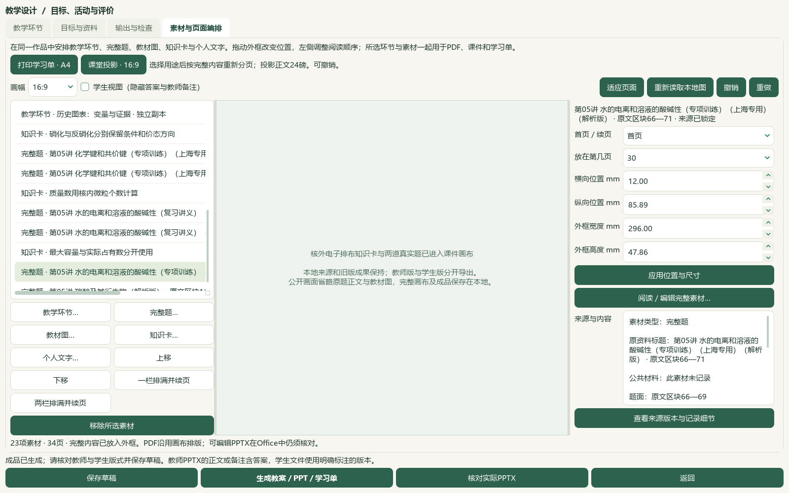

# 沪上化学智研台 · 教师使用说明

用教材、题目、学生作答和成绩表备课、出卷、讲评、复练。

**Windows v0.1.103：** [普通应用包](https://github.com/2067169120-png/shanghai-chemistry-teaching-agent/releases/download/v0.1.103/ShanghaiChem-0.1.103-Windows-x64.zip) · [含本地知识库包](https://github.com/2067169120-png/shanghai-chemistry-teaching-agent/releases/download/v0.1.103/ShanghaiChem-0.1.103-Knowledge-Windows-x64.zip) · [发行说明与校验文件](https://github.com/2067169120-png/shanghai-chemistry-teaching-agent/releases/tag/v0.1.103)

普通包从自己的资料开始；知识版包含五册教材、已登记原讲义与知识索引。安装与首次资料范围见下文，软件、带源恢复、知识读取及仍需核对的范围见[当前验收](docs/qa/2026-10-13-workbench-design.md)。

[第一次使用](docs/teacher/getting-started.md) · [按现象排查问题](docs/teacher/save-and-support.md#problems)

## 今天要完成什么？

| 教学场景 | 进入位置 | 得到的成果 |
| --- | --- | --- |
| 明天讲一节新课 | [备课 → 教学设计](#preparation) | 可续编的教案、课堂 PPT 和学生学习单 |
| 给班级出一份练习卷 | [题库 → 组卷](#paper) | 学生版、教师版 DOCX 与 PDF |
| 复核一份作答或一批作业 | [学生分析 → 同屏批改／作业批次](#student) | 教师评分、诊断及实际作答记录 |
| 月考后决定先讲什么 | [学生分析 → 考试分析（Excel）](#exam) | 本地统计图表与离线分析报告 |
| 给几名学生安排复练 | [考试分析 → 复练与复测](#closure) | 练习任务、练习卷及实际复测记录 |
| 下次接着做，或换电脑 | [我的备课 → 保存与备份](#works) | 草稿、独立成品与所选范围的备份 |

有题目就从选题开始，有成绩表就从考试分析开始。**Ctrl+K** 搜索功能，**F1** 打开帮助。

## 第一次打开

1. 完整解压到可写目录。普通包双击 `启动沪上化学智研台.cmd` 或 `沪上化学智研台.exe`；知识版用 `启动本地知识版.cmd`。保留 `_internal`，按发布页校验文件核对下载。
2. 普通包先导入自己有权使用的 Word、PDF 或图片。知识版首次建立独立的 `本地用户数据`，可从五册教材、已登记讲义与知识索引开始；讲义数量指原文件，图像识别与AI另行确认。已有目录继续使用，新增资料另备份。原文件另外保管，内容和校验清单见发布说明。
3. 查题、环节编辑、成绩统计和课堂工具可离线使用。AI 初稿或建议需配置模型并确认发送；试卷实际分页需本机 Office。微信读书路线已停用。

Word 导入预览会区分重复文件和同名新版本。重复文件可继续原资料，新版本另存并保留旧标签；历史批次可仅重试失败文件。图片识别可续做已完成页组，重做页另行勾选。详见[安装、导入与设置](docs/teacher/getting-started.md)。

## 场景一：明天要讲一节新课

**准备：** 课题、授课对象、课时、可检查的学习目标，以及教材节选或完整例题。

从 **教材** 或备课页 **从教材选材** 进入，选册、章节，阅读原页。维护源码支持在本节直接选原图、讲义知识网与完整题，知识按需勾选；在选材清单中调整顺序，核对本课问题和用途，再整批加入当前备课。没有知识卡的章节也可先读原页、选图和选题。[本节连续选材](docs/teacher/lesson-and-paper.md#forward-section-materials)

图表可跨章节勾选；点 **核对勾选图表**，逐张框选并填写图题与用途。阅读时可 **收起目录／放大阅读**，再 **返回选材**；关闭后可继续上次同版本章节与页码。新教材用 **导入教材PDF…** 保存原件，在 **章节整理** 保存目录，再手工记笔记或批量整理候选知识。[教材阅读与知识整理](docs/teacher/lesson-and-paper.md#textbook-reading)

进入 **备课 → 教学设计 → 教学环节**，按课堂进程安排提问、讲解、例题、练习和反馈。写清“学生做什么、留下什么结果、教师怎样核对”。已有初稿可预览后勾选加入；选中环节后可带入页面画布，修改关联环节时再核对更新。

在 **素材与页面编排** 中调整材料、页面和学生可见内容。备课页 **从讲义选材** 可连续混选知识、图与完整题；**组成图文讲解页…** 编排同页图文，**分步讲解…** 设置点击顺序，**我的模板** 保存课堂结构。原答案按教师设定进入教师版或课堂点击反馈。[图文编排与模板](docs/teacher/lesson-and-paper.md#paired-teaching-page) · [分步讲解](docs/teacher/lesson-and-paper.md#step-flow-entry)

宽窗直接查看内容预览；窄窗打开 **内容预览**，切换 **学生学习单／教师教案** 核对文字与图片范围。保存草稿，在 **输出与检查** 生成新版本；勾选课堂讲义可同时导出教案 Word、课堂 PPT 与讲义 Word。实际 PPTX 可逐页核对、修订讲解稿和使用本机朗读。[备课与检查成品](docs/teacher/lesson-and-paper.md#lesson)

上课时在 **课堂工具** 使用倒计时、点名、随机分组或随堂反馈；反馈可追加回备课并保存。动态平衡演示采用简化模型。[课堂操作](docs/teacher/lesson-and-paper.md#classroom)

**完成标志：** 草稿能重开，Word 与 PPT 可打开；学生学习单隐藏教师答案，课堂反馈按设定顺序出现。每节课的目标、活动与评价由教师填写和核对。

## 场景二：给班级出一份练习卷

**准备：** 已导入并核对的完整题目、练习目标、预计用时和分值安排。

在 **题库** 按来源、章节或知识点找题，阅读完整题面与答案后加入选题篮。在 **组卷** 点 **从题篮新建**，调整题序、配分、答题区和卷面设置，再 **保存当前卷**。已保存卷与公共题篮分别保存，下次选择 **继续所选卷**。

本轮维护源码支持题篮 **Ctrl+Z／Ctrl+Y** 和当前卷 **Ctrl+Alt+Z／Ctrl+Alt+Y**，最近 30 步已保存编辑可跨重开撤销与重做。**查看当前卷细目表** 按卷内顺序显示登记的主题、小题、作答单元和分值，缺失层级或分值另列。两版预览可跳页、放大、定位待核页面，逐页确认后导出。[组卷、撤销与细目](docs/teacher/lesson-and-paper.md#paper)

图、公式或对象看不清时，从题面、答案或完整教案打开 **核对公式与对象**，按原图及段落位置核对；可定位的文件支持在 Word 中选中。维护源码的 **检查本地题库进度** 可返回原题修订标签或裁片；AI 标签建议先查看变化和依据，再明确保存。[公式定位](docs/teacher/lesson-and-paper.md#formula-location) · [题库整理](docs/teacher/lesson-and-paper.md#library-review)

全国卷和外省题也可整理与使用，保留真实出处；上海式练习按对应卷式编排主题和主题内小题。完整题可另加入课件，与教材图、知识和教学环节一起编排。

**完成标志：** 两版题号对应，公共材料、图片和作答区完整，学生版无答案，DOCX 与 PDF 能打开。扫描图内部旧题号与跨题引用须逐项核对。

## 场景三：复核一份作答或一批作业

**准备：** 学生原作答、对应原题、参考答案与真实满分。

在 **学生分析** 打开已有分析，进入 **打开作答与评分（同屏批改）**。先看原页，填写分数和理由，再 **记录本题评分**。同一作业多名学生使用 **作业批次**，逐人核对，未完成输入可暂存。[作答复核与正式评分](docs/teacher/assessment.md#grading)

**完成标志：** 教师正式评分已记录，暂存输入可继续编辑；缺页、未作答等实际情况单独记明。AI 建议需经教师核对后才作为正式评分。

## 场景四：月考后决定先讲什么

**准备：** 同一考试的普通 `.xlsx` 成绩表，可另准备原试卷。

进入 **学生分析 → 考试分析（Excel）**，导入后核对工作表、表头、学生列、题号与真实满分。处理缺失和冲突后，看班级分布、低得分率题目及学生明细。需要讲评草稿时再添加试卷并确认发送给模型。[成绩核对、图表与讲评](docs/teacher/assessment.md#exam)

**完成标志：** 统计范围和有效人数正确，结论能回到原题与作答核实，分析可保存并导出离线报告。只有总分时可看分布，逐题错因需另查原作答。

## 场景五：安排复练，并记录实际结果

**准备：** 需复练的学生、已核实问题与可检查的目标。

从 **考试分析 → 复练与复测** 选择对象，填写目标和计划日期，到真实题库选择完整题目，回任务核对并输出练习卷。完成后点 **记录实际复测**，填写实际日期、满分、得分与作答状态。维护源码的独立题集保留自己的顺序；改分后先 **核对改分影响**，再重核任务与导出。[复练、复测与改分重核](docs/teacher/assessment.md#followup)

**完成标志：** 任务可重开并找到实际复测记录。未作答按实际状态记录；不同卷的分数需结合题目和可比性解释。

## 场景六：下次接着做，或把成果交给同事

**准备：** 要继续编辑的草稿、所需成品版本，或迁移范围。

保存草稿后，从 **我的备课** 按课题或作品名继续。只交成品时分别导出教师稿和学生稿；Office 副本中的修改不会自动写回工作台。

迁移前查看备份清单和缺失项。默认备课 ZIP 保存草稿、作品分类、题篮引用与恢复记录；图片和已登记成品按勾选范围保存。维护源码可明确勾选 **包含本课原讲义及同批原文件，恢复后可继续选材**，带走课程实际引用的完整 Word 来源批次及同批原文件。

备课 ZIP 不包含学生作答、作业批次、批改暂存、考试与复练的完整迁移，也不会自动加入未引用的完整题库。教材裁选回执随对应稿件保存，教材原 PDF 与本机原书位置绑定另外保管；搬家后从 **对照教材原页 → 关联并打开原页** 确认同版本原书。

个人导入的新书可用 **备份全部个人教材与笔记…** 保存原 PDF、目录、章节、候选与修订进度、笔记；范围与普通备课包分别核对。[保存、备份与恢复清单](docs/teacher/save-and-support.md#save)

**完成标志：** 在独立目录恢复，草稿、所选图片和成品可打开；带源包可重新阅读原讲义并继续选材。原资料继续单独保管。

## 卡住时

没有题目先核对实际资料与筛选；无法分页先检查本机 Office；建议过期先查看成绩或材料的变化。处理任务出现停止按钮时，点击后等待状态更新，再检查已保存内容和输出。

[排查问题](docs/teacher/save-and-support.md#problems) · [模型发送范围](docs/teacher/getting-started.md#privacy)

## 版本与维护信息

v0.1.103使用10月13日发行时冻结的源码，包含本节选材、素材画布、独立题集等改进；历史 v0.1.101 保留原功能范围。知识版可使用教材书架与已登记讲义，旧全试卷的册章映射尚未迁入时用关键词查题；Word 的实际分页由本机 Office 完成。Excel 对比重导、全业务迁移、复杂 Word 对象兼容与跨设备表现按实际验收范围记录。

后续维护分支新增持久题目索引、[五来源统一检索](docs/teacher/lesson-and-paper.md#unified-question-search)、跨重启撤销重做、[完整段替题与版本恢复](docs/teacher/lesson-and-paper.md#question-replacement)、成绩列映射方案、外部整班名册导入与身份解绑撤销，以及[动态平衡授课模型](docs/teacher/lesson-and-paper.md#equilibrium-model)。设置新增 [用量与费用](docs/teacher/getting-started.md#usage) 和 [缓存维护](docs/teacher/save-and-support.md#cache-maintenance)。这些改动尚未进入上方 v0.1.103 下载包；操作与专项验收见 [本轮记录](docs/qa/2026-10-13-full-closure-continuation.md)。

[维护者入口](docs/maintainer/README.md) · [当前功能与限制](docs/WORKFLOW_STATUS.md) · [原 59 项与 X01—X10](docs/roadmaps/audit-followup.md)
