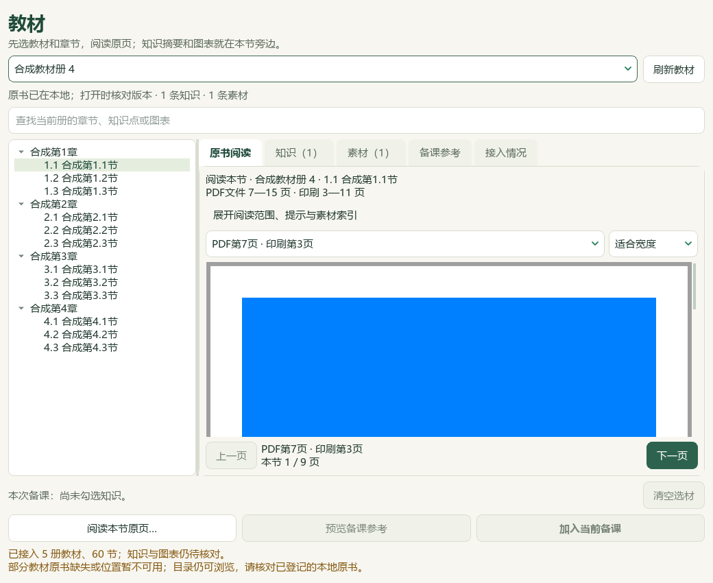
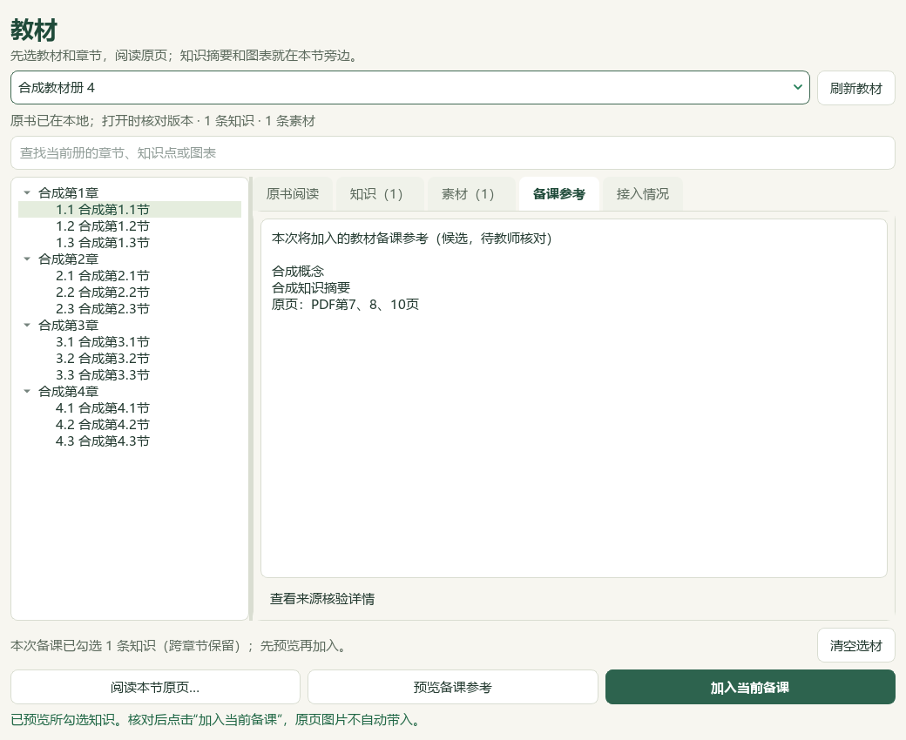
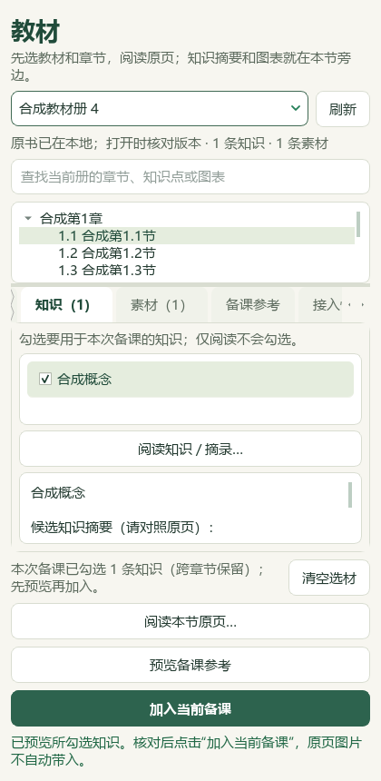

# 2026-10-03 饱和烃、卤代烃、教材书架与题目切片验收

本轮为本机候选整理和维护源码改动，未提交、未发布，未重建v0.1.101 EXE。原教材、Word、试卷、答案、私人数据库和视频帧只保存在本机；本页图片均为自行生成的合成夹具。主代理模型核对不代替教师人审、来源权威性、实测难度或发布验收。

## 数据与原文范围

| 项目 | 本轮证据与结果 | 仍未核验范围 |
| --- | --- | --- |
| PKG-002 饱和烃、卤代烃 | 主代理读取655原生区块，查看48/327个选定图形出现次数；新增10参考＝2知识＋3方法＋3提醒＋2讲练流程 | 其余279图形、OLE及完整Word分页，不能称全讲视觉审校 |
| 教材正文 | 必修二7.1 PDF75—83／印刷71—79；选必三2.1 PDF29—34／印刷25—30；2.3 PDF41—45／印刷37—41，共20新正文页 | 本轮没有重新通读5册645页 |
| 补充栏目 | 14个不同原页，补全16个导言、复习或附录素材入口 | 元数据可定位不等于319项化学与图形全部审校 |
| 旧摘要 | K5明确限定无环饱和一卤代烷通式；M1补充水层硝酸酸化与Cl/Br/I检验范围，共2项显式修订 | 不把本轮描述成全部旧摘要保持不变 |
| 素材说明 | 3项覆盖层更正“大克鼎”“氨合成平衡及CO₂曲线”“石油产量柱状图”，绑定原记录摘要、原书SHA与页序 | 不覆盖原产品，不补猜未知页码，不裁图或提高使用资格 |

原来源中沸点趋势绝对化、命名按位次和简化、反应条件、量与物态、旧答案算术或化学矛盾等9组问题保留在私人原文复核记录中。新增摘要明确适用边界，不把有疑问的原结论直接作为教学依据。

46讲当前共有739条参考：319知识、200方法、151提醒、69讲练建议。32讲有流程，14讲仍缺；383教材概念保持，研读提示累计167。实际只读消费者核验本讲19条新旧参考，10项缺完整支撑和3项身份失配被排除；8条新研读提示按源版本、节与完整依据页可达。查看和预览不自动送模型。

## 12题复核与5项补缺

12道已登记题段核读题面、答案及邻文；13个答案图出现次数中9可严格显示且已看，4个WMF公式保留为不可显示。8题完整、4题部分阅读；部分记录不进入完整台账。

| 保存项 | 实际补缺 | 保留信息 |
| --- | --- | --- |
| PKG-029仪器 | 主知识点K01 | 原教材映射保留 |
| PKG-032离子 | 教材TB-M1-C2:2.2 | 原主知识点K10保留 |
| PKG-033 CeO₂/H₂O₂ | 主知识点K11 | 原教材映射保留 |
| PKG-035焰色 | 教材TB-M2-C5:5.1 | 原主知识点K05保留 |
| PKG-043 P₄结构 | 主知识点K13 | 原教材映射保留 |

按固定计划预览、备份、仅补缺保存和读回，共改变5题；3679其他属性行保持，9484旧历史保持＋5新增。来源、答案状态、材料完整性、作答形态及不可变身份字段保持。重复预览0变更。另7题因属性缺行、原答案冲突、范围夹入下一题或公式无法显示而保留，不自动补建或推测标签。

当前98来源、3579题、3576可选；主知识点2958、教材映射2837，分别缺621／742。930待办＝109纯文字＋762图像＋56范围材料＋3保护。完整阅读身份台账408，累计部分阅读14；扣除已读等条件后，未读可行动纯文字48题。没有把属性行3684或历史记录当作题目数量。

## 教材工作台与备课联动

侧栏新增 **教材**，保留原5个主导航和快捷键；可从备课页 **从教材选参考** 或导入窗口教材类型进入。真实只读快照为5册／19章／60节、383知识、319素材；23条知识不具备可靠节归属，另列待核对，不推测归属。书架列表只读元数据和安全文件位置，原PDF在明确打开时核验SHA、结构和范围。

目录与原页同屏；知识、素材和备课预览分列。章节切换释放旧PDF与缓冲，旧异步回调和关闭后的回调被丢弃；整节不需要先选一个知识点。附录素材只打开绑定的单页，整节和知识点的范围分别保留。阅读不勾选，原页图像不自动带入参考。

勾选知识，先看中文标题、摘要与页码的预览，再确认加入当前备课；完整来源版本在展开详情中。确认时重新编译，内容或版本变化则要求重新预览。当前课题、目标、已有讲义、原题与图像保留。教学环节读取追加后的当前备课资料，引用为锁定、仅教师可见、未确认的快照，进入既有教案／PPT／学习单流程；本轮不声称已生成或人审真实课件。

图表仍是整页候选，尚未裁切，不能当作已审核PPT配图。书架展示当前登记的5册；任意新书或新版本的自动目录整理和激活仍需继续开发与核验。保存文件不等于完成整书接入。

## 视频参照与视觉证据

本轮主代理查看V10/V32/V43三张六帧联图，并核对原尺寸抽帧；18个联图采样点加3个原尺寸帧，不代表逐秒看完44个视频。

| 参照视频 | 实际查看的原尺寸时点 | 可见行为 | 本轮对应 |
| --- | --- | --- | --- |
| V10 上百页教辅AI自动识别拆解入库 | 00:56 | 左侧章节树、节的PDF范围与处理状态，右侧原PDF阅读 | 册／章／节导航、目录旁原页、完整节范围；自动目录识别仍待实现 |
| V32 老师如何建立属于自己的题库(免费) | 00:39 | 按知识分类，明确勾选候选池与原题展示 | 知识分组、显式勾选、预览和确认；不据示例认定上海卷式 |
| V43 题库系统为什么用obsdian？ | 00:42 | 来源属性、层级目录与知识分类一起保留 | 真实归属、中文内容预览与可展开来源详情；未复制宣传准确率 |

私人视频帧、原视频SHA与本地路径在验收回执中，原视频未公开复制。未核验语音、速度、自动识别准确率或全视频流程。本轮不开发用户已取消的手机端。

真实工作台3张私有图及4张合成图已由主代理查看，中文字体Microsoft YaHei，无缺失字形；原页确实由原生QPdfView绘制，合成颜色像素检查避免把空白视图当作通过。最初过早截图的空白视图、拥挤阅读区和透明背景演示图保留为旧尝试；最终文档引用有背景且原页已绘制的v2图。Qt offscreen／96DPI／1x不代替真人DPI、真实Office、EXE或跨机验收。

## 登记、保存与接续

catalog/corpus均131、身份差异0＝108既有来源＋23派生候选。旧130行字节前缀保持，23条候选专门schema及对应文件SHA验证通过；现行库内v2 `status`／`validate` 均通过。4项既有警告保留：旧覆盖计数、旧313文件计数、隐私边界未运行历史全工作区扫描，以及公共快照新增文件漂移45项。未增加官方资格、人审或下游使用权限。

数据回执位于DATA的 `outputs/2026-10-03-hydrocarbon-assets-continuation/`：原文阅读、图像核对、知识同步、消费者读回、标签前后数据库、登记备份、精确队列与阅读身份台账分别保留。原数据库备份摘要 `ca1f41d6…`；仅5题标签写入后的摘要 `f0779354…`。后续只读UI核验保持该数据库、原素材目录和产品清单。

本轮29个相关模块共800个不同用例通过，失败／错误／跳过均0，实际177.94秒；包含完整README、新建书架服务46项、书架UI13项、工作台与教学环节联动，以及旧阅读／导入流程。文档策略通过。历史477项仅属于空间构型批次，不借用为本轮结果。两次180秒超时记录保留，定位为合成Word夹具在导入时自动启动真实Office；夹具现在仅为导入预览生成合成图片，原生Word题目仍实际解析，不能据800项结果声称真实Office转换已验收。

私人交付目录提供“打开本轮教材书架预览.cmd”和“教材工作台预览说明.md”。只读探针确认e6ae源码使用原DATA／STATE、5册／60节／383概念／319素材；尚未自动启动交互窗口。预览入口独立保存，原启动器与安装包保持。

公众号检索0、新原始来源0、新原始整卷0、外部模型供应商0。当前e6ae源码可审阅；DATA旧应用、教材题库融合分支及安装包分别保留，不借用另一个分支的CI或功能完成状态。当前业务尚有14讲流程、930题待办、23知识节映射、素材裁选和教师核验，后续按精确身份去重继续；新书接入、素材到PPT的图片链路及发行集成保持待办。
