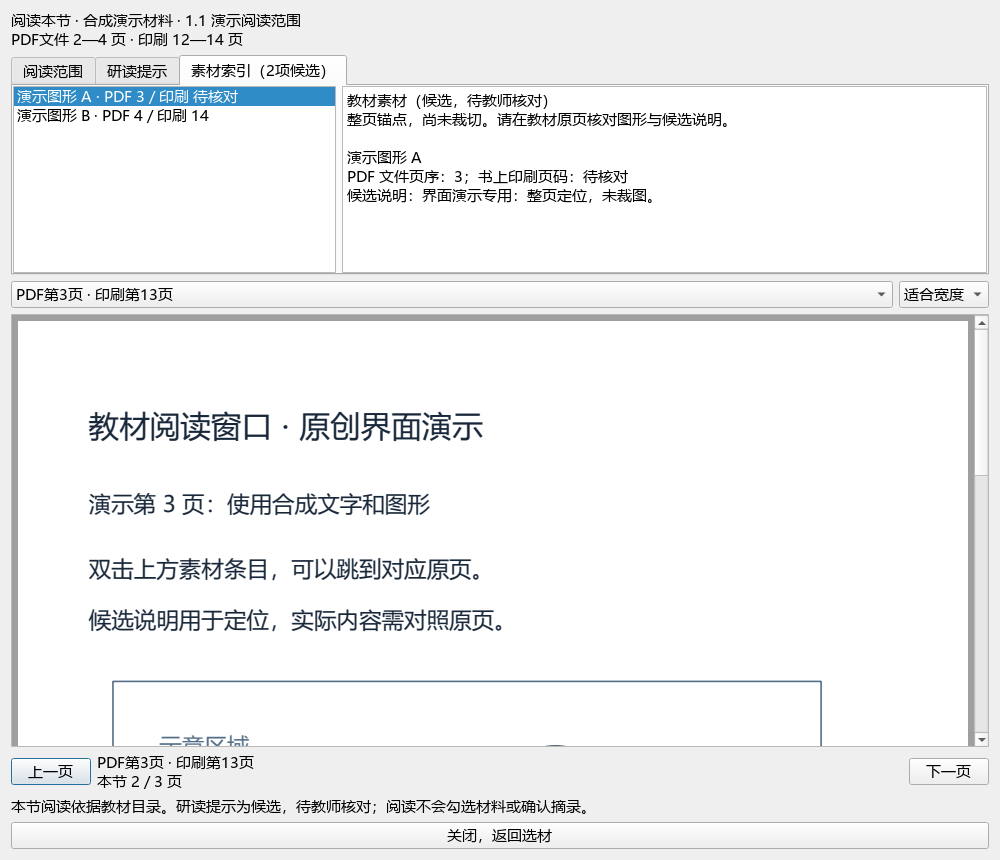

# 2026-10-03 空间构型、分子极性与题目标签切片

承接[上一批化学键研读](2026-10-03-local-distillation-slice.md)，本批在e6ae源码工作区整理PKG-052，新增10讲义参考、8教材研读提示，保存8题标签，并接通原页阅读窗口的素材候选索引。当前CODE仍基于main `e08c3e7`，改动未提交或发布；DATA旧脏分支的应用代码及独立教材题库融合分支保持，v0.1.101 EXE未重建。

## 采集、来源与保存

公众号检索0篇、新原始来源0份、新完整试卷0套、外部模型供应商调用0次。使用现有本机教材与Word，不从讲义标题猜原考试身份，不新增上海卷式结论；资料整理继续不限地域。没有重复导入Word，新增1个派生候选包，原件不覆盖。

CODE：`C:/Users/20671/.codex/worktrees/e6ae/上海高中化学等级考`；DATA：`C:/Users/20671/Desktop/上海高中化学等级考`；个人状态：`%LOCALAPPDATA%/ShanghaiChem/DesktopWorkbench`。本批证据在DATA `outputs/2026-10-03-spatial-polarity-distillation/`，一次性执行脚本在CODE `outputs/2026-10-03-knowledge-goal/`；已完成的apply、sync、register、finish脚本不得重跑。

原讲义SHA `515e68f45c0272e3ade992de8b51741f04673b76ab868a8adfa2ece040dfaaaf`，预览版本 `11de2a7d5952c3016cb7d9b6d7eada76052b172881fbcfa6fdc83a44887e6002`。选必二PDF SHA `4eb751c3bc879d2ad41a2faa723b3b4af05b29ff78f3e89a2eaf9727ebb8a848`。原文件、概念目录、教材素材目录与个人状态按各自身份核验；共享目录其他写入者的变化不回滚，也不归为本轮导入。

## 实际研读与新增候选

主代理读取PKG-052全部416原生区块，查看27/158个选定缓存图形出现次数；131项未选图、完整Word分页及嵌入对象二进制没有据此宣称已审校。选必二2.2《分子结构与物质的性质》PDF49—59／印45—55的11正文页和3目录/边界页为本批新阅读；2.1 PDF35—48／印31—44的14正文页依据同版SHA、原阅读回执复用，不重复计新阅读。下一节只看边界页，不计整节完成。

新增2知识、3方法、3提醒、2段40分钟教学流程，原8参考及其他45讲保持；新增8研读提示。46讲累计317知识、197方法、148提醒、67流程，共729条，31讲有流程、15讲待补；383教材概念不增加。内容区分VSEPR电子域/分子构型、键极性/分子极性、分子间作用/共价键、分子内/分子间氢键，并限定经验规律适用范围。

9组来源冲突与限制保留：旧卷式说明、杂化捷径、孤对电子角度断言、NO₂⁻构型、PCl₅前后矛盾、SO₂/SO₃/NO₂模型、极性概括、CO₂图中三线误画、酸性条件与数值缺失。未采用无法支撑的来源结论，也未把教材手性案例扩写为医学结论。原件不静默纠正，AI阅读不等于教师审核。

当前CODE消费者加真实DATA资料，一次32段精确Word选区返回18条新旧参考、24634字；没有连带填补区块间隔、读取图像或调用模型。10项缺必要支撑、3种身份失配均排除；两端新增8研读按完整支撑页可达，缺页不显示。CODE自身没有私有PDF/概念目录，因此不声称只用CODE独立完成真实备课。

## 题面、答案与标签事务

16题题面、原生答案与邻接文字已读，11个可用答案图形出现次数实际查看；7处严格WMF渲染失败涉及5题，另2题原生答案不完整。9题满足本批完整原生文本和可用答案图检查，其中1题因数量单位矛盾保留；7个部分阅读身份不计完成。

| 样本 | 结果 | 主要证据或保留理由 |
| --- | --- | --- |
| 01、02 | 主标签与映射补缺 | 氧化还原、铬矿转化、铜电解精炼；反应箭头提取缺口另记 |
| 03 | 主标签与映射补缺 | 溶液离子浓度与电荷守恒，参考结果0.4 mol/L |
| 05 | 主标签与映射补缺 | 基态电子排布，装饰图片不作化学证据 |
| 13 | 仅主标签补缺 | 不饱和醛结构、平面与检验顺序；已有醛章节映射保持 |
| 14 | 主标签与映射补缺 | 甘油醛分子式与命名，图中丙醛为命名母体说明 |
| 15、16 | 主标签与映射补缺 | 非金属性证据、周期表位置及半径；难度图标不作标定证据 |
| 04、11 | 部分阅读保留 | 关键公式或答案正文缺失 |
| 06—09、12 | 部分阅读保留 | 共7处旧式公式不可严格显示；07、09另有化学疑点 |
| 10 | 完整阅读后保留 | 答案把x、y称物质的量却写质量单位和x+y=m |

8题按精确预览SHA取得桌面独占锁，missing_only单事务保存8主标签及7题教材映射，没有替换非空字段。3684属性中计划8行变化、3676其他行保持；9476旧历史保留＋8新历史＝9484。来源、答案、材料、作答形态、年级、辅助知识及全部来源/范围身份保持；保存回读一致，重复预览0变更。最终数据库SHA `ca1f41d6b009c3611fe704b95eb6b33aa68012a9c0c55c40c3d4414b964de911`；事务前字节备份单独保存。

现在98来源、3579当前题、3576可选；主标签2955、教材映射2835，缺624／744。935待办＝114文字＋762图像＋56范围材料＋3保护。上述数量属于Word完整题段候选；没有据题号或答案构造正式atomic层级、难度标定、官方答案或评分点。

完整已读身份391→400（含1个本批完整但未采用的题），累计10个部分阅读身份继续单列。排除已读和部分阅读后，未读可行动文字60；另741带图、51范围材料、3保护尚未读。历史已完整读但仍待办70题不重复算未读。

## 素材索引的实际接入

新增只读适配器读取固定本地JSONL，核对字段、文件边界、重复ID、教材SHA、节与当前阅读页范围；不沿元数据内的图像路径读取文件。原页由已有服务按PDF实际字节SHA核验。元数据缺失、失配或损坏会显示提示，已核验PDF仍可查看。双击/Enter定位原页，翻页清除旧说明；不增加摘录或AI材料。

实际核对五册PDF，319条登记全部仍是整页锚点、尚未裁切。383概念中329能显示素材，概念入口可达298个不同素材；360概念可读整节、60节入口可达289个，合并可达303个。剩余16项属于导言、复习或附录，入口缺口保留。281条印刷页码缺失，显示“待核对”，没有按页差猜填；303可定位不等于303项内容视觉通过。

实际选必二2.2阅读窗口显示8项，真实PDF49页已核验和查看。另生成宽1000与窄420窗口合成截图；公开图只含原创示意PDF。首次截图环境未初始化字体，出现方框，失败图移入私人记录；随后调用应用既有字体初始化，中文和化学字符样本缺字0，重做的3幅图已查看。此处是Qt offscreen、96 DPI、1×证据，不代表真实EXE或多屏/DPI人工验收。

当前素材索引仅在本CODE源码接入，DATA旧分支和独立教材题库融合分支未合并此应用代码；它们的原383教材快照也不因增加研读文件而变为更多概念。不能把本地代码改动描述成默认分支、启动器或安装包升级。

另在教材题库融合工作区head `e03290e0`的独立Python进程执行真实读取器，使用DATA原目录，读到46讲/729条参考、PKG-052的18新旧参考及两节全部8条新研读；383概念保持，两节PDF字节SHA一致。该分支响应仍无素材索引字段，与尚未合入新UI的边界一致。工作树head、Git状态和个人题库DB保持；未启动应用或重建安装包。证据见私人`integration-branch-data-consumption.json`，不能把本项数据消费核验称为启动器/EXE测试。

## 登记、验证与后续

本批新增1条派生包，129条旧catalog/corpus字节前缀保持。两目录均130、ID差异0＝108既有来源层＋22派生候选；22派生行通过专门schema和文件SHA校验。现行库内v2验证器通过，保留4项警告（旧计数替代、旧库存数替代、隐私边界阻止旧递归验证、公开快照45文件漂移）。此结果不授予原始来源权威性或化学内容审核资格。

477项相关回归全部通过（29.99秒，无失败、错误或跳过），覆盖讲义扩展/参考/备课UI、教材原页/整节/摘录/研读提示、新素材适配器与UI、离线标签、资源包和完整README。两项新UI检查验证真正PDF跳页、窄窗、未知印刷页码、过期说明清除、伪造范围阻断、元数据失败回退及不加入模型材料。文档策略校验通过；首次62项和适配器80项不累加到477中。未重建EXE或进行真实Office/多屏验收。

已完成的范围、身份、消费者、事务历史、重复与真实UI检查分别保存在本批JSON回执；最新队列、文件保护与文档同步另存最终验收回执。候选全部未人审，检索、教学、命题和发布资格不因本次导入升级。继续15讲课堂流程、935题待办、16素材入口、23概念节映射及公式/边界修复；总目标仍在进行。
