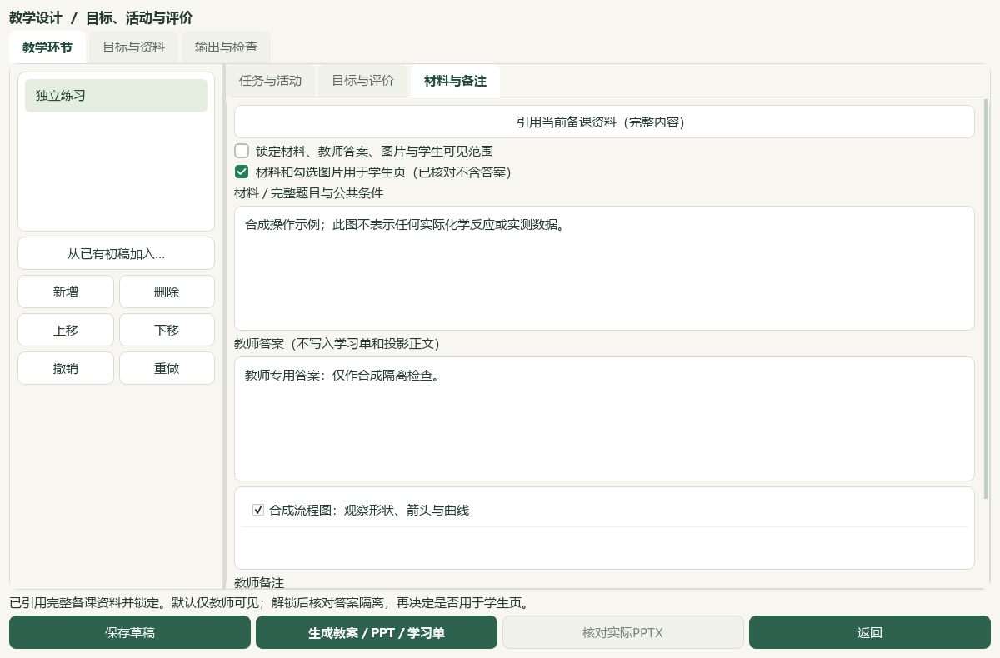

# 教材图表裁选与课件联动的本地验收

当前e6ae维护源码新增教材图表框选与预览，明确选用后进入备课图片，再关联教学环节生成三类文件。应用版本未递增，v0.1.101安装包未重建；独立教材题库融合分支和DATA旧脏应用分支没有合并。本轮不表示任意新教材已完成目录整理，也不表示319项素材已裁图或人工审校。

## 可实际操作的路径

教材 → 素材 → **框选图表，加入备课…** → 拖动选框／微调像素边界 → 填写图题和本次用途 → **预览裁片** → 查看并勾选确认 → **加入当前备课** → 教学环节引用资料 → 解锁并核对学生可见范围 → **生成教案／PPT／学习单**。

原页可适应窗口或按原始大小查看；裁片同窗可缩放和平移，支持另窗。420×820窗口上下滚动，边界输入分两列，底部预览、加入和返回按钮保持可见。界面以册名、页码、图题和用途呈现；完整原始身份保留在来源回执中。页脚保留裁选记录编号，避免两个完整哈希与目录ID挤占PPT正文。

## 来源与写入核对

页图和裁片预览仅在内存重读、渲染及裁选，不创建备课图片库。原页使用已核验素材记录的PDF页和来源SHA；选框按所显示原页的整数像素计算，不自动从旧候选的空bbox猜测。PNG保存不缩放裁片内容。原页渲染设有尺寸、像素和字节上限，巨大原页可能降低有效DPI，教师仍需放大核对原件。

确认后再次核验原页、素材版本、图题、用途、预览摘要和裁片SHA。保存资产沿用严格八字段图片合同，原页身份、源PDF摘要、双页码、渲染配方与边界另存 `tasks/preparation-v1/textbook-crops/<crop_id>.json`。先保存不可覆盖的来源记录再存PNG；来源发布失败不留下无回执图片，图片写入失败可能保留关闭资格的候选回执，不返回可加入备课的资产。重复确认保留原字节和时间；已损坏来源记录或图片不会被覆盖。

全部来源回执保持candidate、human_reviewed=false，检索／命题／发布资格关闭。“已查看并确认当前裁片”只表示教师选择本次备课图片，不签署中央资料库化学审校。原素材目录与产品清单没有写入；这次试验未写入用户正式备课图片库。

## 实际界面与文件验收

私有原页核对：本地必修二PDF第76页，原页渲染1985×2807；选框(710,990)—(1800,1790)，裁片1090×800，SHA-256 `a14f9719c31483332e4185de324a3ddda9761dfc9749c1f2bf7996762349dafb`。主代理查看原页、原尺寸裁片与实际Qt窗口，电子式、结构式、模型、图例和图注均保留。目录中的印刷页码未知保持，不因观察原页而改写目录。只读预览未模拟真人确认，未将真实图保存为备课资产或生成真实教材课件。

合成完整链：自建PDF中的形状、箭头与曲线，经Qt窗口框选、预览、确认，从教材信号加入实际备课页；在实际教学环节窗口引用当前资料、明确学生可见，再点击生成三类文件。实际PPTX、教案DOCX、学习单DOCX均存在且哈希核验。PPTX与文档中嵌入裁片原字节，裁片SHA为 `5a0bd6af24009dcca9b1ba5043f7292a79e94520cc934d11452aea123a4db5b6`。教师答案只在教师稿和PPT备注，学生学习单及PPT正文隔离；默认仅教师可见的图也有真实文件测试。合成图没有实际化学含义，不作为知识内容。

UI照片由真实Qt控件离屏绘制，主代理视觉核对，human_reviewed仍false。公开仅合成图；私有教材原页与图存DATA交付目录。Qt 96DPI／1×，不代替真人高DPI、实际Office、安装包或跨机验收。首个捕获尝试误用任务标签，未生成导出文件；失败和旧界面截图保留，修正后在独立新目录完成，不重跑旧数据导入事务。

## 回归与交付

新增回归覆盖原始PDF裁片像素、旋转页、整页明确选择、边界类型与范围、来源或预览变化、损坏旧文件、取消与来源发布失败；实际PPTX/DOCX嵌图、教师／学生可见范围；鼠标像素框选、重读尺寸变化、旧回调、窗口关闭、真实线程取消恢复、窄窗绘制；保留当前备课、阻断新建／切模板、模型图片模式不变、实际教学环节绑定。

最终本轮测试、静态检查、保护SHA和图像核对以本地交付目录的 `root-final-acceptance.json`、`tests-final.xml`、`root-visual-review.json` 为准；前序800项历史验收保持，复测不累计成新增用例。操作说明见[教师指南](../teacher/lesson-and-paper.md#textbook-crop)。

私有交付位置：DATA `outputs/2026-10-03-textbook-crop-lesson/`。实际三类文件在 `synthetic-final/synthetic-main-state/tasks/preparation-v1/node-exports/`；原教材预览只在 `private/`。脚本只在CODE同名outputs。检索文章0、有效新试卷0、新原始来源0、重复归档0；未进行公众号检索或新题目采集，外部模型调用0。

保存范围：PNG随现有备课图片保存与备份；**源PDF和独立裁选回执尚不包含在备课ZIP里，须另备份**。PPT/Word脚注可定位本机完整回执，导出这三类文件本身不携带源PDF。当前数据仍739讲义参考、167研读、930题待办、14讲缺流程、23概念缺节映射；任意新书目录激活、剩余题目／讲义整理、人审与发行集成继续待办，总目标未完成。
