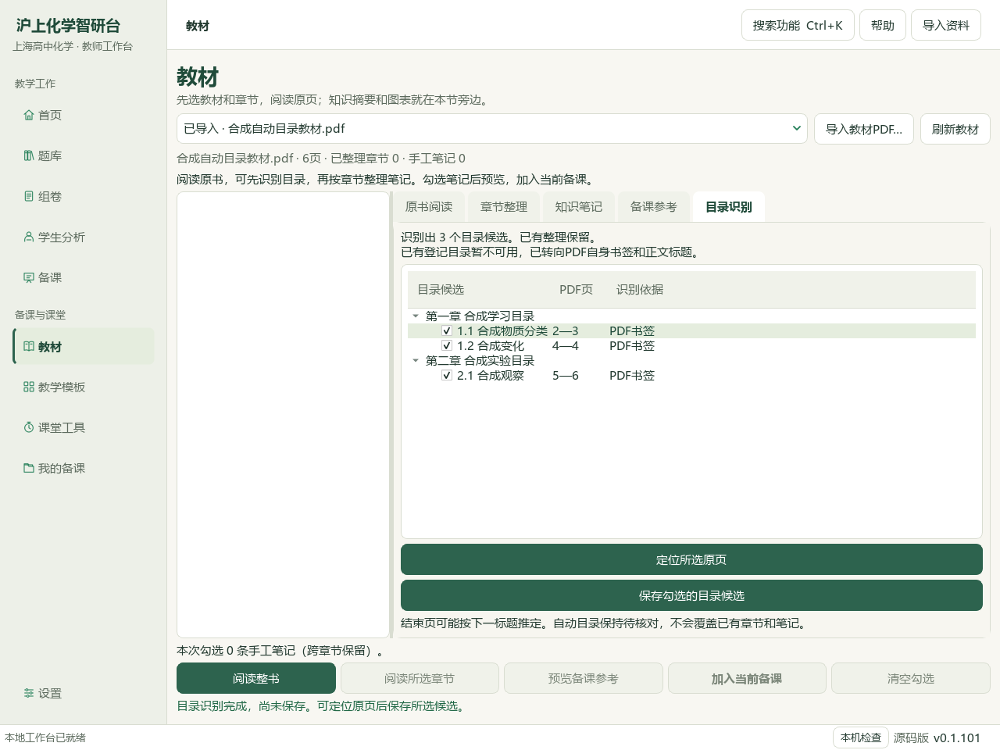
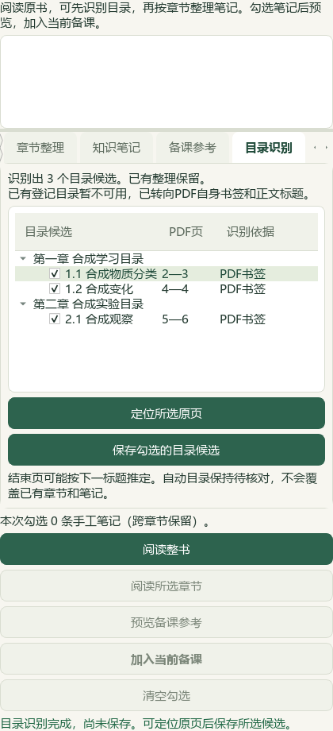
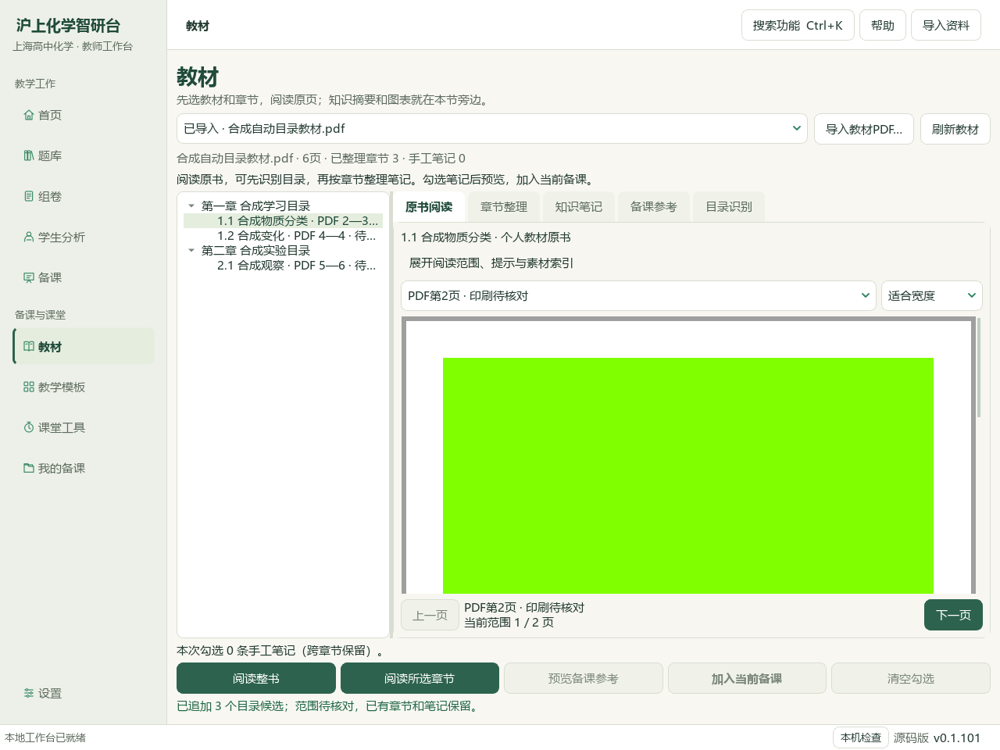
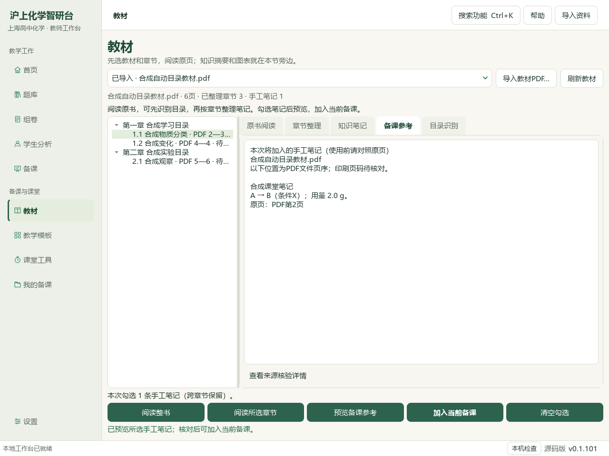

# 2026-10-04 个人教材自动目录与备课联动验收

本轮在e6ae维护源码接通“整书 → 目录候选 → 原页阅读 → 教师笔记 → 当前备课 → 教学环节 → 三类成品”。没有重建v0.1.101试用包；用户现有5本书仅只读预览。整体资料蒸馏、图表接入和发行验收继续推进。

## 操作与行为

选择已导入教材，点 **章节整理 → 识别并整理目录**。目录页按章归组，显示名称、PDF文件页序和识别依据；可定位所选原页，取消不需要的勾选，再保存所选候选。保存只追加，已有章节、笔记和当前未保存输入保留。重复候选或与教师章节完全相同的名称／页范围复用旧记录。

识别先尝试完整原书SHA匹配的已登记目录，再尝试PDF书签，最后读取部分中文章标题或数字节标题。书签父标题保留，结束页可由下一标题推定；同页或倒序书签暂只定位起始页。正文标题按实际PDF页定位，跳过可识别的目录页和重复标题；上限600页／500条，达到上限的最后候选不延伸到未读页。没有可靠结果时仍可整书阅读和手工整理。

自动目录保存为个人候选，范围初始待核对。教师可修订并确认范围，原识别依据保留；修改不能排除已有笔记页。原书、登记目录或章节／笔记版本在预览后变化会阻断保存。取消、换书、关闭和失败会清除旧候选，迟到回调不能恢复。

保存后可按节阅读原PDF，书签起始定位校验真实整数页；布尔值、字符串和越界页拒绝。印刷页码保持待核对，不推算偏移。读取PDF书签与正文文字采用pypdf的原生接口；扫描图像没有文字层时不会进行OCR。[PDF阅读与书签接口](https://pypdf.readthedocs.io/en/stable/modules/PdfReader.html)，[文字提取与OCR边界](https://pypdf.readthedocs.io/en/stable/user/extract-text.html)。

## 实际本地五册只读消费

| 已登记册 | 原书PDF页数 | 目录候选 | 消费依据 |
| --- | ---: | ---: | --- |
| 必修一 | 155 | 13 | 同版本已登记目录 |
| 必修二 | 123 | 10 | 同版本已登记目录 |
| 选择性必修一 | 129 | 15 | 同版本已登记目录 |
| 选择性必修二 | 105 | 9 | 同版本已登记目录 |
| 选择性必修三 | 133 | 13 | 同版本已登记目录 |

主代理用实际服务逐书读回60条候选，核对原书SHA、元数据版本和页范围；没有写用户个人章节、笔记或确认状态。只读辅助审计显示5册均无可用书签，目录文字存在；它不单独作为化学审校或人工视觉验收。相同SHA对应多个登记册时不按文件名猜测归属，转向PDF自身证据。

## 笔记、草稿与成品

合成六页PDF含两个章、三个书签节。实际Qt主窗口通过真实后台任务保存目录，当前首节限定PDF2—3页并绘制原页。教师笔记保留 `A → B（条件X）；用量 2.0 g。` 和PDF第2页来源，勾选、预览并加入当前备课；课题、授课对象、目标、原有资料和图片用法保留。草稿重新读回含该笔记。

从实际教学设计窗口绑定完整备课资料，由合成教师明确填写学生展示文字，再生成 `lesson_plan.docx`、`lesson_presentation.pptx`、`student_worksheet.docx`。读取实际文件核对条件、用量和原页来源；答案哨兵只在教师教案和PPT讲者备注出现，PPT正文及学习单没有。两轮独立合成展示的实际文件和SHA分别保存，未把目录识别当作化学知识生成。

目录候选及识别依据随个人JSON保存；现有教材专用ZIP携带原PDF、候选、教师章节与笔记，恢复到新独立目录后原始字节和依据字段保持。界面仍只提供导出，备课ZIP的范围另行说明。[完整操作和备份范围](../teacher/lesson-and-paper.md#personal-textbook)。

## 验证与保护

17个相关代码模块267个不同用例通过，pytest91.95秒／JUnit91.870秒，失败／错误／跳过0，含本轮两个新增测试模块的33个用例。另14项完整README测试通过，合计18模块281个不同用例，不累加重复运行或前序351／551等历史批次。覆盖目录三种来源、歧义、截断、批内及跨批去重、旧记录及未保存输入保留、来源变化、预览篡改、取消／换书、真实原页定位、备课联动与备份恢复。文档策略及Ruff另有通过回执。

最初测试中的登记夹具多册共用同一SHA，触发正确的歧义保护；夹具更正并保留独立歧义用例。420窗口曾被初始横向布局撑至564像素，现已修复并通过实际420断言。后来新增链路测试缺少授课对象、负例断言使用了错误提示文字，均修正测试输入和断言；原失败JUnit保留。最终只读汇报还因假设教材列表顺序而停止，实际为选必三先于选必二；校验改为逐书SHA、页数及候选绑定，失败脚本和停止记录保留，没有重跑业务写入。透明背景的首幅孤立面板截图和首次章节计数措辞截图留私人证据，公开4幅采用最终原生界面，由主代理实际查看。

917个输入冻结文件核对，196原Word、用户494状态文件和原书集合保持。题目属性库仍为前序验收SHA；383概念、319素材、77补充栏目、60编号节、776讲义参考和193研读提示未改。新书自动整理保留候选状态，化学人审及命题／发布资格未提升。没有覆盖DATA旧应用代码、改启动器、提交、推送或发包。

准备下一讲PKG-050《物质的检验》的129个缓存原生区块，仅生成待读包，尚未核读、蒸馏或新增题目。公众号文章0、有效新试卷0、新原始来源0、重复新资料0、外部模型供应商0。

## 证据位置与未完成项

公开操作为[教师教材流程](../teacher/lesson-and-paper.md#personal-textbook)，当前状态为[闭环状态](../WORKFLOW_STATUS.md)。私有证据在DATA的 `outputs/2026-10-04-personal-textbook-auto-outline/`：冻结清单、5册预览、合成隔离状态、两轮三类成品、截图、JUnit、保护校验、源码补丁及最终验收；CODE同名outputs保存本轮脚本。原始全文、原教材或用户个人数据未加入公开截图。

正文目录识别仅覆盖部分标题格式，不支持OCR和复杂排版；可读范围不代表逐页化学审校。新书批量知识蒸馏、个人图表候选、未保存输入跨关闭恢复、真实Office成品视觉、真人DPI及新版EXE集成继续待做。当前截图为Windows Qt offscreen、1倍设备比例；成品结构读取和原PDF绘制不代替Office实际版式验收。总目标保持active。
