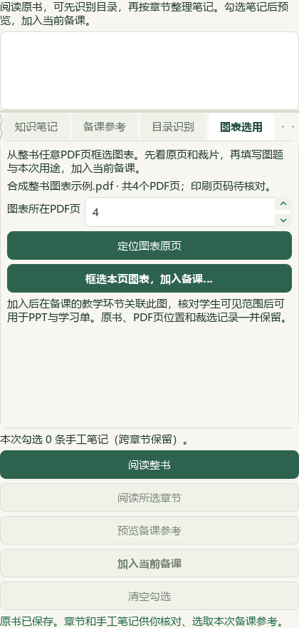
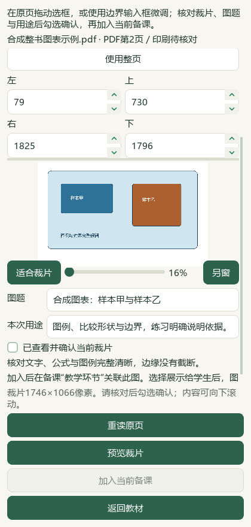
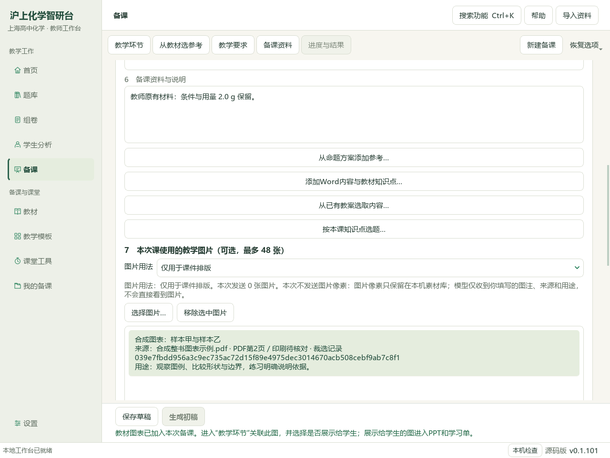
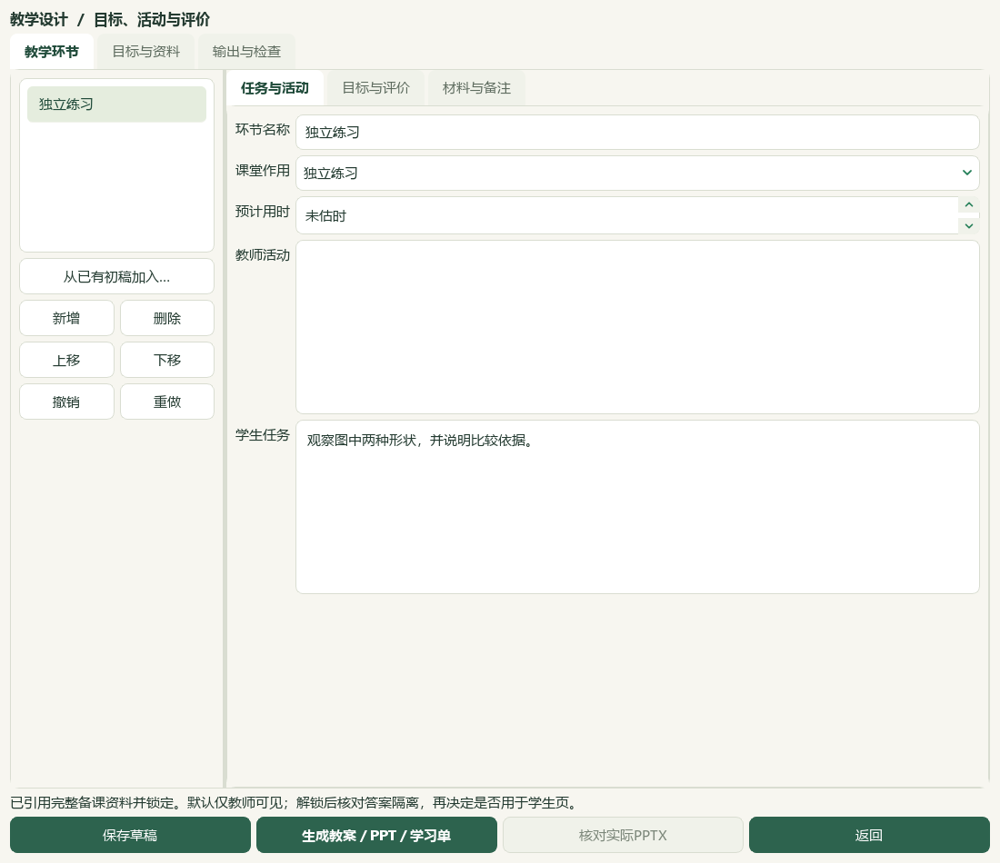

# 个人整书任意页图表与备课联动验收

2026-10-04，当前维护源码增量，尚未提交、发布或重建 v0.1.101 EXE。

新导入的整书现在可以从任意有效PDF页框选图表，再加入当前备课、关联教学环节并制作教案、PPT与学习单。没有整理章节也可使用；选择章节时默认从该章起始页进入。已有正式素材入口继续使用原来的裁选流程。

## 操作结果

选择“已导入 · 文件名 → 图表选用”，填写PDF页序，可先定位原页，再框选、填写图题和用途、预览、明确确认。来源绑定已登记原书、归档SHA、PDF页、渲染版本与像素选框；确认时重新读取核对。来源或预览变化、取消、关闭、切换教材/页位置后不使用旧请求。原书保留，原课题、目标、材料、图片用法保留。

个人来源使用独立整书身份，册别和印刷页码待核；不凭文件名挂正式册别。重复裁片沿用已有图片与来源记录，仍受备课48张上限约束。仅核对本次选用不会提升资料库的人审、检索、生成或发布资格。

以上均为实际原生Qt组件的 offscreen 抓图，主代理已逐张查看。420图为组件/对话框检查；手机端已取消。完整实际Office显示仍未核验。

## 已验证范围

14模块214个不同相关用例通过，其中新增26项覆盖真实裁片、任意有效页、源文件与版本失配、页越界、额外路径、确认/预览变化、上下文切换、取消、窄窗口和教学输出。首次测试读取尚未进入Qt事件队列，补上事件等待后该用例通过；按最终结果合并计数，保留首次失败日志。

隔离状态使用实际整书预览/保存、真实模态裁选窗口及主窗信号，完整走到备课保存后重读，再生成三份Office文件。PPT与两份Word内图片字节均与确认裁片相同，PDF第2页来源可追溯；教师答案哨兵只在教师教案与PPT备注，不在PPT可见文字与学生学习单。生成未调用模型，合成原书与未整理章节状态保持。

五册真实个人教材各完成第17页读取与裁片预览，确认调用0、真实裁片保存0、模型调用0。主代理实际查看其中一张原页，其余只有服务读取/校验，不称逐页化学审校。494真实个人状态文件集合和SHA保持。

完整README测试、文档策略、保存范围及源码清单以本轮最终回执为准。隔离抓图脚本的字段名称、宿主背景与布局等待修正保留初始证据，未重复用户业务写入。

## 视频参照与资料状态

本轮实际查看用户BDL的V10-056s原帧（教辅目录和原页）及V43-042s原帧（来源属性与知识层级），据此保留“资料导航→原页核对→来源属性→选用”的组织。仅两帧的界面参照，不称完整视频功能对齐；帧、原视频及SHA记录留本地。

本轮增加应用能力，未新增化学参考或题目属性：810参考、209存储研读、869题目待办、9讲缺流程、492完整/50部分、136登记保持；953初始保护文件按最终计划核对，196原Word、5个人原书、494状态保持。化学候选资格保持，正式层级、出处和难度未知字段不猜测。

下一蒸馏PKG-058《糖类和油脂》，图像队列669尚未尝试身份先排除已有完整/部分阅读。批量新书知识蒸馏、批量图表勾选、真实Office排版和发行集成仍待办，总目标保持active。

## 保存与备份

原书在个人状态 `textbook-sources/<SHA>.pdf`；独立裁选来源回执在 `tasks/preparation-v1/textbook-crops/`；PNG沿用备课图片库。备课草稿保存图片元数据及教学设计，现有备课ZIP包含图片，但不包含原教材PDF和独立裁选回执。个人教材ZIP包含原书与章节/笔记，也不包含这些裁选回执或备课成品；完整保留需另行保存个人状态目录及原文件。没有全业务恢复或实际Office显示验收。

私有证据：`C:\Users\20671\Desktop\上海高中化学等级考\outputs\2026-10-04-personal-textbook-crops\` 的 `synthetic-ui-receipt.json`、`narrow-capture-v5.json`、`real-book-read-only.json`、JUnit与 `root-final-acceptance.json`。真实原书与状态、原视频不进入源码。

[操作指南](../teacher/lesson-and-paper.md#textbook-crop) · [前序铝专题切片](2026-10-04-aluminium-distillation.md) · [当前闭环](../WORKFLOW_STATUS.md) · [返回主指南](../../README.md)
