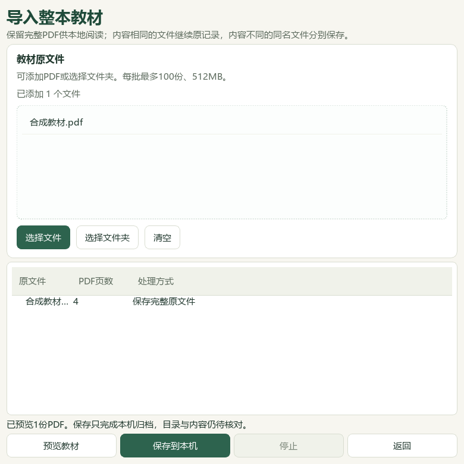
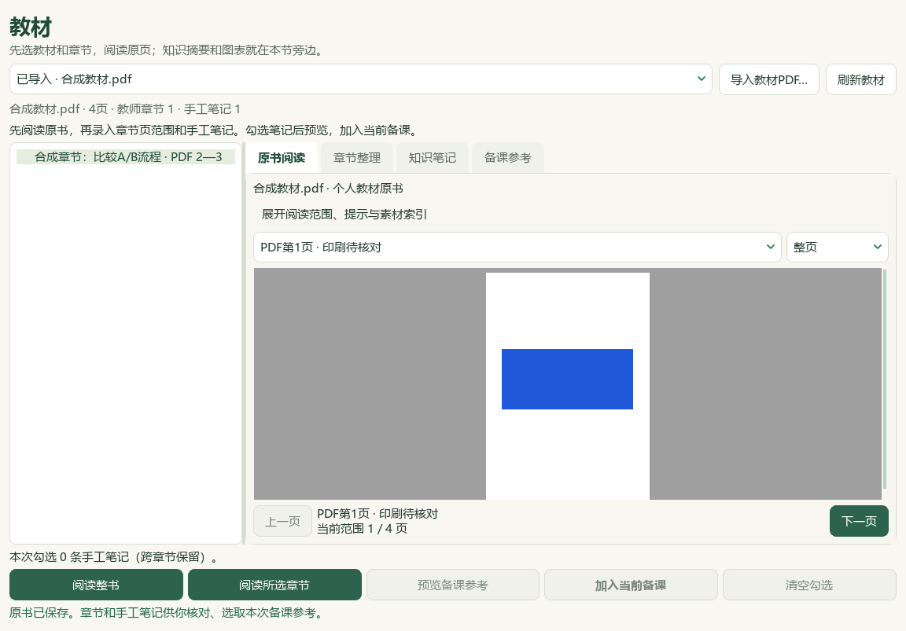
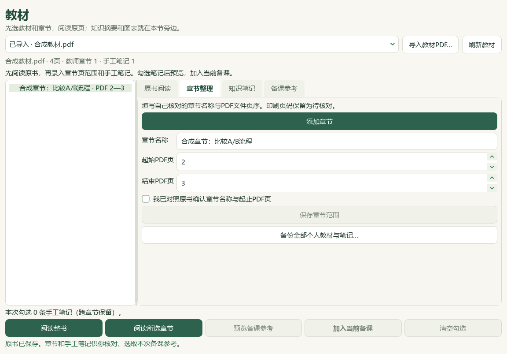
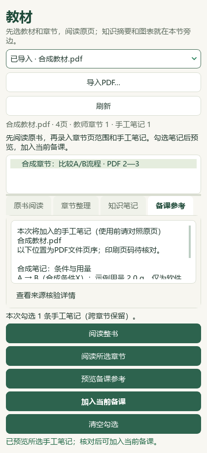
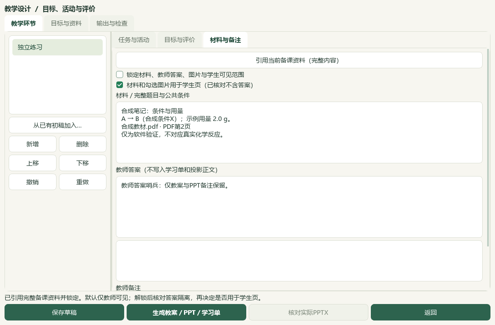
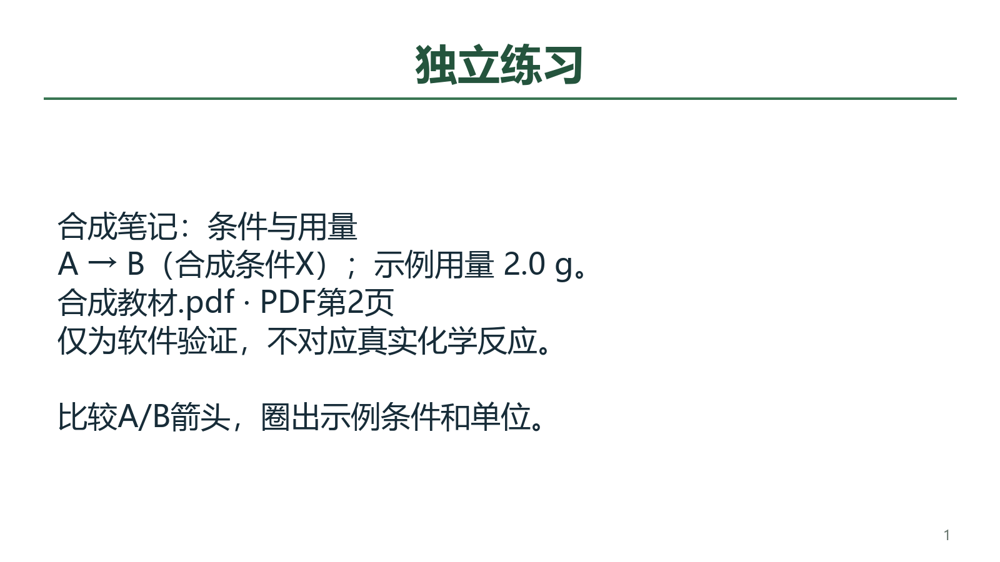

# 整书导入、教师章节和备课笔记的本地验收

本轮维护源码打通整本PDF的本机保存、原页阅读、教师手工章节与笔记、本次备课引用、草稿和三类文件联动。复用独立教材融合工作树b4d9a58的教材存储合同，适配有限依赖；没有整体合并其应用分支、更新版本或重建v0.1.101 EXE。全部公开图片与成品均为合成软件验证资料，无真实化学含义。

## 可操作路径

教材 → **导入教材PDF… → 预览教材 → 保存到本机** → 选择已导入书 → **阅读整书** → **章节整理**录入并确认页范围 → **知识笔记**录入并确认手工内容 → 勾选 → **预览备课参考 → 加入当前备课** → 保存草稿 → 教学环节引用资料 → 明确选取学生展示文字与可见范围 → **生成教案／PPT／学习单**。

## 来源、状态和保存核对

内容寻址原书仍使用`BOOK-<完整SHA>`与`textbook-sources/<SHA>.pdf`；相同内容复用，同名不同内容分别保存。原文件不改写；预览后文件变化、归档损坏和路径不安全时拒绝使用或覆盖。保存期间可停止，先前完成的教材保留并可再次预览续导。旧textbook_workspace记录可直接消费，不强制迁移或读候选文件。

个人章节与笔记是同一教材状态中的可选、严格校验记录，绑定原书SHA、明确PDF页序、稳定身份和内容版本。保存采用每书版本检查，其他状态保留；旧窗口不覆盖新记录，范围缩小不丢弃已有笔记。教师输入保持原条件、符号和单位；空白、超长、未确认、越页、跨书跨章错绑、损坏权限记录均拒绝写入。重复保存相同内容不改时间、原字节或身份。

教师确认本次手工整理与human_reviewed字段分别记录；candidate_only仍为true、human_reviewed与teaching_use／generation／publication均保持false。个人笔记不并入原383条概念，不提升检索、命题或发布资格。印刷页、年份、区校和原始URL未知时不填猜值。普通题目／讲义的按页导入仍保留；资料类型“教材与课程文件”另有专用整书入口，不把按页识别宣传为整书接入。

实际用户状态只读核对：既有5本个人原书能从新消费者列出，五个PDF文件SHA与内容身份一致；正式5册／60节、383概念和319素材入口保留。用户章节与笔记未代填，原JSON状态、归档PDF、visual_assets、manifest、题目属性SQLite和catalog／corpus保护文件保持。公众号检索0、新原始来源0、新整卷0、外部模型供应商0；本轮没有新增教材蒸馏或题目标签。

## 草稿与三类成品

合成四页PDF经真实Qt导入界面保存，录入PDF2—3页章节、PDF2页笔记，再经真实主窗口信号加入备课。课题、目标、已有资料与图片输入模式保留，草稿能回读完整来源与手工笔记。教学环节默认锁定、仅教师可见；测试明确解锁、填写短的课堂展示文字并选为学生材料，实际生成PPTX、教案DOCX和学习单DOCX。三类文件均含同一A/B笔记，教师答案仅教案和PPT讲者备注可见，学生正文不含答案。

完整来源在备课草稿保留；学生正文过长会拒绝并提示拆分，不自动剪掉原文或哈希。下图为应用生成器的结构预览，非LibreOffice或PowerPoint渲染，实际Office版式尚未验收。

## 备份和未完成边界

**章节整理 → 备份全部个人教材与笔记…** 新建ZIP，包含全部已登记个人PDF、章节、手工笔记及归档候选快照；目标已存在时保留旧ZIP。后端可校验清单、SHA、状态与路径后恢复至新独立目录，不覆盖当前用户资料。合成备份恢复后原PDF字节及个人整理版本相同。当前界面尚未提供恢复按钮。

专用教材ZIP不包含整机资料、备课成品、学生档案、未归档候选JSONL、外部正式五册原书或教材裁选回执；普通备课ZIP不能代替教材ZIP。未保存录入不会自动成为永久笔记，切换教材／章节前须明确保存。自动目录识别、批量知识蒸馏和个人新书图表接入尚未实现，已有裁片入口继续使用已登记素材。截图由Qt offscreen、1×缩放生成，主代理视觉查看不计真人使用或化学审校。

最终20模块511个去重用例通过，含40新增和14个完整README用例，失败／错误／跳过均0，141.92秒。Ruff F、32个改动Python文件AST和文档策略通过；只改计数与文本格式后复核文档。原800／379为各历史批次，不与本轮累计。精确XML及日志见本地`outputs/2026-10-04-personal-textbook-intake/`验收记录。初版透明背景、未定位到笔记正文的旧截图均保留，不作为当前公开图；早期测试失败及修正不充当最终通过证据。当前应用改动仅e6ae维护源码，另一融合分支、DATA旧应用分支和EXE保持，整体目标继续active。
