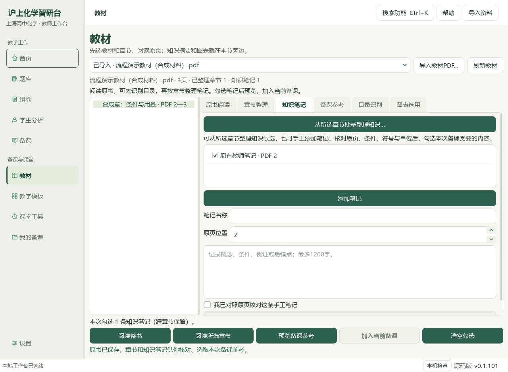
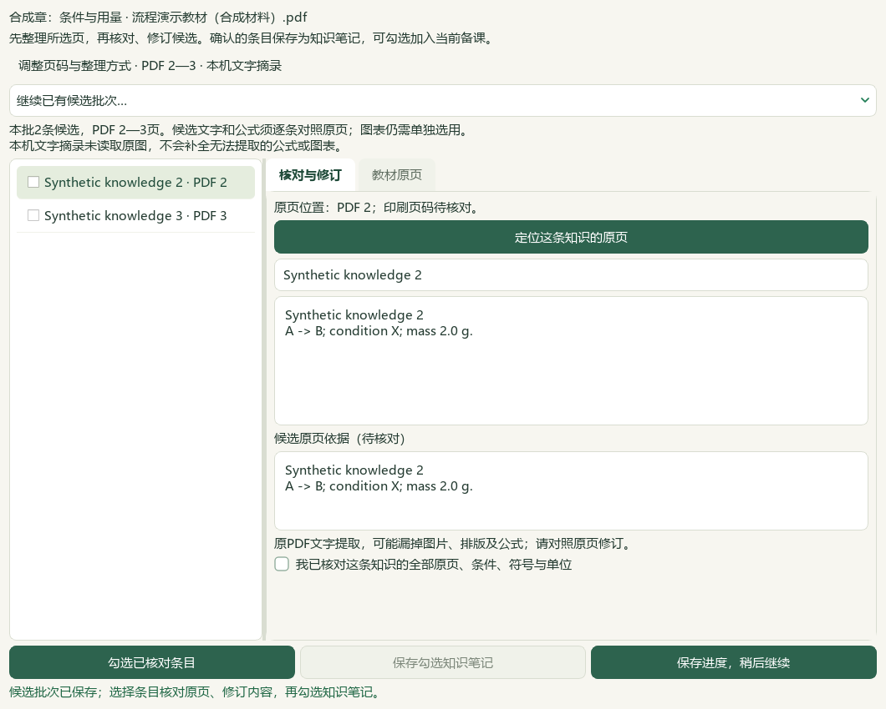
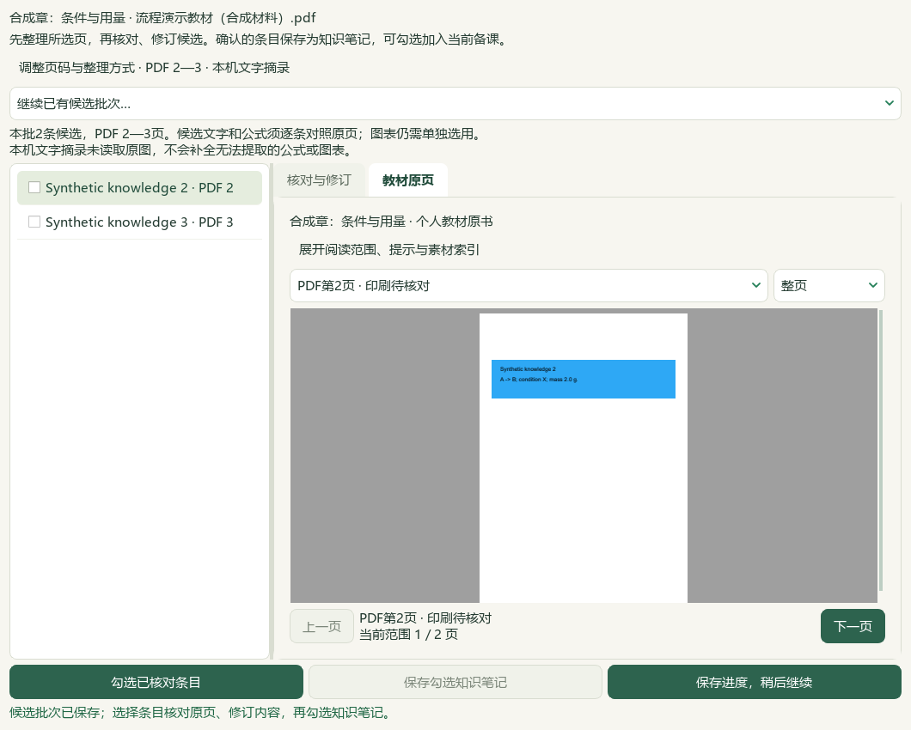
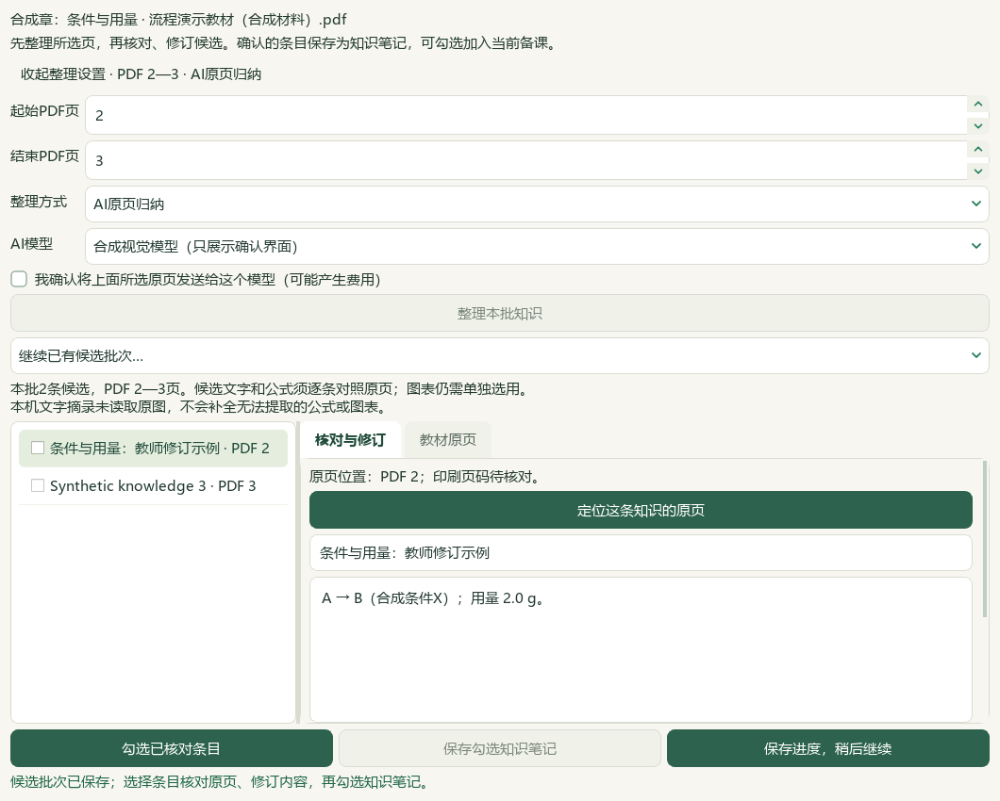
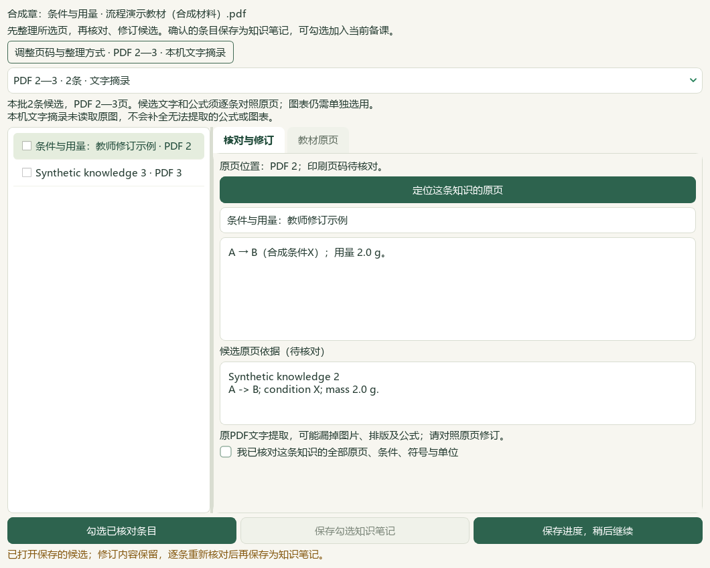
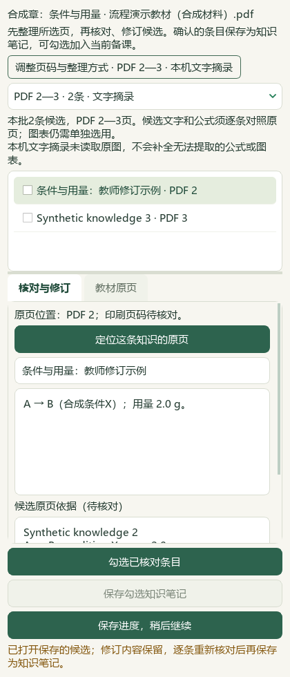
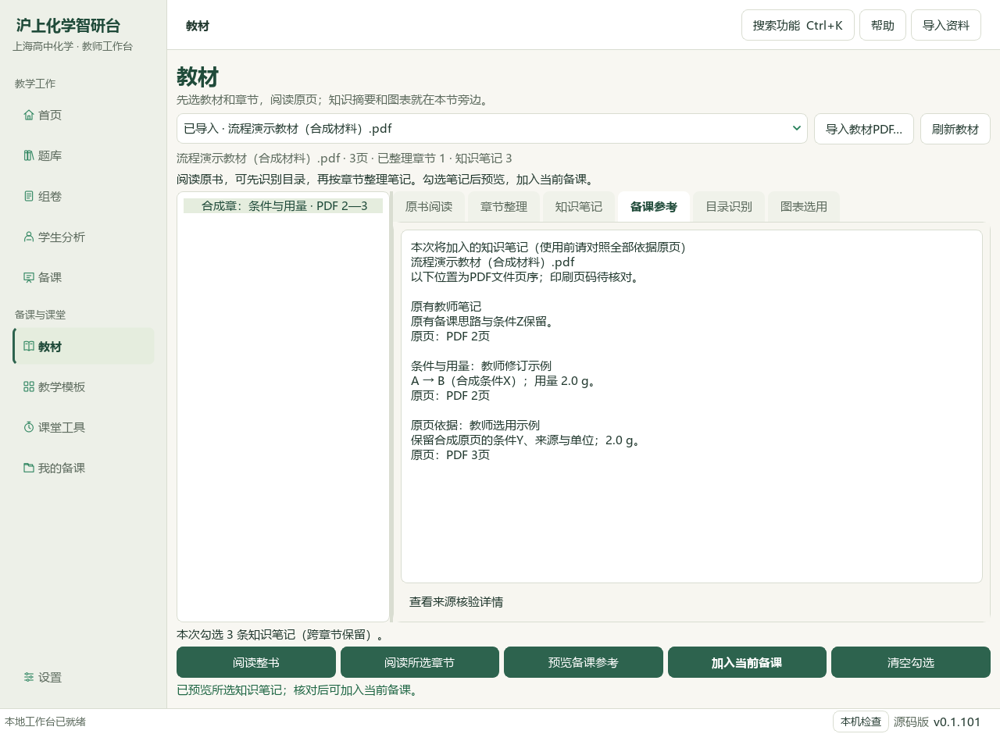
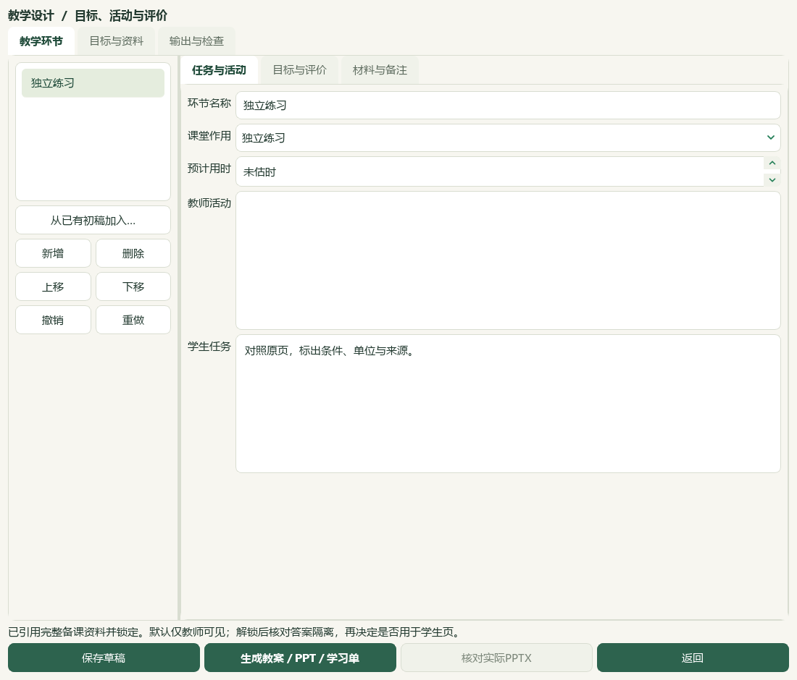

# 2026-10-04 个人教材批量知识与当前备课联动

本轮接通维护源码中的“所选章节 → 知识候选 → 原页核对与修订 → 知识笔记 → 当前备课 → 教案/PPT/学习单”。当前HEAD e08c3e7，应用增量未提交、推送、发布或重建EXE；旧DATA应用和v0.1.101试用包保持。本轮没有新增真实题目、知识条目或原始来源，未触发真实模型调用。

## 操作与保存

从“教材 → 已导入的书 → 知识笔记 → 从所选章节批量整理知识…”进入。选择当前已保存章节内连续1—8页，可用本机文字摘录；扫描页没有原生文字时提示改用已配置的视觉模型或手工整理。AI原页归纳须明确确认所选页和接收模型，改页码/方式/模型清空发送确认；失败不自动重试。

每批1—20条、每条正文最多1200字。生成后保存候选批次并收起整理设置，同窗查看原页、修订名称正文、逐条确认，勾选后整批保存知识笔记。保存候选本身不会生成笔记或带入备课。关闭空闲窗口、切换批次或整理下一批前保存文字进度，重开不恢复核对和勾选；无效进度不覆盖旧值，窗口保留。运行时关闭请求取消，已经保存的结果保留。

知识候选保留完整原页证据，教师修订笔记沿用原始依据；保存和恢复时逐笔核对原候选、原书与章节绑定，伪造依据或缺失候选会被拒绝。重采用相同内容复用，有不同旧内容时要求在笔记中编辑。原书SHA、章节、学习记录或候选版本变化阻止旧操作；旧章节批次仍能定位原书，但不能采用。正式人审/教学使用/生成/发布资格始终关闭，教师对本课选用的确认不等于正式资料审校。

候选和进度随个人教材状态保存，专用教材ZIP包含原PDF、候选、修订进度及知识笔记，隔离新目录恢复可回读。最高200批，批次清理按钮和图形化恢复入口尚未提供；每次备课参考1—30条，不自动截断过长内容。备课完整来源保留在草稿，学生文字由教师明确选择。

## 实际原生窗口与联动

合成教材、隔离个人状态、实际Qt模态窗口和真实后台任务走通整理、原页绘制、进度保存、关闭重开、逐条采用。父页保留既有手工笔记并勾选新增2条，预览后加入当前备课；原课题、对象、目标、原参考和图片用法保持。当前备课草稿与教学设计分别保存重开，通过同源三文件输出与教师答案隔离核验。

最终8张窗口存放在final目录；前两次截图及原始回执保留作过程记录，不替代最终布局证明。以下为合成材料，不是实际化学题：

原BDL V10-056s与V43-042s两帧重新核对原视频/帧SHA并实际查看，采用章节—原页导航、候选列表、来源属性组织。只查看声明的两帧，不把视频摘要或选帧当成完整功能验收。

## 验证与边界

已通过312项不同的相关回归与14项完整README检查，共326项。先执行16模块310项，再执行39项界面文字回归、97项最终候选依据绑定回归；相关回归按测试身份去重，不重复计数。新增57项覆盖范围/结构/页序、真实文字读取与8页上限、扫描/长行失败、批次重复与修订重开、来源失配、逐条确认、批次原子保存、取消中途回滚、备份恢复和笔记依据防伪、两个API格式的选页图片、失败无重试、传输前后取消、发送/模型权限、实际窗口与课件联动。供应商传输均为模拟，凭据为测试占位且未进入请求正文/保存记录；没有配置真实密钥或发送真实教材页。

完整README检查和文档策略通过，最终保护核验见本轮机器回执。不可仅据合成测试认证真实供应商质量、全部扫描教材、化学事实、教师课堂效果、高DPI或复杂Office版式。最后一次改动加强笔记与原候选依据的绑定，97项相关回归重新执行通过；隔离合成状态和恢复副本也按最终校验规则回读。

Word教案和学习单由专属只读实例各渲染1页，PowerPoint导出1页；原始输出字节保持。PowerPoint专属PID在10秒内退出未确认，原回执保留；后续只读打开该PID取得ERROR_INVALID_PARAMETER，确认不存在，没有发送终止信号。Office物理页来自同流程v2成品；最终三文件的全部77个ZIP成员内容逐字节相同，仅ZIP时间戳不同，比较结果见成品回执。未重新物理转换最终三文件。

真实库913参考/259研读、809题目待办、571完整/91部分、141登记、4讲缺流程保持。下一教材讲义PKG-072和新图文切片继续待办；本轮先补工作台整理与备课体验。196原Word、5个人原书、383概念、319素材、77补充栏目/60正式节与494真实状态文件纳入冻结核对；正式四层结构、未知难度、来源权威性和化学审核门槛保持。

## 机器回执

本轮证据存放在E盘真实资料目录：

- [最终原生窗口、保存重开与三文件回执](E:/项目/上海高中化学等级考/outputs/2026-10-04-personal-textbook-knowledge/synthetic-ui-receipt-final.json)
- [成品逐成员比较](E:/项目/上海高中化学等级考/outputs/2026-10-04-personal-textbook-knowledge/export-member-comparison.json)
- [原Office转换回执](E:/项目/上海高中化学等级考/outputs/2026-10-04-personal-textbook-knowledge/office-render-receipt.json)
- [PowerPoint后续退出核实](E:/项目/上海高中化学等级考/outputs/2026-10-04-personal-textbook-knowledge/powerpoint-parent-exit.json)
- [最终视觉复核](E:/项目/上海高中化学等级考/outputs/2026-10-04-personal-textbook-knowledge/root-visual-review.json)
- [源文件复核清单](E:/项目/上海高中化学等级考/outputs/2026-10-04-personal-textbook-knowledge/source-review-manifest.json)
- [最终冻结文件核验](E:/项目/上海高中化学等级考/outputs/2026-10-04-personal-textbook-knowledge/root-full-hash-verification.json)
- [本片最终验收](E:/项目/上海高中化学等级考/outputs/2026-10-04-personal-textbook-knowledge/root-final-acceptance.json)

图示和回执为本轮局部验证，所有AI/机器核对均不记为正式human_reviewed。总目标继续active，真实化学复核、全量导入及发行集成未完成。
