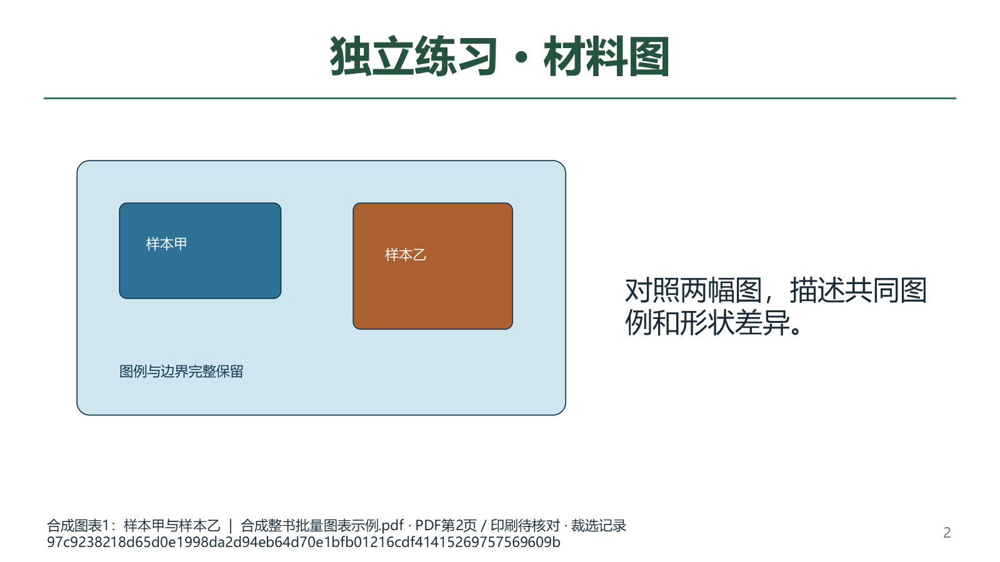

# 教材图表批量选用与备课联动验收（2026-10-04）

维护源码已接通“跨章节勾选图表 → 同窗逐张框选与核对 → 一次加入当前备课”。个人整书可先将任意PDF页加入待选批次，再逐页框选；没有章节也可使用。本轮没有新增教材知识、题目或标签，没有重建v0.1.101 EXE、修改启动器、提交、推送或发布。总目标继续active，下一内容切片仍为PKG-064《分子的手性和分子间作用力》。

## 操作与结果

已登记素材可单张勾选，也可勾选本节或取消本节，选择跨章节和册别保留。刷新时取消来源版本已经变化的旧选择。个人整书的待选页按添加顺序排列，可移除或清空；同页每批选一张图，换书后重新选择。这些临时选择不自动保存为教材知识或课件。

同一窗口显示待核对与已核对进度。每张必须明确框选或使用整页，填写图题和本次用途，查看真实裁片后勾选确认。切换时保留尚未完成的图题、用途和选区；重新打开已确认图会撤销该图确认，要求重新预览。全部确认后另点“加入当前备课”。返回教材不会提交前面已经确认的图。

批量接收先重新核对每张来源、原页版本、预览摘要、PNG摘要和当前备课容量，最后重读来源再保存。失败或旧回调不能更新备课表单；成功时一次追加，保留原有课题、目标、材料、图片用法及已有图片。重复像素保留已有或本批首张的图题、用途和来源。单批和当前备课均沿用48张上限；本批PNG累计另设128MiB上限。

磁盘写入失败可能留下已经保存的候选图片及独立来源回执，备课不会得到部分批次；它们保持未人审和关闭的资料库使用资格。重试可复用一致的文件，不能覆盖损坏回执或图片。候选缓存写入与备课表单追加有不同的失败边界，没有宣称磁盘事务回滚。

## 实际桌面及Office文件

在隔离状态中通过实际Qt模态窗口，从合成整书PDF第2、4页选取不同裁片，经主窗口信号一次加入备课，保存并重开草稿与教学设计，将两图绑定同一环节后生成教案DOCX、PPTX和学习单DOCX。三种文件均逐字节嵌入原裁片；原有材料和图片用法保持。教师答案哨兵仅在教案和PPT备注，学生正文与幻灯片可见文字均无哨兵。

主代理逐张查看8张最终原生Qt截图，覆盖1100/1280像素宽窗口、420像素滚动窗口、逐张核对、最终提交及备课/教学设计。4张早期透明背景或滚动定位截图已按原字节保存到私有验证目录，并保留原回执及位置映射，最终截图使用实际宿主背景。Qt验证为offscreen，不等于真人桌面DPI或课堂体验验收。

实际Microsoft Word分别将教案与学习单转换成2页PDF，私有实例及退出均核对；4页均已查看。Microsoft PowerPoint以无文档的已核对专属实例读取私有PPTX副本，导出3张1600×900幻灯片，均已查看。图例、边缘、图题和来源脚注完整可见，文件原字节保持。前两次PowerPoint辅助脚本缺少显式系统模块加载，在启动Office前失败；修正后第三次完成3页输出及文档关闭，辅助进程的10秒退出等待尚未确认，后续只读观察确认原专属PID已不存在，未向任何进程发送终止信号。全部尝试及后续退出回执保留。

这次Office检查仅覆盖上述合成中文与两张图，不代表真实化学公式、复杂表格、长答案、48张大批次或全部教案版式已通过；PPT备注仍需按发放用途检查。原教材PDF和独立裁选回执仍不在备课ZIP中，需按[操作说明](../teacher/lesson-and-paper.md#textbook-crop)另行备份。

## 视频参考范围

本轮重新核对原视频和既有帧摘要，实际查看《上百页教辅AI自动识别拆解入库》56秒帧与《题库系统为什么用obsdian？》42秒帧。仅参考章节目录/PDF同屏组织、来源属性及资料选择，未声称完整观看两视频、复制全部功能或由此认证化学内容、上海题型和难度。

## 数据与验证边界

接续标题已核对：PKG-064讲义是《分子的手性和分子间作用力》，原文件名、原生正文首段与coverage一致；历史接续说明写作“极性”有误，后续按本源身份处理。PKG-065《分子的极性和分子间作用力》为另一份专项训练，保留独立身份。仅核对首段和元数据，本轮未完成PKG-064正文蒸馏。

工作前冻结1025个既有路径。真实用户状态494文件及属性库、196原Word、5个人原书、原知识和题库保持；仅修改计划应用源码、操作文档与知识库索引。INDEX中的其他项目并发更新按写入前版本保留，未覆盖其他项目。资料仍为46讲867参考、239存储研读、832题目待办、539完整/75部分阅读、597尚未尝试图像身份，catalog/corpus139＝108来源层＋31派生。383概念、319素材、77栏目/60正式节及6个待补流程保持。本轮资料采集、有效新卷、题目导入、化学候选、题目补标和模型供应商调用均为0。

相关15个模块276项通过，另加1项后续I/O失败与可追溯重试验证通过，共277项不同用例；40项批量和72项初始回归为这些用例的子集，不重复累加。完整README14项也通过，共291项不同用例；文档策略及F/E9静态检查通过。源码边界与保护文件最终结果另写入本轮私有最终验收回执。

主要实现：[批量核对窗口](../../integrations/deeptutor_shchem_v1/desktop_workbench/textbook_batch_crop_dialog.py)、[裁片服务](../../integrations/deeptutor_shchem_v1/desktop_textbook_preparation_crops.py)、[教材书架](../../integrations/deeptutor_shchem_v1/desktop_workbench/textbook_bookshelf_page.py)、[个人整书](../../integrations/deeptutor_shchem_v1/desktop_workbench/personal_textbook_panel.py)、[备课接收](../../integrations/deeptutor_shchem_v1/desktop_workbench/workflow_pages.py)。测试：[服务及写入](../../staging/coordination/deeptutor_gateway/tests/test_textbook_batch_crops.py)、[原生窗口与手动任务回调](../../staging/coordination/deeptutor_gateway/tests/test_textbook_batch_crops_ui.py)。

私有证据在DATA的 `outputs/2026-10-04-textbook-batch-crops/`：`inputs-before.json`、`synthetic-ui-receipt.json`、`opaque-panels-receipt-v3.json`、`root-visual-review.json`、`office-render-receipt.json`、`powerpoint-helper-attempt-v2.json`、`powerpoint-helper-attempt-v3.json`、`powerpoint-parent-exit.json`、`source-review-manifest-v3.json`及`root-final-acceptance-v2.json`。原始失败回执不会被改写为成功。软件与资料均未因本轮获得化学人审、自动蒸馏、命题或发布资格；新书批量知识蒸馏、余下内容切片、复杂Office版式和发行集成继续待办。
