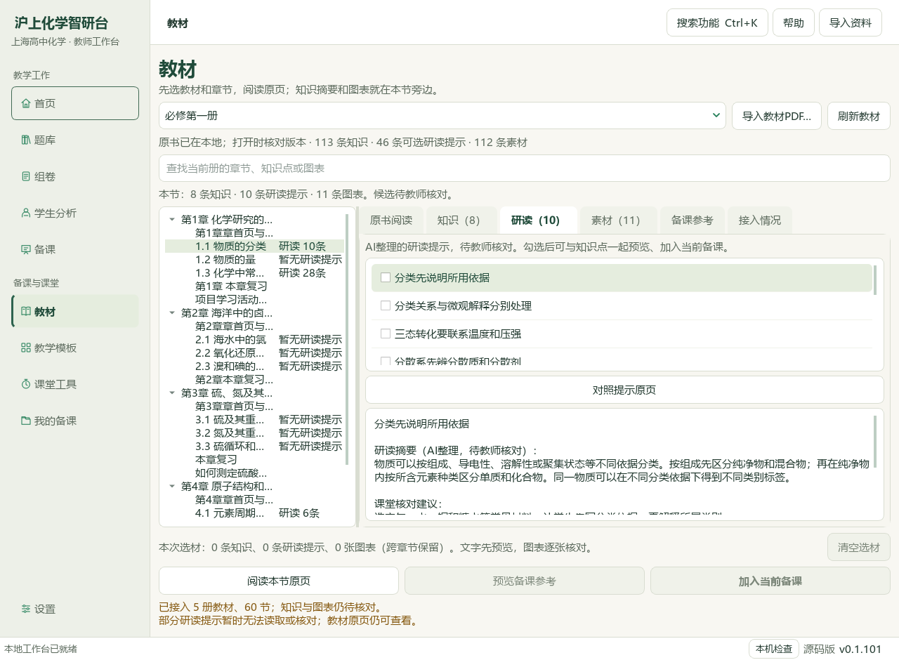
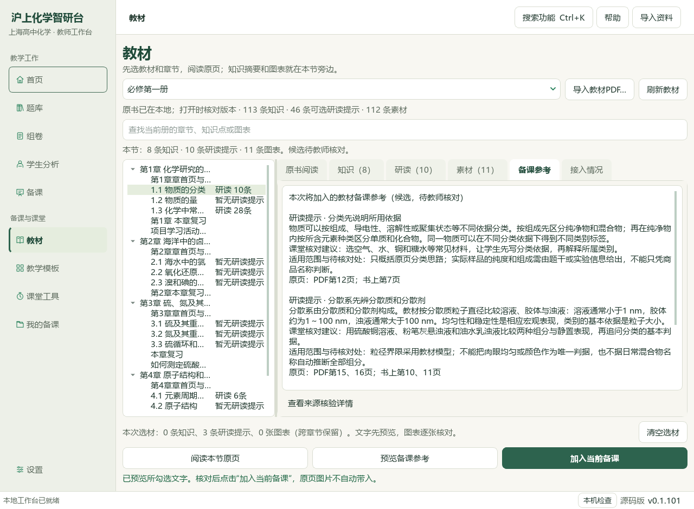
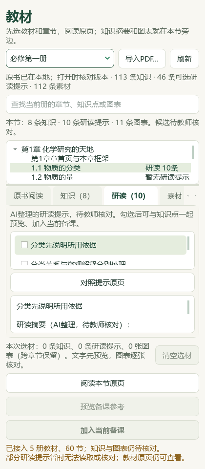
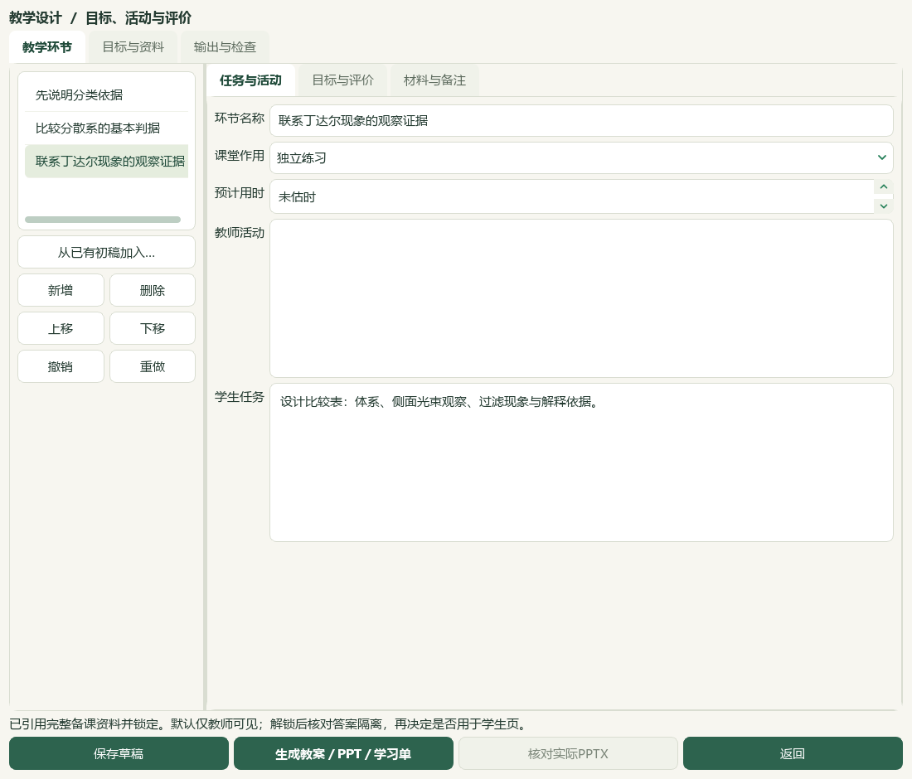

# 物质分类研读与教材提示联动备课

2026-10-04，本地维护源码与资料候选，未提交、未发布。旧桌面应用和 v0.1.101 EXE 尚未交付本轮源码改动。

《物质的分类》必修第一册正式节 TB-M1-C1:1.1 的 PDF12—19、印刷7—14共8原页逐页查看，新增10条研读提示，原299条笔记保持。未虚构讲义身份，也未把本页三道教材练习记作已入题库。

| 当前口径 | 数量与边界 |
| --- | --- |
| 存储研读笔记 | 309条；数量不认证全节阅读或人审 |
| 当前可选提示 | 270条，41个正式教材节；核对来源SHA、目录范围和双页码 |
| 暂不可选 | 39条缺必要字段；保留原件等待逐页补证据 |
| 教材索引 | 383概念、319素材、60正式节、77补充栏目保持 |
| 讲义及题库 | 1009参考、98来源/3579题/3576可选、759待办保持；本轮新增题目及标签变更0 |
| 资料登记 | 146项＝108来源层＋38派生；新增1派生候选，旧145项前缀保持 |
| 检索采集 | 公众号检索0、有效新试卷0；纯本地教材和应用工作 |

教材页显示章节可选提示数量，支持查看摘要、课堂核对建议和适用范围，定位提示对应原页，跨章节勾选，再与知识点合并预览、重新核对来源、加入当前备课。每次合计不超过30条；教师已有课题、目标和资料保留。笔记版本、原PDF或目录变化时阻止旧选择；阅读不会自动选材。来源核验详情在预览中按需展开。

旧 limitations 字符串或列表只读规范化为界面文字，所有原限制保留；不改旧笔记，不补猜证据、来源、年份或权限。原有知识点备课路径不自动加载提示；提示必须明确勾选。全部新增仍为AI候选、未经教师化学核对。

实际教材第16页在原生PDF视口绘制并核对；包含教材原页的截图只留本地，不进入公开截图目录。五张公开页面图只含界面、索引与AI派生候选；均经主代理查看。

隔离示例状态走通选提示→加入备课→保存与读回草稿→引用教学环节→生成教案/PPT/学习单。三份文件的文字和来源已读回，教师答案只在教案及PPT讲者备注，未出现在学生学习单或投影正文。未调用模型，未写教师现有状态；示例仍待教师复核，Office版面未在本轮另做视觉验收。

205项相关回归通过，覆盖提示单独选择、原页定位、跨节选材、版本变化、异步迟到、列表限制兼容、长度限制、旧路径隔离及主窗口备课转接。完整README检查、文档策略和保护哈希另见本地最终回执。早期测试辅助函数导入错误和脚本环节名称输入显示已修正；原始尝试记录保留，最终记录单列，不把重跑数量累加。

私有验收、来源页与示例文件位于 E:/项目/上海高中化学等级考/outputs/2026-10-04-textbook-classification-preparation。原教材、196原Word、既有研读记录、个人原书与真实状态按冻结SHA检查；代码只改5份应用模块，未更改应用版本、EXE或启动器。

更多视频与UI逐项对齐、复杂Office验证和发行集成仍待完成；本轮没有新增视频全文或完整视频观看证据。下一片继续旧笔记原页补证据与453个尚未尝试图像题的独立切片。总目标保持active。
