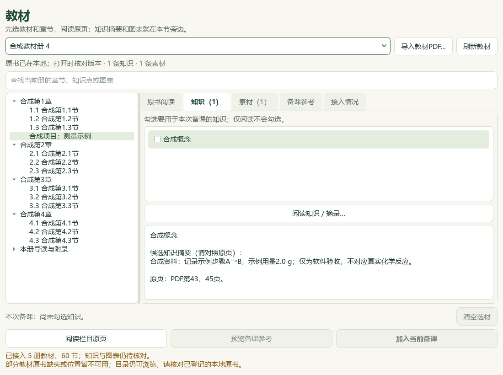
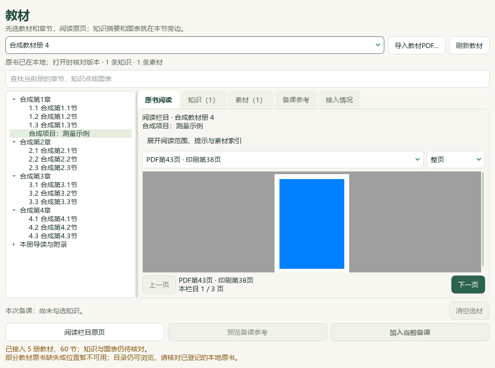
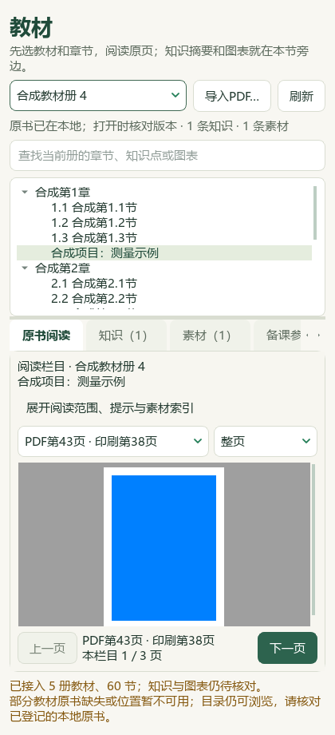
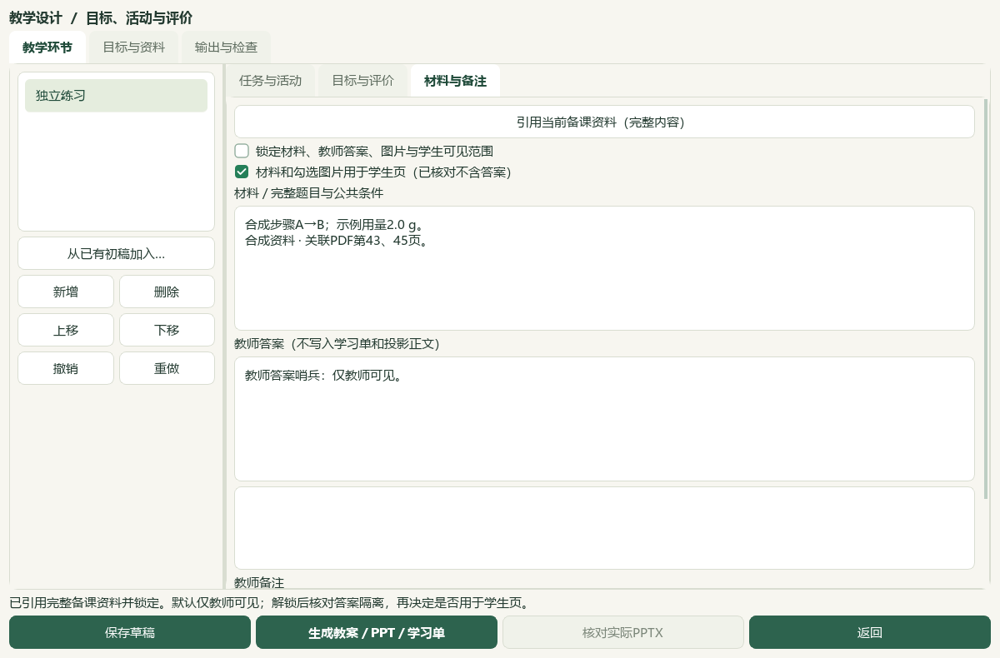

# 2026-10-04 教材补充栏目、原页与备课联动

维护源码已把23条原“待归章节”概念按其明确补充栏目归组，知识和图表可随栏目阅读、搜索与选入备课。5册、19章、60个编号节保持；另外显示77个补充栏目，包括章首页、复习、项目、册级导读与附录。当前为未发布源码，v0.1.101 EXE未重建。

## 目录与内容范围

当前补充目录以激活目录的实际SHA绑定，逐条核对来源路径、原书SHA、册与父章、明确页列表和候选状态。42个栏目挂章，35个挂册；册级附录的空父章没有被填成某一章。重复或矛盾节点均不作为阅读入口，其他有效栏目和正式章节可继续浏览；旧安装缺补充目录时沿用原入口。

23条概念对应9个栏目，30条素材对应18个栏目，二者合计引用19个栏目；58个栏目没有现有概念或素材，仍可按目录读原页。没有创建新知识或伪造空栏目的内容。素材总数仍319，原概念仍383；原文件、修订身份与页列表没有改写。

16个栏目未登记印刷页，仍显示待核对；30条补充素材中25条没有印刷页，不从栏目范围回填。4个无父章附录素材保留空父章；5条缺路径的原素材继续经已核验册目录取原书路径。旧U25概念仍是 `[43,45]`，独立项目栏目明确读 `[43,44,45]`；知识参考与备课保留概念原两页，不因查看栏目自动扩大材料。

## 实际操作

从教材书架选册，章首页、复习和项目出现在所属章内，按PDF页序排列；册级内容放在“本册导读与附录”。选择栏目后点击“阅读栏目原页”，可翻阅明确页列表；知识和素材页签仅列当前栏目，搜索能找到栏目标题、知识摘要和素材说明。切换栏目或刷新后旧阅读器释放，迟到回调不恢复旧页。

窄窗口保留选册、导入与刷新一行；阅读时没有选材就收起暂不用的备课按钮，切回知识页恢复。最终420×920截图的实际PDF视区高度205像素；前一版被挤成狭窄条带的截图保留为修订依据。并非手机端开发或真人DPI验收。

## 备课与三类成品

合成资料通过实际主窗口信号完成勾选、预览、重新核对、加入当前备课、保存草稿、引用到教学环节、明确学生可见材料，再由界面生成PPTX、教案DOCX和学习单DOCX。已有课题、对象、目标与材料保持；三类成品均含示例正文，教师答案只在教案和PPT备注保留，学生正文没有答案。本文不声称已做这三份成品的实际Office视觉渲染。

图表继续沿原有“看原页→框选→预览→确认加入备课→绑定教学环节”的路径选用，本轮没有自动裁取真实教材图。教师候选参考和中央来源用途字段保持，显示归组不是来源认证或人工审校。

## 核对与保存

77个栏目逐个经当前源码读回真实PDF，原书SHA、实际PDF页数、栏目页范围与关闭资格字段均核对通过，涉及180个不同PDF页。这是入口与文件核验，不等于180页化学全文视觉审校。主代理看过10幅截图：4幅当前公开合成图、3幅真实教材私有图、3幅旧布局合成图；Qt offscreen、96DPI、1倍缩放。真实教材截图留在私人输出目录。

本机DATA的 `outputs/2026-10-04-textbook-supplement-bookshelf/` 保存冻结回执、77次原页读回、合成备课草稿及三类成品、初始和最终截图、阅读范围与测试记录。CODE同名outputs为本轮辅助脚本。没有覆盖原教材、题目属性、个人教材JSON或5本个人归档PDF；没有新增catalog/corpus资料。化学快照仍为750条参考、175条研读、914题待办、13讲缺流程、132条登记。

22个相关模块551个不同用例全部通过，含40个新增用例和完整README14项，87.75秒，失败／错误／跳过0；Ruff F、Python AST、文档策略及diff检查通过。833个已冻结文件哈希全部保持，494个用户状态文件的集合与字节保持。初次新增测试的4项任务调度辅助错误、窄窗恢复按钮检查和正式节素材返回字段不一致的初次失败保留，不以中间结果代替最终验收。教材蒸馏、剩余题目导入、自动新书整理与发行集成继续，当前总目标保持active。
