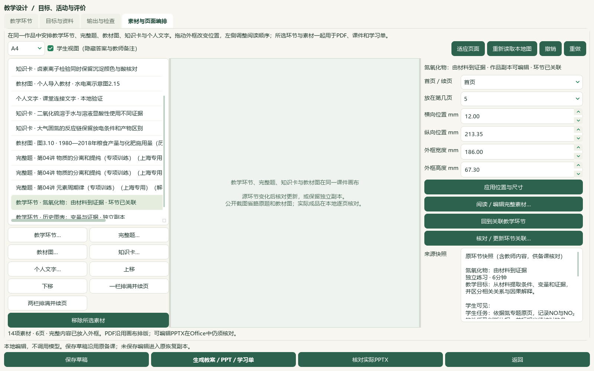
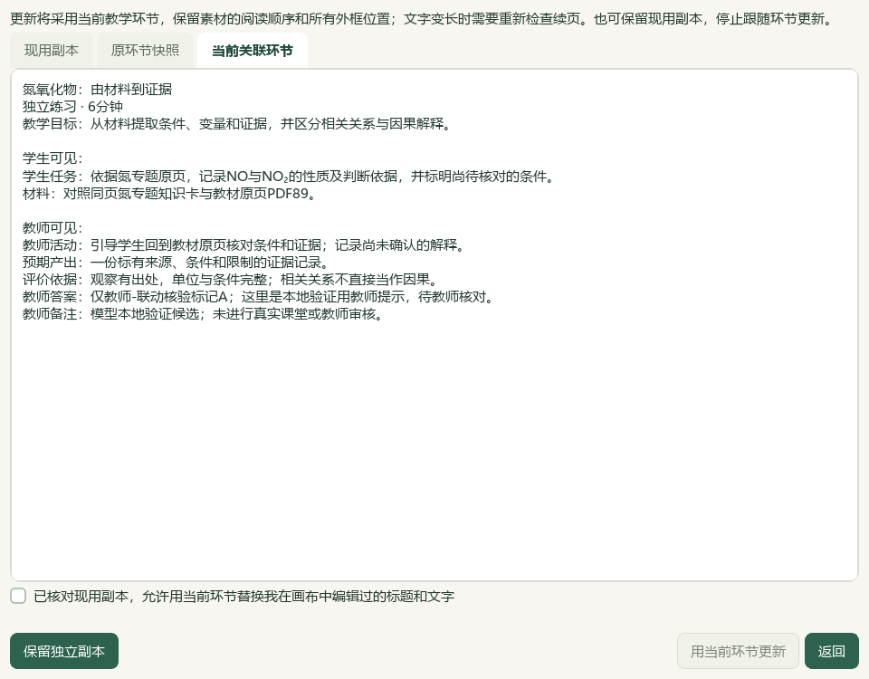

# 环节与画布联动、氮专题研读及12题切片

2026-10-05，当前维护源码和本地资料，尚未进入 Windows v0.1.101 试用包。总目标仍为 active；本片是有界进展，未提交或发布，版本、EXE和启动器未更新。

本片把本课教学环节接入现有素材画布：可以多选加入、回到原环节、核对更新或保留独立副本。原来源快照、作品中的编辑副本和既有成品继续保留。微信读书／wechat-search-weread路线按用户要求停用；本片检索关键词、文章、外部有效试卷和模型调用均为0，直接核对本地原件。

## 实际操作与验证范围

在 **备课 → 教学环节** 选中环节，点击 **把所选环节加入课件画布**；多选用 **素材与页面编排 → 教学环节…**。搜索不会丢失勾选，按设计顺序加入，重复加入关联环节会定位已有素材。学生任务及明确勾选的材料／图片进入学生版，教师活动、目标评价、答案和备注留在教师版。来源说明以环节、任务和材料呈现。

选中环节素材，用 **回到关联教学环节** 继续编辑。原环节、所关联目标或图片说明变化后显示待更新，新生成前须打开 **核对／更新环节关联…** 比较现用副本、原快照和当前环节，再更新或保留独立副本。画布副本已经编辑时须另勾选允许替换。更新保持所有外框位置与阅读顺序，可撤销；文字变长后的溢出仍须处理。原环节删除后可保留独立副本或移除素材。

验证使用实际Qt窗口和本地原件，不调用模型。前序7项素材、4个成品版本保持；本片增加3道真实完整题、氮专题知识卡、个人教材图和2个环节，合计14素材、6页。原生题目窗口勾选、预览并重新确认3题；来源重读及原图完整性检查未绕过。该隔离窗口的来源目录绑定两份真实讲义，整库冷启动性能不由本片认证。

| 验证 | 结果 | 限制 |
| --- | --- | --- |
| 多选、筛选、跳回、重复加入 | 原生窗口通过 | 环节源变化不自动改写画布副本 |
| 已编辑副本的更新 | 比较、明确允许替换、位置与顺序保持、撤销通过 | 字变长后仍重新核版 |
| 原环节删除 | 明确保留独立副本后可生成 | 原源已经移除，保留的是选择时快照 |
| 教案、课件与学习单 | 最新六文件读回；关联任务各出现一次，学生文件排除教师答案 | 未进行真实教学／教师审核 |
| PDF | 教师6页与学生6页全部逐页查看，图表与条件可读 | 隐藏教师块后保留原框中的空白 |
| 保存、重开、自动恢复 | 完整载荷一致 | 在新的隔离资料目录验证 |
| 另存、ZIP恢复 | 7版42登记文件逐文件字节一致，关联图像一致 | 备课备份不包含原Word完整题库和外部正式原教材 |
| 实际Office版面 | PPTX可编辑文本与图像、DOCX内容读回 | 本机无LibreOffice，实际Office渲染／物理分页尚未核验 |

个人书与既有个人笔记沿用前序模型隔离验证副本，不冒充教师真实录入。本片裁选必修一PDF91图3.10，保留1980—2018年的年份、两侧纵轴、图例、图题。该图通过明确选择既作为独立裁图，又作为历史图表环节材料；不能据相关变化认定单一因果或代表最新统计。

公开复核画面共7张：[知识卡](screenshots/2026-10-05-activity-composition-nitrogen/01-nitrogen-note-picker-verified-06.png)、[环节入口](screenshots/2026-10-05-activity-composition-nitrogen/02-native-node-to-canvas-human.png)、[多选](screenshots/2026-10-05-activity-composition-nitrogen/03-native-activity-picker-verified-06.png)、[更新](screenshots/2026-10-05-activity-composition-nitrogen/04-native-review-source-update-verified-06.png)、[独立副本](screenshots/2026-10-05-activity-composition-nitrogen/05-native-keep-snapshot-verified-06.png)、[宽窗](screenshots/2026-10-05-activity-composition-nitrogen/06-native-composition-1600-human.png)、[桌面窄窗](screenshots/2026-10-05-activity-composition-nitrogen/07-native-composition-1000-human.png)。原题、原教材图、完整画布与实际PDF只在本地证据中展示。

## 教材与题目整理

必修一3.2《氮及其重要化合物》PDF89—95／印刷84—90七页逐页核读，新增10条来源绑定研读候选，编号 READ-20261005-NITROGEN-01—10。原书SHA-256为 `a565f0a15ffd10c704f4be42bfe7200c125b68959d11ef582acdc45dde2ccf22`。反应条件、物质名称、状态、历史图表年份与未知的实验记录分别保留；未补造学生实验结果、官方答案或评分细则。

| 资料状态 | 本片完成后 |
| --- | --- |
| 存储研读笔记／可选／覆盖正式节 | 365／326／47；39条旧缺项保持 |
| 正式目录／补充栏目 | 60／77，未扩张已核目录 |
| catalog及corpus | 152＝108原来源＋44派生；新增1份氮专题候选 |
| 讲义参考／概念／素材 | 46讲1009参考／383／319，保持 |
| 分析来源／题库题目／可选 | 98／3579／3576，新增原卷和题库题目均0 |
| 主知识已填／教材映射 | 3098／2985，分别缺481／594 |
| 属性行／历史行 | 3684／9694，本片新增8条历史 |
| 待办 | 733＝81文字＋593图像＋56范围材料＋3保护 |
| 完整阅读身份／部分阅读 | 664／154；部分不计完整 |
| 未尝试图像队列 | 393；另135图像已有部分阅读 |

两份讲义12题的题面、答案、邻文与52处图像／对象逐题核验，48处可读取并已查看，8张联系图已核读；9题完整技术范围、3题部分。只对8题提出并保存缺失字段候选：7个空主知识点、2处空教材映射，非空替换为0。映射另对照选必三PDF115和必修一PDF120、123原页。

原答案范围含下一专题标题的题保留待核，未提标签候选；一题解析中的电负性说明错配另列待核，原文不改写。两题旧公式／WMF缺口及一题绘图布局继续阻断正式完整读入，不把部分读图计作全题完成。题面中标注的外省考试信息照实保留，来源权威性、原考试身份、正式层级及难度仍按证据登记，不从讲义文件名推定。

数据库只改变8个计划属性行，3676其他属性行及9686旧历史行保持。真实桌面状态另493文件、5本个人原书及来源字节保持。重复补缺预览为0变更，未改答案、来源、教师确认、难度或正式层级字段。新研读、映射和标签均为AI候选，人工审核、教学、生成与发布资格不解锁。

## 视频依据与检查

重新查看用户视频V28与V30各6张已提取画面，并重核两份原视频SHA。V28的分页课件和纲要、V30的课题／目标／年级到教案联动用于本片交互参考；未声明完整播放、营销效率复现、自动语音或第三方模板功能已经实现。手机端按用户要求排除。

30模块433项相关回归通过；最后来源说明调整后另20项通过，与前者重叠，不能相加。完整README14项、文档策略及本地资料控制器检查另行留档。最终源码审阅集按当前HEAD全部差异核对，包含此前增量，私有原件、桌面状态、验证脚本和临时成品不进入审阅补丁。

私有证据目录：`E:/项目/上海高中化学等级考/outputs/2026-10-05-activity-composition-nitrogen`，包括原页及逐题材料、补缺预览与应用回执、原生成品／备份、视觉复核、测试报告、保护哈希、文档回执、源码审阅清单和next-work。隔离验证的早期超时、目录绑定、点击与画面问题保留诊断；最终从已保存恢复副本继续，实际画布与公开截图另行核对，未修改真实教师资料来排错。

## 继续范围

下一正式节为3.3《硫循环和氮循环》PDF96—103／印刷91—98，并继续393个未尝试图像队列中的下一组12题。其余教材与题目、化学及装置图审核、复杂／嵌套公式、实际Office字体和分页、更多视频功能、0.1.102候选统一和桌面发行仍未完成。本片没有把本地候选写成已发布成果。
