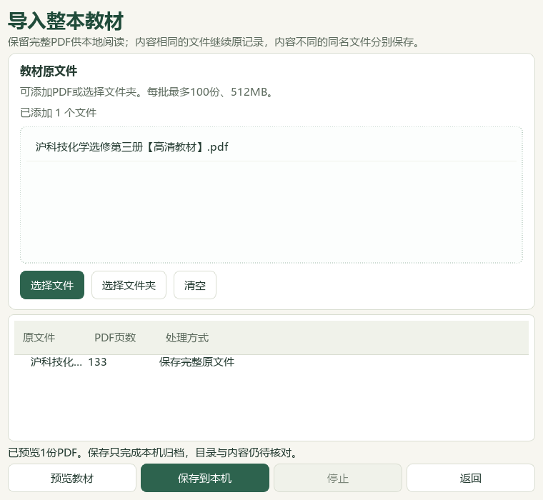
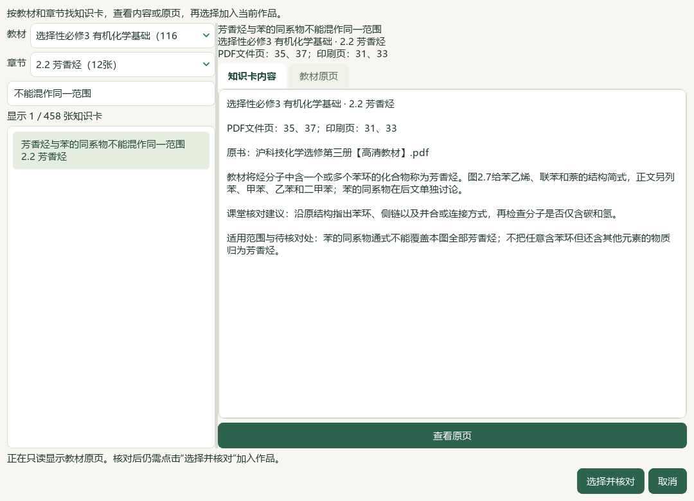
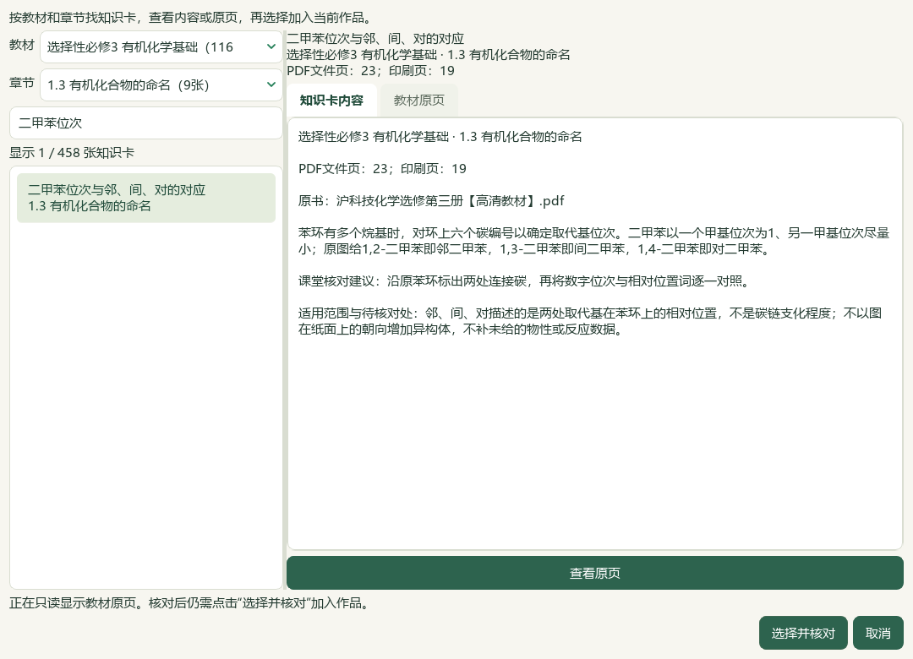
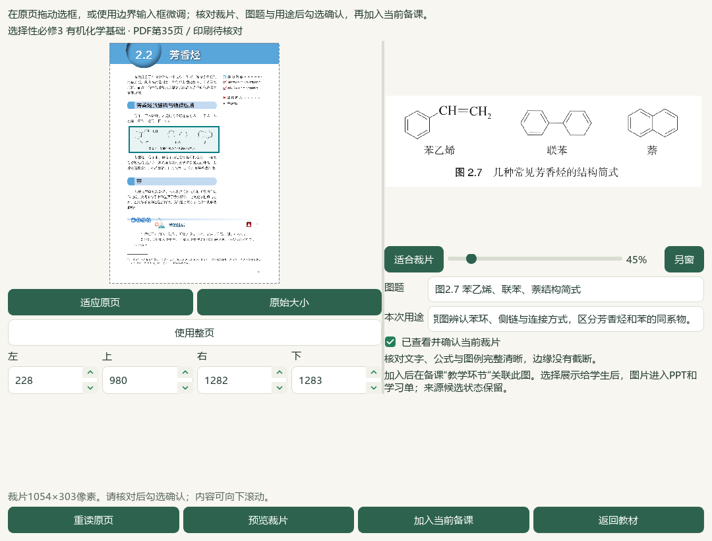
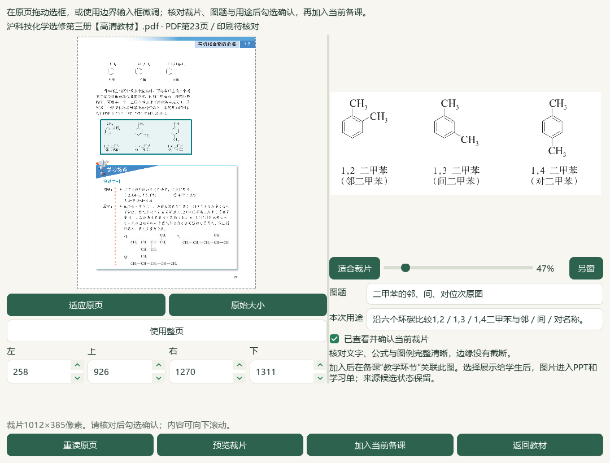
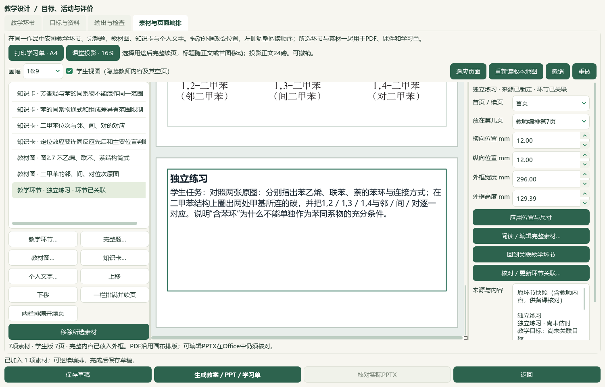

# 2026-10-05 芳香烃研读与教材原图备课联动切片验收

新增12条教材候选；两张真实教材裁片随知识卡和任务进入实际Word／PPT，并完成备份恢复。12题保留源范围、图形与答案问题。本轮为本地有界进展，完整目标仍在进行。

选必三2.2《芳香烃》正文PDF35—40／印刷31—36及邻页34、41共8张原页实际核看，新增12条来源绑定候选，覆盖芳香烃／苯同系物范围、物性一般趋势、苯反应条件、硝基苯颜色脚注、烷基苯通式、侧链氧化、主要取代位置和原空白练习。空白表格不补答案，原页不展开成实验操作规程。教材496存储／457可选／60个正式节均有候选，39旧缺项保持；60节有笔记不等于各节完整蒸馏、教师审核或课堂合格。catalog/corpus166＝108来源＋58派生，本片只追加研读和图题更正2份派生，原件及旧登记前缀保持。碳酸Ka2两处4.8×10⁻¹¹／4.7×10⁻¹¹冲突仍未解除。

PDF35图2.7实际为苯乙烯、联苯、萘三个结构，素材目录原标题多写“苯”。以原记录SHA绑定的更正覆盖层仅修改显示图题和说明，原319图记录、旧3项更正及原印刷页未知字段保持。原书与来源版本不变，新显示标题“图2.7 苯乙烯、联苯、萘结构简式”需刷新重选。全页锚点尚未变成正式定位框；本片另经明确框选形成1054×303像素图2.7裁片和1012×385像素二甲苯原图裁片。

PKG-057—060四份原Word按来源SHA、版本、题答和邻区块核读12题；86处资产中66处可显示、20处不可显示，11张完整联系图及5张原尺寸对象由根代理实看。2题现有原生图文范围可读、10题部分可读；12题均保留待核，标签和题库写入0。样本5／8的下一章节标题边界、样本8皂化式右侧漏系数、酸滴定原解析与条件疑点、重复Cu／葡萄糖题不同身份、缺失公式与原表格布局均保留，不修补原题答案或猜正式层级、出处年份和难度。

本片使用既有教材裁片与页面编排功能，新增应用代码和测试模块均0，渲染v11及应用版本保持。实际Qt在全库存验证副本中预览、保存同SHA选必三完整PDF，再从教材图入口选正式图2.7和个人整书PDF23；逐张填写图题、用途，预览并明确勾选后带入同一备课作品。4张知识卡（3芳香烃＋1前序二甲苯）、2张原图和1个未审核独立练习共7素材。知识卡选择窗口458＝457正式可选＋1旧个人笔记。源范围仍保留未知，加入作品不会自动通过化学审校；本轮不认证冷启动完整题目目录或真实新题UI导入。

六份教师／学生Word、PPTX及画布PDF生成、保存和复制。实际Word教案4／学习单2页，PowerPoint两版各7页，共20实际Office页；两图在两版PPT第5、6页、学习单第2页完整显示，原PNG字节均在四份Office文件内一致。4知识卡标题与完整可见正文同页，完整短活动在教案第4、学习单第2、两版PPT第7页，教师提示只进入教师版。根代理实看6张完整Office联系图、6选定原生UI、7个原尺寸成品页和2个原尺寸裁片；不称20页均逐张原尺寸細读。两份画布PDF各7页仅机器计数。学生卡仍有候选适用范围语言，目标与活动未由教师关联确认，知识与图的自动配对、课堂递进和长题分页继续。

新保存1份候选草稿至19份，共享历史去重24版144登记成品；原18草稿载荷、138成品及2套讲稿保持，新6份和全部引用图片在备份恢复后逐份一致。完整PDF新归档仅在验证副本；用户真实494个人状态文件、3684属性和9733历史全部保持，源辅助466文件保持事故后字节，历史临时desktop-state.v1.json原字节仍未恢复。冻结3659条选定路径后，图题更正前另补冻结2条原图目录／覆盖层路径，终验合计3661，不称新鲜全私有档案扫描。知识库索引鲜读再备份，只更新化学行并保留其他项目的新鲜变化。

新鲜队列仍702＝81文字＋562图像＋56范围材料＋3保护；714完整／224部分阅读身份，273未尝试可处理图题，19未读纯文字均已有部分读取阻碍。空候选章节数0；下一教材图候选按实际目录为2.2 PDF36“苯性质对照实验照片”，仍须核原页、范围与用途。保留全部12题待核理由，2完整阅读身份不解锁答案或边界门槛。普通status先于准备，8相关模块245项检查通过；终验status／validate、文档策略与14项完整README另验。

本轮仅重新核看V28前序60秒参考帧1张，以完整示例与教师备注布局作为图／任务联动参考；新视频帧0，完整播放和音频核听0，未新增HTML、目录或语音功能。检索文章、新试卷、新下载、外部请求及模型供应商调用均0，微信读书永久停用，登录、扫码和密钥不再是本地任务前置。原生助手首次在UI前因同SHA个人整书不存在停止；保留脚本／克隆，补实际导入预览与保存后第二轮成功。图题助手首次冻结路径遗漏、队列助手类名导入错误及早期命令引号错误均保留说明，不写成应用故障。

教师独立化学审校、全部教材图表、复杂Word与长题、候选课堂语言、更多视频／语音、统一候选和桌面发行继续。手机端排除，总目标active；全部新候选human_reviewed、teaching_use_allowed、generation_allowed、publication_allowed均false。维护源码与DATA旧应用存在版本差异，未用文档更新复制应用功能，未提交推送发布、未递增版本或重建v0.1.101 EXE。

## 实际操作

在 **备课 → 教学环节 → 素材与页面编排 → 知识卡…** 选择“选择性必修3 有机化学基础”及“2.2 芳香烃”，查看候选并对照原页，再选择并核对。需要原结构时点 **教材图…**，选择“图2.7 苯乙烯、联苯、萘结构简式”，填写用途、框选、预览并勾选确认；个人整书可先导入完整PDF，再在同一入口指定原页。资料进入作品后主动点“课堂投影16:9”，生成并查看实际Word／PPT。详见[操作指南](../teacher/lesson-and-paper.md#lesson-composition)。

## 来源与证据

[12条芳香烃候选](../../knowledge/textbook/reading-notes-20261005-aromatic.json)与[图题更正覆盖层](../../knowledge/textbook/visual-asset-caption-corrections-20261003.json)绑定本地原书`E:/项目/上海高中化学等级考/课本/沪科技化学选修第三册【高清教材】.pdf`，SHA-256为`26ccd86648c807476fd6f08db7e414571fa0d5e077db63b15c9880cb225cd137`。正文PDF35—40／印刷31—36，邻页34、41只核边界；二甲苯图另来自PDF23。原图目录未知印刷页未根据笔记回填。

12题来源、SHA、版本及区块范围在私有selected-questions.json与questions/root-review.json中保存。原范围可读2题仍因边界或原答案问题待核，其余10题保留原式或版式缺口，本片不写标签、不把不同身份的重复内容合并。

备课ZIP覆盖验证副本的19草稿、引用图片及24唯一版本的144登记成品；整本教材PDF及个人教材研读归档、原Word、完整资料库和真实用户档案仍须另行备份。原图只在验证副本中实际带入候选课例，用户真实草稿与教材档案保持。本片验证既有功能，没有新增应用代码或发行包。

私有证据目录：`E:/项目/上海高中化学等级考/outputs/2026-10-05-aromatic-figure-lesson-slice`。原教材页、题答／对象、实际Office页面、视频帧和备份保留私有。

| 记录 | 验证范围 |
| --- | --- |
| inputs-before.json、caption-inputs-before.json、preparation.json | status先于准备、3659＋2路径冻结、前序55证据与391公开文件核验 |
| book-pages/manifest.json、reading-completion.json、registration-receipt.json | 8原页实看、12新候选、496／457／60节及研读派生登记 |
| figure-caption-correction.json、caption-registration-receipt.json | 图2.7更正与第二份派生登记，166总登记、原319图记录和3旧更正保持 |
| asset-manifest.json、questions/root-review.json、root-image-review.json | 12题、86对象／66可显示／20缺失，11联系图＋5个别对象实看 |
| questions/root-scope-acceptance-final.json、database-preservation-final.json | 2源范围可读仍待核；0标签，真实494文件及全部旧属性历史保持 |
| next-question-work.json、current-bookshelf-final.json | 714完整／224部分、273未尝试图题；0空候选节不表示全教材蒸馏完成 |
| native-02/native-book-import.json、crop-actions.json、native-verification.json | 实际整书导入、图表／个人页框选确认、7素材保存及144成品恢复一致 |
| actual-consumer-final.json、root-native-visual-review.json | 实际Office20页、6联系图／6UI／7原页／2裁片；4卡同页，原PNG字节嵌入一致 |
| native-helper-first-failure.json、caption-helper-first-failure.json、route-helper-first-failure.json | 助手初次缺个人书源、补冻结前停止及类名错误保留，修正后成功 |
| video-reference/root-review.json | 重看1前序参考帧、新帧0、无全片或音频验收 |
| related-tests-final.xml | 8相关模块245不同用例通过；本片新增测试0 |
| documentation-sync-final.json、documentation-policy-final.json、readme-tests-final.xml | 8文档鲜读备份及比较写入、14README检查，其他索引行保留 |
| controller-status-final.json、controller-validate-final.json | 166登记终验门禁；微信读书停用 |
| source-review-manifest.json、full-hash-protection-final.json、root-final-acceptance.json、next-work.json | 最终源码与冻结路径核验；保留历史临时异常，总目标active、未发行 |
