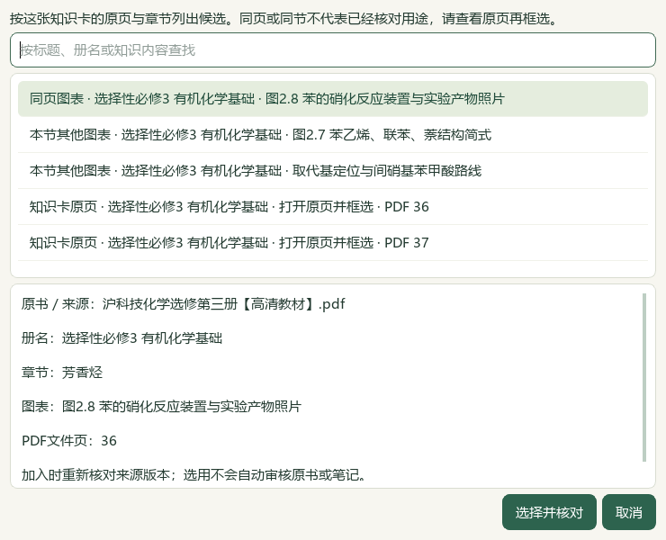
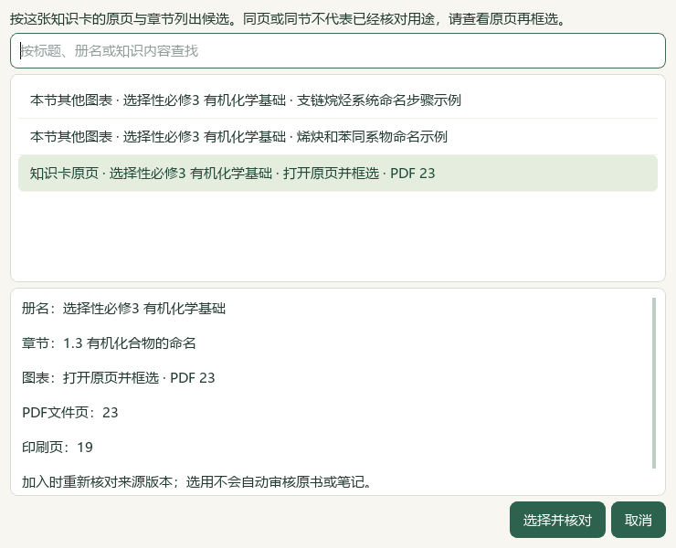
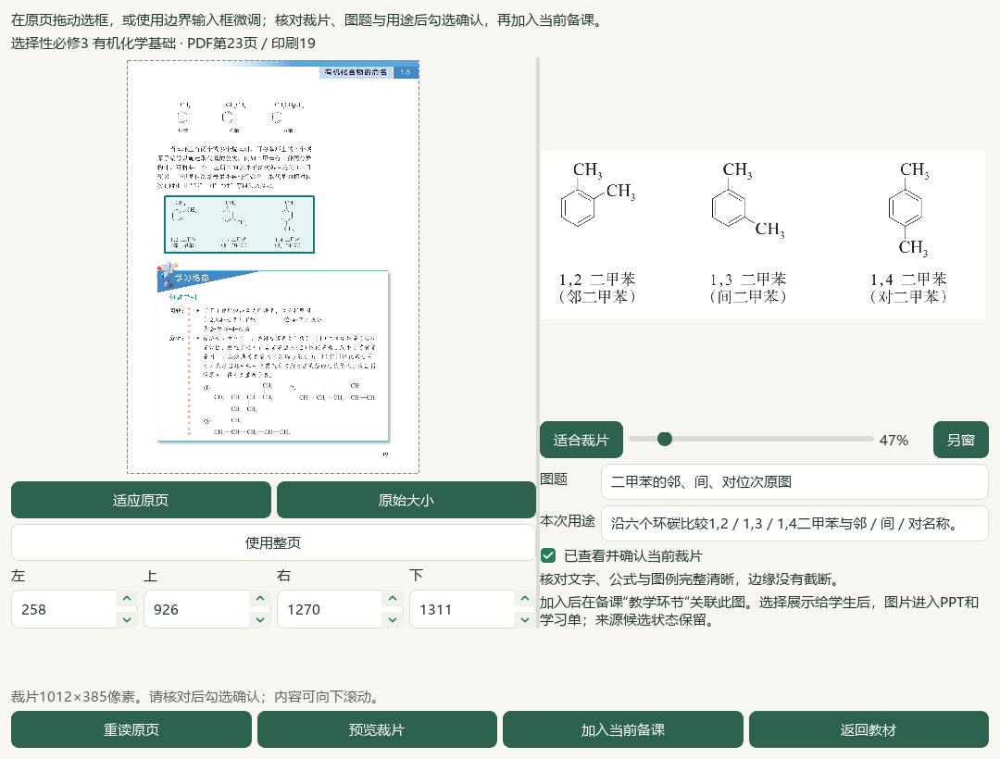

# 2026-10-06 知识卡直达教材原页与图表切片验收

新增知识卡旁选图入口，完成来源与作品版本约束；两张原图实际进入同一候选Word／PPT并备份恢复。12题问题与资格边界继续保留。切片开始于2026-10-05、完成核验于10-06；总目标仍active。

知识卡旁新增“从这张知识卡选教材图…”入口，按原知识卡的来源版本列出同页图、本节其他图和明确引用的原页。原页没有登记图表时也能直接框选，无须为此再次导入整书；个人教材笔记也按原笔记版本与明确页码选择。列表只读元数据，真正打开／确认时复核原书SHA、知识卡与目录版本、页范围和裁片；旧笔记、原书变化、无关页、取消或作品在任务期间变化时不能带入旧选择。同页／同节排序不是化学相关性判断，未自动审核或持久化化学配对关系。新增原页适配模块、修改4既有应用模块和2测试文件；86不同相关检查经失败夹具修正后的补测均通过，最后仅修改选图提示，并以实际Qt原页烟测核对。

原PDF36／印刷32图2.8是苯硝化装置与产物照片，原显示标签“苯性质对照实验照片”不准确。另存原记录SHA绑定的第5条候选更正，标题为“图2.8 苯的硝化反应装置与实验产物照片”；4旧更正及319原图记录不覆盖，印刷页未知字段保持。catalog/corpus167＝108来源＋59派生，本片只追加这1份派生。黄色杂质与纯品颜色需结合PDF37脚注核对，选图不补写独立操作规程。教材候选496存储／457可选／60正式节，新增笔记0；39旧缺项及碳酸Ka2两处冲突保持，60节有候选不等于完整蒸馏或教师审校。

PKG-060原Word按SHA、来源版本、题答及邻文核读12题，32处对象中30处可显示、2处不可显示。根代理实看5完整联系图及5原尺寸对象；9题现有图文范围完整可读、3题部分读取。4题仅结构范围可进入下一候选复核，教材映射与独立化学审校仍未通过，标签、题库和原答案修改均0。柠檬酸铁铵原解析缺失措辞、Na₂SO₄题B／H装置标记、磷酸氢二铵选项与原解析理由不对应、乙醚式缺系数与下一章节混入、上海卷仅转载片段、旧公式及表格布局分别保留，不猜正式层级或难度。

实际Qt在全库存验证副本选择芳香烃05及前序二甲苯07知识卡，再从各卡新入口选择同页图2.8和未单列图表的PDF23原页，逐张框选、填图题与用途、预览并明确勾选。2卡＋2原图＋1未审核练习共5素材进入同一作品，生成、保存及复制6成品。图2.8裁片815×668、二甲苯1012×385，两原PNG均以相同字节嵌入四份Office文件。正式图印刷页仍未知，知识卡原页按已登记成对页码显示19，未回写原图索引。

实际Word教师4／学生3页，PowerPoint教师6／学生5页，共18实际Office页。两原图在教师Word第2、3页、学生Word第2页，教师PPT第3、5页、学生PPT第3、4页完整显示；两卡标题与完整可见正文同页。教师图2.8的用途／来源文字延续到Word第3页及PPT第4页，尚未把这段短说明与图排在同页；不称全部素材为完整单页。未审核短活动完整在教师Word4、学生Word3、教师PPT6、学生PPT5，教师提示仅在教师版。根代理实看6完整Office联系图覆盖18页、12原尺寸成品页、8可读UI及2裁片；另1字体未初始化烟测图只计失败观察，不称全部页均逐张原尺寸细读。画布PDF教师6／学生5页仅机器计数。

验证副本新增1候选草稿至20份，共享历史去重25版150登记成品；旧19草稿、144成品与2讲稿保持，全部150源／恢复文件及引用图片逐份一致。无需新增个人整书导入，备课ZIP仍不含个人整书PDF与研读档案。真实494文件、3684属性／9733历史及源辅助466文件保持；历史临时desktop-state.v1.json原字节仍未恢复。冻结4166选定路径，终验另核对计划内应用、候选与文档变更，不称全私有资料新鲜扫描。

新鲜题目队列702＝81文字＋562图像＋56范围材料＋3保护；完整阅读身份723、部分227，261未尝试可处理图题，19未读纯文字均已有部分读取阻碍。下一教材图候选为2.2 PDF39“取代基定位与间硝基苯甲酸路线”，需继续核原页、范围与用途。普通status先于准备，终验status／validate、文档策略和14完整README另验。知识库索引鲜读备份后只改化学行，其他项目变化保留。

本轮复看V28已有95秒帧1张，参考其目录、页码与图文例题，新增抽帧、完整播放、音频核听均0；未新增HTML、目录或语音功能。检索文章、有效新试卷、下载、外部请求及供应商调用均0；微信读书永久停用，不再作为任何本地工作前置。测试夹具、图题登记编码、原生助手旧标题／截图重名／脚注判据、续跑变量与队列报告字段错误均保留失败及修正记录，不冒称首轮全通过。最后烟测助手缺中文字体的图已保留，按真实应用字体与样式复验。

来源、化学、装置、课堂语言、全部教材和复杂长题审校，短说明分页、明确图卡关联、更多视频／语音、候选统一及桌面发行继续。手机端排除，总目标active；所有新候选human_reviewed、teaching_use_allowed、generation_allowed、publication_allowed均false。维护源码与DATA旧应用存在版本差异，未复制应用代码到DATA、提交推送发布、递增版本或重建v0.1.101 EXE。

## 实际操作

在 **备课 → 教学环节 → 素材与页面编排 → 知识卡…** 选择教材、章节和内容，查看原页再加入。回到作品左侧选中该知识卡，点右侧 **从这张知识卡选教材图…**，选择同页图、本节其他图或知识卡原页。明确框选后填图题及用途、点“预览裁片”、核对边缘和名称，再勾选并加入。取消不改变作品；笔记或原书更新后重新选择。加入后编排、生成并打开实际Word／PPT检查。见[操作指南](../teacher/lesson-and-paper.md#lesson-composition)。

以上是本地实际Qt窗口。选图后提示文字最后已修正，并另存实际烟测截图；这里保留完整生成验证运行的原截图，不把旧提示声称为当前文字。

## 私有证据与限制

私有教材、讲义对象、真实状态副本与Office文件位于本地资料根 `E:/项目/上海高中化学等级考/outputs/2026-10-05-card-to-textbook-crop-slice`，未写入发布包。

| 文件 | 核验范围 |
| --- | --- |
| inputs-before.json、preparation.json | 4166冻结路径，前序58引用、399公开文件及144成品复核 |
| figure-caption-correction.json、caption-registration-receipt.json | 第5条来源绑定图2.8更正；原记录与旧登记前缀保持 |
| questions/root-review.json、root-image-review.json | 12题完整题答及邻文，5联系图／5原尺寸对象；9完整、3部分 |
| next-question-work.json | 723完整、227部分阅读身份，261未尝试图题，真实标签数据库保持 |
| native-03/native-verification.json、actual-consumer-final.json | 实际Qt选图、保存；18 Office页、150成品源／恢复一致 |
| root-native-visual-review.json | 6联系图、12原尺寸页、8可读UI、2原裁片与已知续页限制 |
| related-checks-final.json | 7模块86不同检查，失败夹具修正后补测；原始XML保留 |
| documentation-sync-final.json、readme-tests-final.xml | 8文档鲜读备份与CAS写入，其他索引行保留；完整README核验 |
| root-final-acceptance.json | 仅接受本片有界进展；全目标不标完成 |

新入口按这张卡的原来源列候选，并不自动确定化学教学用途。正式图的精确定位、跨页长题、教师语言、源答案错误与原表格仍需独立审校。教师PPT图后短说明单独占一页，尚需改善阅读；活动目标、确认与估时也未补猜。没有安装或更新正式EXE。本片不代表整库入库、全教材蒸馏或44视频整体对齐。
