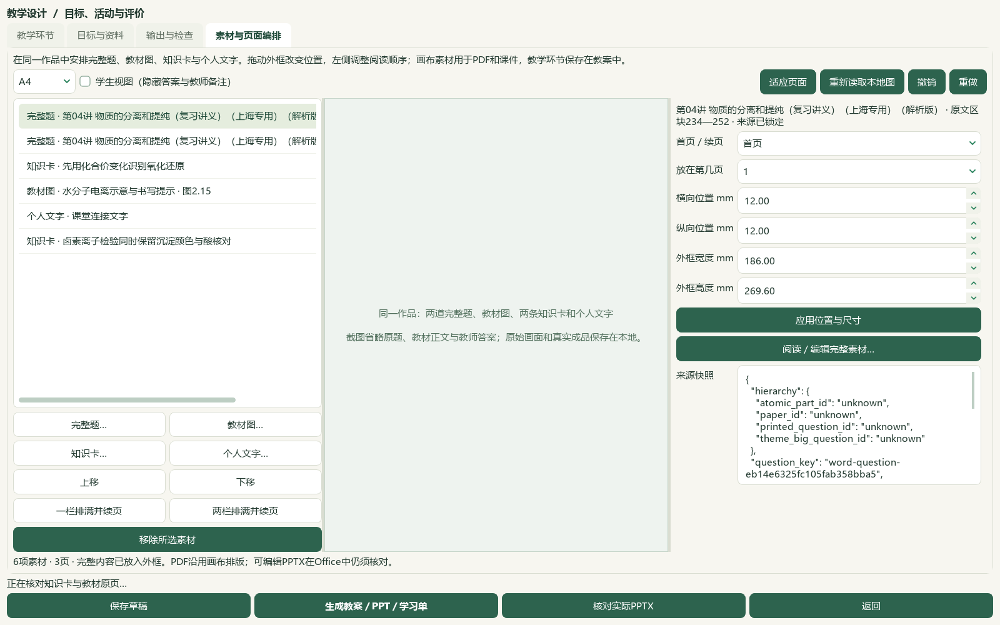
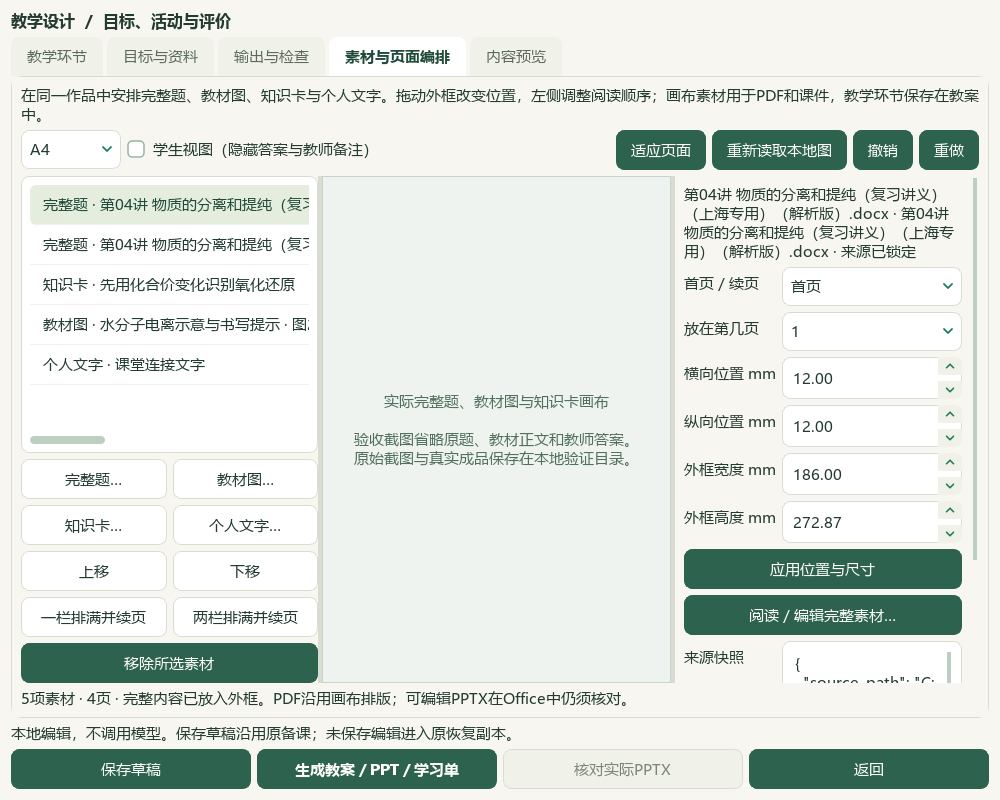

# 完整素材页面编排与溴碘研读验收

2026-10-05，维护工作区 `e08c3e7` 上的未提交源码增量。发行基线仍为 v0.1.101；旧桌面应用、EXE和启动器尚未更新。总目标继续包括教材／讲义／试题内容完善、备课与课件联动、参考视频功能对齐及桌面交付；本次验收只接收这一段可复查的进展。

## 当前结果

“教学环节”新增“素材与页面编排”，将完整题、教材裁图、知识卡与个人文字放在同一作品中。来源内容先锁定，明确解锁后只修改作品副本；原文快照保持。A4、A3和16:9纸面支持拖动外框、填写毫米位置和尺寸，阅读顺序单独调整；可一栏／两栏续页、撤销／重做、切换教师／学生视图、保存重开、读取恢复副本并备份。

画布素材生成教师／学生PDF和PPT，文字及图片在PPT中分别保留为可编辑文本框与图片。教学环节另保存在教案中，目前尚未合成为同一套画布活动版式。未加入画布素材的旧设计沿用原三份输出；已有草稿、环节和成品版本保留。

《溴和碘的提取》六页新增6条来源绑定研读候选，现存345条笔记／306条可选／45个正式节有可选笔记。39条旧缺项仍待核。该数量不认证全量教材阅读或教师审核；全部新增保持候选资格。

[实际操作](../teacher/lesson-and-paper.md#lesson-composition) · [保存与备份范围](../teacher/save-and-support.md#backup) · [前序环节内容预览](2026-10-05-lesson-preview-redox-slice.md)

## 页面与完整来源验证

实际Qt窗口显示素材、纸面、位置编辑与来源快照。公开截图省略原题及教材正文；私有来源验收使用真实题文、图像和教材页，未用公开截图的占位文字代替正文验证。

[1600像素来源控件](screenshots/2026-10-05-composition-integration/01-composition-source-controls-1600.png) · [保存后重开](screenshots/2026-10-05-composition-integration/03-reopened-composition-1600.png) · [恢复后工作台](screenshots/2026-10-05-composition-integration/04-restored-workbench-1600.png)

验证素材来自已保存的分离提纯讲义两题，源Word SHA-256为 `59e4577ee16553dd9b5194ed54da0c5f43d5794ea11dc2ad809c4a7f6465db7a`。只读重核原来源、当前题范围和属性版本，两题共21＋11＝32原文区块、5张不同图片；共享题材、题面及题答文字按原顺序完整带入，每次出现的图片引用保留。原文区块234—252和253—260用于定位来源，不冒充印刷题号、主题或正式层级；原有未知结构字段仍为unknown。

教材图来自必修一PDF63／印刷58，在真实裁图窗口明确框选并确认，保留图2.15的题目、图像和图题。原页与裁图分别核看。图像摘要和书源版本重核通过；已有图片合并后仍受48图上限约束，缺图不能生成。

最终作品含两题、一教材裁图、两知识卡及一条个人文字，共6项、3页。新增提示 `READ-20261005-BROMINE-IODINE-05` 已通过实际选择窗口选择并确认加入，随后实际鼠标拖动只改变位置；来源快照和既有备课材料保持。素材排序、取消编辑、删除后撤销、两次连续加入不改写历史，以及过时选择不覆盖当前表单均有检查。

## 教师／学生输出与恢复

| 成品 | 实际读回结果 | 使用范围 |
| --- | --- | --- |
| lesson_canvas.pdf | 3页，全部教师文字及6图读回，三页实际渲染核看 | 教师画布，含答案 |
| student_canvas.pdf | 3页，学生文字及6图读回，三页实际渲染核看 | 学生画布，排除答案和教师备注 |
| lesson_presentation.pptx | 3页，63个可编辑文本框、6图 | 教师课件，正文含答案 |
| student_presentation.pptx | 3页，33个可编辑文本框、6图 | 学生课件，不含教师答案 |
| lesson_plan.docx | 原教学环节与完整教师素材，6图 | 教师教案 |
| student_worksheet.docx | 学生任务及完整学生素材，6图 | 学生学习单 |

**给学生投影或分发使用明确的学生文件。** 页面编排的教师PPT正文包含答案；普通旧环节PPT的答案放在讲者备注中，二者的教师文件均不直接分发。

画布与PDF共用Qt测量后的文字换行、图像尺寸和位置，整行或整图续页，不截断溢出内容。图片保留比例，低分辨率小图不自动放大；重叠、缺图、框高不足等问题会阻止生成。教师内容隐藏后沿用相同位置，学生页可能保留空白。PPT沿用这些物理位置并保留可编辑文字，但本环境无LibreOffice，**Office实物字体与版面没有完成核验**；不将PDF核看说成PPT实际渲染。

旧六份成品未覆盖，改进图像尺寸和排版后另生成新六份。独立导出副本哈希一致；保存重开与恢复副本内容相同。ZIP包含两版共12份已登记成品，恢复到项目外独立个人状态目录，启动真实工作台后读回同一作品，全部12文件逐字节一致。真实个人桌面状态不作为写入目标。

第一次将恢复状态放在资料项目内，实际工作台初始化触发“settings root must be outside project”；该失败回执保留。随后按原安全约定在项目外独立目录恢复同一ZIP并打开工作台，未修改供应商安全规则，也未借此重生成原六份文件。备份仅纳入已登记成品和关联备课图片；原Word、正式五册外部PDF、完整题库和学生业务仍须另外备份。

## 新教材增量与登记

必修一2.3，节点 `TB-M1-C2:2.3`，原书SHA-256为 `a565f0a15ffd10c704f4be42bfe7200c125b68959d11ef582acdc45dde2ccf22`。PDF68—73／印刷63—68六页均由主模型核看，目录与来源摘要绑定。新增6条提示分别整理卤素物性比较、萃取与颜色、提溴流程、海带提碘、卤素离子检验、提溴后的富集；实验空白与未知参数不补猜，方程式保留物质名称、状态和电荷。

笔记文件 [reading-notes-20261005-bromine-iodine.json](../../knowledge/textbook/reading-notes-20261005-bromine-iodine.json) 在维护工作区及真实资料目录分别保存，字节一致。339条旧笔记原文件保持，新6条均通过真实阅读引用接口预览。新增派生候选登记 `derived-bromine-iodine-20261005`，catalog／corpus旧前缀保持，150项＝108来源＋42派生；新增原卷或题库题目0。

46讲1009参考（386K／273M／246P／104F）、383概念、319素材、77补充栏目及60正式节保持。98分析来源／3579题／3576可选，主知识3091、教材映射2983、缺488／596保持；3684属性／9686历史记录没有写入。740待办＝81文字＋600图像＋56范围材料＋3保护，655完整／151部分保持；未完整610，其中537图像含132部分读及405未尝试，当前可行动纯文字0。此次两题只验证进入作品及其成品，不新增题库身份、不清除旧材料缺口、不更改难度或教师确认。

按用户指示停用微信读书／wechat-search-weread路线。本片关键词、文章及新有效试卷均0，本地归档新增1份派生候选，旧登记前缀保留；尚缺其余教材研读、原出处、完整原卷、官方答案与评分依据时照实待核。未开启微信读书、扫码、重试接口或配置密钥，模型调用0。

## 检查与保护

27个相关测试模块402项通过；图像比例、版式指纹和标题更新后另47项受影响检查通过，状态与成品数量提示修正后另10项原生UI检查通过。完整README14项及文档策略独立核验；这些是不同阶段的重叠检查，不相加为唯一测试数量。初始失败报告保留，最终通过报告另存。A4／A3／16:9与一栏／两栏的长文字尾部、答案范围、图片、保存／恢复和备份均有针对性检查。

主模型实际核看最新教师与学生PDF的全部六页、两幅当前私有画布及五幅公开Qt窗口，并核看原教材图、裁片和本次六页教材。自动渲染完成不算人工教师视觉审核，核看结果不解锁正式教材、教学、生成或发布资格。

保护校验以本片开始冻结的1225文件为基准，逐一核对原件、旧笔记、前序证据和真实状态路径集，仅接受计划的源码、文档及两份登记表变更。494份真实个人状态与5份个人原教材保持；知识库索引按写入前的实时内容只更新化学项目行，保留其他项目的新进展。可复查源码清单和相对HEAD的差异另存，不提交或发布原题、教材页、个人状态和私有验收文件。

私有回执保存在本地 `outputs/2026-10-05-composition-integration`：来源、原页及裁图、成品、初始失败／修复记录、测试XML、视觉核看、来源清单、SHA保护与最终进展验收分别保留。

## 剩余范围

Word行内结构式目前独立显示为图块，未按原行内位置重建；部分OMML投影保留文本上下标及对象占位，复杂表格、旧对象和原版布局仍需处理。营销横幅作为原图保留，不自动冒充教学材料。素材与来源完整不等同于化学正确、图形可教或正式审核。

已登记教材可进入这一编排入口，个人新书图／笔记的直接入口仍需衔接。画布素材与教学环节版式整合、更多视频工作台功能、其余教材与题目、0.1.102候选和当前源码统一、实际Office核验及桌面EXE交付继续。原59项与X01—X10不重新编号，不将局部接通计为全功能完成。
