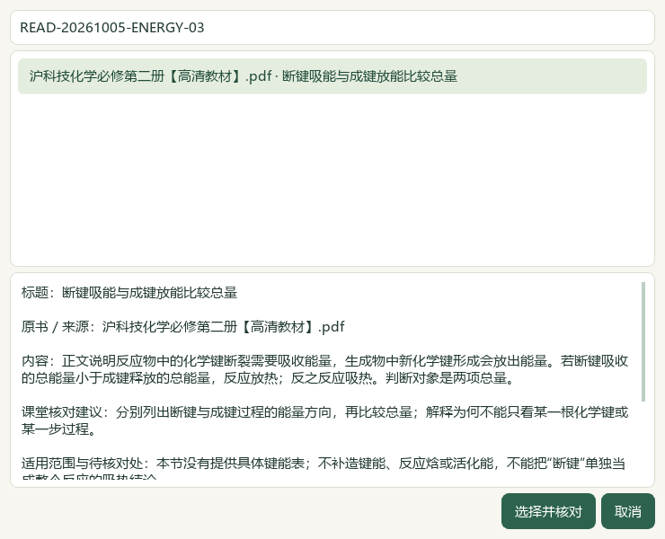
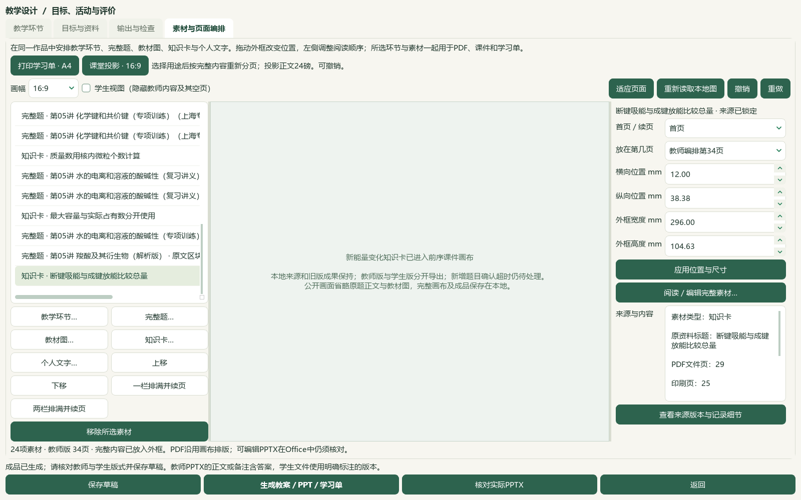
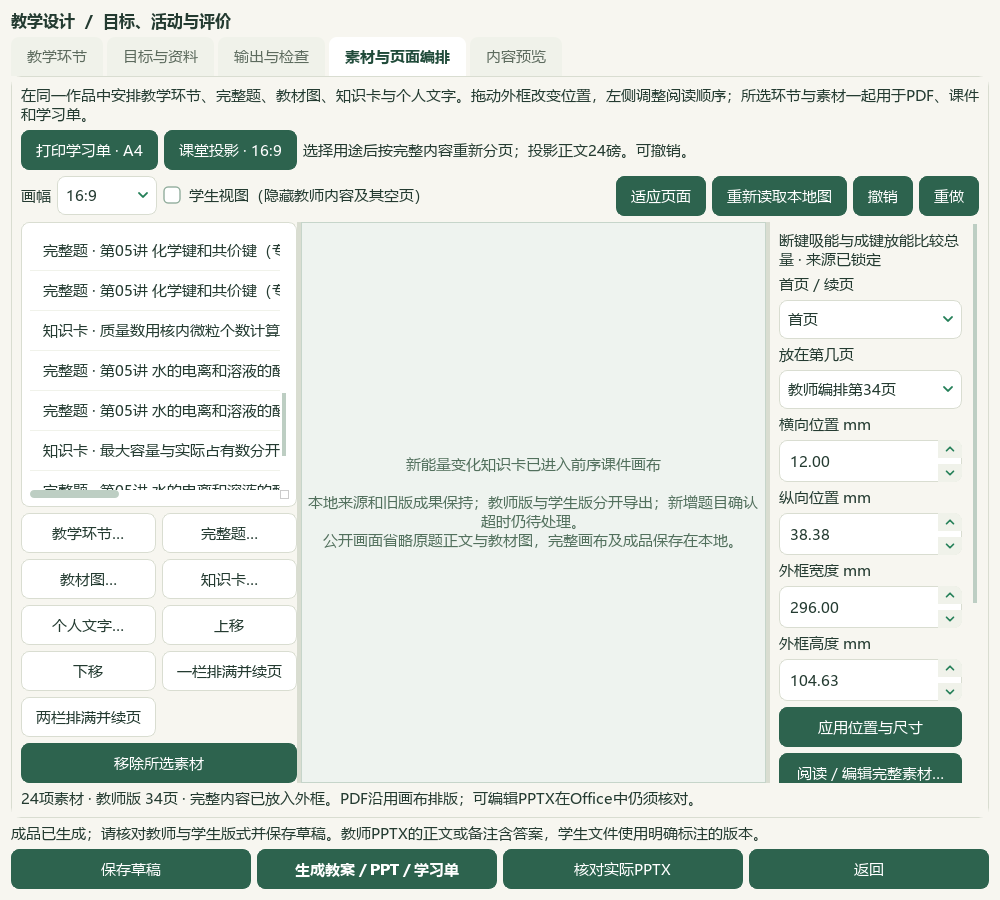

# 2026-10-05 学生版空页处理、能量变化研读与12题切片验收

本地源码与资料取得进展；完整用户目标继续。微信读书路线永久停用，旧v0.1.101包未更新。

学生视图、学生PDF和学生PPT按学生可见页输出。仅因隐藏教师答案、解析或备注形成的整页空白被略去，原本教师／学生都空的手工空页保留；教师页码和素材位置不变，切换视图不改草稿历史。教师专用素材的标题也不进入学生文档。输出审计分别记录两版页ID，渲染修订v5防止与旧成品混用；旧版保持。长题图文跨页与部分留白仍待优化。

必修二5.3《化学变化中的能量变化》PDF28—34／印刷24—30七页逐页查看，新增10条来源绑定候选；405存储／366可选／51正式节，39旧缺项保持。catalog/corpus156＝108来源＋48派生，只增1份教材候选。教材中的电池术语保留页内使用范围，不扩写为永久分类或官方题目答案。

两份羧酸讲义12题的题答与邻文已读，103次对象引用中101可读、2失败，17联系图已看；9完整原生图文读取身份，其中2题的答案范围混入下一节标题，故仅7题来源范围可补缺。7题只补5个空主知识点和5处空教材映射，非空替换0；映射只指共同的局部基础，不将陌生氨基化／重排机理冒称教材完整覆盖。选必三PDF14、17、56、57另看，PDF66—70复用前序已看且本轮哈希核验的五页。尼克酸酸碱性、Dapsone溶解性因果解释、N+表述及药物引言均单列待核；原答案不改，讲义自述年份和考区不冒充已核原试卷。

3684属性中3677其他行和9707旧历史逐字保持，新增7历史至9714；真实状态另外493文件和5本个人原书保持，重复预览0变更。主知识3112／教材映射3000，分别缺467／579。713待办＝81文字＋573图像＋56范围材料＋3保护；687完整图文阅读身份／179部分，345未尝试图像进入后续队列。98来源／3579题、3576可选及46讲1009参考、383概念、319素材、77补充栏目／60正式节保持。

实际Qt通过来源绑定选择窗口加入能量知识卡，保留前序两道已完成题及其他素材，24素材／11既有真实题。A4教师10页／学生10页，16:9教师34页／学生32页；学生省略页ID与可见页数一致，切换不写历史。旧23素材与外框在明确重排前保持；13版78登记文件另存、ZIP恢复、草稿与恢复副本逐字节一致，旧66成品保持。实际Word及PowerPoint六份转换共111页，通过30组整页联系图核读；学生答案／教师标记隔离和完整可见文字另验。7张实际UI图已看；快速画布PDF86页仅机器核对，不写成逐页视觉查看。

初次整库读取超过脚本60秒上限，失败原件与残留进程处置记录保留。重试增加有界等待和线程诊断，诊断显示原文件读取及哈希核对耗时；成功不认证整应用冷启动性能。重试准备脚本的一次缩进错误也保留，不计成产品缺陷或成功验证。完整目录第二次已读到3579题，随后图片加载阶段进程退出码为0xC0000005，根因未定。后续验证单独运行真实备课窗口并串行读取题图；成功不认证默认并发读图或整应用启动。原失败目录、进度与线程诊断均保留。串行题图验证随后完成目录、两题选择及完整参考预览，再次确认超过180秒；本片不计新增题目界面导入通过。最终只为已保存作品加入新能量卡，验证学生页、实际Office和恢复。单窗验证期间发现脚本试图深复制不可序列化的Qt排版对象，提前结束该脚本并改为只记录页面ID；这项准备脚本修正不计作产品检查。

7模块56相关检查通过，覆盖A4/A3/16:9、手工空页保留、教师标题隔离、真实两版页数、全部教师内容的学生空输出阻断及原生视图切换。旧实现7项失败和修正测试夹具后另1项原生失败分别留档，初次夹具错误不充作产品失败。完整README14项及文档策略另验，前序1053不重复算成本轮结果。

微信读书永久停用，请求／文章0；外部只核验ILO/WHO吡啶原页和DailyMed物性描述，PubChem正文未读到，不以检索摘要认证。新原卷、新题库题目、模型调用0。候选未教师人审，教学／生成／发布资格保持关闭。本片未新增视频阅读，沿用前序24抽帧、0完整播放／0音频的证据范围。下一空节为TB-M2-C6:6.1《化学反应速率》，PDF[45, 53]／印刷[41, 49]。全量资料、化学与装置图复核、复杂Word、长题跨页、整库首次打开、更多视频及语音功能、候选统一和桌面发行继续；手机端排除。总目标active，未提交发布，版本／EXE／启动器未更新。

## 学生版使用与页面图

打开素材与页面编排，勾选“学生视图（隐藏教师内容及其空页）”，核对可见页数。右侧页码仍指教师编排原页；学生页只略去因教师内容隐藏形成的空页，不将手工空页删除。生成新版本，分发student_presentation.pptx与student_canvas.pdf；旧成品不会自动改写。

## 来源与化学核对边界

教材本轮正式节TB-M2-C5:5.3，源SHA-256为92f09535689cbb1192526a7f8b4dde2254869052d8e3b6d88b8bed9d354094ce。讲义PKG046／047分别为14f08c7e8486b2bb95a13a9de457fb21e42d6682ea0fc2ea01ad6b8ddc3ec813与10d8d38163cae7c45aae382d8a81b7a94fbf866d0265f273736ecab800de3638。正文、对象、邻文、来源修订及属性前置修订一起绑定；题目最小作答层级、实测难度与教师资格不由本轮标签猜填。

[ILO/WHO ICSC0323](https://chemicalsafety.ilo.org/dyn/icsc/showcard.display?p_card_id=0323&p_lang=en&p_version=1)原文说明吡啶为弱碱。由此提出原解析“与苯环相似所以不能与酸反应”的推理疑点，是主代理判断；该页面不代替尼克酸整题的教师审核。[DailyMed Dapsone标签](https://dailymed.nlm.nih.gov/dailymed/lookup.cfm?setid=57a47368-d1f6-4d61-a2ee-c5f1fe7ff690)只支持几乎不溶于水的物性，不证明砜基疏水的单因果解释；未输出医学治疗建议。

原生完整读取样本1、3、4、5、6、8、10、11、12；其中8、10边界暂缓。仅1、3、4、5、6、11、12进入缺失字段候选，本轮3和12通过完整题窗口完成选择及参考预览，但再次确认超时，未写成成功引入作品。2、7未支持对象，9缺两个公式；可用图已看不等于完整原生范围通过。原题图片使用原对象或可信预览，未执行OLE；未声称还原整份原Word版式。

## 私有证据位置与可复核范围

私有材料根目录：`E:\项目\上海高中化学等级考\outputs\2026-10-05-energy-student-layout-slice`。这些JSON和原题／教材图不随公开源码或试用包分发。

| 文件 | 支持的范围 |
| --- | --- |
| reading-completion.json、registration-receipt.json | 七原页实读、10笔记、教材候选登记 |
| questions/root-review.json、root-image-review.json | 题答邻文、101可读对象、17联系图及未核范围 |
| questions/root-scope-acceptance-final.json | 7范围可补缺、5暂缓；化学资格未解锁 |
| questions/mapping-original-pages-viewed.json | 4新增原页与5前序冻结页，局部教材映射依据 |
| questions/label-preview.json、label-apply.json | 同一哈希计划，7题补缺、非空替换0 |
| questions/database-preservation-final.json、repeat-preview.json | 3677其他行、9707旧历史、493文件保持，重复0 |
| historical-read-identity-ledger.json、next-work.json | 687完整／179部分及下一教材／题目路径 |
| native-final-05/audience-preview-verification.json、purpose-transition.json | 两版页ID和数量、视图不写历史、用途撤销恢复 |
| native-final-05/native-verification.json、native-metadata-correction.json、actual-consumer-final.json | 原始回执保留，派生回执纠正复制脚本的不适用worker与新题答案字段；98来源目录与选题尝试另留诊断；24素材、13版78文件恢复一致 |
| native-final-05/actual-office-verification.json、root-native-visual-review.json | 实际Office页与联系图核读，区别于快速PDF机器检查 |
| composition-regression.xml、student-pages-baseline.xml、student-pages-native-baseline.xml | 56本轮通过及旧逻辑失败／夹具修复范围 |
| documentation-sync-final.json、documentation-policy-final.json、readme-tests.xml | 文档、页面图、链接、旧包边界与README14项 |
| source-review-manifest.json、full-hash-protection-final.json、root-final-acceptance.json | 源码审阅清单、2321冻结路径与本片验收 |

原始数据、前序回执、旧成品和备份不覆盖。真实状态仅缺失标签计划写7行；新作品、Office和ZIP恢复使用隔离状态，不写真实备课草稿。不能将已读取身份数或标签齐备数写成可教学、可生成或可发布数。
