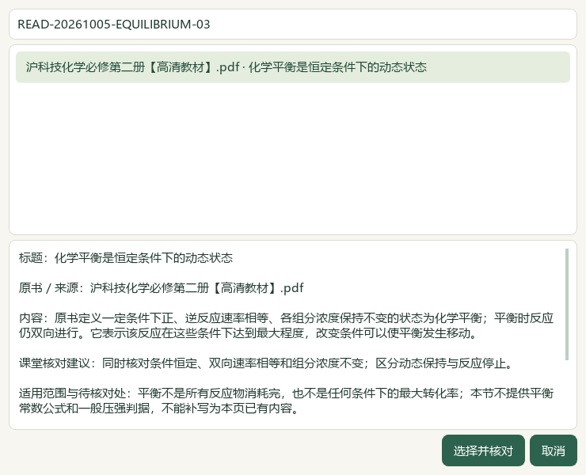
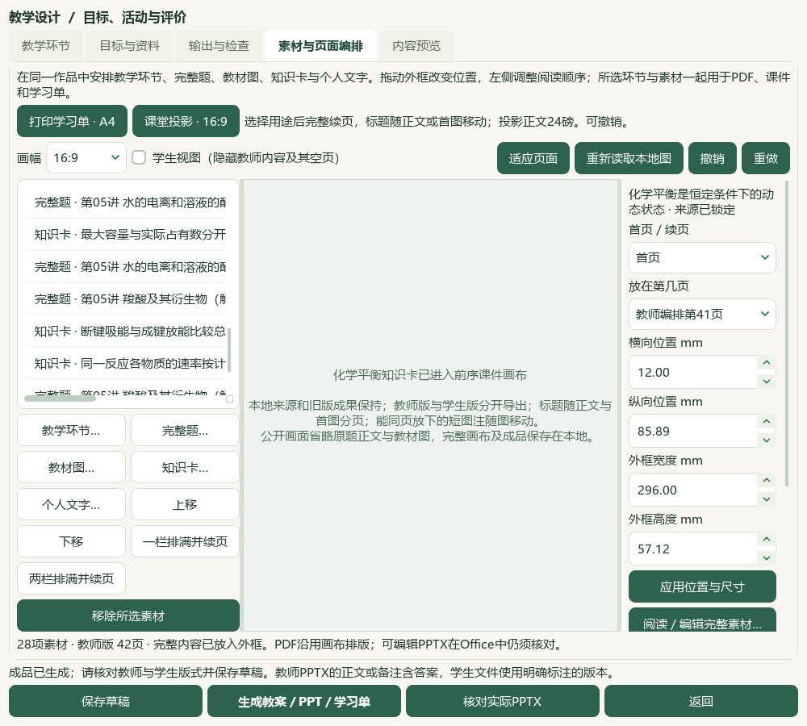

# 2026-10-05 化学平衡研读与标题、图文分页切片验收

本片取得教材与本地源码进展；前序临时验证状态例外保留，完整用户目标继续。微信读书路线停用，旧试用包未更新。

必修二6.2《化学平衡》PDF54—59／印刷50—55六原页逐页查看，新增10条来源绑定候选。保留同条件可逆、动态平衡、速率计量关系、浓度与温度影响的具体条件；FeCl3/KSCN实验保留教材表示法与对照体积，不补写空记录表和NaOH问题答案，不将教材简式冒称完整现代物种模型。SO2／O2／SO3曲线与PCl5练习只保存题设，未附解析不冒称标准答案。425存储／386可选／53正式节，39旧缺项保持；覆盖表示有可选笔记，不能等同整节教师审核。catalog/corpus158＝108来源＋50派生，只增1份教材候选。

画布自动分页让标题随正文开头的两行或首图移动；空间不足两行时保留至少首行，图像等比适配整页。单段开头和末尾尽量保留两行，能在一页放下的短相邻图注随图移动。分组依据实际排版，不推断题目依赖；超过整页的长题仍可拆页，手工较小外框可拆软分组但保留整行与整图。来源文字、图像和素材ID不改，显式用途切换或一／两栏排满才重排旧外框。渲染修订v6，旧成品按登记摘要继续可读。5项新回归在旧实现失败，修正后10相关模块82项通过；界面提示调整后其中2模块7项再验通过，不累计为89个独立案例。

实际Qt备课窗口在默认任务桥和正常事件循环中选择EQUILIBRIUM-03知识卡，加入前序27素材作品的独立副本；本片未重新读取题库目录、未从界面新选题，13道既有真实题保持。只读来源服务绑定保留的完整库存；可写备课、选择与属性状态在新的临时副本。28素材，原27素材及外框在主动重排前保持。A4教师／学生各11页；投影教师42／学生40页，学生略去2页教师内容，视图切换不改历史，用途撤销／重做恢复准确。17版102登记文件另存与ZIP恢复逐字节一致，旧90文件、草稿、恢复副本和图片保持。对比同27素材的前序实际导出与本次显式重排导出，标题独占片段4→0；本次另加1知识卡，40→42页不作为受控的页数性能对比。

实际Word教师19页／学生10页，PowerPoint投影42／40页、A4两版各11页，共133页通过35组整页联系图核看；另看7张原生UI图。联系图1480×2050，请求原尺寸显示，不称逐页原尺寸核查或教师人审。六份实际Office转换另核完整可见文字及教师答案／标记隔离；104页快速画布PDF只机器核验。仍有题干与图分页、长题答案与选项跨页、稀疏投影页、学生局部留白及Word来源附注跨页；本片不证明整题语义分组或复杂Word无损排版。

前序验证例外保持：临时辅助目录profile/desktop-state.v1.json曾被前序消费脚本写入选择暂存，改变随机修订和更新时间，未找回原字节。原异常回执、前后SHA和事故后副本保留，本片冻结事故后状态并核对保持，不能据此称历史原字节已恢复。本片真实工作台494文件、3684属性、9714历史及原Word／PDF保持，真实标签／历史写入0。当前验收使用progress_with_prior_verification_exception_preserved，当前非计划变更由最终哈希回执记录，历史例外未解除。

私有验证首次程序在知识选择已完成后读错record_id字段而退出，未算成品成功；失败脚本、独立profile与原回执保留，另建程序更正后完成全流程。准备程序stdout旧文件数78为沿用字面值，实际冻结与preparation.json核对90；profiles.json的full_source_catalog_used仅表示绑定保留的完整库存，不代表本片重新读取题库。派生更正解释这两项元数据，原件未覆盖。

713待办＝81文字＋573图像＋56范围材料＋3保护，687完整图文读取身份／179部分、345未尝试图像保持。主知识3112／教材映射3000，分别缺467／579；98来源／3579题、3576可选及46讲1009参考、383概念、319素材、77补充栏目／60正式节保持。下一空节由当前目录实际读取：TB-M2-C7:7.2《不饱和烃》PDF84—94／印刷80—90。

微信读书永久停用，本片请求、文章、外部检索、新原卷、新题库题目和模型调用均0。候选未教师人审，教学／生成／发布资格不解锁。未新增视频播放或音频核听，前序24抽帧范围保持。全量教材题目、化学与装置图、首次整库打开、复杂对象、跨页布局、更多参考视频功能与语音、候选统一和桌面发行继续；手机端排除。总目标active，未提交发布，旧v0.1.101版本／EXE／启动器未更新。

## 实际操作与页面

在“备课 → 教学环节 → 素材与页面编排”用“知识卡…”检索新平衡提示，阅读内容、双页码与适用范围，再选择加入。选择不等于教师审核。点击“打印学习单 · A4”或“课堂投影 · 16:9”，或一／两栏排满，重新分页；需要时撤销。核对学生视图、生成并打开六份成品，检查长题、图形及答案范围。

## 原件与证据范围

教材原文件《沪科技化学必修第二册【高清教材】.pdf》，SHA-256：92f09535689cbb1192526a7f8b4dde2254869052d8e3b6d88b8bed9d354094ce。六页原图均由根代理逐页查看；笔记只绑定已核原页，未作答表格与练习保持题设。牙齿材料只整理教材平衡例子，不提供医疗判断。

备课从前序已保存作品继续，本片新加入知识卡一条，既有13题继承前序来源完整范围证据；本片不新增题目阅读身份或题库导入通过。页面规则及测试不判断化学正确性、作答依赖或官方评分点。标题4→0只对同27素材的实际导出测量，完整题与图仍可能跨页。

首轮私有验证的公开知识卡图仍保留原路径，并在失败回执中说明；这里展示成功第二轮。全部实际Office与完整原生私有画布保存在本地，本页公开图使用原生界面并临时省略私有正文。题库首次整库读取、原生默认并行题图和更多陌生资料没有在本片新增认证。

资料登记validate初次达到180秒限时；原检查程序和通过的文档／README回执保留，独立重试只处理未完成的校验，最终状态见controller-validate-final.json及超时记录。耗时原因未定，不据此推断设备或防护软件原因。

冻结基线inputs-before.json中previous_goal_turn_classification的progress字段是沿用默认字面值；前序真实验收为progress_with_verification_exception。原基线不改，baseline-metadata-clarification.json明确指向前序带例外的原验收，本片从未据该字段解除历史状态异常。

## 私有验证记录

私有证据目录：`E:\项目\上海高中化学等级考\outputs\2026-10-05-equilibrium-flow-slice`。原教材页、题目及成品不随公开源码或试用包分发。

| 文件 | 支持范围 |
| --- | --- |
| reading-completion.json、registration-receipt.json | 六原页、10平衡候选、1份登记；158条总登记 |
| flow-before.xml、flow-regression-01.xml、ui-after-hint.xml | 旧实现5失败，10模块82通过；其中7案例在UI提示调整后复验 |
| flow-real-comparison.json | 同27素材标题独占4→0，新增知识卡与页数对比的限制 |
| native-consumer-02/native-verification.json、profiles.json | 实际知识卡进入作品、副本隔离、28素材／13题／17版本 |
| native-consumer-02/purpose-transition.json、audience-preview-verification.json | 两用途撤销重做、两版页数、学生内容隔离 |
| native-consumer-02/actual-office-verification.json、root-native-visual-review.json | 六份实际Office转换、133页35联系图与7原生UI；104快速PDF页只机器范围 |
| actual-consumer-final.json | 102登记文件恢复、旧90文件、图片与草稿一致 |
| consumer-failed-attempt-01.json、verification-metadata-clarifications.json | 私有程序字段错误、原元数据限制与派生更正 |
| real-state-preservation.json、current-bookshelf-final.json、next-work.json | 真实494文件保持、386可选／53正式节和既有待办 |
| documentation-sync-final.json、documentation-policy-final.json、readme-tests.xml | 文档鲜读备份、比较写入、策略及完整README14项 |
| source-review-manifest.json、full-hash-protection-final.json、root-final-acceptance.json | 当前审阅集合、冻结输入核验与有限切片验收 |

前序异常仍见2026-10-05-question-confirm-performance-slice/auxiliary-state-exception.json。原回执、冻结基线、原教材与题目、旧成品和备份保持；不以代理视觉检查、标签齐备或导出成功解锁教师审核、教学或发布资格。
