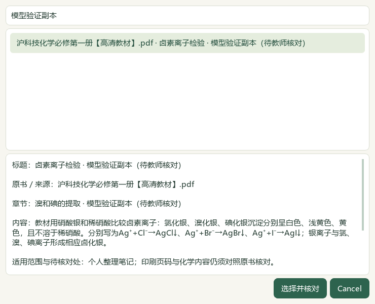
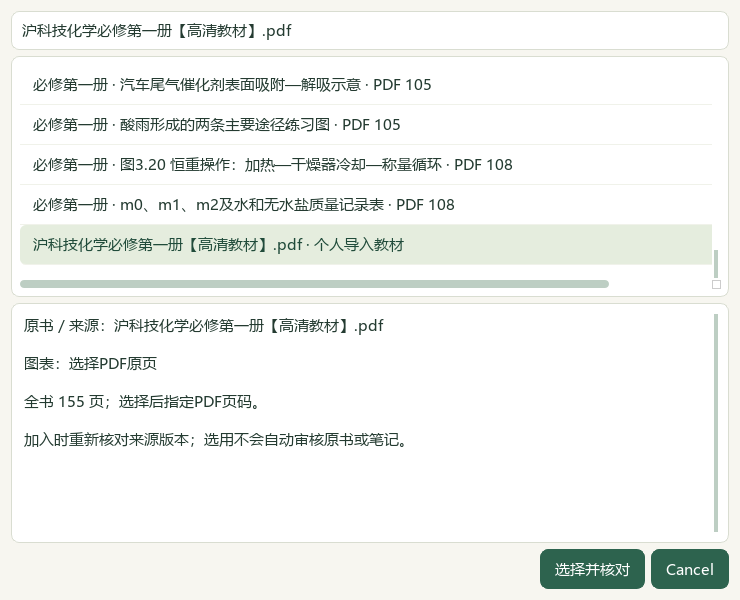
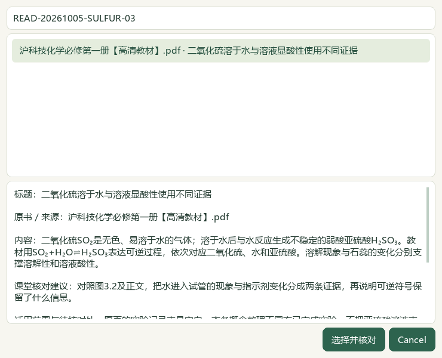
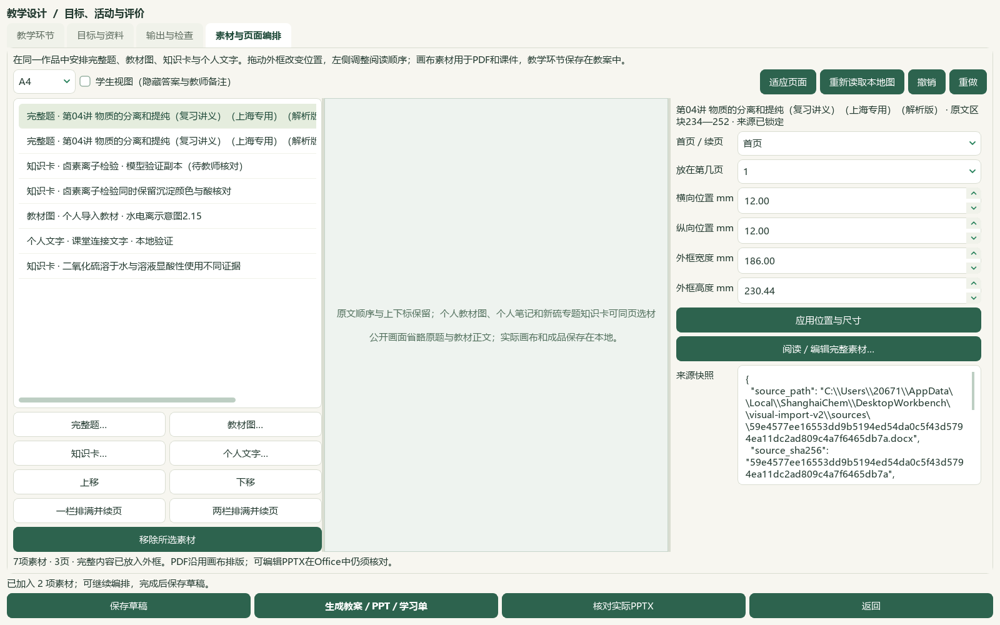
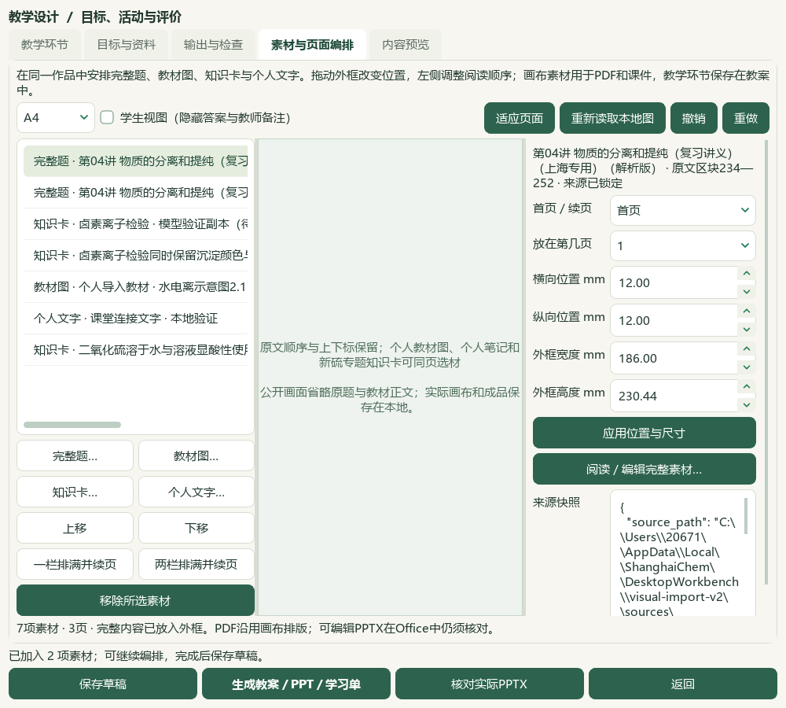

# 行内图、上下标、个人教材选材与硫专题研读

2026-10-05维护源码进展，未发布。微信读书路线按用户要求停用；本批检索关键词、公众号文章、新原卷和新增题库题目均为0。资料直接核对本地原件。上一片见[完整素材页面编排](2026-10-05-composition-integration.md)。

完整题中的已验证图片按Word原生对象顺序插回段落，保留来源尺寸和原字节；文字上下标依据实际Word格式与已支持的简单OMML操作数呈现。字面的`_{…}`、`^{…}`不会被自动解释为格式。原始完整转录、对象占位、来源摘要和封存快照继续保存，作品解锁后的修改仅影响副本。图片标记和绑定不可静默删除或替换；复杂公式、表格、浮动对象仍保留原有准入限制。

真实PDF检查发现按裁剪区绘制整段会在PDF内部重复收录文字，已改为绘制单行。长段落、复制检索、行内图、上下标、教师答案隔离通过检查。Qt字体和位置按[QTextCharFormat官方文档](https://doc.qt.io/qt-6/qtextcharformat.html)核对；这项版式检查不认证题目化学正确性。

在“素材与页面编排”中，**知识卡…**可选择已登记研读或个人教材笔记；**教材图…**可选择资料库图表或个人导入教材，后者先指定PDF文件页，再使用已有裁选窗口核对原页并确认。选择窗口展示内容、来源、页码和适用范围。个人教材印刷页未知时保持待核对，选用不自动解锁审核资格。

必修一3.1《硫及其重要化合物》PDF80—88、印刷75—83九页已逐页阅读，新增10条来源绑定候选。当前355条已存／316条可选／46正式节，39条旧缺项继续待核。原书与345条旧笔记保持。catalog/corpus151＝108来源＋43派生，只新增1份派生候选登记；原始题目、教学标签及历史记录未修改。

实际Qt验证使用既有分离提纯讲义的两道完整题，共32原文／图像块、5个行内图对象；另加入个人教材图、个人笔记、两条正式研读候选和文字，共7项、3页。个人原书使用与真实归档文件SHA一致的隔离副本，笔记在隔离状态中建立，未代填用户的真实教材笔记。保存、重开、恢复副本、四版24个登记成品另存及ZIP恢复后的字节一致；当前六份成品为教师／学生DOCX、PPTX和PDF。教师PPT正文含答案，学生使用明确标注的学生版本。

28模块415项相关回归通过；最后段落空格与上下标修正后43项相关检查通过，包含14项新增格式／个人教材用例，与前面用例重叠，不累加。第一次全套检查发现导入测试受到恢复定时器影响，已在该手动调度测试中停止无关定时器，实际恢复行为另有回归。完整README14项、文档策略与资料库验证通过，最终验收回执见下列本地目录。

主代理查看最终六页PDF、教师／学生画布、五张公开窗口及教材裁片；教材九页原图另已看。Office实际分页与字体仍未验证，本环境没有LibreOffice。复杂嵌套公式、教学环节与画布活动版式合并、剩余教材／题目、更多视频功能对齐、0.1.102候选统一和桌面发行继续；总目标active。当前代码未提交、推送、发布，旧EXE和启动器保持。

[本地验收与保护回执](E:/项目/上海高中化学等级考/outputs/2026-10-05-inline-personal-composition/root-final-acceptance.json) · [真实成品与恢复证据](E:/项目/上海高中化学等级考/outputs/2026-10-05-inline-personal-composition/native-word-final/native-verification.json) · [教材阅读证据](E:/项目/上海高中化学等级考/outputs/2026-10-05-inline-personal-composition/reading-completion.json) · [操作说明](../teacher/lesson-and-paper.md#lesson-composition)
