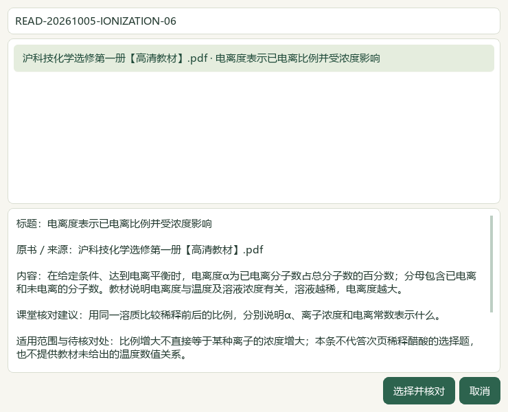
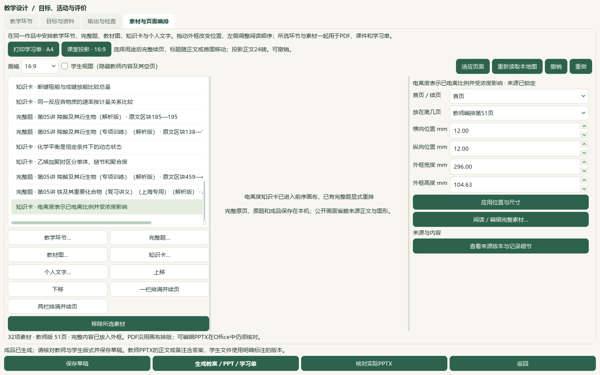

# 2026-10-05 弱电解质研读与行内图文分页切片验收

本片新增8条教材候选，并改进短题干与行内装置图分页；未新增原题、标签或阅读身份。微信读书停用。完整教材导入、界面与发行目标继续。

选择性必修一3.2《弱电解质的电离平衡》正文PDF70—73／印刷64—67及邻页69、74共6张原页逐页查看，新增8条来源绑定候选：部分电离、动态平衡、Ka／Kb、常见弱酸表、碳酸分步电离、电离度、跨页例题和练习条件。练习空白不补答案，课堂建议与原书内容分开。原书PDF71表3.3的碳酸Ka2为4.8×10⁻¹¹，PDF72正文为4.7×10⁻¹¹；保留两处、温度与页码，精确数值使用继续待核，不平均或自行改正。445存储／406可选／55个正式节有笔记，正式节共60；39条旧缺项保持，数量不代表整节审核。catalog/corpus160＝108来源＋52派生，只追加1份教材候选，原件及旧笔记保持。

页面编排改为识别富文本行内图，短导语／图注与整图按页面容量组合；首页为标题及最多3行短题干预留位置，原图字节与比例、投影正文24磅保持。学生版遇到仅能容下教师内容的短续框时，可跳到后续能够完整显示下一块的既有外框，内容游标不前移、不删内容；确实放不下仍阻断。教师Word来源附注内部保持成段。内部渲染指纹v6→v7使旧布局需重新生成；应用版本未递增，既有成品仍按登记摘要读取。

实际Qt在前序31素材／15题作品的全库存独立副本，经“知识卡…”选择电离度提示并明确确认，再主动点课堂投影重排。变为32素材／15道既有题／19版114登记文件；旧31素材及重排前外框保持，2套旧讲稿保持。本片没有重新读取完整题目目录、没有新增题目UI选择、阅读身份、标签或历史写入。真实用户494文件、3684属性行及9719历史行逐字节保持。708待办＝81文字＋568图像＋56范围材料＋3保护，693完整／185部分阅读身份及333未尝试图题，仅沿用摘要绑定的前序回执，不称本片新鲜整库统计。

实际本机Word教师22／学生12页、PowerPoint教师51／学生41页，共126页通过可用源文字及指定受众标记检查。根代理实际查看33张整页联系图和4张UI图；每张联系图最多4页全页缩略图，不冒称126张原尺寸页面逐张细读。原生课件预览仅显示教师第1页，画布PDF92页仅机器核对。本片不新增语音、音频核听或参考视频阅读。保存草稿、恢复副本及ZIP恢复载荷相同，114成品和恢复文件逐份摘要一致，原108文件、备课图片和2套讲稿保持。

乙酸乙酯装置题原区块459—468现在教师PPT47、学生PPT38同页显示标题、题干、完整装置图和选项，教师答案在48；铁与水蒸气原区块501—508现在教师49、学生39同页显示标题、题干与整图，选项仍续到教师50、学生40。长段落内图形如溴苯流程题仍题干在1、图在2；长答案、稀疏页面和学生选项续页保持。Word来源内部不拆行，但仍可与题目分处不同页；新增知识卡填入末页不算受控分页改善。历史图表活动中用户已写入的裁片说明与摘要串仍在教师22、学生19—20可见，未暗改封存正文。作品仍用于混合素材联动验证，独立教师化学审校和真实课堂可用性未完成，B04／B09仍部分完成。

首次原生验证在重排时发现学生短外框无法容下历史整图，保存／导出／备份前失败；原失败、诊断及回归XML保留，修正后在新副本重试通过。第一次重试准备又遇到C→E跨盘rename失败；无文件移动，原助手文件和失败回执保留，改为核对摘要后复制自有截图。最初排版回归的两个夹具索引错误单列；修正夹具后3个旧版排版失败，加上学生短外框1个失败均有原XML。末次11相关模块106项通过；前次105项及重叠复验不累计。文档策略与14项完整README检查另验。

启动普通status先于准备，教材登记前validate与批次结束status/validate均通过；冻结1628条选定路径，以摘要区分应用、登记和文档计划改动，不冒称本片重核整个私有档案。来源辅助466文件保持，前序临时辅助desktop-state.v1.json事故原字节仍未恢复，异常回执与事故后副本保留；当前保持不等于历史恢复。教材候选未教师人审，教学／生成／发布资格关闭。

微信读书永久停用，本片关键词、检索文章、新有效试卷、新下载、模型供应商和外部网页请求均0。下一空节按实际书架为选必一4.1《氧化还原反应》PDF91—94／印刷85—88；3.3已存在旧笔记，不重复记为空节。余下5个空节、708题目待办、教师化学和装置图核对、复杂Word／长题分页、首次完整目录打开、更多视频及语音功能、候选统一与桌面发行继续。手机端排除，总目标active；未提交、推送、发布或重建v0.1.101 EXE。

## 实际操作与画面

在“教材”选择选必一3.2，进入“研读”，用“对照提示原页”核验摘要和范围。需要直接排版时，在“备课 → 教学环节 → 素材与页面编排 → 知识卡…”选择来源绑定的电离度提示，经预览确认加入作品。明确用途后点“课堂投影 · 16:9”或“一栏排满并续页”，再核对教师与学生文件并保存草稿。详见[页面编排](../teacher/lesson-and-paper.md#lesson-composition)。本片实际选择卡为READ-20261005-IONIZATION-06，既有两道实验题沿用前序导入，未再次点击题目导入。

## 来源、保存与未完事项

原件：`E:\项目\上海高中化学等级考\课本\沪科技化学选修第一册【高清教材】.pdf`；SHA-256为79e1e8391749b01a2d9d632531615ef9b644613130e28b98279aaea71aab2b05。本片正文PDF70—73、邻页69／74；印刷正文64—67，本册偏移6。来源版本按实际文件保留，未从文件名猜年份或官方资格。Ka2差异保留PDF71／印刷65表3.3与PDF72／印刷66正文两处，精确数值使用为blocked_pending_review。

[8条研读候选](../../knowledge/textbook/reading-notes-20261005-ionization.json)均为candidate_only，human_reviewed、teaching_use_allowed、generation_allowed、publication_allowed保持false。备课联动用于操作与保存验证，不解锁课堂发布。题目保留原文、现有解析与原区块范围，实验图和化学正确性仍待独立教师核对；外省原题按真实出处保留，不冒称上海官方题。

独立本机副本保存32素材、15道既有题、19输出版本和2套旧讲稿。ZIP包含114登记文件和备课图片；原教材、原Word、完整题库和独立来源回执仍按原范围另行保存。旧登记108成品和恢复文件字节保持，末次6份新成品另存。当前页面数包含新增知识卡，不当作整体排版效率对照。原稿与实际Office页、联系图及备份位于私有目录，不上传公开来源全文。

长段落内图、续页选项、长答案、稀疏页、Word来源与资源分离，以及用户旧活动正文中的摘要串继续待处理；B04／B09仍部分完成。整库首次打开、化学审校、完整参考视频、音频核听及新版EXE验收未完成。下一空节为选必一4.1，PDF91—94／印刷85—88，同一原书摘要重新核对。

私有目录：`E:\项目\上海高中化学等级考\outputs\2026-10-05-ionization-layout-slice`。

| 记录 | 可支持的结论 |
| --- | --- |
| preparation.json、inputs-before.json、startup-qualification.json | 普通status先于准备；1628选定冻结路径；初始猜测控制器路径失败无写入后已改用规范入口 |
| reading-completion.json、current-bookshelf-final.json | 6原页模型实际核看、445存储／406可选／55节及下一实际空节 |
| registration-receipt.json | 1份派生候选，160登记，旧字节前缀保持，新原卷／新题库题0 |
| regression-before.xml、regression-before-corrected-fixture.xml | 首轮含2夹具索引错误，修正后3个旧版分页失败；原记录保留 |
| student-frame-regression-before.xml、application-tests-final.xml | 学生短外框失败复现；末次11模块106项通过，前次105项不累加 |
| native-failed-attempt-01.json、flow-diagnostics-01/、native-01/ | 首次学生图形分页失败，未完成保存／导出／备份，不算成功 |
| retry-preparation-failure-01.json、retry-preparation-helper-failed-01.py | 跨盘rename失败原记录；无文件移动，随后按摘要复制自有文件重试 |
| native-02/native-verification.json、actual-consumer-final.json | 原生知识卡选择、实际Office检查、114成品恢复、无新题目选择或整库鲜读 |
| visual-contact-manifest.json、root-manual-viewed-filenames.json、root-native-visual-review.json | 33联系图／126实际Office页及4UI模型核看；原程序root_viewed=false保留；可见改善与限制分开 |
| native-02/pdf-native-hyphen-verification.json | PDF提取连字符按原生标志核验，原来源字符未修改 |
| next-work.json | 下一空节与前序SHA绑定的708题目待办；本片未新鲜重读题目整库 |
| controller-status-final.json、controller-validate-final.json | 普通门禁；旧库存漂移与隐私范围仍以原回执为准 |
| documentation-sync-final.json、documentation-policy-final.json、readme-tests.xml | 文档鲜读、精确备份与比较写入；仅知识库化学索引行更新；文档策略与14项README检查 |
| source-review-manifest.json、full-hash-protection-final.json、root-final-acceptance.json | 当前待审公开集合、冻结范围及有界进展验收 |

前序2026-10-05-question-confirm-performance-slice/auxiliary-state-exception.json所记临时辅助原字节仍未恢复。当前466辅助文件保持只覆盖事故后状态，不能消除历史例外。未把候选写成已发布，旧试用包未更新。
