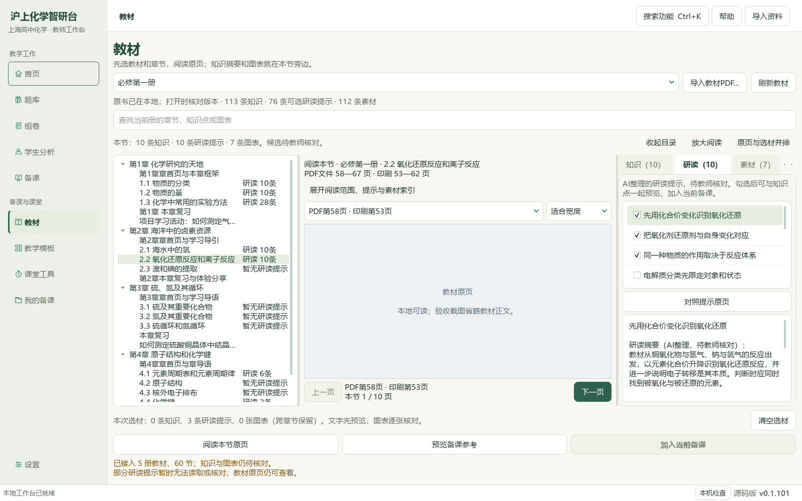
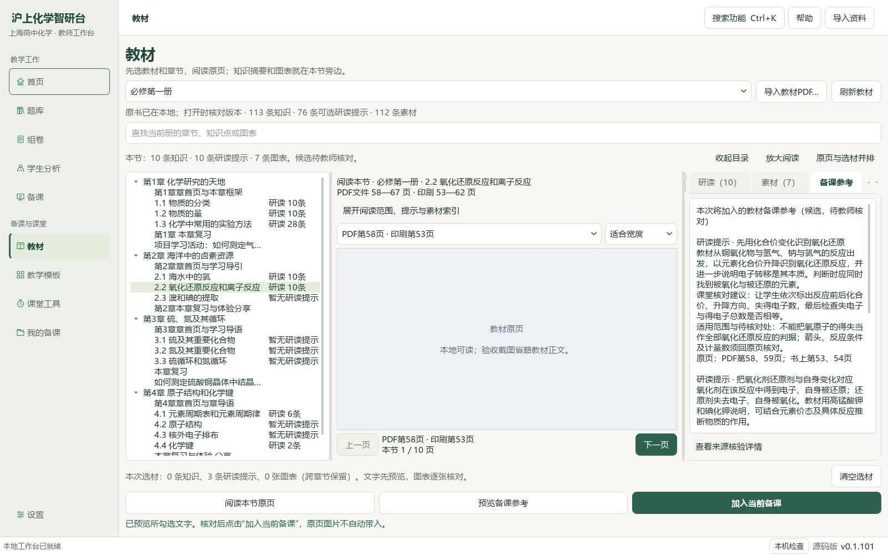
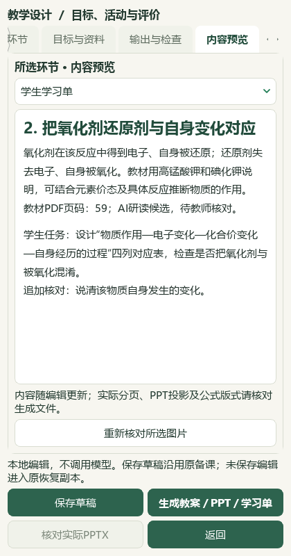
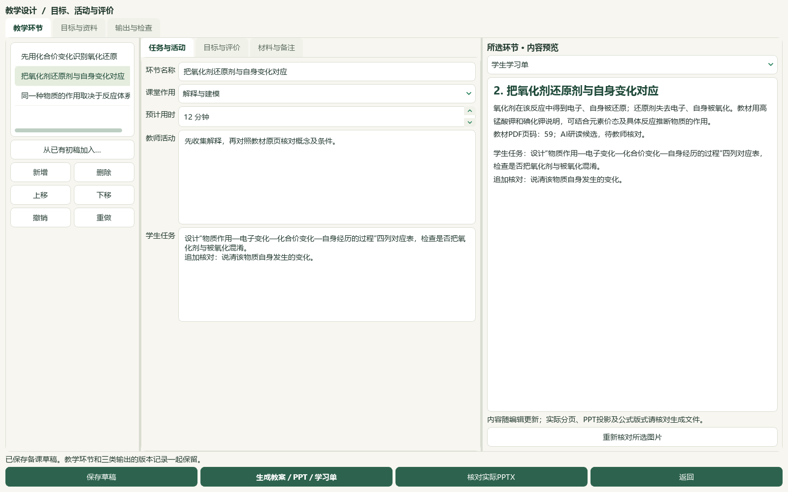

# 教学环节内容预览、氧化还原研读与题目切片验收

2026-10-05，HEAD `e08c3e778d94ac9bdb526266dc668cc9b18a5091`。这是维护源码与本地资料的进展片；未提交、未发布，桌面旧应用、v0.1.101试用包及启动器未更新。总目标继续。

## 本片结果与边界

教学环节增加“所选环节·内容预览”，宽窗同时显示环节、属性与内容；桌面窄窗移入同一“内容预览”页签。学生学习单／教师教案范围可切换，编辑即时更新、完整文字不截断，本地图片核对摘要后显示。1600、780及420宽度实际Qt窗口、排序撤销、恢复副本、保存重开和三类成品另存读回通过。教师答案只在教师文档及PPT讲者备注，未进入学生学习单或投影正文。内容预览不认证PPT版式；本环境无LibreOffice，Office实物分页仍待核。

必修一2.2《氧化还原反应和离子反应》PDF58—67／印刷53—62十页逐页核读，新增10条来源绑定候选。339存储／300可选／44正式节，39条旧笔记仍缺必要字段；原书与329旧笔记保持。真实PDF58原页和3条新提示已预览、明确加入备课并保存读回，既有课题、目标和材料保持。

分离提纯两份讲义12题题答、邻文和44/44资产已核读，8张联系图；7完整原生范围、5部分。7题仅补6个空主知识点和4处教材映射，非空替换0；另读选必三PDF56—57、115—117和必修一PDF49、56核映射范围。3684属性中3677其他行、9679旧历史保持，新增7历史至9686，重复预览0变更。原生表格／对象阻断、两题语义重复、原解析试剂及后处理疑点分别保留；非空K14疑点未自动改写。

46讲1009参考、383概念、319素材、77补充栏目和60正式节保持。catalog/corpus149＝108来源＋41派生，新增1教材候选；新增原卷、题库题目0。98分析来源／3579题／3576可选，主知识3091／教材映射2983，分别缺488／596。740待办＝81文字＋600图像＋56范围材料＋3保护；655完整／151部分，完整已读仍待办130。未完整610＝19文字＋537图像＋51范围＋3保护，其中132图像已部分读、405未尝试；行动纯文字0。373相关回归通过；本片修改1份既有应用Python、新增1模块和1测试模块。教师化学复核、全量资料、复杂Office、统一自由编排候选与桌面发行集成继续，总目标active，版本／EXE／启动器未更新，未提交发布。

按用户2026-10-05指示停用微信读书／wechat-search-weread路线，不再等待扫码、重试或配置密钥。本片该路线关键词、文章、新有效试卷均0；旧登录尝试只作历史。后续先核本地原件，需要外部依据直接读可核验原页。苯胺物态与氢气危险性另核两份ILO/WHO原卡，只支撑原解析疑点；未导入外部全文、图像或试卷，原出处与官方答案评分仍待核。

## 实际页面与备课联动

公开7图、私有原页2图已由主模型逐张核读。原页确实绘制，墨迹采样大于20；公开图仅临时遮住原页像素，未改原书。使用独立临时状态，未接入教师真实草稿或学生资料。420宽度属于桌面适配，不新增手机功能。

三环节由已选提示的改述内容手工安排，完整选材快照留在备课材料中。第一环节原页图只供教师核对，教案含1张原图、学习单0图；3页实际PPTX正文无教师答案，教师答案留在讲者备注。三份导出副本与登记原版本SHA逐一一致。该内部验收不解锁候选的教学、生成、官方或发布资格，也不认证整书、图形或化学全部正确。

## 题目证据与未解锁项

12题取自PKG-038/039分离提纯讲义，两份原Word与原摘要版本保留。7题原生范围完整，5题因表格或旧对象兼容性保留阻断；资产全部可见不等于整题布局完整。已有非空标签保持；苯甲酸重结晶题旧K14、两处重复除杂题、茉莉醛流程KOH与解析NaOH不一致及乙醇作用推断分别待核，不按题名或答案命中修改。

苯胺后处理解析写为过滤／重结晶，需另核。原卡确认苯胺为液体、熔点−6℃；这仅支持室温物态疑点，不能替代后处理方案。[ILO/WHO ICSC 0011](https://chemicalsafety.ilo.org/dyn/icsc/showcard.display?p_card_id=0011&p_lang=en)。氢气原卡明确气体与空气可形成爆炸性混合物；据此保留原解析排空气解释的安全疑点，未给出已验证的实验操作。[ILO/WHO ICSC 0001](https://inchem.org/documents/icsc/icsc/eics0001.htm)。首次动态氢气原页502，另开原卡成功；搜索摘要没有替代原页。

缺少可核验的原始卷件、原出处、官方答案评分与化学教师复核；年份、学校和难度没有补猜。新增原卷、题库题目、学生记录、正式最小作答单元均0。7行标签仅填空字段，保留来源／题目／版本守卫；3677其他属性和9679旧历史逐条保持，新历史7，二次预览0变更。

## 参考、验证与继续路线

本片实际查看V28、V30两张来源绑定视频联系图，对照内容导航和教案表单。44视频264帧的旧盘点属于抽样，不是完整74分43秒观看证明。本片先补所选环节内容核对，统一自由编排、两道完整题与个人材料同一画布的候选仍待集成；B01保持部分完成。

373项相关回归通过，覆盖教材阅读选材、环节预览、恢复、备份、导入和标签守卫；预览专项13项含DOCX范围一致性。完整14项README检查、文档策略、资料控制器及全量冻结哈希由最终回执核对。初次测试的Qt旧文档生命周期、样例可见范围和不存在的图片辅助导入已修复；失败回执保留。真实导出初次检查因PPT自动换行造成严格子串断言失败，后续保留DOCX精确文字核对、仅忽略PPT文本空白比较；未缩短材料、未重跑数据库事务或成品生成。

私有回执与成品在 `E:/项目/上海高中化学等级考/outputs/2026-10-05-lesson-preview-redox-slice`：`root-visual-review.json`、`lesson-native-verification.json`、`questions/database-preservation-final.json`、`registration-receipt.json`、`related-tests-final.xml`、`documentation-policy-final.json`、`readme-tests.xml`、`full-hash-protection-final.json`、`source-review-manifest.json`、`root-final-acceptance.json`。原书／题目／个人状态与私有截图不写入公开补丁。

下一教材切片：必修一2.3《溴和碘的提取》PDF68—73。题目继续从排除655完整与151部分身份后的405个未尝试图像任务中选择。全量教材题目、复杂Office、人审、更多视频UI及源码到桌面发行交付继续，微信读书路线退出前置条件。

[教师操作](../teacher/lesson-and-paper.md#lesson-content-preview) · [当前闭环](../WORKFLOW_STATUS.md) · [任务表](../roadmaps/audit-followup.md) · [主指南](../../README.md)
