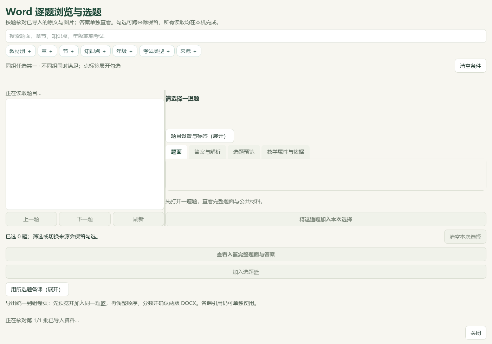
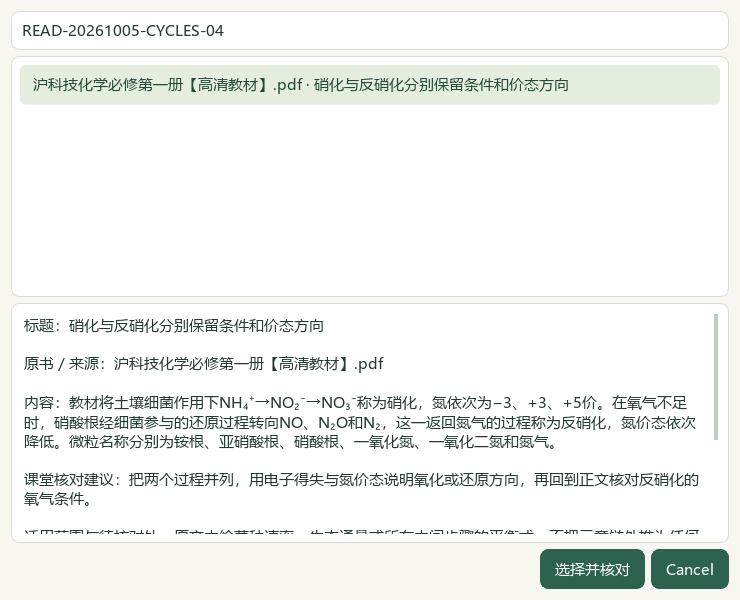
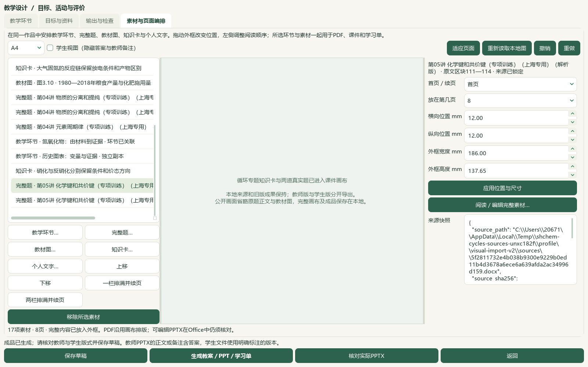

# 整库读取进度、硫氮循环研读与12题切片

2026-10-05维护源码及本地资料增量。发行基线仍为v0.1.101，工作区HEAD为`e08c3e7`；未递增版本、重建EXE、修改启动器、提交或发布。总目标保持active，本片是可复核的局部进展。

## 结果与实际操作

打开Word逐题窗口后，会显示批次、来源和题数核对进度，再提供完整目录。关闭窗口会请求停止读取；已经关闭或被新任务替代的窗口不再接收旧进度和结果。目录复用只读缓存树，返回的题目和公开来源副本仍独立；每次读取继续核对原文件与范围，不使用来源子集代替整库。

过滤题目时暂停重复绘制，完成或异常后恢复原来的信号、绘制状态。试用的分批列表布局会使远处题目滚动定位失败，已撤掉；题目高度、筛选规则、顺序与来源保留。三个应用模块改变：`desktop_word_questions.py`、`desktop_facade.py`、`desktop_workbench/word_question_dialog.py`。新增7项缓存隔离、来源变动、取消、旧任务结果、绘制恢复和3500题列表定位测试；既有图片测试改为使用实际48张上限常量，产品容量未修改。

## 性能证据及范围

同一隔离状态目录使用真实98份来源、3579道题；整库返回内容指纹一致，搜索“硫”均为736题。以下记录使用已有本地预览缓存，没有清理操作系统缓存。就绪时间取完整目录进入窗口状态的时刻，不等于全应用冷启动或列表全部绘制耗时。

| 原生测量 | 目录工作线程 | 目录进入窗口 | 完整目录就绪 | 搜索“硫” | 最大事件计时间隔 |
| --- | ---: | ---: | ---: | ---: | ---: |
| 修改前before03 | 17.469秒 | 3.562秒 | 21.297秒 | 13.094秒 | 3.625秒 |
| 修改前before04 | 11.422秒 | 1.953秒 | 13.578秒 | 9.578秒 | 1.984秒 |
| 过渡分批布局after02 | 7.765秒 | 0.907秒 | 8.734秒 | 3.235秒 | 0.953秒 |
| 过渡分批布局after03 | 11.735秒 | 1.219秒 | 13.046秒 | 5.328秒 | 1.266秒 |

| 最终源码after04 | 9.984秒 | 1.796秒 | 11.860秒 | 8.844秒 | 1.828秒 |

过渡分批布局已撤掉，其after02/03数字只留作历史对照，不用于最终速度承诺。after03与相关回归并行运行，有CPU竞争；最终after04在重跑回归前取得。其余测量条件与运行负载也有波动，不据这几次测量承诺固定耗时或稳定p95。使用cProfile的两次前置诊断超时，仅留作诊断，不进入有效计时样本。私有即时抓图没有等待长列表完成绘制；撤掉分批布局后另以正常Qt事件等待核对首行与目标行，不能把额外等待并入原性能数字。真实状态只读目录测量16.812秒另存回执。

## 本地教材新增内容

必修一3.3《硫循环和氮循环》PDF96—103、印刷91—98共8页实际渲染并逐页查看，新增10条自己改述的来源绑定候选：硫的储库、自然和人为迁移、固氮、硝化与反硝化、酸雨判断与路径、NOₓ区别、防治证据及教材示例。物质名称、氧化态、箭头、反应条件和模型适用范围保留；不补教材习题答案，不把历史资料推为现行政策或工程效果。

候选文件为`knowledge/textbook/reading-notes-20261005-cycles.json`，CODE与本地DATA副本一致；原书SHA-256为`a565f0a15ffd10c704f4be42bfe7200c125b68959d11ef582acdc45dde2ccf22`。375条存储笔记中336条可选，48个正式节有可选提示，39条旧缺项保留待核；60正式节、77补充栏目保持。catalog/corpus153＝108原始来源＋45派生，只增1份教材候选登记。

## 12道题的原件核对与补缺

PKG041—044四份本地Word讲义的12个来源题目身份，题面、答案及邻文逐一读回；47处资产中42处可读，5处严格渲染失败，7张联系图已查看。6题技术范围闭合、6题部分；“技术范围闭合”不表示化学答案、官方出处或教师审核通过。

| 原题内容 | 本片处理 |
| --- | --- |
| 第一电离能曲线 | 原生绘图布局不支持，答案范围含后续装饰标题；保留部分状态 |
| Mg/Al/Si/Mn/Cu合金 | 补空主知识点K12，原教材映射保留 |
| 两份讲义收录的环状碳酸酯σ键题 | 保留各自来源身份及原K13，仅补空映射至选必二2.1；原题“分了”和键数单位疑点待核 |
| 咪唑鎓离子液体σ键 | 补空K13及选必二2.1映射；区分待计数阳离子与BF₄⁻、Cl⁻图像 |
| σ/π分子表格 | 模型图可读，原生表格不支持；不补标签 |
| 石灰氮、氨基氰及尿素 | 补空K13；原必修一4.4映射保留，不因肥料情境强行映射氮循环 |
| 水杨酸几何 | 补空K13，原映射保留；原解析把120度印为℃及角度近似待核 |
| 药物结构题 | 图像可读但绘图布局不支持；不补标签，不形成用药建议 |
| 水电离平衡、温度K_w表格、液氨自偶电离 | 旧公式、表格或对象同一性有缺口；不以推算符号填补原件 |

映射另查看选必二2.1 PDF35—38原页，σ/π依据在PDF36—37。6题只补4个空主知识点、3处空教材映射，非空替换0。预览计划指纹`b0c8839f849a64a37d944f371e31da5b39ec42edb71607cfae30cc6d6029c354`只应用一次，重复预览0变更。3684属性中3678其他行及9694旧历史保持；新增6历史至9700，真实状态另外493文件保持。

98分析来源、3579题、3576可选保持；主知识3102／教材映射2988，分别缺477／591。727待办＝81文字＋587图像＋56范围材料＋3保护；670完整阅读身份、160部分，132完整已读仍待办。未读图像522中141已部分读、381未尝试；19未完整纯文字均已部分读，行动纯文字0。全国和外省来源继续按内容整理，不冒充上海原题。

## 原生选材、输出与恢复

沿用前序隔离备课副本，增加本次硝化／反硝化知识卡和两道真实完整题，共17素材、8页、7道真实题。实际Qt窗口完成勾选、预览、确认；Word窗口读取全部98来源、3579题，未限定来源子集。题目窗口使用单独的标准`DesktopTaskBridge`；整应用共享任务池首次打开仍未认证。

保留旧14素材的内容与位置、旧42份成品原字节；新增一版教师／学生DOCX、PPTX、PDF共六份文件，8版48登记文件另存及ZIP恢复逐文件一致。草稿、恢复副本、图像字节与恢复后作品一致。六份内容读回、教师答案隔离通过；主代理查看两版16页实际PDF、3张私有原生画面及4张公开画面。PDF文字与结构图可读，部分页面留白；可编辑Office文件的实际字体、投影与物理分页仍未核验。

[窄窗画面](screenshots/2026-10-05-library-startup-cycles-slice/04-native-canvas-1000-03.png)。来源检查栏中Word素材仍显示原始JSON，阅读器标题仍可能包含对象占位，知识选择窗口仍有英文Cancel；这些可用性差距继续处理，不据此宣称全部视频UI已对齐。

## 验证与后续

46个相关模块最终850项通过；首次发现的旧图片上限断言和无进度调用包装兼容问题已修复。完整README14项、文档策略、AST、Git差异集合、冻结文件和资料登记在最终回执中核对，不与前序或重复测试相加。所有检验及原件图像留在本地`outputs/2026-10-05-library-startup-cycles-slice`，公开审查集合只含源码、测试、自己改述的知识候选、文档及已处理的界面图。

按用户指示停用微信读书，关键词、检索文章、新有效试卷、模型调用均0；新增原卷、题库题目0。本地转载的原出处、原卷、官方答案及评分细则继续待核。候选的`human_reviewed`、教学、生成和发布资格保持关闭。本片未新增视频阅读记录，沿用前序依据，不宣称完整播放。

下一教材空节为必修一4.2《原子结构》PDF124—131、印刷119—126；4.1已有笔记。剩余教材、381个未尝试图像身份、化学与装置图审核、复杂Word、实际Office、整应用首次打开、更多参考视频功能、0.1.102候选统一及桌面发行继续。手机端按用户要求排除，总目标继续active。
