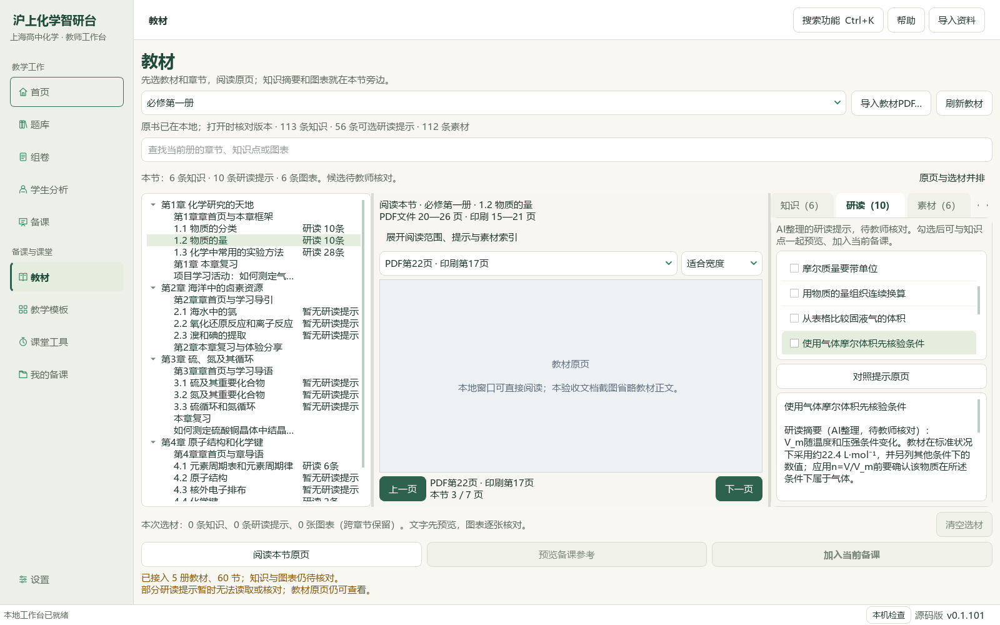
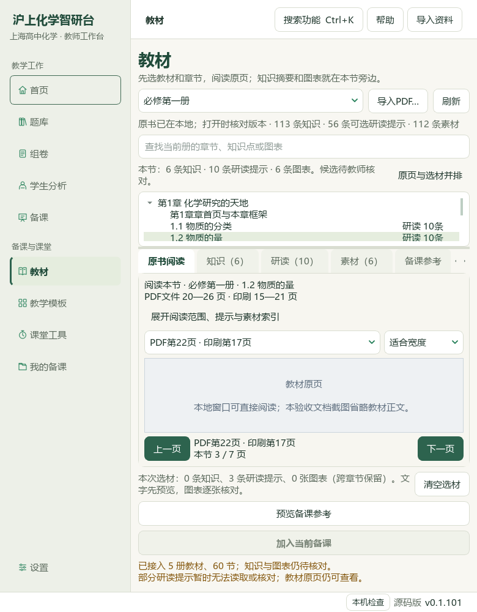
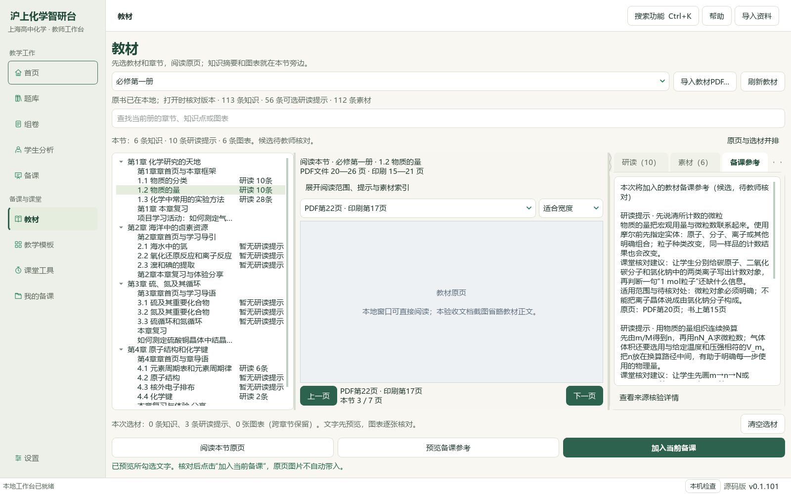
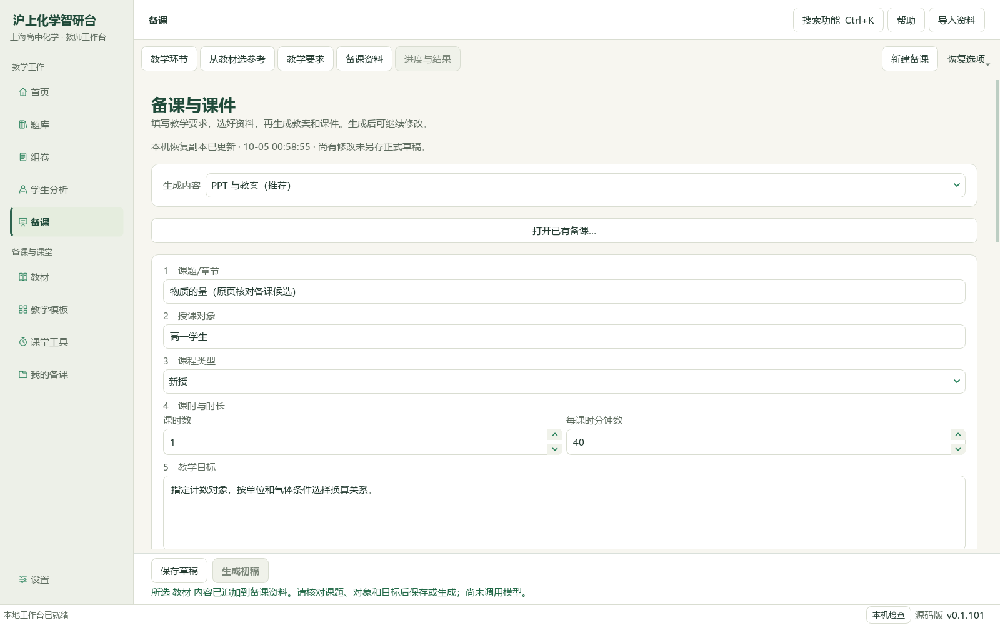
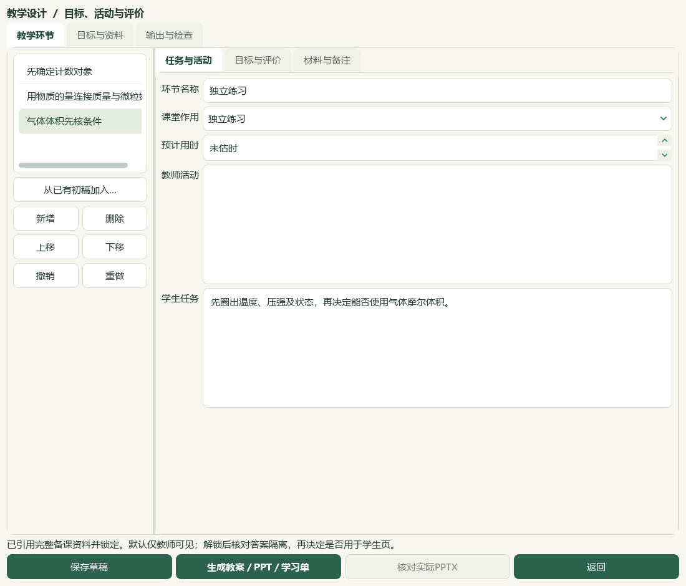

# 物质的量教材研读与醛酮图像题切片

2026-10-05，本地资料候选增量，未发布。

必修一1.2《物质的量》PDF20—26／印刷15—21七页已逐页核读，新增10条来源绑定研读提示；319条存储笔记中280条可选，42个正式节有可选提示，39条缺必要字段继续保留待核。新提示实际进入原页并排阅读、预览与明确加入当前备课；既有教师表单保持，隔离草稿保存读回。生成三环节教案、PPT和学生学习单候选，三文件内容读回、教师答案隔离通过；Office实物版面和教师化学复核仍未完成。

醛酮两份解析讲义的12题文字、95/97图像公式、16联系图及2幅放大原图已核读；9完整原生读题、3部分。7题补7个空主知识点与3处空教材映射，非空替换0；映射另对照选必三3.2 PDF59—65／印刷55—61。串题范围、原生表格、2处不可读资产继续阻断；O₂/臭氧图文冲突和用途表述冲突留待复核。3684属性中仅7计划行改变，3677其他行及9668旧历史保持，新历史7至9675，重复预览0变更。

46讲1009参考（386K/273M/246P/104F）、383概念、319素材、77补充栏目与60正式节保持；catalog/corpus147＝108来源＋39派生，本片只新增1份教材研读派生登记，原卷、题库题目新增均0。98分析来源／3579题／3576可选，主知识3082、教材映射2978，分别缺497／601；749待办＝81文字＋609图像＋56范围材料＋3保护。642完整／140部分；完整已读待办126。未完整623＝19文字＋550图像＋51范围＋3保护，121图像已部分读、429未尝试，行动纯文字0。微信读书页面可打开但需本人扫码登录；首页提交物质的量关键词只出现电子书，公众号轮次0、文章数无法确认、链接/全文/新有效试卷0。源码功能沿用上一片并排布局，本片应用源码改动0；桌面旧应用及EXE未升级，未提交发布，总目标active。

## 操作与实际画面

在“教材”选择必修第一册1.2 → 研读 → 对照提示原页。勾选所需提示，先预览、明确加入当前备课，再到教学环节绑定并修改。已有课题、对象、目标与材料保留。示例三环节只演示联动；教师仍需补课堂活动、时长和评价。窄窗原页显示高度有限，可滚动和缩放，布局仍有继续优化空间。

下面为实际维护源码窗口及隔离示例状态；公开截图在控件层省略教材正文，真实PDF像素另存在私有验收目录，均已目视核对。

## 输入、输出与保全

输入沿用两份本地醛酮解析讲义和已登记教材SHA。原出处、原卷、权威性与官方评分未独立核验；外省题保持自身来源标注，没有改作上海原题。新增阅读提示保存到源码和E:/项目/上海高中化学等级考/knowledge/textbook/reading-notes-20261005-mole.json；派生候选登记同步catalog.csv与corpus_manifest.jsonl，旧146行字节前缀保持，来源层108行不变。本片没有新增原卷或原题，不对全库语义去重另作结论。实际原子四层关系、题型、难度和教师审核未由补标解锁。

私有完整任务账位于E:/项目/上海高中化学等级考/outputs/2026-10-05-mole-textbook-question-slice。备课候选示例目录含lesson_plan.docx、lesson_presentation.pptx、student_worksheet.docx；正文与来源读回通过，教师答案留在教师教案和演示备注，未进入学生正文。未完成Office实际版面复核，不作为课堂或发行成品。

## 检查与边界

新增10提示逐条经过实际消费者校验，旧笔记字段没有猜补；原页、预览、明确选材、草稿读回及三份输出均有回执。7标签行逐字段比较、全部旧历史保全，重复预览0变更。当前原生读题台账633旧身份加9新身份等于642；复制时继承的表头已单独核正，原身份前缀不变。最终文件SHA、完整README测试、文档策略和登记控制器检查见root-final-acceptance.json。上一片应用源码与相关211回归证据沿用；本片应用Python改动0。

首次保护读取未完成即被停止，重新定位显示文件读取很慢，随后完整冻结；截图验证脚本的彩色测试页判据及过早采样均已修正，失败尝试不计通过。原Word、教材与5本个人书保持，真实个人状态只允许计划属性库变动；示例使用临时隔离状态，没有调用模型。用户BDL V10/V28/V30/V32的上一片抽帧参考沿用，本片没有增加视频观看声明；手机端按用户要求不在范围。

微信读书入口可打开，但公众号操作等待本人扫码；已计划未提交的关键词为“上海 高中化学 物质的量 教学”“上海 等级考 化学 醛和酮 专项解析”。公众号文章数无法确认、有效试卷0、文章直链0；全文、原出处、官方评分继续缺失。未绕过登录、未写入占位密钥。后续从429未尝试图像身份以及必修一2.1页段继续。全量教材、剩余题目、原生图形/Office、更多视频UI与桌面发行集成尚未完成。
