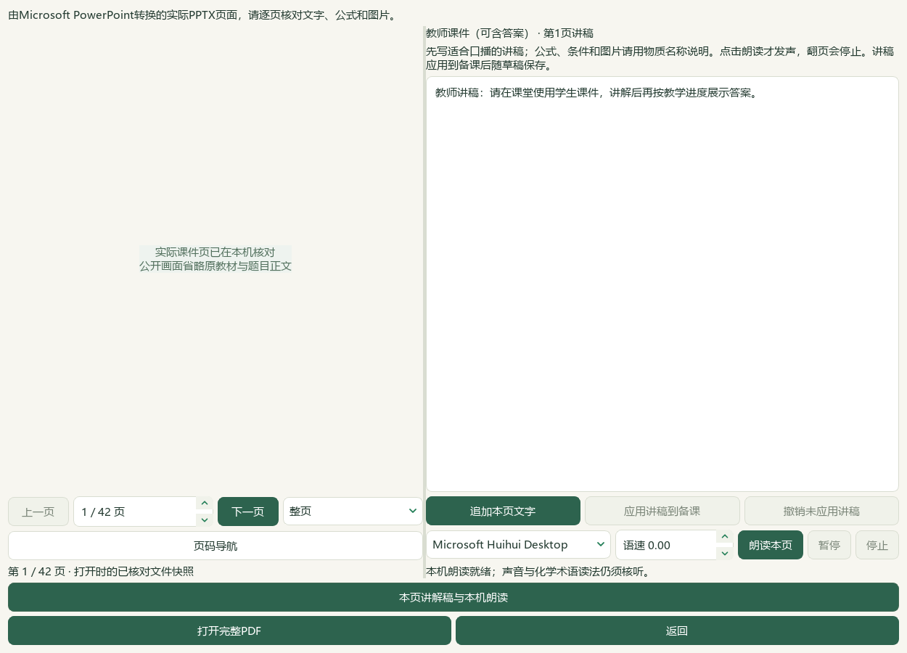

# 2026-10-05 实际课件逐页讲稿与本机朗读切片验收

本片接通课件与逐页讲稿的本地工作流；完整用户目标继续。资料数量保持，微信读书停用，旧试用包未更新。

实际PPTX预览增加逐页讲稿与本机SAPI朗读。输出与检查可选择学生或教师课件，默认优先学生；教师课件明确标为可含答案。讲稿分别绑定登记成品、原PPTX摘要与本次实际转换页数，另一版或不同页数不串用。可追加当前已显示页的可提取文字，保留已写内容；图片不作OCR或化学推断。教师明确点击才朗读，支持暂停、继续、停止、声音与语速调整；翻页、改稿、换声音或关闭停止，旧任务晚到回调不写入新页。缺少本机声音时仍可编辑保存。

宽窗左右对照实际页与讲稿；800像素桌面窄窗上下排列，默认收起缩略导航，需要时展开，当前页和讲稿保持。应用或正常返回时把有效讲稿写入原备课设计，再保存草稿；未应用且窗口异常退出的输入不保证恢复。应用后的讲稿随原恢复副本和备课ZIP保留；恢复成品仍需勾选包含任务与成品。讲稿编辑不改PPTX或使正文内容过期；PPT正文或版式改动后须重新生成并核对新版本。尚无音频文件导出、配音HTML、自动整套配音或独立学生屏。

5相关模块73案例通过；语速提示补充后其中20案例再验，不累计为93个独立案例。首轮71通过／1夹具错误的原XML保留，补入窗口夹具后独立19案例通过，随后新增可读版面对照案例并重验73。实际Qt从前序作品的独立副本选择学生PPT、教师PPT，再重开学生PPT；本机PowerPoint转换对应40／42页，按需显示与提字；本片仅对学生第1、2页和教师第1页的UI进行视觉核对，前序133页联系图记录保持，不冒称本片重看全部82页。SAPI的Speaking、Paused、Ready及翻页停止在音量0下核验；声音为Microsoft Huihui Desktop，不证明音频质量、化学读音或真人核听。

28素材／13道既有真实题／17版102登记文件保持，另存讲稿2套。原设计除讲稿字段逐项一致，保存草稿、恢复副本与ZIP恢复载荷相同，102份原成品和恢复文件摘要逐份复核一致，图片保持。本片不新增教材候选、题库题、标签、阅读身份或UI选题通过。当前书架鲜读425存储／386可选／53正式节，正式节共60；39旧缺项保持。catalog/corpus仍158＝108来源＋50派生。713待办、345未尝试图像及98来源／3579题清单沿用摘要保持的前序回执，本片未重读题目整库。下一空节仍TB-M2-C7:7.2《不饱和烃》PDF84—94／印刷80—90，原书摘要重新核对，本片未读这些页。

参考V28原MP4摘要和6抽帧联系图已重新核对；复用已存抽帧，无新增完整视频观看或音频核听。打开作者语音课件原文，支持其Markdown、HTML、讲稿、音频分阶段的工作流描述；动画原文本轮超时，正文不计已读。微信读书请求、检索文章、新试卷与下载均0，本地应用模型调用0；外部原文打开尝试2次、1次失败，不承诺全部过程零外传。

初次公开UI截取在调整窗口时重显原页缩略图，3张原图已移入私有证据；其后6张旧布局／语速提示前公开截取也保留私有。最终3张公开图隐藏原页及缩略图，实际控件与自写讲稿保留；另3张私有实际页图已由根代理看过。native-01的root_viewed_pages原字段是验证程序自动记录的显示页号，实际模型图像核对由独立视觉回执记录，原件未改写。

前序临时辅助profile/desktop-state.v1.json事故原字节仍未找回；原异常回执、前后摘要和事故后副本保持，本片不会把事故后字节保持写成历史恢复。真实用户494文件、3684属性、9714历史逐字节保持，标签和历史写入0。本片冻结1129条选定路径，只覆盖前序336公开审阅文件、真实状态、102旧成品及恢复文件、关键回执、登记和笔记，不冒称重新散列整个私有档案；最终非计划变更由哈希回执记录。

完整教材与讲义／题目导入、化学与装置图审核、首次整库打开、复杂Word和长题跨页、更多视频功能、可保存音频与交互组件、候选统一和桌面发行继续。手机端排除。候选不解锁教师审核、教学或发布资格；总目标active，未提交发布，旧v0.1.101版本／EXE／启动器未更新。

## 实际操作与页面

在“输出与检查”选择学生或教师课件，打开“核对实际PPTX → 本页讲解稿与本机朗读”。填写或明确追加本页可提取文字，核对并应用，返回保存草稿。操作细节见[逐页讲稿](../teacher/lesson-and-paper.md#lesson-narration)。

## 参考与证据边界

作者[语音讲解课件原文](https://developer.volcengine.com/articles/7563928277170323502)支持其分阶段工作流；本地实现依据实际PPTX页保存教师自写讲稿，并用本机声音朗读，不据此认定其收费工作流已复现或备课效率提高10倍。[动画课件原文](https://developer.volcengine.com/articles/7574419762412388395)本片访问超时，未新增正文核验。

V28原MP4 SHA-256：dbeb9199d6fb3595ab9249452d420354dc59b5cc1a43d4ceac32a077d1adc559；6帧联系图SHA-256：c3cb1df3050362023213ce538522efa3525716a524dadaed88dd941ae9043654。6帧复看只支持页面导航、输入与下载等可见操作；没有新增视频听音或连续播放证据。静音SAPI验证只证明本机状态转换和停止，不证明完整配音音质。

备课ZIP纳入已应用讲稿与登记成品；原Word、完整题库、正式原教材、Office和本机声音依赖仍按各自范围另行保存。恢复需用支持逐页讲稿的维护源码。运行完成、标签齐备或模型看图不替代独立教师化学审核。

## 私有验证记录

私有目录：`E:\项目\上海高中化学等级考\outputs\2026-10-05-narration-workflow-slice`。原题、教材页、成品和备份不随公开源码分发。

| 文件 | 支持范围 |
| --- | --- |
| preparation.json、inputs-before.json | 前序进展分类、1129选定路径、本片任务范围；旧事故未解除 |
| narration-regression-01.xml—04.xml、regression-summary.json | 原夹具错误、19单模块补验、5模块73通过、语速提示后20复验 |
| native-01/native-verification.json、actual-consumer-final.json | 实际两版PPT预览、静音SAPI、2套讲稿与102成品保存恢复 |
| capture-review-02.json—04.json、root-native-visual-review.json | 早期截取私有保留、当前3公开与3私有图的实际模型核看、自动页号字段的范围澄清 |
| reference-evidence.json | V28原片摘要与6复用抽帧，原文1成功／1超时，无完整音频核听 |
| real-state-preservation.json、current-bookshelf-final.json | 真实494文件保持、书架386可选／53节、158登记及下一空節 |
| controller-status-final.json、controller-validate-final.json | 普通任务门禁；既有隐私保护与旧快照漂移警告保持，不等于扫描完整私有工作区 |
| documentation-sync-final.json、documentation-policy-final.json、readme-tests.xml | 鲜读、备份与比较写入；文档策略和完整README检查 |
| source-review-manifest.json、full-hash-protection-final.json、root-final-acceptance.json | 全部待审公开源码集合、当前冻结范围及有界切片验收 |

前序异常见2026-10-05-question-confirm-performance-slice/auxiliary-state-exception.json，原字节仍未恢复。登记校验保留旧锁定分母、隐私保护跳过旧全私有扫描和公开库存漂移警告，不以machine pass认定资料全部完成。
