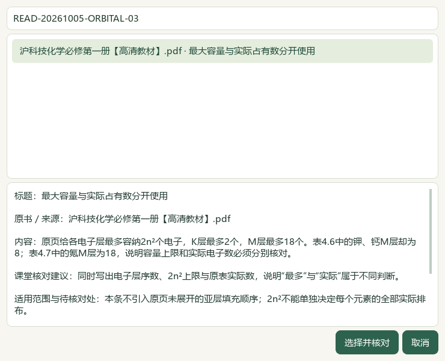
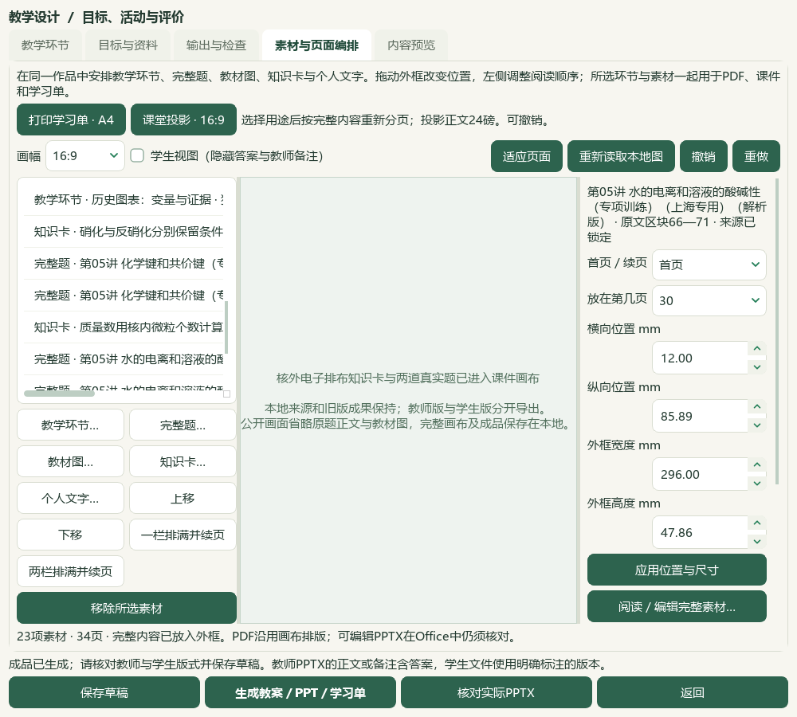

# 2026-10-05 打印／投影分离、核外电子排布研读与题目切片验收

本片为总目标中的可复核进展，当前维护源码及资料未发布。微信读书路线已按用户指示永久停用，本地整理继续按原件核验。

素材编排增加“打印学习单 · A4”和“课堂投影 · 16:9”入口。明确切换用途后按完整内容重新分页，一次撤销／重做能恢复对应编排；旧20素材和外框在主动切换前逐项保持。投影正文按32px即24磅测量换行，标题28.5磅，原始行内图随正文等比放大，原图字节与来源快照保持。A4/A3继续使用打印字号。选题图片按自身容器宽度适配，滚动条、栏宽或窗口改变后重新缩放；原图字节保持。教师Word来源附注改为9磅灰字紧凑段落，完整字段保留；长裁图／版本标识仍有阅读负担。

必修一4.3《核外电子排布》PDF132—137／印刷127—132六页逐页查看，新增10条来源绑定候选，395存储／356可选／50正式节，39旧缺项保留。catalog/corpus155＝108来源＋47派生，只增1份教材候选。两份讲义12题题答与邻文已读，64次图像引用中50可读、14失败，9联系图核对；5题图文包已完整查看、7题仍有原生对象缺口；其中仅4题来源范围通过本轮核对。Q7虽然15图可读，末尾区块属于下一节“02核心突破练”，仍保留范围阻断。只补4题空字段：2个空主知识点与4处空教材映射，非空替换0。选必一3.1的PDF65—69复用前序已看且本轮哈希核验的五页；选必三3.3另看PDF66—70五页。原解析争议、原生表格／对象及题目边界继续待核，讲义自述题源未冒充已核官方原题。

3684属性中3680其他行、9703旧历史保持，新增4历史至9707；真实状态另外493文件与5个人原书保持，重复预览0变更。主知识3107／教材映射2995，分别缺472／584。720待办＝81文字＋580图像＋56范围材料＋3保护；678完整图文阅读身份／176部分。本轮5个完整图文包含1个范围暂缓，阅读身份不等于来源边界或教学资格通过。未完整图像514中157已部分读、357未尝试；19纯文字待办均已部分核读，行动纯文字0。98来源／3579题、3576可选及46讲1009参考、383概念、319素材、77补充栏目／60正式节保持。

实际Qt从完整目录选择本轮核外电子排布卡和两道完整题进入前序作品，共23素材／11真实题，A4 12页／16:9 34页；11版66登记文件另存、ZIP恢复、草稿与恢复副本逐字节一致，旧54文件保持。六成品全文及答案范围检查通过。实际本机Word教师16页／学生9页，PowerPoint投影教师／学生各34页、A4各12页，共117页经28组整页联系图查看；六次转换源哈希、学生版新增答案及教师标记隔离另验。12张主验证UI图和4张布局稳定后的选题补充图已看；快速画布PDF共92页机器核对，本轮只直接查看其中第26页，不写成92页全部人工查看。两张名为projection-canvas的截图实际是输出检查页，画布证据以末次私有图和用途按钮为准。验证窗口用独立标准任务桥，整应用共享任务池首次打开仍待验。

初次投影PDF文本检查被行末化学键“-”的PDFium标记阻断，诊断保留。原字形实际可见；重新读取时仅对原生IsHyphen为真且Unicode映射无错误的标记还原连字符，不修改来源字符或泛化忽略未知字符。初次选题截图尚未等待异步图片及Qt布局稳定，出现图文重叠；布局稳定后还发现大图按旧父窗口宽度缩放会裁边，已改为按图片容器实际内容宽度缩放并响应栏宽变化。完整目录末次补充等待图片实际显示及布局稳定，另核1400／1000桌面窗口，没有图文重叠或图片超出容器；超出可见视口的部分仍需滚动阅读。读取60秒仍未完成、补充脚本首次只等待已选按钮而未等图片的失败均保留，不据此认证冷启动速度。

教师Word来源段与图题仍可能跨页；投影存在长题跨页、标题与图分离、稀疏末页，学生隐藏教师内容后可能留下空页。这些是后续排版与实际课堂核对项，不写成完全对齐参考工作台。重看V27、V28、V30、V43各6抽帧，共24帧，0完整播放／0音频核听；用途切换、课件大字号和紧凑教案来源据此推进。作者课件文章已读，另一原页超时、作者主页HTTP412；未采信“10倍效率”，语音与所有参考功能仍未完成。

前段56模块1053相关检查通过；末次选题图修正后，2模块54项另过，其中52项为同模块重跑、2项新增，旧实现两个裁边检查均能复现失败，重叠测试不累加。完整README14项与文档策略单列回执。微信读书路线永久停用，请求／文章0；本片新原卷、新题库题目和模型调用0。候选未教师人审，教学／生成／发布资格不解锁。下一空节为TB-M2-C5:5.3《化学变化中的能量变化》PDF28—34／印刷24—30；剩余原始资料、化学与装置图、复杂Word、整库首次打开、更多视频UI、候选统一及桌面发行继续，手机端排除。总目标active，未提交发布，版本／EXE／启动器未更新。

## 实际操作与界面

在“素材与页面编排”先加入知识卡、完整题或教学环节，再选打印／投影用途。切换会重排作品，可撤销；保存并生成后打开对应教师／学生文件。给学生使用明确标注的学生PPTX及PDF。旧草稿若仍用旧外框，在确认用途后点一栏或两栏排满并续页；原快照与旧成品继续保留。

## 证据范围与保留限制

证据目录：`E:/项目/上海高中化学等级考/outputs/2026-10-05-orbital-projection-source-slice`。原书、题面、答案、个人数据库、私有截图与辅助脚本只在本地保存；公开审查只纳入维护代码、测试、说明与省略私人正文的界面图。

| 回执 | 核验范围 |
| --- | --- |
| `preparation.json`、`inputs-before.json` | 前序验收、1516文件冻结及完整目标 |
| `reading-completion.json`、`registration-receipt.json` | 六页原书、10候选、395／356／50与155登记 |
| `questions/root-review.json`、`questions/root-image-review.json` | 12题、50可读引用、14失败及Q7边界阻断 |
| `questions/root-scope-acceptance-final.json` | 5图文包已看完、4来源范围通过、8仍阻断；Q7完整图像仍不解锁边界 |
| `questions/mapping-original-pages-viewed.json` | 五页前序复用、五页本轮新看，原件哈希保留 |
| `questions/database-preservation-final.json` | 四行仅补缺，3680其他属性与9703旧历史保持 |
| `root-native-visual-review.json`、`actual-consumer-final.json` | 117实际Office页／28联系图、16原生图、1快速PDF直接查看及66文件恢复 |
| `native-final-02/purpose-transition.json` | 两用途、原素材保持与撤销／重做逐项一致 |
| `native-question-settled-04/verification.json` | 完整目录选题图显示稳定、两个桌面宽度与图文几何 |
| `native-final-02/pdf-native-hyphen-verification.json` | 原生连字符标记与来源不变；初次失败诊断另存 |
| `root-video-reference-review.json` | 四视频24抽帧、作者文章及读取失败，不声称完整观看或语音完成 |
| `related-tests-final-receipt.json`、`word-image-layout-final-receipt.json`、`readme-tests.xml` | 前段56模块1053，末次2模块54及两项旧逻辑失败复现；README14项，重叠集合不加总 |
| `documentation-policy-final.json`、`source-review-manifest.json` | 文档策略、完整HEAD差异及公开Python语法 |
| `full-hash-protection-final.json`、`root-final-acceptance.json` | 原件、真实状态和最终验收 |
| `next-work.json` | 720待办、357未尝试图像、下一原书节与完整active目标 |

补充-03验证脚本未加载应用现有中文字体入口，文字方框不作为中文界面成功证据；末次-04使用已有字体入口，图文及容器范围另核。前序失败图、脚本日志和两个裁边失败检查保留。

117页通过包含整页的联系图查看，不声称117张全部分别以原尺寸查看；91页快速PDF未直接人工查看，仍保留root_viewed为false。联系图所见不等于全量复杂化学对象、真实课堂投影或教师人审已通过。

## 参考来源与技术说明

本轮参考四个本地视频的抽帧，用于题卡、筛选、教学阶段和输出用途；[V28作者课件说明](https://developer.volcengine.com/articles/7563928277170323502)介绍课题与参考资料输入、Markdown/HTML课件及朗读流程。语音仍待实现，营销效率不作为本项目证据。

PDFium的[公开文本接口](https://pdfium.googlesource.com/pdfium/%2B/main/public/fpdf_text.h)提供字符及连字符判别；本轮依据本机原生标记及可见字形核验行末化学键。仅修正验证脚本的提取判断，没有替换原题字符或放宽未知字形门槛。渲染修订标识为`shchem.composition-qt-projection.v4`，维护源码旧成品与新生成版本仍分开保留。

当前试用包仍为v0.1.101，本轮维护按钮未进入旧EXE。未更新官方答案、正式题库层级、实测难度或教师审核状态。

[操作步骤](../teacher/lesson-and-paper.md#lesson-composition) · [当前闭环](../WORKFLOW_STATUS.md) · [原59项及X01—X10](../roadmaps/audit-followup.md) · [前序验收](2026-10-05-readable-sources-atom-office-slice-qa.md)
