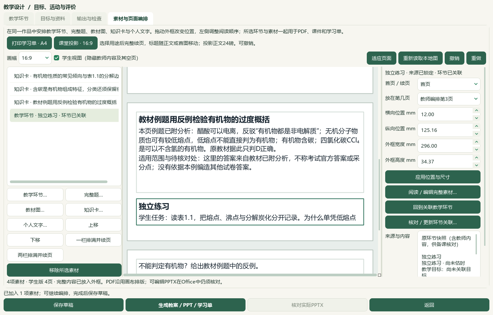

# 2026-10-05 有机化学研读与知识卡选材切片验收

本片新增9条教材候选、核读12题并给4题补空主知识点，知识卡可按册／章节搜索并直接对照原页。只接受有界源码与资料进展；课例分页和独立教师审校继续。微信读书永久停用。

选必三1.1《有机化学的建立和发展》正文PDF7—11／印刷3—7及邻页6、12共7张原页核看，新增9条来源绑定候选。保留常见性质与反例、历史模型、含碳分类例外及跨页合成／分析、天然产物来源边界；葡萄糖“200 ℃以上分解炭化”不转录成沸点。1865年苯模型不当作现代固定单双键结论；教材已附例题答案与空练习分开，空练习不补答案。教材462存储／423可选／57个正式节有笔记，共60节；39条旧缺项保持，数量不代表完整蒸馏或教师审核。catalog/corpus162＝108来源＋54派生，只追加1份候选；原件、旧笔记和碳酸Ka2两处4.8×10⁻¹¹／4.7×10⁻¹¹未决差异保持。

PKG-049—053五份原Word按SHA、版本、题面、现有答案和邻区块核读12题；58处资产中51处显示、7处仍不能显示，9张完整资产联系图及两张装置原图实际查看。7题完成声明范围的现有图文核读，5题为部分核读。仅给4题补空主知识点：1题K05、1题K03、2题K13；新增教材映射0。三处题表边界、醛类／还原性概括及原As2O3—Zn—HCl反应式未配平等疑点保留；不改原解析、不用答案命中猜主主题。考试原身份、正式四层题目结构、R/RP、能力与难度仍按缺证状态保留。标签候选不解锁教学或出卷资格。

知识卡选择窗口按真实书架元数据提供教材、章节和内容搜索，并分“知识卡内容／教材原页”。点“查看原页”重新核对笔记、目录和原书版本，再只读定位原页；切换、取消或关闭会取消未完成读取，过期回调不替换当前卡。只有明确点“选择并核对”才交给既有导入路径再次验证。正式提示和个人教材笔记均保留各自版本依据，未知册名／章节不从内部ID猜测。桌面窄窗改为上下布局；应用版本与渲染v9未变。本片2既有应用文件、1新应用文件、1新测试模块，5相关模块87项通过，其中新模块11项，重叠初验不累加；文档策略和14项完整README检查另验。

保留全库存的独立副本通过实际Qt“新建空白备课”，在知识卡窗口按册／章节搜索并对照PDF7；先取消且草稿不变，再明确选择第02、04、08条候选。另创建1个未审核独立练习，经课堂投影重排，形成4素材的同一有机化学入门课例。此副本保留1条旧个人笔记，因此选择窗口总数424＝423正式可选＋1个人；不把截图数字写成正式教材统计。没有在本次原生流程中重新读取完整题目目录或选择新真实题。

新草稿生成教师／学生Word、PPTX与画布PDF六份。实际本机Word教师3／学生1页，PowerPoint教师4／学生4页，共12页通过关键源文字与指定教师活动受众检查；根代理实际查看4张整页联系图及5张UI，联系图为最多4页全页缩略图，不称12张原尺寸页逐张细读。画布PDF8页只作机器检查。学生PPT任务在第3—4页跨句续接，第4页稀疏；教师Word练习标题在第2页、行动与任务在第3页，教师PPT亦跨第3—4页。这些问题已记入视觉清单，课例仍为候选；未把内容完整或来源可追溯当成课堂排版已验收。

15份旧保存草稿逐载荷保持，新增1份至16份；旧草稿共享历史输出，去重后共21个输出版本、126登记文件，含旧120文件及新6文件。源文件、导出副本和恢复文件逐份摘要一致，原备课图片、2套旧讲稿和保存／恢复载荷保持。首次原生助手误假定仅1份旧草稿，第二次误用settle参数，第三次在保存／备份／恢复载荷核对后误按必需字段读取可缺省image_assets；失败助手保留，已从第三次持久化产物独立只读完成尾部校验，不称首遍通过。联系图提前读取和路径分隔符比较错误亦单列；不重做已完成原生修改。

真实494文件中493保持，唯一改变为属性库按来源核对的4行补空字段计划；3684属性总数保持、其他3680行及9724旧历史逐行保持，追加4行至9728。辅助466文件保持事故后字节；前序临时辅助desktop-state.v1.json原字节仍未恢复，异常回执与事故后副本保留。原生UI只写独立副本。冻结2224条选定路径，区分应用、登记、数据库与文档计划改动，不宣称新鲜扫描整个私有档案。

新鲜题目队列704＝81文字＋564图像＋56范围材料＋3保护；706完整阅读身份／196部分阅读身份，309未尝试可处理图题，19未读纯文字均已有部分读取阻碍。阅读身份不替代化学和教学质量。普通status先于准备，登记前validate及结束status/validate通过。只重新核看既有V10第56秒、V43第42秒两张原帧并核对原MP4／帧摘要，参考章节树、原页和来源属性的摆放；新视频帧、完整视频播放、音频核听均0，不称44视频已对齐。

微信读书永久停用；检索文章、新有效试卷、新下载、外部网页请求和模型供应商调用均0。下一空节按实际书架为选必三1.2《有机化合物的结构》PDF12—19／印刷8—15，余3空节；其余57节有候选不代表全部完成。教师化学审校、短活动／长题分页、原Word复杂对象、目录冷启动、更多视频及语音功能、统一候选层和桌面发行继续。手机端排除，总目标active；新候选human_reviewed、teaching_use_allowed、generation_allowed、publication_allowed均false，未提交、推送、发布或重建v0.1.101 EXE。

## 实际操作与画面

在 **备课 → 教学环节 → 素材与页面编排 → 知识卡…**，选“选择性必修3 有机化学基础”和“1.1 有机化学的建立和发展”，搜索“分解炭化”。右侧先读内容、PDF7／印刷3及边界说明，再点“查看原页”。关闭或取消不选入作品；明确点“选择并核对”后才加入。个人教材笔记沿用自身导入版本和研读记录，原页查看也需重新核验。详见[操作指南](../teacher/lesson-and-paper.md#lesson-composition)。

## 来源与验收边界

[9条教材候选](../../knowledge/textbook/reading-notes-20261005-organic-history.json)绑定原书`E:/项目/上海高中化学等级考/课本/沪科技化学选修第三册【高清教材】.pdf`，SHA-256为26ccd86648c807476fd6f08db7e414571fa0d5e077db63b15c9880cb225cd137。正文PDF7—11、印刷3—7；邻页6和12只用于边界核对。原表的萘熔点80.5 ℃／沸点217.7 ℃、葡萄糖熔点150 ℃／200 ℃以上分解炭化、氯化钠熔点800.8 ℃／沸点1465 ℃保留类别和单位。历史模型、天然产物与教材医疗措辞仅作为原文研读，不提升为当前科学或医疗推荐；未知版本年份不猜。前序碳酸Ka2冲突未解除。

12题来自PKG-049—053五份用户提供的铁、金属、原子与结构讲义Word；逐文件路径、SHA、版本和12题区块范围见selected-questions.json与questions/root-review.json。样本3、5、9、12分别补空K05、K03、K13、K13；其他字段及非空标签保持，新增教材映射0。样本11原方程式As2O3＋6Zn＋12HCl＝AsH3＋ZnCl2＋6H2O原样保留并标注未配平；未自写解析替换。样本8、10、11范围含下一标题，继续待核；不能只因图文可读而判化学正确或选择进教学。本次原生课例没有选这些题。

教材原件、原Word、完整题库与来源回执按原范围另外保存。备课ZIP仅纳入所选草稿登记的126输出文件、图片和选定本地任务记录；不冒称整个私有档案已备份。16个草稿共享历史版本，21版与126文件均去重计算，不能累加每份快照的exports长度。新课例有完整六份产物，关键教师活动仅在教师版本出现；此标记检查不保证学生版已排除全部课堂建议或候选说明。学生Word仍含知识卡候选的适用范围；是否改写为教学语言待教师核对。

原生UI在副本完成。失败native-01、native-02与native-03助手分别保留；native-03在保存、备份、恢复载荷核对后因可缺省image_assets字段停止，再用既有递归可选资产校验器只读检查持久化产物。未重复创建第四个草稿。联系图助手首次早于尾部回执、视觉路径比较首次未统一Windows分隔符的错误单列，修复后通过。源失败不覆盖或计为成功首遍。

私有证据目录：`E:/项目/上海高中化学等级考/outputs/2026-10-05-organic-history-knowledge-picker-slice`。原教材页面、讲义完整图文和实际Office页保持私有。

| 记录 | 支持的结论 |
| --- | --- |
| preparation.json、inputs-before.json、controller-status-start-command.json | 先运行规范status；2224选定冻结路径、旧证据与微信读书停用约束 |
| asset-manifest.json、reading-completion.json、registration-receipt.json | 7原页核看、9候选，原件与旧登记前缀保持，162登记 |
| current-bookshelf-final.json、remaining-textbook-sections-final.json | 462存储／423可选／57节，下一1.2及3空节，非教师资格统计 |
| questions/root-review.json、root-image-review.json、root-scope-acceptance-final.json | 12题、51显示资产／7缺失、7完整／5部分，原解析与边界疑点 |
| questions/label-preview.json、label-apply.json、database-preservation-final.json、repeat-preview.json | SHA绑定计划补4主字段、0映射，9724旧历史＋4，重复预览0变更 |
| after-continuation/summary.json、next-question-work.json、historical-read-identity-ledger.json | 新鲜704待办、706完整／196部分阅读身份、309未尝试图题 |
| related-tests-final.xml、picker-tests-initial.xml | 最终5模块87项包含新11项；初验不重复累计 |
| native-01/failure.json、native-02/failure.json、native-03/helper-failure.json | 原生助手三次错误及保留范围；尾部只读补验非首遍通过 |
| native-03/native-verification.json、actual-consumer-final.json | 实际Qt搜索／原页／取消／确认，16草稿、21去重版、126文件与旧讲稿恢复一致 |
| native-03/actual-office-verification.json、visual-contact-manifest.json、root-manual-viewed-filenames.json、root-native-visual-review.json | 12实际Office页4整页联系图／5UI实看，短活动跨页限制；原程序root_viewed=false保留 |
| video-reference-check.json | 原MP4和2张已有帧摘要复核，仅2帧实看、0完整播放／核听 |
| controller-status-final.json、controller-validate-final.json | 当前规范控制器门禁通过 |
| documentation-sync-final.json、documentation-policy-final.json、readme-tests.xml | 8文档鲜读备份及比较写入，化学索引行独立维护，文档策略／14README检查 |
| source-review-manifest.json、full-hash-protection-final.json、next-work.json、root-final-acceptance.json | 待审公开集合、选定路径保护、后续节点；全目标仍active |

前序`2026-10-05-question-confirm-performance-slice/auxiliary-state-exception.json`记录的临时辅助事故原字节仍未恢复，辅助466文件保持仅覆盖事故后状态。源码未复制覆盖DATA旧应用；应用版本／渲染v9未变，未提交、推送、发布或重建旧EXE。B04／B09保持部分完成。
