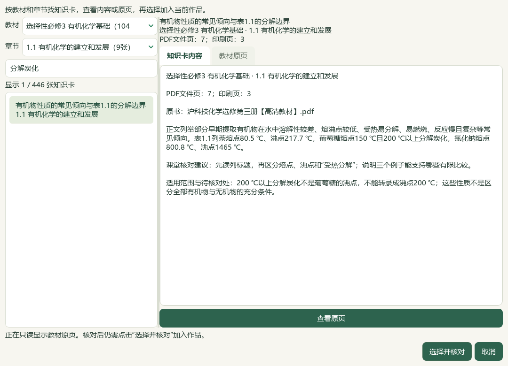
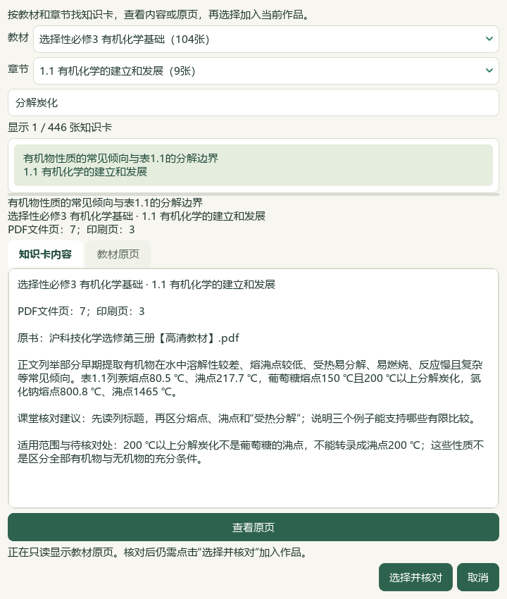
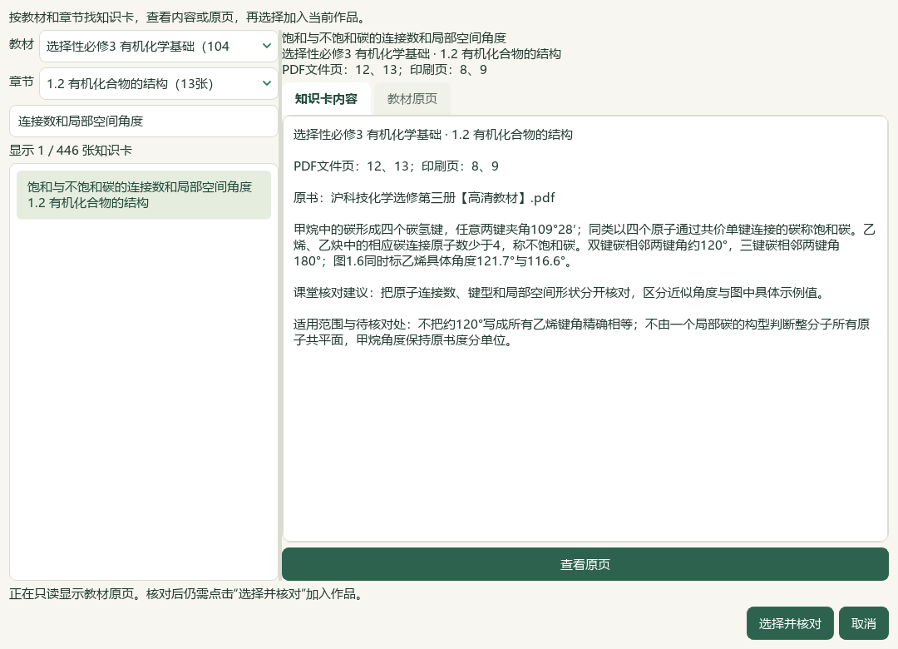
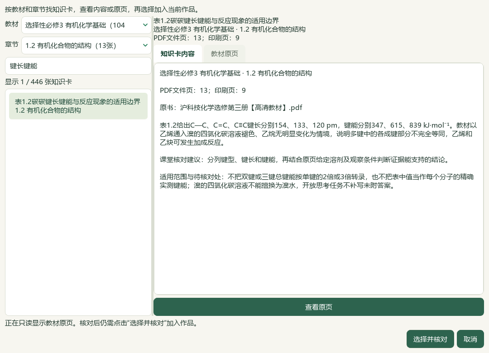
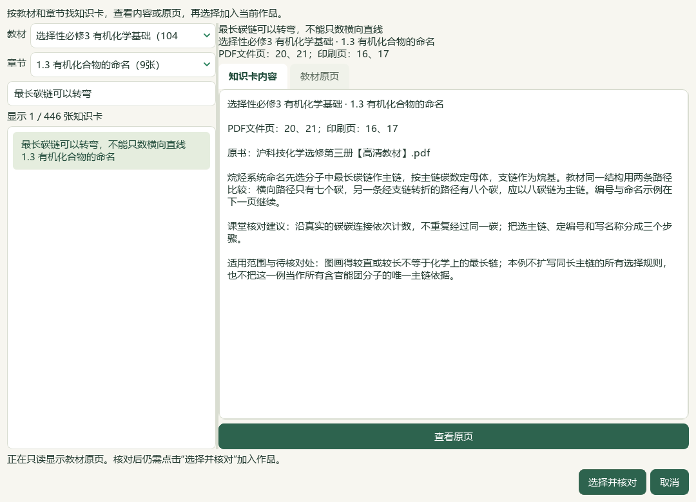
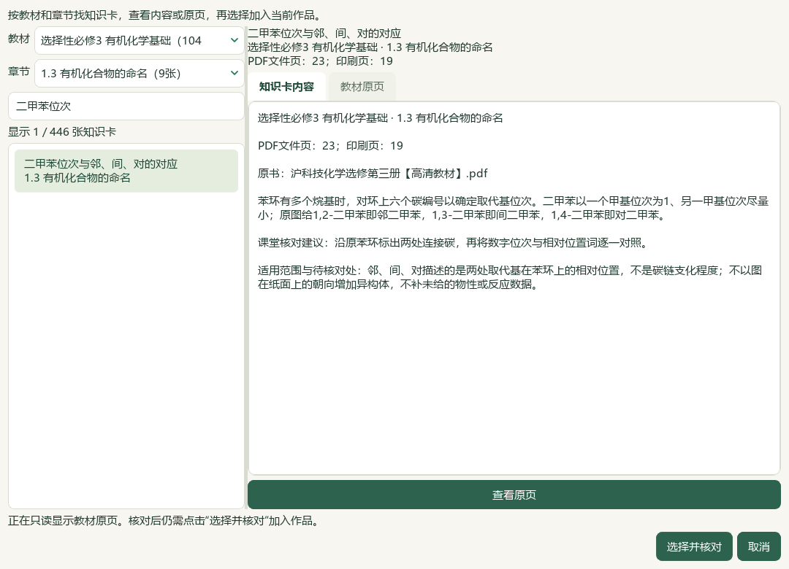
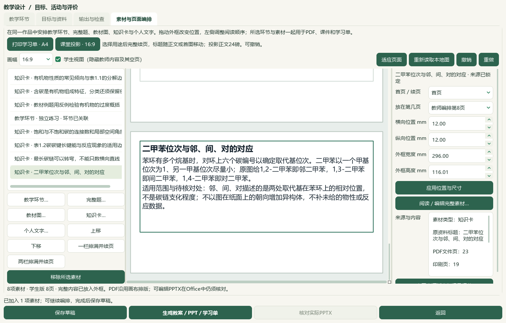

# 2026-10-05 有机命名研读与知识卡整页切片验收

新增9条教材候选，核读12题并给2题补空主知识点；本课例7张短知识卡在实际Office中保持标题与正文同页，教师Word来源跟随正文。接受本轮有界进展，完整教材、教师审校与发行仍在进行。

选必三1.3《有机化合物的命名》正文PDF20—24／印刷16—20及邻页19、25共7张原页实际核看，新增9条来源绑定候选。覆盖普通／系统命名范围、烷基连接位点、转弯最长链、编号与书写、烯炔主链、苯同系物、二甲苯位次、教材纠错例及未附答案的练习。保留原书规则范围，未补同长主链、E/Z或混合烯炔规则；“□,□-二甲基-1-丁□”损坏题名不猜。教材484存储／445可选／59个正式节有笔记，共60节；39旧缺项保持，数量不代表完整蒸馏或教师审核。catalog/corpus164＝108来源＋56派生，仅追加1份候选，原件与旧登记前缀保持。碳酸Ka2两处4.8×10⁻¹¹／4.7×10⁻¹¹冲突未解除。

PKG-055—057三份原Word按来源SHA、版本、现有题答和邻区块核读12题；45处资产中18处显示、27处缺失，3张整幅联系图及5张原资产实看。3题完成声明范围的现有图文核读、9题部分核读，不代表化学答案验收。只给样本3、4补空K05主知识点，新增教材映射0；样本2既有K05、样本3硫映射保持。GeO原对象、无已存属性、碳酸题指数8.4×10⁹／8.4×10⁻⁹及电荷疑点、下章标题混入、恒温／升温条件、H3PO3题与H3PO4解析冲突均保留。缺图、OLE身份、原版表格与图形范围仍按题阻断，不补答案、来源年份、四层结构或难度。

短纯文字知识卡能放下一整页时，主动投影重排将标题和完整可见正文整体移页；Word在保守长度范围内把标题、正文和教师来源附注组成原生同页段落组。原短活动规则延续，长卡保留完整内容续页、投影正文保持24磅，手工过小外框仍可整行续接。内部渲染v10→v11，应用版本未变；已有布局须主动重排并重新生成，旧成品保持原摘要。3既有应用文件＋1新测试模块，9相关模块80项通过，含新6项；旧实现有3真实失败、3通过，重叠运行不累计。

全库存副本通过实际Qt新建空白备课，按册／章节／内容搜索，对照PDF7、12、13、20、23；取消核对不改变草稿，明确确认7张知识卡并创建1个未审核“独立练习”。本课例8素材，含前序性质3卡、结构2卡、本轮命名2卡。选择窗口446＝445正式可选＋1旧个人笔记，1.3有9候选。未在本片原生流程选择真实新题或完整读目录；副本题目数据库取自本片2标签写入前。

六份教师／学生Word、PPTX及画布PDF生成并保存。实际Word教师5／学生2页，PowerPoint教师8／学生8页，共23页；7知识卡在每种实际Office输出中均标题与完整可见正文同页，教师Word各卡来源附注也同页。结构两卡在两版PPT第5、6页完整呈现，命名两卡第7、8页完整呈现；短活动教师Word第3、学生Word第1、两版PPT第4页，教师行动仅在教师版且同页。根代理实看7张完整Office联系图、9张选定UI和7张个别Office原尺寸页，不称23页全都逐张原尺寸细读。教师Word末页来源孤页在此课例已消除，留白仍较大；学生候选语言、原结构图联动、课堂递进、长卡与富内容分页继续。

旧17份保存草稿载荷保持，新保存1份至18份；共享历史去重23版138登记文件，原132及新6份与恢复副本逐份一致，引用图片和2套旧讲稿保持。原生助手本片首轮成功。媒体助手首次因cv2缺失在输出前停止，保留失败脚本并改用已安装ffmpeg；未安装新包。验收助手把页数整数误作数组，在读取前序生成的实看清单后停止，保留脚本及失败回执、修正类型后完成；不把这些助手错误写成应用故障。

真实494文件中493保持，仅标签库按确认计划改2属性行；3684总属性、其他3682行及9731旧历史保持，追加2至9733。原生UI只写副本。辅助466文件保持事故后字节，历史临时desktop-state.v1.json原字节仍未恢复，异常回执保留。冻结3172条选定路径，区分应用、登记、标签库与文档计划改变，不冒称新鲜全私有档案扫描。知识库索引只更新化学行，保留鲜读备份中的其他项目行。

新鲜队列702＝81文字＋562图像＋56范围材料＋3保护；712完整／214部分阅读身份，285未尝试可处理图题，19未读纯文字均已有部分读取阻碍。下一空节按实际目录为选必三2.2《芳香烃》PDF35—40，仅1个空节；其他有笔记的节仍须继续蒸馏与审核。普通status先于准备，终验status／validate、文档策略和14项完整README另验。

本轮新增并实看本地参考视频V28的6帧，指定时点8、30、60、95、120、135秒；读取原视频SHA，观察输入摘要、HTML课件入口、完整示例页、目录和页数。这里只据整页示例改善短卡阅读，未完整播放或核听音频，未新增HTML、目录或语音功能；不称44视频整体对齐。检索文章、新有效试卷、新下载、外部网页请求及模型供应商调用均0；微信读书永久停用，登录、扫码和密钥不再是本地工作的前置条件。

教师化学审校、教材图表联动、复杂Word／长题、候选课堂语言、目录冷启动、更多视频与语音、统一候选及桌面发行继续。手机端排除，总目标active；全部新候选human_reviewed、teaching_use_allowed、generation_allowed、publication_allowed为false。维护源码与DATA旧应用存在版本差异；未复制新功能到旧应用、未提交推送发布、未改版本或重建v0.1.101 EXE。

## 实际操作

在 **备课 → 教学环节 → 素材与页面编排 → 知识卡…** 选择“选择性必修3 有机化学基础”和“1.3 有机化合物的命名”，搜索“最长碳链”或“二甲苯”。先看候选及原页，再点“选择并核对”；加入后主动点“课堂投影16:9”并重新生成实际Word／PPT。详见[操作指南](../teacher/lesson-and-paper.md#lesson-composition)。

## 来源与证据

[9条命名候选](../../knowledge/textbook/reading-notes-20261005-organic-naming.json)绑定本地原书`E:/项目/上海高中化学等级考/课本/沪科技化学选修第三册【高清教材】.pdf`，SHA-256为`26ccd86648c807476fd6f08db7e414571fa0d5e077db63b15c9880cb225cd137`。正文PDF20—24／印刷16—20，邻页19、25只核边界。教材纠错示例按原分析保留，不称官方考试答案。未附答案或损坏题名均保留未知。

12题原文件、SHA、版本及区块范围在私有selected-questions.json与questions/root-review.json中保存。仅样本3、4补空K05，计划SHA为`6accc8e63009620059e8292f5824113f21f33e672ef657a06584c47452dc1b0b`；实际写入须以label-preview.json和label-apply.json回读为准。完整图文核读只表示原有材料可读，不解锁化学正确性、官方身份、四层结构、R/RP、难度或课堂资格。

备课ZIP覆盖选定18份草稿、其引用图片及23个唯一版本的138登记成品，原教材、原Word和完整题库仍须另行备份。两份画布PDF各8页为机器页数，实际Office共23页经完整联系图核看，另实看7个原尺寸页；这两种证据分别记录。本片原生流程在副本中操作，真实资料库仅按2标签计划更新。

私有证据目录：`E:/项目/上海高中化学等级考/outputs/2026-10-05-organic-naming-card-flow-slice`。完整教材原页、原题图文、Office页及视频帧保留私有。

| 记录 | 验证范围 |
| --- | --- |
| preparation.json、inputs-before.json | status先于准备、3172选定路径冻结、前序56证据及381公开文件核验 |
| asset-manifest.json、reading-completion.json、registration-receipt.json | 7原页、9候选、484／445／59节及164登记 |
| questions/root-review.json、root-image-review.json、root-scope-acceptance-final.json | 12题、45资产／18可显示／27缺失，3完整／9部分，原答案疑点保留 |
| questions/label-preview.json、label-apply.json、database-preservation-final.json、repeat-preview.json | 2主字段补空、0映射；9731旧历史＋2，重复预览0改变 |
| historical-read-identity-ledger.json、next-question-work.json、remaining-textbook-sections-final.json | 702待办、712完整／214部分、285未尝试图题、下一2.2及1空节 |
| knowledge-tests-before.xml、related-tests-final.xml | 旧版3真实失败／3通过，最终9模块80项含新6项，重叠不累计 |
| native-01/native-verification.json、actual-consumer-final.json | 实际UI选材、8素材、18草稿、23版138文件及2旧讲稿恢复一致 |
| native-01/actual-office-verification.json、root-native-visual-review.json | 23实际Office页、7联系图／9UI／7原页实看；7卡正文及教师Word来源同页 |
| video-reference/manifest.json、root-review.json、media-helper-first-failure.json | V28来源SHA与6帧实际观察；cv2失败保留，改用已安装ffmpeg |
| accept-native-helper-first-failure.json | 验收助手将页数整数误作数组的类型错误，已保留并修正 |
| controller-status-final.json、controller-validate-final.json | 164登记的终验门禁；微信读书停用 |
| documentation-sync-final.json、documentation-policy-final.json、readme-tests.xml | 8文档鲜读备份／比较写入，化学索引行独立维护，14README检查 |
| source-review-manifest.json、full-hash-protection-final.json、root-final-acceptance.json、next-work.json | 公开源码及冻结路径最终核验；历史临时例外原字节未恢复；总目标active，未发行 |
