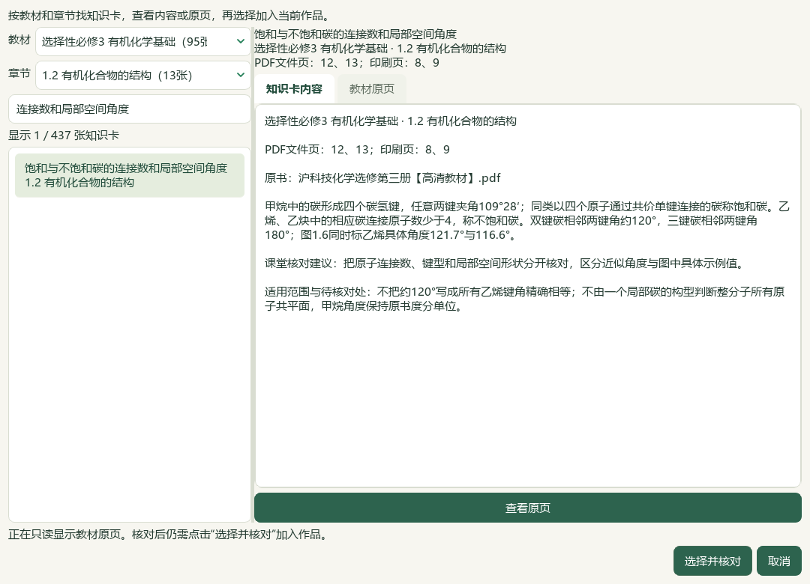
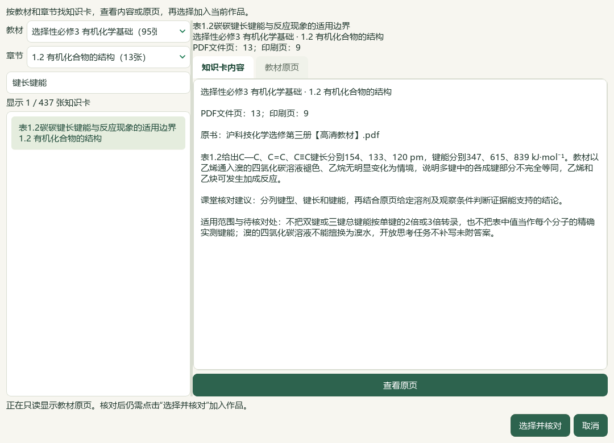
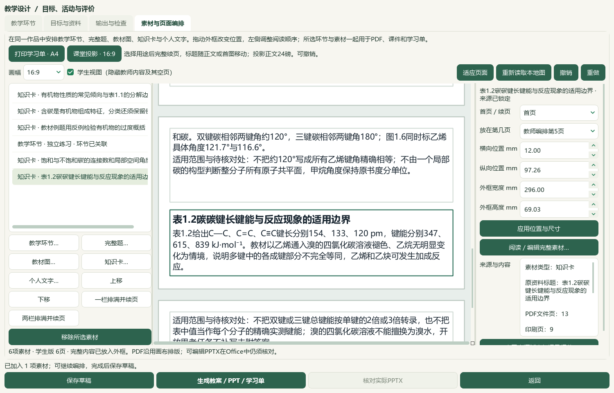

# 2026-10-05 有机结构研读与短活动分页切片验收

新增13条教材候选，核读12题并给3题补空主知识点；在实际Office验证限定短活动的标题与完整任务同页。接受本轮有界进展，教师审校与桌面发行继续。

选必三1.2《有机化合物的结构》正文PDF12—19／印刷8—15及邻页11、20共10张原页核看，新增13条来源绑定候选。整理碳成键、局部角度、键长键能、键极性、结构表示、同分异构及官能团；保留溴的四氯化碳溶液条件、碳氢键弱极性脚注、角度近似与具体值的区别，开放练习不补答案。教材475存储／436可选／58个正式节有笔记，共60节；39条旧缺项保持，数量不代表完整蒸馏或教师审核。catalog/corpus163＝108来源＋55派生，仅追加1份候选，原件与旧登记前缀保持。碳酸Ka2原书两处4.8×10⁻¹¹／4.7×10⁻¹¹冲突仍未解除。

PKG-053—055三份原Word按SHA、版本、题面、现有答案及邻区块核读12题；52处资产中44处显示、8处仍不可读，8张完整资产联系图及5张原资产实看。3题完成声明范围的现有图文核读、9题部分核读。仅给样本5、9、11补空K05主知识点，新增教材映射0，既有镓题5.2映射保持。铁离子价态、0.16 L=1600 mL换算、镓题CO₂适用条件和下一标题混入等问题保留，不改原答案。样本10无已存属性，原GeO对象及上海卷转载线索保持，不猜GeO₂或官方身份，也不创建属性或伪造修订。正式四层题目结构、R/RP、能力及难度缺证保持。

短纯文字活动在能放入完整一页时，主动课堂投影重排把标题、上下文和任务一起移到有足够空间的页；学生版跳过放不下整组但后续已有合适外框的短框，保留原布置与内容。Word对限定长度的纯文字活动使用原生同页段落规则。长活动仍按完整行续页，不缩小24磅投影正文，手工过小外框仍可按整行拆分。内部渲染v9→v10，应用版本未变；已有布局需主动重排并重新生成，旧成品按原摘要读取。本片3既有应用文件、1新测试模块，8相关模块74项通过，含新5项。初验有一个非法CP夹具；修正后旧版4个真实失败、1通过，最终5个新用例全过。重叠运行不累计。

全库存独立副本通过实际Qt新建空白备课，按册／章节／内容搜索并对照PDF7、12、13；先取消且草稿不变，再确认三张前序性质知识卡和两张本轮结构知识卡，另创建1个未审核“独立练习”。六素材形成有机特征与结构候选课例。新结构卡保留角度单位和键能数据。窗口437张＝436正式可选＋1旧个人笔记，不把界面总数写成正式统计。没有在本轮原生流程中重新读取完整题目目录或选择真实新题，五张知识卡均未自动取得教学资格。

六份教师／学生Word、PPTX及画布PDF均生成。实际Word教师4／学生2页，PowerPoint教师6／学生6页，共18页；完整学生任务与活动标题同在教师Word第3、学生Word第1、教师PPT第4、学生PPT第4页，指定教师行动只在教师输出且与任务同页。根代理实看6张整页联系图、9张UI及3张Word／PPT活动页原尺寸图；不称18页均逐张原尺寸细读。短活动跨句及标题与任务分离在此课例已改善。结构卡在PPT第4—5页的“不饱和碳”内续接，键能卡条件在第5—6页续接；知识卡全文分页、教师Word末页来源孤页、学生Word中的候选适用范围与课堂建议、长任务和稀疏页仍待处理，不能据此验收全部课堂材料。

16份旧保存草稿逐载荷保持，新保存1份至17份；共享历史按输出身份去重，共22版132登记文件，旧126及新6份与导出副本、恢复文件逐份摘要一致，原图片与2套旧讲稿保持。首轮助手把setText填写但未提交的自定义标题当成已绑定标题，在第一份实际Word后失败；第二轮焦点移动仍未触发textEdited，在导出前失败。两轮记录与产物保留，成功第三轮按实际“独立练习”标题核验，不称首遍通过。第一轮未登记的6份文件未算进132份正式备份范围。题图stager因缺属性与尾部哈希函数被exec命名空间替换三次停止，均保留并由只读尾部复核完成，不据助手错误推断应用故障。

真实494文件中493保持，属性库仅按确认计划改3行；3684属性总数、其他3681行和9728旧历史保持，追加3行至9731。原生UI只写副本。辅助466文件保持事故后字节，前序临时desktop-state.v1.json原字节仍未恢复，异常回执保留。冻结2672条选定路径，区分应用、登记、数据库与文档计划改变，不冒称新鲜扫描整个私有档案。知识库索引只更新化学行，保留鲜读备份中的其他项目行。

新鲜题目队列703＝81文字＋563图像＋56范围材料＋3保护；709完整／205部分阅读身份，297未尝试可处理图题，19未读纯文字均已有部分读取阻碍。普通status先于准备，结束status/validate通过；文档策略与14项完整README另验。本轮参考视频帧实看、新帧、完整播放、音频核听均0，既有两帧证据只作历史依据，不称更多视频已对齐。检索文章、新有效试卷、新下载、外部网页请求及模型供应商调用均0，微信读书永久停用。

下一空节按实际书架为选必三1.3《有机化合物的命名》PDF20—24／印刷16—20，余2空节；58节有笔记不代表全部完成。教师化学审校、教材图表联动、复杂Word／长题分页、目录冷启动、更多视频和语音、统一候选与桌面发行继续。手机端排除，总目标active；候选human_reviewed、teaching_use_allowed、generation_allowed、publication_allowed均false。未提交、推送、发布或重建v0.1.101 EXE。

## 实际操作

在 **备课 → 教学环节 → 素材与页面编排 → 知识卡…** 选择“选择性必修3 有机化学基础”和“1.2 有机化合物的结构”，搜索“连接数和局部空间角度”或“键长键能”。先看候选内容与原页，再点“选择并核对”。加入环节后主动点“课堂投影16:9”，重新生成并核对实际Word／PPT。详见[操作指南](../teacher/lesson-and-paper.md#lesson-composition)。

## 来源与边界

[13条教材候选](../../knowledge/textbook/reading-notes-20261005-organic-structure.json)绑定原书`E:/项目/上海高中化学等级考/课本/沪科技化学选修第三册【高清教材】.pdf`，SHA-256为26ccd86648c807476fd6f08db7e414571fa0d5e077db63b15c9880cb225cd137。正文PDF12—19／印刷8—15，邻页11、20只核对边界。表1.2按C—C、C=C、C≡C顺序保留154、133、120 pm与347、615、839 kJ·mol⁻¹，不按倍数推算。甲烷109°28′、双键约120°、三键180°保留各自局部范围；官能团和异构示例、维生素C教材分析与空练习分开。未给开放题添答案，未新增官方考试答案或评分点。

12题路径、SHA、版本及原区块范围见私有selected-questions.json、questions/root-review.json。样本5、9、11只填空主主题；标签直接依据氯化铝、镓及铝题面，不代表其化学解析全篇已验收。样本3铁离子价态、样本6原换算、样本9CO₂条件及样本12下一标题均保留；样本10缺属性仍阻断。未猜原题来源年份、地区、原始URL、分值、正式层级、R/RP或难度。

备课ZIP仅覆盖选定草稿登记的132输出文件、引用图片和所选本地任务；原教材、原Word及完整题库仍须另外备份。17草稿共享输出历史，按22个版本去重后为132文件。首轮助手生成但未保存登记的六份文件保留在失败副本，未包含在正式132统计。指定教师活动受众检查不保证学生版所有课堂建议已经过教师改写。全部新候选教学、生成及发布资格关闭。

私有证据目录：`E:/项目/上海高中化学等级考/outputs/2026-10-05-organic-structure-activity-flow-slice`，完整教材页、题答图文与Office原页保持私有。

| 记录 | 验证范围 |
| --- | --- |
| preparation.json、inputs-before.json | status先于准备、2672选定路径冻结、前序50证据和366公开文件复核 |
| reading-completion.json、registration-receipt.json、current-bookshelf-final.json | 10原页、13候选、475／436／58节及163登记 |
| questions/root-review.json、root-image-review.json、root-scope-acceptance-final.json | 12题、52资产／44可显示／8缺失，3完整／9部分，原文疑点保留 |
| question-staging-failure.json、question-image-staging-failure.json、question-staging-completion.json | 缺已存属性与最终哈希工具错误；既有文件不覆盖，独立只读尾部完成 |
| questions/label-preview.json、label-apply.json、database-preservation-final.json、repeat-preview.json | 3主字段补空、0新映射、9728旧历史＋3，重复预览0改变 |
| next-question-work.json、after-continuation/summary.json | 703待办、709完整／205部分、297未尝试图题，下一1.3及2空节 |
| activity-regression-before.xml、activity-test-before-fixture-correction.py、activity-regression-before-corrected-fixture.xml、activity-regression-after.xml、related-tests-final.xml | 夹具错误与真实旧版失败区分；最终8模块74项含新5項，重叠不累计 |
| native-01/helper-failure.json、native-02/helper-failure.json | 两次助手自定义标题门槛错误，不覆盖或计作首遍成功 |
| native-03/native-verification.json、actual-consumer-final.json | 实际UI选材、六素材、17草稿、22版132文件与旧讲稿恢复一致 |
| native-03/actual-office-verification.json、visual-contact-manifest.json、root-native-visual-review.json | 18实际Office页、6整页联系图／9UI／3活动页实看；短任务同页，来源孤页继续 |
| controller-status-final.json、controller-validate-final.json | 163登记的规范控制器门禁通过、微信读书路线停用 |
| documentation-sync-final.json、documentation-policy-final.json、readme-tests.xml | 8文档鲜读备份／比较写入，化学索引行独立维护，14README检查 |
| source-review-manifest.json、full-hash-protection-final.json、root-final-acceptance.json、next-work.json | 公开增量与选定冻结路径最终核对；总目标active，未发行 |
