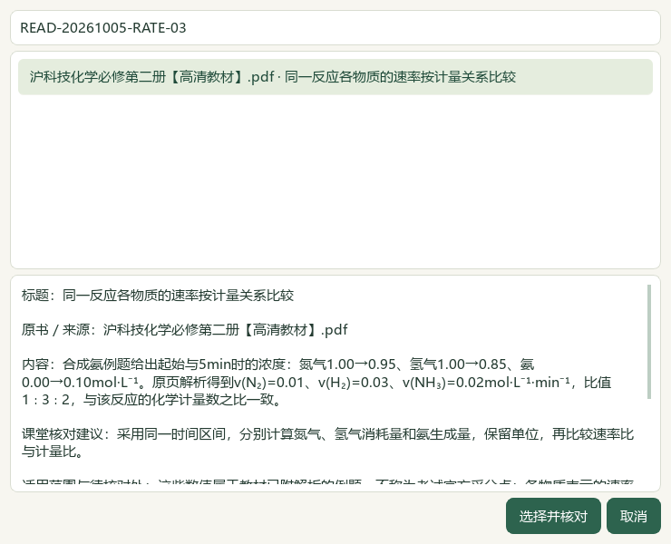
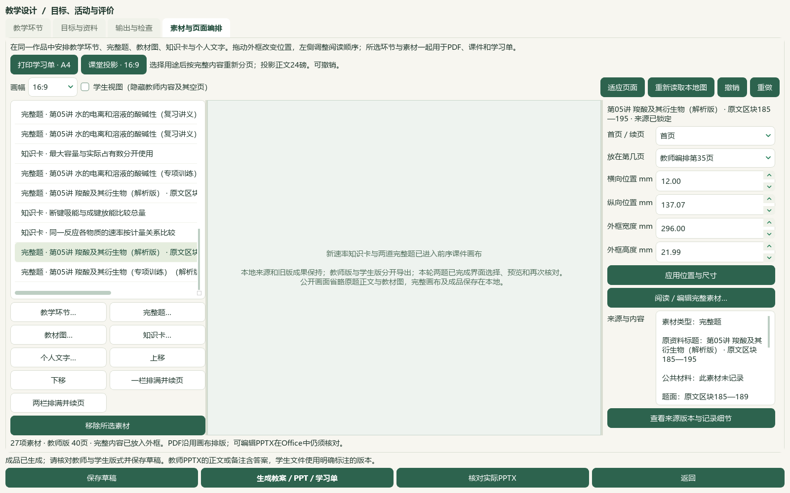
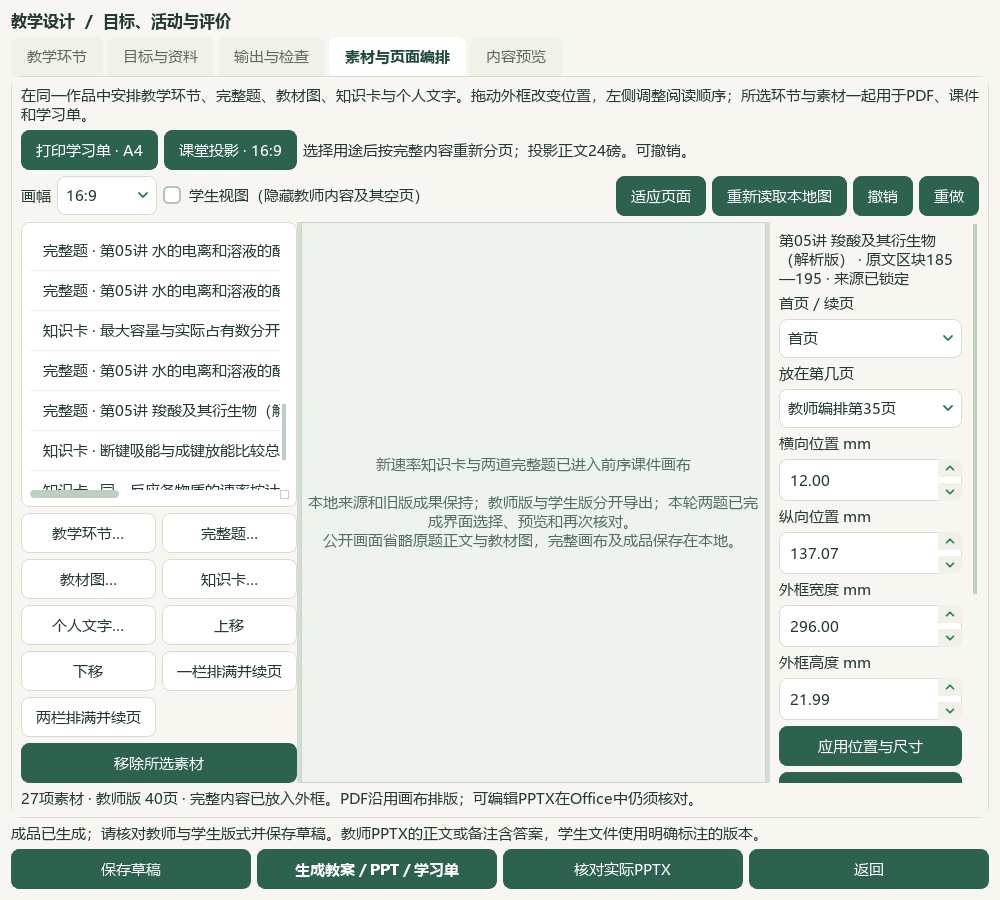

# 2026-10-05 批量题图读取、选题确认与化学反应速率研读切片验收

本地源码与资料取得进展，保留一项临时验证状态变更例外；完整用户目标继续。微信读书路线停用，旧试用包未更新。

完整题窗口的每个当前页签将待显示图片合为一项可取消任务，先重核来源、范围与图像摘要，再按原生位置返回各图；同一页签内复用一次文档解析，重复对象仍在各原位置显示。失败或未完整返回的图片保持选择阻断，离开旧题、关闭窗口或晚到回调不会恢复旧选择。完整参考预览与再次确认仍重新读取来源及标签，不用长期缓存替代版本核对；答案页按需读取。新增7项检查，连同相关6模块共122项通过。

默认门面、完整98来源／3579题目录和4工作线程的原生Qt验证完成两题选择、参考预览及再次确认。成功重试目录19.53秒，两题题面3.19／2.97秒，参考预览3.93秒，再次确认3.74秒。这些是保留完整临时状态的单次观测，不证明首次冷读或整应用启动。初次60秒及两次180秒整库观察失败保持原件；一次180秒诊断累计76次读取约180.78秒，耗时位于文件读取，原因未定，不归因于防病毒。一次成功任务因验证程序过早退出没有最终确认回执，不计通过；其他失败和脚本修正分别留档。

必修二6.1《化学反应速率》PDF45—53／印刷41—49九页逐页查看，新增10条来源绑定候选。保留平均速率的时间区间、正值与单位、计量比例和实验条件；合成氨例题0.01／0.03／0.02 mol·L⁻¹·min⁻¹属于教材已附解析，不补写未作答实验表、曲线或官方采分点。压力作用按气体压缩改变浓度的条件记录，催化剂结论保留具体实验。415存储／376可选／52正式节，39旧缺项保持。catalog/corpus157＝108来源＋49派生，只增1份教材候选。

实际备课窗口从完整98来源只读辅助目录选择前序已核完整范围的羧酸讲义Q3、Q12，与新RATE-03速率卡一起加入前序作品；备课与选题共用默认4线程任务桥，选择暂存与属性库位于独立验证副本。作品27素材／13真实题，本轮只增作品内两题，不新增题库题目或阅读身份。原24素材和外框在主动用途重排前保持。A4两版各11页；投影教师40页／学生36页，学生省略4页教师内容，视图切换不改历史，用途撤销／重做恢复准确。15版90登记文件另存与ZIP恢复逐字节一致，旧78文件保持，草稿、恢复副本和图片一致。

实际Word教师19页／学生10页，PowerPoint投影40／36页、A4两版各11页，共127页通过33组整页联系图核看；另看12张原生UI图。联系图原1480×2050，在工具中显示1340×1856，不称逐页原尺寸核查或教师人审。六份实际Office转换另核完整可见文字及教师答案／标记隔离；快速画布PDF98页只机器检查。长题跨页、标题与图分离、稀疏投影页、学生局部留白及复杂Word仍待优化。

验证例外：初次消费脚本误将选择暂存写入保留的临时辅助资料profile/desktop-state.v1.json，改变随机修订与更新时间；原字节副本未找到，不能声称精确恢复。保留前后SHA和原回执，未改写冻结基线。后续成功程序已把可写选择与标签状态绑定到新的副本。真实用户profile的494文件、3684属性、9714历史及原Word／PDF均保持，本轮真实标签与历史写入0；这个单文件例外计作1项非计划变更，切片状态为progress_with_verification_exception。

713待办＝81文字＋573图像＋56范围材料＋3保护，687完整图文读取身份／179部分、345未尝试图像保持。主知识3112／教材映射3000，分别缺467／579；98来源／3579题、3576可选及46讲1009参考、383概念、319素材、77补充栏目／60正式节保持。下一空节TB-M2-C6:6.2《化学平衡》PDF54—59／印刷50—55。

微信读书永久停用，本片请求、文章、外部检索、新原卷、新题库题目和模型调用均0。来源自述的年份／地区仍待核，不冒称官方；前序化学争议保持。候选未教师人审，教学／生成／发布资格不解锁。未新增视频播放或音频核听，前序24抽帧的范围保持。全量资料、化学与装置图、跨页布局、首次整库打开、更多视频功能与语音、候选统一和桌面发行继续；手机端排除。总目标active，未提交发布，旧v0.1.101版本／EXE／启动器未更新。

## 操作与实际界面

在“备课 → 教学环节 → 素材与页面编排”用“知识卡…”选择新速率提示；用“完整题…”阅读题面、答案及图片，等待当前图完整显示后勾选，预览完整参考，再次确认加入。选择不是教师审核。加入后按A4或16:9用途编排，核对学生视图，再生成并检查六份文件；学生投影与分发使用student_presentation.pptx和student_canvas.pdf。

## 来源与验证边界

教材原文件《沪科技化学必修第二册【高清教材】.pdf》，SHA-256：92f09535689cbb1192526a7f8b4dde2254869052d8e3b6d88b8bed9d354094ce。本片研读是来源绑定候选，原图、条件和未作答空表保持。

两道作品题的原文件PKG046／047的SHA-256分别为14f08c7e8486b2bb95a13a9de457fb21e42d6682ea0fc2ea01ad6b8ddc3ec813和10d8d38163cae7c45aae382d8a81b7a94fbf866d0265f273736ecab800de3638。Q3为word-question-8547c341ded24085f9fe43a8、原区块185—195；Q12为word-question-49ca2065b795696268901287、原区块138—151。共9个独立图像，按11次来源引用复核。前序完整范围证据按冻结哈希继承，未算新的完整读取身份；本片验证其进入实际作品。教材标签只支持已核局部对应，不保证陌生有机机理完整覆盖。

默认完整门面验证与备课消费验证分别保存：前者没有来源服务替换，后者通过完整98来源辅助目录读取原件，并隔离可写状态；二者都使用正常Qt事件循环与默认4线程池。第二次消费程序的600秒超时提示没有实际超时依据；第三次在知识选择窗口仍打开时观察到短暂busy=false，过早退出等待。第三次0.735秒且timed_out=false的原观测不能称600秒超时；第二次是否同因保留为推断。最终等待条件增加模态窗口和稳定条件核对，完成实际选择、加入与保存。原失败JSON、诊断和不适用的旧元数据均保留，通过派生更正解释。

## 私有证据与未改写的原记录

私有证据目录：`E:\项目\上海高中化学等级考\outputs\2026-10-05-question-confirm-performance-slice`。原题、教材页、成品及下列机器回执不随公开源码或试用包分发。

| 文件 | 支持的范围 |
| --- | --- |
| reading-completion.json、registration-receipt.json | 九原页、10新笔记、1教材候选登记 |
| reference-baseline.json、source-read-diagnosis.json | 指定来源计时、整库读取失败与未定原因 |
| native-after-batch-02/diagnosis.json、native-question-reference.json | 完整默认门面、正常Qt、目录与两题确认 |
| native-consumer-04/native-question-reference.json、profiles.json | 实际作品选题、完整只读目录、可写状态隔离 |
| native-consumer-04/native-verification.json、native-metadata-correction.json、actual-consumer-final.json | 原回执、线程桥元数据更正、27素材与90文件恢复 |
| native-consumer-04/purpose-transition.json、audience-preview-verification.json | 两版页数、学生答案隔离、用途撤销恢复 |
| native-consumer-04/actual-office-verification.json、root-native-visual-review.json | 六份实际Office转换、127页联系图与12界面；98快速PDF页机器范围 |
| consumer-failed-attempts.json、consumer-failure-correction.json | 原失败、过早结束等待的更正 |
| auxiliary-state-exception.json、full-hash-protection-final.json | 一份辅助临时状态未恢复原字节，真实494文件保持 |
| real-state-preservation.json、current-bookshelf-final.json、next-work.json | 真实标签历史保持、376可选／52节及713待办 |
| word-image-regression.json | 本轮6模块122项实际终端通过；未生成单例JUnit明细 |
| documentation-sync-final.json、documentation-policy-final.json、readme-tests.xml | 文档备份与比较写入、文档策略和完整README14项 |
| source-review-manifest.json、root-final-acceptance.json | 当前源码审阅集合与有例外的切片验收 |

旧回执、冻结哈希、原题答案、原书、旧成品与备份保留。本片不把标签齐备、图片可读、软件导出成功或代理视觉查看当成教师审核、教学资格或发布验收。
