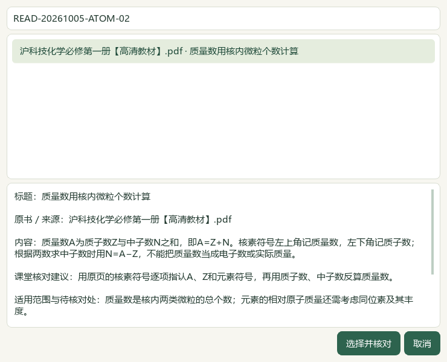
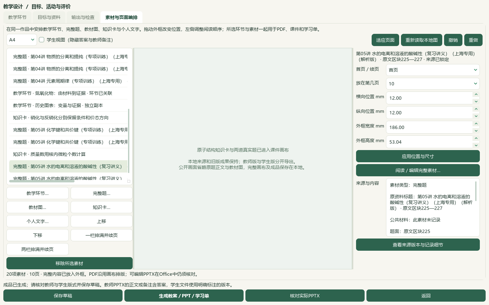

# 2026-10-05 中文来源阅读、原子结构研读与实际Office切片验收

本片是总目标中的已核本地进展，源码与资料未发布。微信读书路线按用户指示永久停用；本地整理不再等待公众号接口。

默认素材来源改为中文的类型、原资料标题、题答区块、PDF文件页及印刷页；未知印刷页保留待核对，Word区块明确不是印刷题号或正式层级。完整素材编辑器可按原顺序阅读全部密封快照，原始JSON按需展开；取消按钮改为“取消”，作品副本与原快照仍分开。教师教案的来源附注也改为中文说明。

必修一4.2《原子结构》PDF124—131／印刷119—126八页逐页查看，新增10条来源绑定候选，385存储／346可选／49正式节，39旧缺项保留。catalog/corpus154＝108来源＋46派生，只增1份教材候选。两份讲义12题题答与邻文已读，65次图像引用中40可读、25失败，7联系图核对；3完整技术范围／9部分。只为完整3题补3个空主知识点与3处空教材映射，非空替换0；另核选必一3.1的PDF65—69。题源年份与学校仅是讲义自述，未冒充已核官方原题；指示剂范围差异、A/C复用同一原图及Kw单位问题单列待核。

3684属性中3681其他行、9700旧历史保持，新增3历史至9703；真实状态另外493文件与5个人原书保持，重复预览0变更。主知识3105／教材映射2991，分别缺474／588。724待办＝81文字＋584图像＋56范围材料＋3保护；673完整阅读身份／169部分，132完整已读仍待办。未完整图像519中150已部分读、369未尝试；行动纯文字0。98来源／3579题、3576可选题及46讲1009参考、383概念、319素材、77补充栏目／60正式节保持。

实际Qt从完整目录选择本次原子结构卡和两道真实题进入前序作品，共20素材／10页／9真实题，9版54登记文件另存及ZIP恢复逐字节一致，旧17素材与48文件保持。当前六成品内容读回与答案隔离、20页画布PDF和10张原生UI图逐项查看。另由本机Word实际转换教师19页／学生8页、PowerPoint实际转换教师10页／学生10页，共47页逐页查看，四文件源哈希和学生版新增答案／教师标记隔离另验。PPT预览使用实际生成的PowerPoint PDF并显示引擎名称。验证窗口使用独立标准任务桥，整应用共享任务池首次打开仍待验。

PowerPoint只在没有运行中实例时启动转换；打开文件前绑定新隐藏PID、创建时间和持有句柄，只读不可变副本，重新核对归属后才清理。Word/PPT均在退出与原件哈希复核后发布PDF，不强杀教师进程。第一次Word退出观察未及时确认，后来确认自然退出；第一次PPT空PrintRange转换失败，诊断保留，改用全部幻灯片的明确范围后成功。失败结果未当成成品。实际教师Word来源说明占页较多，PPT样本仍沿用竖版画布；投影格式、留白、复杂对象及更多Office样例继续优化。

55模块1049相关检查通过，完整README14项与文档策略单列回执。本片只查询Microsoft技术原文，微信读书检索／文章、新原卷、新题库题目、模型调用均0；本片没有新增参考视频阅读。候选未教师人审，教学／生成／发布资格不解锁。下一空节为4.3《核外电子排布》PDF132—137／印刷127—132；剩余原始资料、化学与装置图、复杂Word、整库首次打开、更多视频UI、候选统一与桌面发行继续，手机端排除。总目标active，未提交发布，版本／EXE／启动器未更新。

## 实际操作与界面

从“素材与页面编排”选择知识卡或完整题，默认右栏阅读来源说明；“阅读／编辑完整素材…”的原资源页保留全部题面、答案和图片位置提示，点击详情才显示JSON。作品中的行内图仍在完整素材和画布核对。公开图省略私人原题与教材正文，完整验证图和原件仅在本地。

实际PPT预览优先使用已安装LibreOffice；未发现时可用本机PowerPoint。若已有PowerPoint实例，显示明确提示，教师自行保存并关闭后重试；未证明私有归属的实例继续保留。此次本机只有Office，没有用LibreOffice结果代替Office实物。

## 本地证据

证据目录：`E:/项目/上海高中化学等级考/outputs/2026-10-05-readable-sources-atom-office-slice`。公开代码审查不收录原书、题面、教师答案、个人数据库、私有截图或工作辅助脚本。

| 回执 | 核验范围 |
| --- | --- |
| `preparation.json`、`inputs-before.json` | 前序验收与1388文件冻结，完整目标与用户指示保留 |
| `reading-completion.json`、`current-bookshelf-final.json` | 八页原书、10条候选、385／346／49及实际目录下一节 |
| `registration-receipt.json` | catalog/corpus154的原有前缀与新增候选 |
| `questions/root-review.json`、`database-preservation-final.json` | 原题技术范围、图像缺口、三行仅补缺及数据库保护 |
| `root-native-visual-review.json`、`actual-consumer-final.json` | 10原生图、20画布PDF页、47实际Office页、54文件恢复及答案隔离 |
| `word-late-exit.json`、`powerpoint-first-late-exit.json` | 失败探索留下的进程自然退出，未强杀或误报成功 |
| `related-tests-final-receipt.json`、`readme-tests.xml` | 55模块1049检查、完整README14项，重叠运行不累加 |
| `documentation-policy-final.json`、`source-review-manifest.json` | 文档策略、全部公开Python语法及完整HEAD差异文件集合 |
| `full-hash-protection-final.json`、`root-final-acceptance.json` | 原件／真实状态保护与主代理最终验收 |
| `next-work.json` | 724待办、369未尝试图像、下一原书节及完整active目标 |

## 技术原文与适用边界

PowerPoint的只读打开、隐藏窗口和固定格式导出参数分别按Microsoft的[Presentations.Open](https://learn.microsoft.com/en-us/office/vba/api/powerpoint.presentations.open)和[ExportAsFixedFormat](https://learn.microsoft.com/en-us/office/vba/api/powerpoint.presentation.exportasfixedformat)核对；明确幻灯片范围使用[PrintRange](https://learn.microsoft.com/en-us/office/vba/api/powerpoint.printrange)。Word实际PDF输出按[Document.ExportAsFixedFormat](https://learn.microsoft.com/en-us/office/vba/api/word.document.exportasfixedformat)核对。安全归属检查是本项目实现及本机回执的证据，不宣称Microsoft保证任意COM实例独立。

当前试用包仍为v0.1.101，以上维护源码入口未装进旧EXE。本片没有验证全部复杂化学排版或真实课堂投影，也未更新正式题库层级、官方答案、实测难度或教学审核状态。

[操作步骤](../teacher/lesson-and-paper.md#lesson-composition) · [当前闭环](../WORKFLOW_STATUS.md) · [原59项及X01—X10](../roadmaps/audit-followup.md) · [前序验收](2026-10-05-library-startup-cycles-slice-qa.md)
