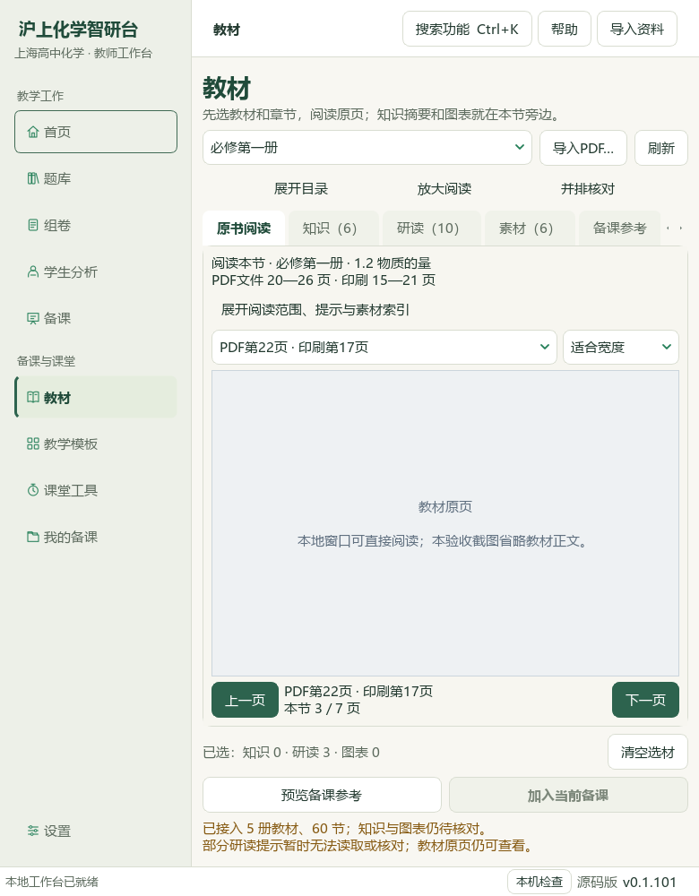
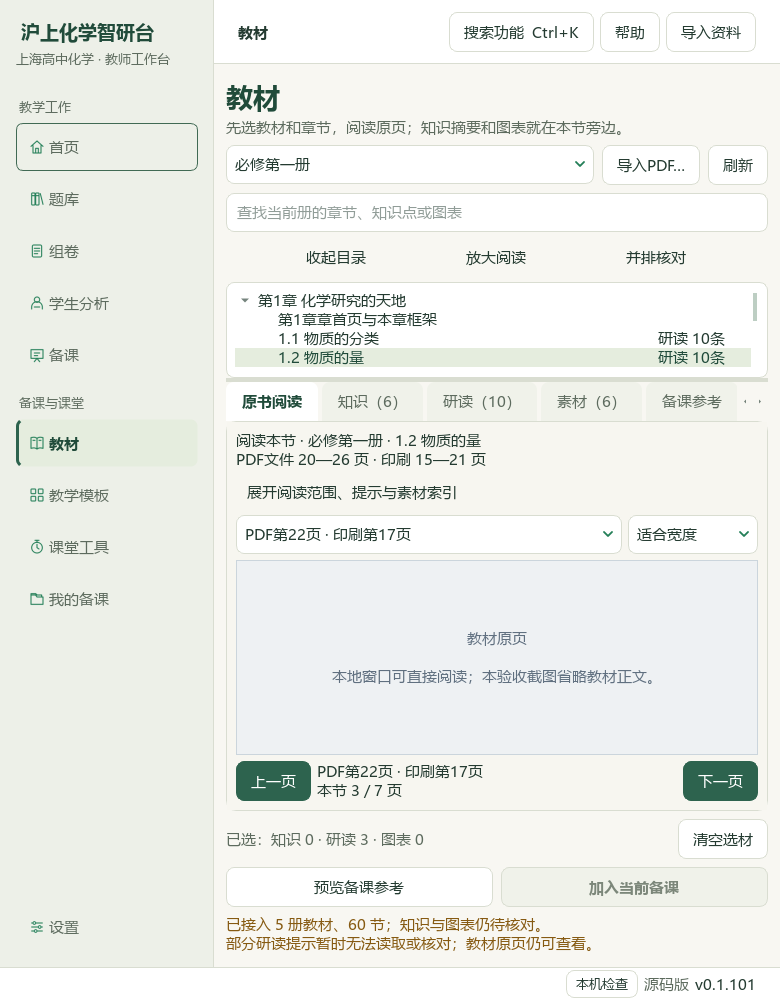
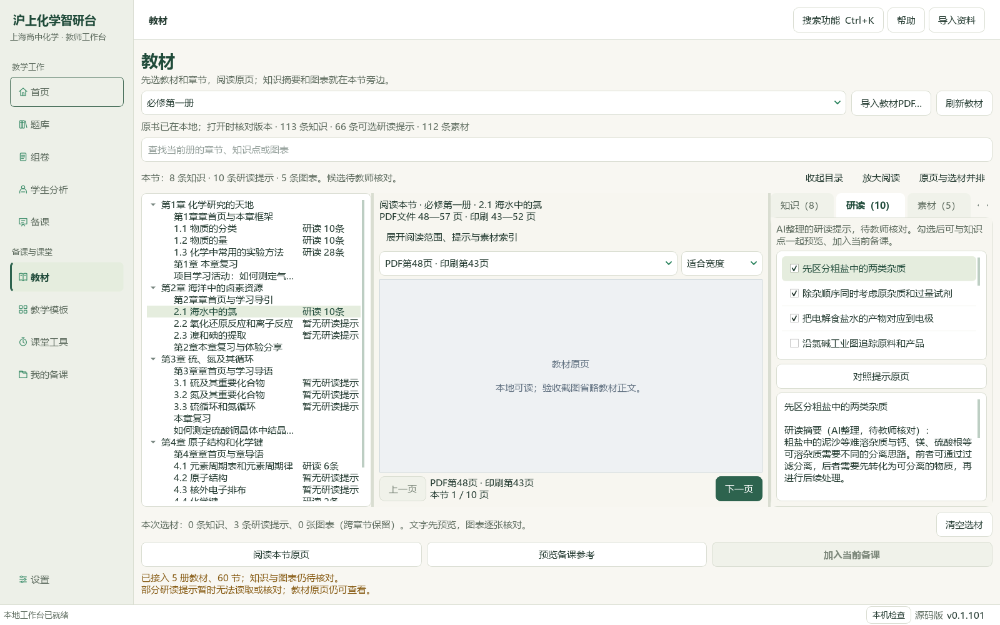
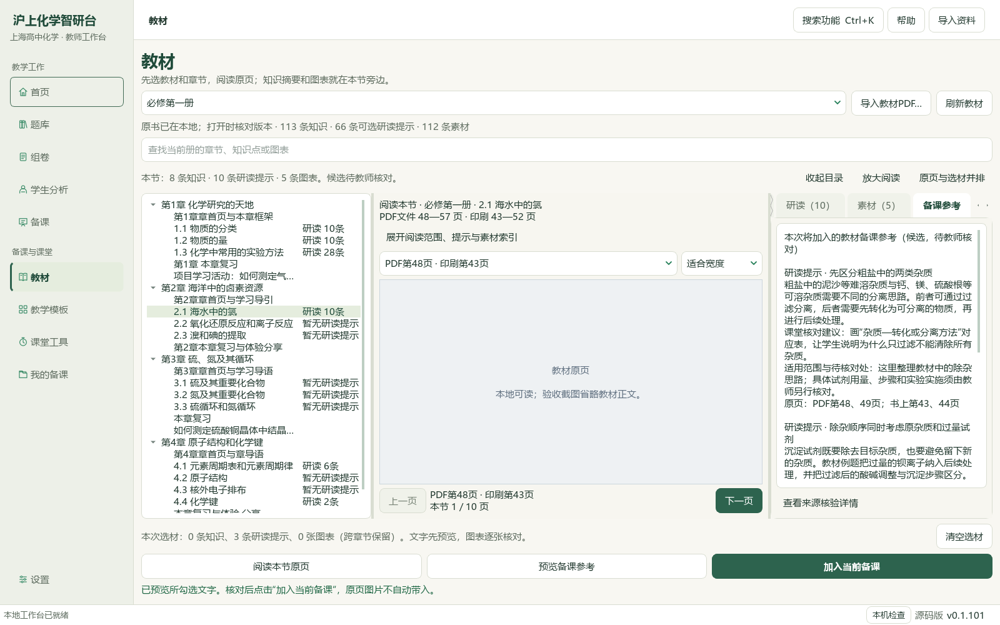

# 教材阅读空间优化、氯专题研读与图像题切片

2026-10-05，当前维护源码和本地候选资料，未发布。

教材页增加“展开／收起目录”和“放大阅读／返回选材”。窄窗原页阅读默认收起目录，备课按钮按可用宽度排列；同一PDF22和780×1000窗口中，视口高度120→340，放大后444像素。布局切换保留原页、选材；预览退出放大阅读，确认重核来源。必修一2.1《海水中的氯》PDF48—57／印刷43—52十页逐页核读，新增10条来源绑定研读候选。329存储笔记／290可选／43正式节，39条缺必要字段仍待核。新提示3条已实际预览、明确加入并保存草稿读回，教师原有表单保持。

醛酮专项与分离提纯讲义12题的题答、邻文和80/83资产已核读，14联系图与3幅原图放大；6完整原生范围、6部分。4题只补3个空主知识点与1处局部教材映射，非空替换0；该映射对照选必三3.2 PDF61—62，只对应醛基检测，不覆盖整题。3684属性中仅4计划行改变，3680其他行及9675旧历史保持，新历史4至9679，重复预览0变更。3处不可读旧公式、原生表格／装置布局／图像变换缺口保留；原解析试剂a标签、银镜条件绝对表述及既有K19错配疑点另核。

46讲1009参考（386K/273M/246P/104F）、383概念、319素材、77补充栏目、60正式节保持。catalog/corpus148＝108来源＋40派生，新增1份教材派生候选；新增原卷、题库题目0。98分析来源／3579题／3576可选，主知识3085／教材映射2979，分别缺494／600。747待办＝81文字＋607图像＋56范围材料＋3保护；648完整／146部分，完整已读仍待办130。未完整617＝19文字＋544图像＋51范围＋3保护，其中127图像已部分读、417未尝试；可行动纯文字0。217相关检查通过；本片只改1份应用Python。Office版面与教师化学复核、其余教材题目、更多视频UI及发行集成继续，EXE与版本未更新、未提交发布，总目标active。

## 进入与使用

“教材”→必修第一册→2.1海水中的氯→研读→对照提示原页。窄窗原页默认收起目录，点“展开目录”换节。需要更多空间时点“放大阅读”，点“返回选材”恢复页签；当前页和勾选保留。勾选提示→预览备课参考→核对后加入当前备课→保存草稿。预览退出放大阅读，显示实际将加入的材料。既有课题、对象、目标和材料保留；后续可到教学环节引用并制作教案/PPT/学习单，使用前仍须教师核对。

下面是实际Qt窗口和隔离示例状态，原页像素存于私有目录；公开截图在控件层省略教材正文。01—06图摄于本轮新氯提示保存前，07—08图反映新增后本册66可选提示。

## 输入、输出与保存范围

教材输入为登记SHA匹配的沪科技必修第一册，2.1正式页段PDF48—57／印刷43—52；题目来自PKG-037醛酮专项与PKG-038分离提纯讲义。未独立核验题头原卷身份、权威性或官方评分，外省题保留自身来源。本轮新增提示保存到源码及E:/项目/上海高中化学等级考/knowledge/textbook/reading-notes-20261005-chlorine.json；派生候选在sh-chem-db/05_命题热点素材/教材研读候选登记，catalog与corpus旧147项字节前缀保留。新标签通过既有缺失字段路径写入真实属性库；原题正文、答案、非空标签、难度和正式四层关系未改。新题库题目0。本轮身份选题排除历史完整和部分身份，12新身份互不重复；不据此声称全库语义去重完成。

布局操作不保存或重新导入原书。实际验证用隔离状态，备课草稿保存读回；真实494状态文件仅计划属性SQLite改变，5个人教材和196原Word受保护。知识笔记与备课草稿按教师指南各自范围保存、备份；本轮未创建新的Office导出，上一片三份候选示例保留，Office实际版面仍待核。

## 验证和后续

新增6界面测试覆盖可视空间、目录恢复、放大返回、预览退出、分隔比例保持和来源失败；相关13模块共217项通过。14个原生画面由主代理目视核对，包括两张冻结旧类对照；同一窗口、PDF22与三条选材，旧120像素、新340像素、放大444像素。新氯提示实际定位PDF48、三条预览与明确加入、表单保持和保存读回另有回执。标签只改4行，全部9675旧历史保持，重复预览0。初次对照脚本误用缓存新类、续办脚本常量生成错误及回执字段命名均有保留和修正记录；失败尝试不计为通过，数据库事务未重复。README14项、文档策略、全文件SHA保全和登记控制器最终结果见私有root-final-acceptance.json。

微信读书原页签已关闭，本片新开页签1193727498确认“使用微信扫一扫登录”，未执行认证。公众号关键词提交0、轮次0，文章数无法确认，直链／全文／有效新试卷0。待用关键词为“上海 等级考 化学 醛和酮 专项解析”“上海 高中化学 分离提纯 教学”；原出处、原卷、官方答案及评分细则继续缺失，不把本地转载标为官方。

私有任务账：E:/项目/上海高中化学等级考/outputs/2026-10-05-reading-space-question-slice。使用先前V10目录/原页、V28分页课件、V30备课表单、V32题卡候选池的已核抽帧参考，本轮没有新增视频观看声明；手机端按用户要求不在范围。下一教材节为2.2氧化还原反应和离子反应PDF58—67，另有417未尝试图像身份。剩余全量整理、复杂原生图形、教师化学、Office视觉、更多视频UI和发行集成继续。维护源码尚未合入旧桌面应用或EXE，没有提交、发行或更改版本；总目标继续active。
