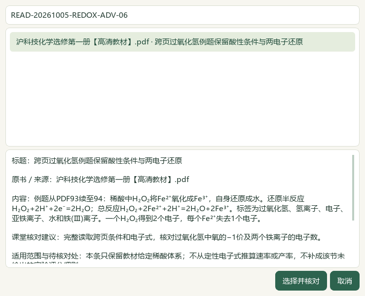
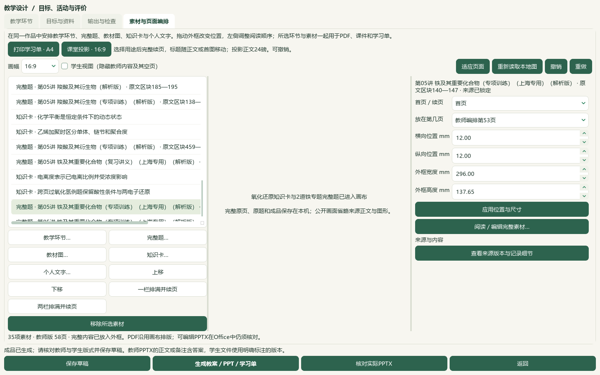

# 2026-10-05 氧化还原研读与铁专题题目导入切片验收

本片新增8教材候选，核读12题并补缺标签，修正溴苯实际PPT首页图文分离。当前仅接受有界的源码／资料进展；完整工作台与发行目标继续，微信读书永久停用。

选必一4.1《氧化还原反应》正文PDF91—94／印刷85—88及邻页90、95共6张原页核看，新增8条来源绑定候选，保留氧化剂／还原剂、锌铜置换、半反应、介质与实际微粒、酸性高锰酸根—亚铁离子和跨页过氧化氢例题的条件、电子数及物质标签。练习空白不补答案。教材453存储／414可选／56个正式节有笔记，共60节；39条旧缺项保持，数量不代表教师审核。catalog/corpus161＝108来源＋53派生，仅追加1份候选；原件和旧笔记保持。前序碳酸Ka2在PDF71表中4.8×10⁻¹¹、PDF72正文4.7×10⁻¹¹的差异继续保留，精确数值使用待核。

PKG-049铁专题原Word按SHA、版本、题面、现有答案与邻区块核读12题；33处资产中30处显示、3处缺失，5张完整资产联系图以及第21题两张原图实际核看。6题完成声明范围的现有图文核读，另6题仅部分核读，不把完整阅读等同于化学正确。仅给5题补缺主知识点K05“金属及其化合物”，其中2题新增选必一4.1映射；映射限氧化还原基础，不代表所有装置操作得到教材支撑。已有胶体及离子反应映射、非空标签、原答案、教师字段与未知考试信息保持。CO2排空气论证、廷德尔效应与磁性混淆、原文CO2与HCO3−方程式不一致、医疗选项及题表边界问题留在独立清单；有医疗选项和CO2解析疑点的两题未选入备课。未猜整卷—主题—印刷小题—作答单元层级、原题分值或难度。

内部渲染v7→v9，应用版本未变。富文本先测量首个大图前的实际短行，按剩余容量保持完整图与短题干组合；正文仍24磅，图片字节和比例保持。实际溴苯题的徽标／题干在区块234，流程图在区块235，属于两个原段落；浮点舍入曾把两倍字号高的小徽标当成大图，现以微小几何容差修正。教师／学生实际PPT第1页均显示标题、徽标、题干和完整流程。合成用例另覆盖同一段落内短文字＋大图及长导语控制。中间v8的109项测试和原生导出恢复虽通过，实际溴苯仍跨页，已明确降格为中间机械记录；初始徽标夹具计数错误与修正夹具后的真实失败XML保留。最终11模块110项通过，重叠运行不累加。

全库存独立副本通过实际Qt“知识卡…”预览确认跨页H2O2提示，再在“完整题…”核看、预览并确认两道铁题，明确点课堂投影重排。保留库存的3579题完整目录本次实际读取，不能当作冷启动空配置目录性能结论。作品为35素材／17题／20版120登记文件，旧32素材及重排前布局、114旧成品、备课图片和2套旧讲稿保持。新增铁泥题教师53／学生42同页显示题干与全流程，C/D选项续页54／43；Fe(OH)2题教师56／学生44同页显示题干与完整A/B装置，其余任务续页。既有酯题教师47／学生37完整同页，铁水蒸气题教师49／学生38题干与整图同页，选项50／39。页面仍混合多个主题，只用于集成验证。

实际本机Word教师25／学生13页，PowerPoint教师58／学生45页，共141页通过可用源文字和指定受众标记检查。根代理实际查看38张整页联系图、9张UI，以及两版PPT第1页原尺寸图；联系图最多4页全页缩略图，不称141页原尺寸逐张细读。画布PDF103页只作机器检查。草稿、恢复副本和ZIP恢复载荷相同，120源成品与恢复文件逐份摘要一致，旧114源／恢复文件另行复核。原生验证没有写真实UI状态；真实494文件中493保持，仅属性库按确认的5行计划改变，3684属性行保持总数、9719旧历史逐行保持并新增5行至9724。辅助466文件字节保持；前序临时辅助desktop-state.v1.json事故原字节仍未恢复，异常回执与事故后副本保留。

长答案、选项续页和稀疏页继续，教师PPT41仍有短答案孤页。Word来源附注内部成段但仍可与题目分处两页；历史用户活动中的裁片元数据／摘要串在Word教师10／学生6和PPT教师22／学生19—20可见。受众标记机器检查不代表所有技术串已自动排除。根代理视觉核看不等于独立教师化学审校，全部新教材与标签候选仍human_reviewed=false，教学／生成／发布资格关闭；B04／B09仍部分完成。

启动status先于准备，登记前validate与结束status/validate通过；文档策略和14项完整README检查另验。冻结1907条选定路径，区分3应用文件、1测试文件、教材登记、5行属性库和文档计划改动，不冒称新鲜扫描整个私有档案。题目队列本次重新生成：704＝81文字＋564图像＋56范围材料＋3保护；699完整阅读身份、191部分阅读身份，321未尝试可处理图题，19未读纯文字均已有部分读取阻碍。阅读身份不替代质量或课堂资格。

微信读书永久停用，检索文章、新有效试卷、新下载、模型供应商调用及外部网页请求均0。下一空节按实际书架为选必三1.1《有机化学的建立和发展》PDF7—11／印刷3—7，还剩4空节；选必一4.2已有笔记，不重复记为空节。教师审校、复杂Word／长题分页、目录冷启动、更多视频与语音核听、统一候选层和桌面发行继续。手机端排除，总目标active；未提交、推送、发布或重建v0.1.101 EXE。

## 操作与实际画面

在“教材”选选择性必修一4.1，进入“研读”对照提示原页；章节数字表示可选候选数，不能当作已人审。备课的“素材与页面编排 → 知识卡…”实际选择READ-20261005-REDOX-ADV-06，预览条件及课堂建议后确认。在“完整题…”分别看铁泥纳米Fe3O4流程题与Fe(OH)2装置题的题面、答案和选题预览，明确确认两题。再点“课堂投影 · 16:9”重排，生成教师／学生两版，核对实际PPTX并保存草稿。旧成品保留；采用新分页需重新生成。详见[页面编排操作](../teacher/lesson-and-paper.md#lesson-composition)。

## 来源、保存与限制

本片[8条教材候选](../../knowledge/textbook/reading-notes-20261005-redox-advanced.json)绑定原书`E:\项目\上海高中化学等级考\课本\沪科技化学选修第一册【高清教材】.pdf`，SHA-256为79e1e8391749b01a2d9d632531615ef9b644613130e28b98279aaea71aab2b05，正文PDF91—94／印刷85—88。第93—94页过氧化氢例题保留稀硫酸、2电子还原和Fe2+→Fe3+，不以方程式推算速率或产率。来源版本据实际文件，不猜年份、出版版本或考试官方资格。

题目来自用户提供的PKG-049《第05讲 铁及其重要化合物（专项训练）（上海专用）（解析版）.docx》，SHA-256为143efff467b39d9b1e70226df67574d6e1da60fe915637a238d9ba7cd8d5dca6。两道实际加入备课的题为原区块140—147和170—178；题内学校、年份仅为来源文本自述，未知结构化字段不补猜。原Word、图片、答案和版本引用保留，不能称官方评分细则。医学选项、CO2解析疑点、装置论证及部分表格／题目边界均不因标签写入而解除复核。

全部新增候选human_reviewed、teaching_use_allowed、generation_allowed、publication_allowed均false。根代理的来源和视觉核看不能代替独立教师审核。维护源码联动验证副本保有35素材、17题、20版成品及2套旧讲稿；ZIP登记120文件和备课图片，原教材、原Word、完整题库与独立来源回执按原范围另存。旧114成品及恢复文件另行摘要核对。本片没有生成新音频、核听或新增视频阅读。真实用户配置只发生已经来源核对的5行补缺标签及5历史追加，所有UI编排在独立副本完成。

实际两版溴苯第1页已查看原尺寸图并核验完整源图片字节，正文24磅保持。首屏预览视口可以滚动，不能把视口下边缘当作PPT裁断。长选项、长答案、稀疏页、Word来源附注孤页和旧活动正文中的技术摘要串仍在。当前作品跨多个化学主题，仅证明消费、保存和恢复路径，不当作完成的一节课堂课件。B04／B09保持部分完成。

下一实际空节是选必三1.1《有机化学的建立和发展》，PDF7—11／印刷3—7，原书SHA-256为26ccd86648c807476fd6f08db7e414571fa0d5e077db63b15c9880cb225cd137。余下4节空候选不代表其他56节已完整蒸馏或教师审核。704题目待办和321未尝试可处理图题按本次新队列继续。

私有证据目录：`E:\项目\上海高中化学等级考\outputs\2026-10-05-redox-inline-stem-slice`。原件、实际Office页及完整图文不上传公开文档。

| 记录 | 可支持的结论 |
| --- | --- |
| preparation.json、inputs-before.json、controller-status-start-command.json | 普通status先于准备，1907选定冻结路径，目标与手机／微信读书约束保持 |
| asset-manifest.json、reading-completion.json、current-bookshelf-final.json、remaining-textbook-sections-final.json | 6原页核看、8候选及当前453／414／56，下一实际空节及4空节清单 |
| registration-receipt.json | 1派生候选、161登记，旧catalog/corpus字节前缀保持，新试卷／题库题0 |
| questions/root-review.json、root-image-review.json、root-scope-acceptance-final.json | 12题、30显示资产与3缺失、6完整／6部分；原题疑点及仅候选结论 |
| questions/label-preview.json、label-apply.json、database-preservation-final.json | SHA绑定预览应用，5属性行、5主字段、2新教材映射；其他3679行和9719旧历史保持 |
| questions/repeat-preview.json | 重复预览0变更，不覆盖已有非空标签 |
| after-continuation/summary.json、next-question-work.json、historical-read-identity-ledger.json | 本次新鲜704待办、699完整／191部分阅读身份，321未尝试可处理图题 |
| regression-before.xml、regression-after.xml、related-tests-final.xml | v8阶段短行内图失败修复及109项中间检查，不算最终v9验收 |
| badge-boundary-regression-before.xml、badge-boundary-regression-before-corrected-fixture.xml | 首个徽标夹具计数错误单列；校正夹具后的实际分页失败保留 |
| actual-intro-measurement.json、intermediate-native-01-qualification.json、native-01/ | 实际两个源段落及徽标浮点诊断；v8原生机械成功但实际布局未达标 |
| application-tests-final.xml | 最终11模块110项通过，重叠测试不累加 |
| native-02/native-verification.json、actual-consumer-final.json | 实际Qt完整目录、1卡／2题选择、120源／恢复摘要、旧114及2讲稿保持 |
| native-02/actual-office-verification.json、visual-contact-manifest.json、root-manual-viewed-filenames.json、root-native-visual-review.json | 141实际Office页、38整页联系图／9UI核看及两版第1页原尺寸；原程序root_viewed=false保留 |
| controller-status-final.json、controller-validate-final.json | 当前规范控制器门禁通过，统计范围及限制见原回执 |
| documentation-sync-final.json、documentation-policy-final.json、readme-tests.xml | 8文档鲜读／精确备份／比较写入，知识库仅化学索引行更新，策略和14完整README检查 |
| source-review-manifest.json、full-hash-protection-final.json、next-work.json、root-final-acceptance.json | 待审公开集合、选定路径保护和有界进展；全目标仍active |

前序`2026-10-05-question-confirm-performance-slice/auxiliary-state-exception.json`所记临时辅助事故原字节仍未恢复；当前辅助466保持只覆盖事故后状态。原失败和中间验证记录保持，不改写旧验收。当前源码未复制到DATA旧应用，未递增应用版本、提交、推送或重建旧Release，v0.1.101 EXE仍为原发行。
