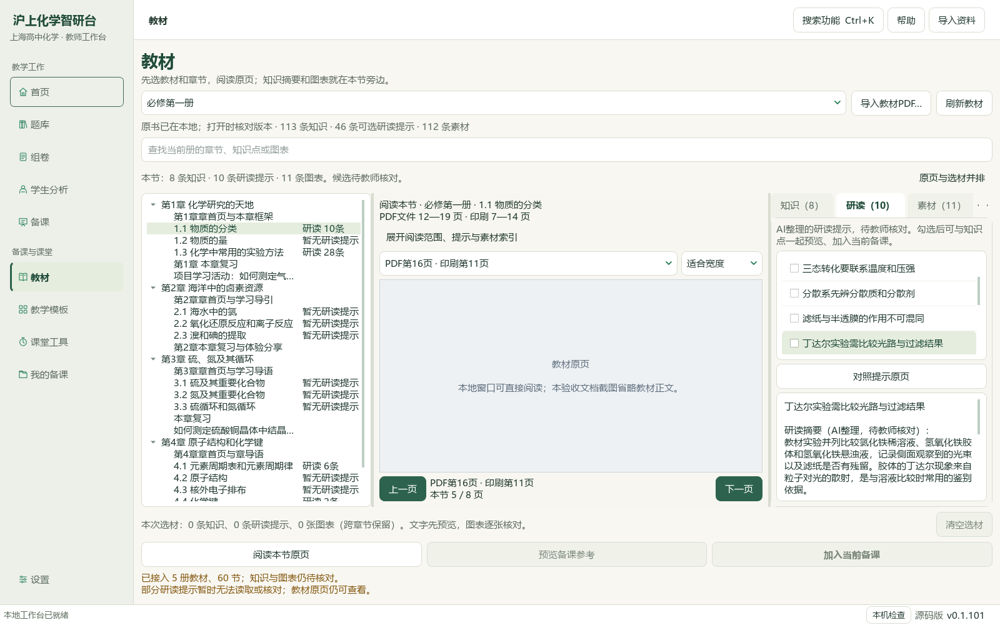
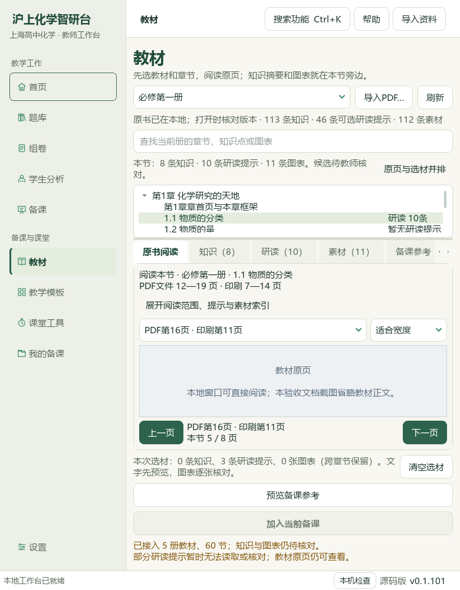
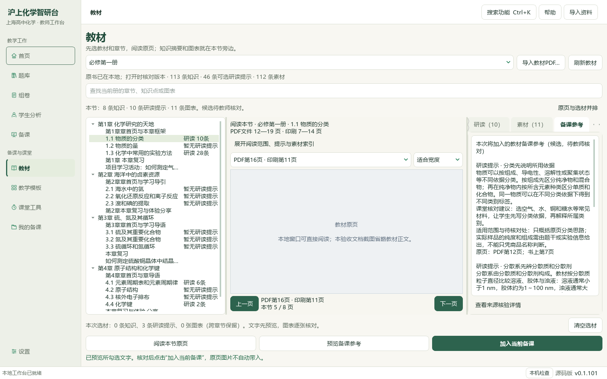
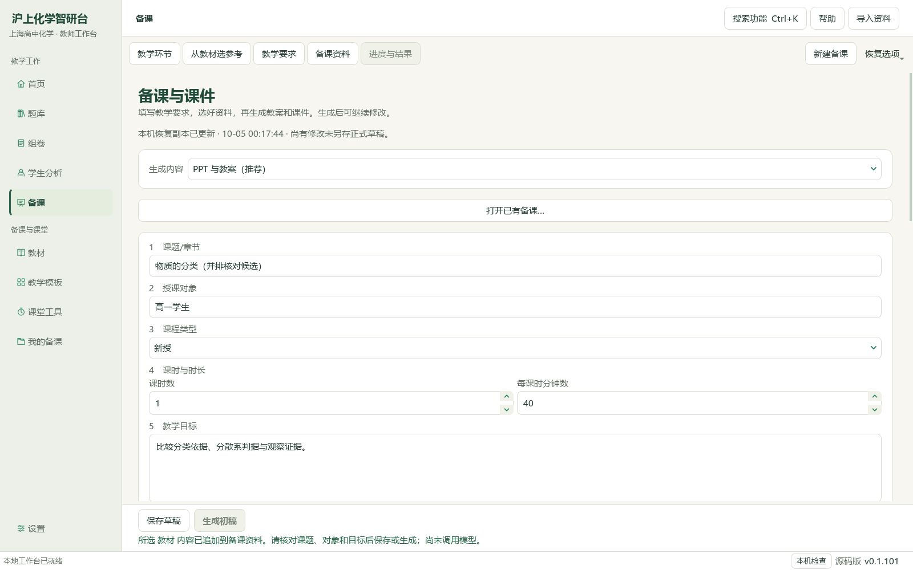

# 教材原页并排核对与钠专题12题切片

2026-10-05验收，工作于2026-10-04开始的本地切片目录。维护源码候选，未提交发布。

教材页新增“原页与选材并排”：宽窗可同时读原页、研读提示、知识或图表；窄窗使用页签，拉宽恢复并排，原页与跨章节勾选保留。点“对照提示原页”定位，预览后再明确加入当前备课；重核来源版本，既有课题、目标和材料保持。真实本地教材原页16已在Qt视图绘制，隔离示例草稿保存读回；公开截图省略教材正文，私有原页画面另存。只修改1份应用Python源码。

钠专题12题题答和邻文、27/34资产、5联系图及2幅放大原图已核读，7完整原生范围、5部分。6题补5空主知识点与3处空教材映射，非空替换0；碳酸盐映射另对照必修二PDF21、23—24／印刷17、19—20。装置细节待核1题不补，焰色题暂缺准确教材节锚点，原生7资产缺口保持。3684属性仅6计划行改变，3678其他行和9661旧历史保持；两次事务新增7历史至9668，重复预览均0变更。

46讲1009参考、383概念、319素材、309存储研读／270可选／41正式节、77补充栏目／60正式节保持；本轮新增研读0、题库新增0、catalog/corpus146＝108来源＋38派生保持。98来源／3579题／3576可选，主3075、教材映射2975，分别缺504／604；754待办＝81文字＋614图像＋56范围材料＋3保护。633完整／137部分，完整已读仍待办122；未完整632＝19文字＋559图像＋51范围＋3保护，118图像部分、441未尝试，行动纯文字0。公众号浏览器探测挂起且未取得页面，关键词提交0、完成轮次0，文章数无法确认，链接／全文／新有效试卷0。211相关回归通过；真实教材全量、剩余题目、复杂Office视觉复核、更多视频/UI及桌面发行集成继续。AI候选未人审，EXE与版本未更新，未提交发布，总目标active。

## 操作与页面

从“教材”选章节 → 研读 → 对照提示原页。宽窗同时查看目录、原页与选材，可切换知识、素材及备课参考；窄窗仍有页列表、前后页和滚动阅读。选中的知识与研读提示经预览和重新核对来源才加入当前备课。

下列是真实维护源码窗口与隔离示例状态；公开截图在控件层省略教材正文。真实PDF像素只保存在本地私有验收目录，主代理另逐张核对。

## 参考视频与证据

用户原BDL目录中V10、V28、V30、V32四文件SHA与原视频清单一致。本次实际核对四张六帧联系图，未逐秒完整观看；V10的目录旁原页核对用于此片布局，V28／V30的课件、教案同源路线沿用前片三份候选输出，V32题卡与选题池仅为交互参考。手机端不在用户当前范围。不据视频宣称化学正确性、速度、准确率或任意题图可编辑。

211项相关回归覆盖实际QPDF绘制、双栏与窄窗复用、来源变化阻断、切章与迟到结果、显式预览／确认、正式与个人教材及图表旧流程。完整README检查与文档策略结果、1165冻结路径最终SHA核验见私有root-final-acceptance.json。

## 保存与限制

新增UI不新增原书或笔记副本；已有教材、知识、备课备份范围按主指南。正式目录、教材原文件、旧研读、196原Word、5个人书与真实状态除计划属性库外均保留。前片Office候选沿用，此片没有重导出或新增Office版面认证。文字加入备课仍需明确引用到教学环节；正式四层题目关系、未知难度、来源权威性与教师审核不由缺失标签补全解锁。待办754、137部分读与122完整已读待办均保留原因，下一新图像切片从441未尝试身份选择。必修一1.2 PDF20—26仍待下片核读；全量教材、题目、复杂Office、更多视频/UI和桌面发行集成尚未完成。

公众号探测异常、初次队列计数校正、图像题9的后续准确教材映射以及截图脚本修正均保留原始回执；失败尝试不计通过，原始说明不悄悄覆盖。此片任务账与有效结果位于E:/项目/上海高中化学等级考/outputs/2026-10-04-textbook-parallel-sodium-slice。
