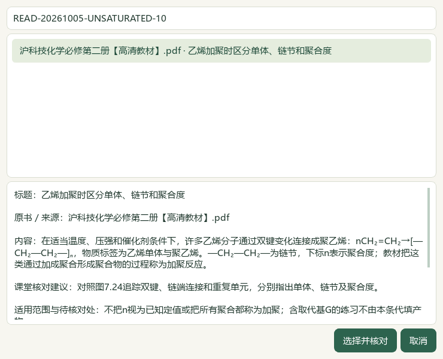
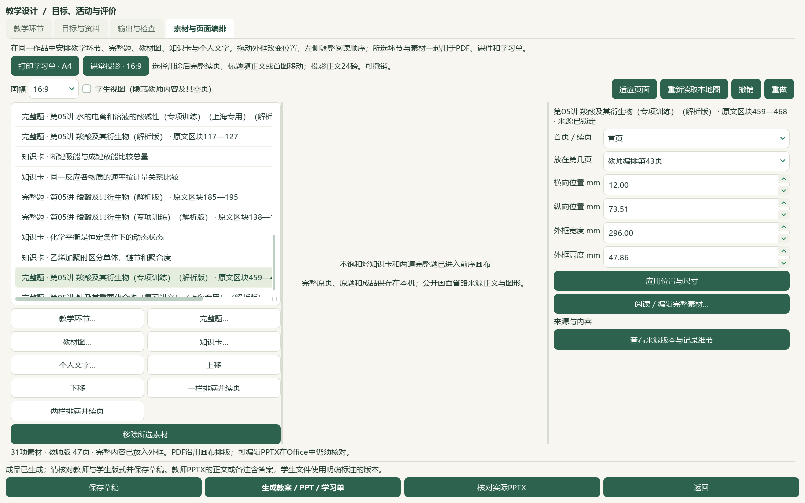

# 2026-10-05 不饱和烃研读与装置图题导入切片验收

本片新增12条教材候选，并核读12道原Word题；其中5题补缺，2题实际进入验证备课。微信读书停用。完整教材导入、界面与发行目标继续。

必修二7.2《不饱和烃》PDF84—94／印刷80—90的11原页及邻页83、95逐页查看，新增12条来源绑定候选，保留石油分馏与裂解、煤加工、电石制乙炔、乙烯／乙炔／苯结构、氧化、加成、加聚、塑料分类和二氯乙烷反应类型的原页范围。历史统计不当作当前数据，空练习与实验表不补答案，苯不按固定单双键解释。437存储／398可选／54个正式节有笔记，正式节共60，39旧缺项保持；数量不表示整节教师审核。catalog/corpus159＝108来源＋51派生，只追加1份教材候选，原文件保持。

3份羧酸／铁原Word按来源、版本与区块核读12题的题面、现有答案和邻区块；42处资产中36处实际显示、6处仍不可读，另看4张原资产。6题声明范围的正文和可用答案图已完整核看，6题仅部分核看；两题有邻标题边界问题。仅给5题补缺候选标签：4个主知识点、5个教材映射／链接，覆盖酯基础7.3和铁与水蒸气反应基础5.1；后者及酯映射不等于装置细节全部被教材支撑。补读教材PDF10、99、100原页。7题保留图形或范围问题；已补标签的异丙酯两路线题，其原解析共平面说法仍待独立教师核对，未选入备课。既有标签、未知原考试信息及教师字段保持，不补猜原题层级或难度。

真实属性库3684行中只计划修改5行，其他3679行保持；9714旧历史全部保持，追加5行至9719，其他493真实状态文件保持。补标预览与确认绑定计划摘要，重复预览改变0题。新鲜整库98分析来源／3579题／3576可选，主知识3116／教材映射3005；708待办＝81文字＋568图像＋56范围材料＋3保护。693完整阅读身份／185部分阅读身份，333未尝试图像继续；标签齐备不代表化学和教师审核通过。

实际Qt窗口以正常任务桥读取完整3579题目录，目录阶段约14.563秒，属于这次保留库存副本的观测，不是空白用户首次启动验收。经“知识卡…”选择加聚提示，再经“完整题…”阅读、预览并明确确认乙酸乙酯装置题及铁与水蒸气题，前序作品在独立副本变为31素材／15题／18版108登记文件。旧28素材及外框在主动投影重排前保持，原2套讲稿保持。实际Word教师22／学生11页、PowerPoint教师47／学生44页，共124页文字与受众检查通过；根代理逐一查看32张整页联系图和9张实际UI图。联系图为每张4页全页缩略图，不冒称124张原尺寸页逐张细读；画布PDF的91页仅机器核对。本片不测试新语音或完整视频。

草稿、恢复副本及ZIP恢复载荷相同，108份成品与恢复文件逐份散列一致，原102份和图片保持。首轮验证在保存与备份前因公开截图继承旧目录、碰到既有文件而失败，原图未覆盖；新产生的错放图保留私有，失败记录未改写。改正目录后用新副本重试通过。输出仍是混合学科验证作品：新题题干与装置图跨页，长答案、选项和短图注续页，Word教师末页仅续来源说明，旧图表活动将裁片摘要放进可见正文；这些排版及技术文字问题仍待处理，不能据文件完整认定成品课例可交付。

普通任务启动status先于准备，中央登记与补标前validate及批次结束status/validate均通过。应用源码本片改动0，沿用前序功能；前序73应用用例及20重叠复验不计作本片新测试。文档策略和14项完整README检查另验。冻结1139条选定路径，最终散列按计划区分登记、数据库与文档改动，不宣称重新核验全部私有档案。前序临时辅助desktop-state.v1.json事故原字节仍未恢复；异常回执与事故后字节保持，不写成历史恢复。当前来源辅助466文件保持。旧stager输出的article_search_login_required=true是继承字面量，未发起登录或接口请求，不作为后续前置。

微信读书永久停用，本片关键词、检索文章、新有效试卷、新下载、模型供应商调用及外部网页请求均0。下一空节按实际目录为选必一3.2《弱电解质的电离平衡》PDF70—73／印刷64—67，使用该册页码偏移；708待办队列中的下一批未读图题继续。完整资料、独立教师化学和装置图审核、复杂Word／长题跨页、更多视频与语音功能、候选统一和桌面发行仍待完成。手机端排除，目标active；未提交、推送、发布或重建v0.1.101 EXE。

## 选材与备课操作

在“教材”选择必修二7.2，打开“研读”对照提示原页；勾选后预览并加入当前备课。需要在页面中直接排版时，在“备课 → 教学环节 → 素材与页面编排 → 知识卡…”选来源绑定提示。点“完整题…”逐题阅读题面和答案，预览后确认；核对教师和学生文件，再保存草稿。详见[页面编排](../teacher/lesson-and-paper.md#lesson-composition)。知识卡仍待教师核对。

## 来源与候选边界

| 来源 | 本片核读范围及SHA-256 |
| --- | --- |
| 沪科技化学必修第二册【高清教材】.pdf | 正文PDF84—94、邻页83／95、映射页10／99／100；92f09535689cbb1192526a7f8b4dde2254869052d8e3b6d88b8bed9d354094ce |
| PKG-047 羧酸及其衍生物专项解析 | 3题；10d8d38163cae7c45aae382d8a81b7a94fbf866d0265f273736ecab800de3638 |
| PKG-048 铁及其重要化合物复习讲义解析 | 5题；4a68bf425af0d4c1fd128957b3082a8e374a9cbcb97aae8e5be9c68bd1b66d1f |
| PKG-049 铁及其重要化合物专项解析 | 4题；143efff467b39d9b1e70226df67574d6e1da60fe915637a238d9ba7cd8d5dca6 |

原Word标题及题内年份仅为原材料线索，未查到原卷不解锁官方来源、整卷结构、答案或评分资格。首题乙酸乙酯b459—468与铁水蒸气b501—508用于本地验证作品，仍是来源绑定候选。羧酸两路线b650—659只补基础标签，原答案共平面说法待教师核对，不作化学定论。其余不可读对象不按图形猜写，两个邻标题边界保持待核，完整阅读身份与正式题库写入分别计数。新原卷、新题库题均0。

下一教材原件为沪科技化学选修第一册【高清教材】.pdf，SHA-256为79e1e8391749b01a2d9d632531615ef9b644613130e28b98279aaea71aab2b05；该节本片未读，不沿用必修二的页码偏移。教材、题面、答案、联系图、成品和备份保留私有；源码截图只展示操作和候选摘要。

## 保存、验证与未完事项

独立本机副本的31素材／15题／18输出版本与2套既有讲稿按原草稿恢复机制保存。ZIP包含登记成品与备课图片；完整原Word、原教材、题库及独立裁图回执仍须按原范围另行保存。108登记文件含前序102文件，逐份与恢复目录核对一致。可查看本机实际Office原文件继续细核；本片联系图不能替代教师审校。

题干与装置图、选项及长答案仍可能跨页；教师Word第22页只剩来源续文，历史图表活动的裁片摘要仍显示在页面正文。混合验证作品未完成课堂编排，B04／B09仍部分完成。未进行本片声音核听、自动配音、完整参考视频或新版EXE验收。

私有目录：`E:\项目\上海高中化学等级考\outputs\2026-10-05-unsaturated-intake-slice`。

| 记录 | 可支持的结论 |
| --- | --- |
| preparation.json、inputs-before.json | 启动status先于准备，1139选定冻结路径与接续目标 |
| reading-completion.json、mapping-original-pages-viewed.json | 13原教材页及3映射原页的本片模型实际核看 |
| questions/root-review.json、root-scope-acceptance-final.json | 12题、36显示／6不可读资产、边界和化学待核 |
| questions/label-preview.json、label-apply.json、repeat-preview.json | 缺项计划与确认、5题候选补标、重复预览0改变 |
| questions/database-preservation-final.json、registration-receipt.json | 5计划属性行、5新增历史、493其他用户文件保持，1派生登记 |
| native-failed-attempt-01.json、native-01/ | 首次截图目录失败及保留原记录，不算验收成功 |
| native-02/native-verification.json、actual-consumer-final.json | 原生选材、完整目录、实际Office和108成品恢复 |
| visual-contact-manifest.json、root-native-visual-review.json | 32整页联系图／124实际Office页及9UI模型核看，原程序自动字段不改 |
| next-question-work.json、next-work.json | 新鲜708待办、693完整／185部分阅读身份、333未尝试图题及下一空节 |
| controller-status-final.json、controller-validate-final.json | 普通门禁，保留旧库存漂移及隐私范围说明 |
| documentation-sync-final.json、documentation-policy-final.json、readme-tests.xml | 鲜读、精确备份、比较写入，文档策略与14项README检查 |
| source-review-manifest.json、full-hash-protection-final.json、root-final-acceptance.json | 全部当前待审公开集合、冻结范围、有界进展验收 |

前序2026-10-05-question-confirm-performance-slice/auxiliary-state-exception.json所记临时辅助状态原字节仍未恢复。当前466辅助文件保持只覆盖事故后状态，不能抹去该例外。未把候选写成已发布，旧试用包未更新。
