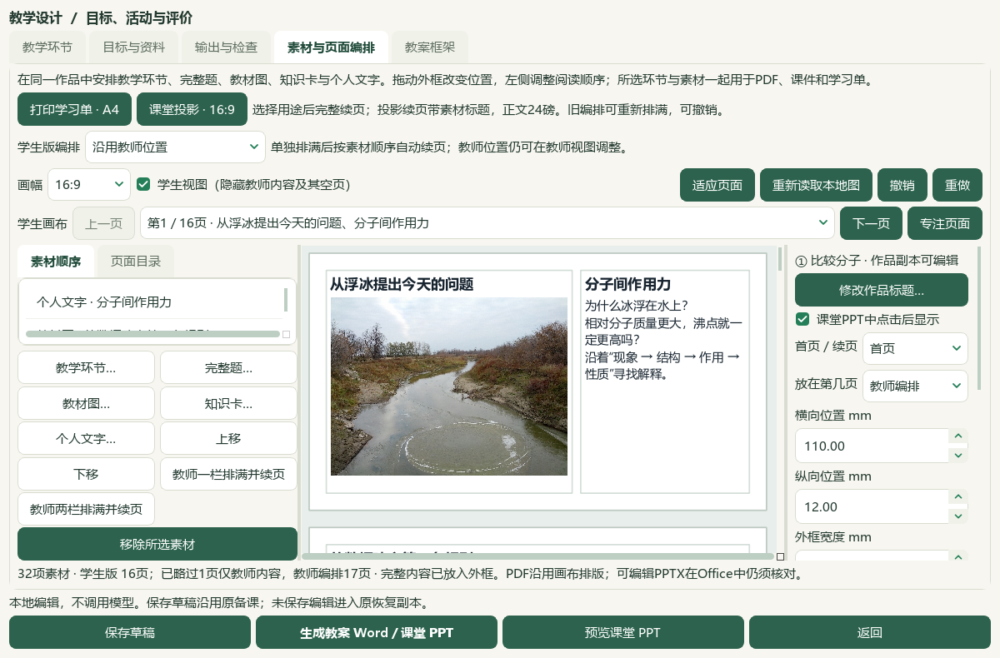
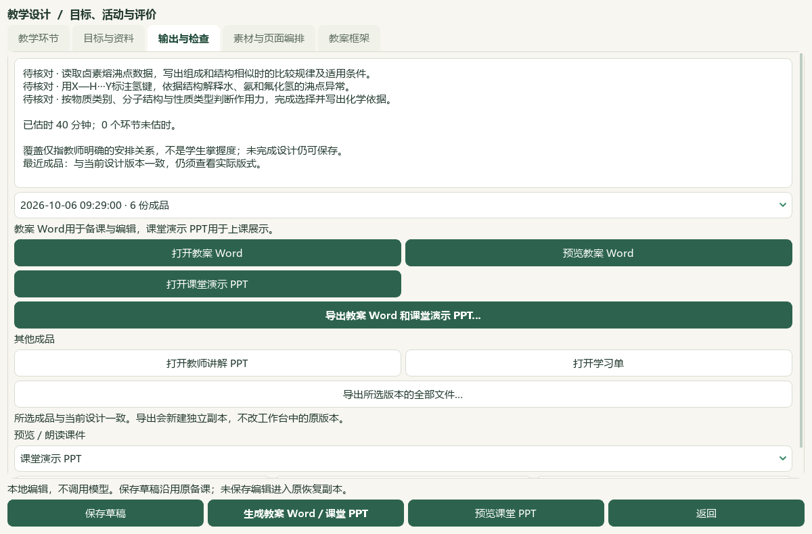

# Word教案、教材素材与课堂点击讲解验收

2026-10-06，本地维护源码切片；当前大目标仍为 active，本页不计整体工作台或发行完成。

按用户本次明确要求，教案主要交付可编辑Word，课堂演示交付PPT；生成正文、图注和备注不写来源、待核实提醒或防御性文字。课件以知识讲解和教材、课外真实素材组织课堂，练习为辅；答案可与题目同页，点击才出现，标注与因果链也可逐步显示。完整来源与原始题答继续保留在内部材料记录。微信读书永久停用。

## 可直接打开的当前结果

- 成品目录：`E:\项目\上海高中化学等级考\outputs\2026-10-06-word-plan-classroom-ppt\classroom-design\animated\教师成品\教案与课堂PPT-e7a1073a-w0mn7uyy`，只含 `教案.docx` 和 `课堂演示.pptx`。
- 工作台入口：`E:\项目\上海高中化学等级考\outputs\2026-10-06-word-plan-classroom-ppt\classroom-design\animated\打开课堂动画与Word教案工作台.cmd`。使用隔离候选配置与当前维护源码，未替换 v0.1.101 EXE。
- 普通备课备份：上述 `animated` 目录内 `课堂动画与Word教案备课.zip`；原教材与笔记专用备份仍在上两级 `个人原教材与三条知识笔记.zip`。
- 当前草稿 `prep-20f1591bf80e4ddd9bc60cbee6bf1fd4`，所选输出 `OUT-d9b93ecb6e02441c808eb489e7a1073a`。完整文件SHA、实际渲染与检查输入见同目录的JSON回执。

## 课堂结构和素材

六个环节共40分钟：现象与数据4分钟、同类比较7分钟、氢键建模11分钟、教材例题与宏观解释7分钟、迁移和诊断8分钟、小结与作业3分钟。当前32素材、2完整原讲义题、18个保存输出版本；课堂PPT16页，教师编排多出的原答案续页不进入课堂PPT。

| 课堂页 | 学习任务 | 点击显示 |
| --- | --- | --- |
| 1—2 | 从真实浮冰照片提问，阅读卤素熔沸点表 | 无 |
| 3—4 | 建立组成结构相似时的比较链，再读同族氢化物反例图 | 第3页两步 |
| 5—9 | 阅读完整氢键模型，标注X—H与H···Y；解释异常沸点，区分物理性质与热稳定性 | 第6、7页各两步，第8页一步 |
| 10—12 | 教材甲醚／乙醇例题同页反馈；回到浮冰现象，连接排列、体积与密度 | 第10页反馈一步，第12页两步 |
| 13—16 | 一道正式课堂诊断题同页反馈，整理判断方法与知识关系，布置课后迁移 | 第13、14、15页各一步 |

13个点击步骤分布9页；第10与13页的题目、分析保持同页。不是连续罗列11道题的前序样例。第16原讲义题用于课堂诊断，第22题用于课后迁移；两题题干、全部选项、原始答案及上下标依据保持，原11题仍保留在前序草稿和原Word库中。

直接阅读本地选必二原PDF54—56／印刷50—52，实际选用卤素熔沸点表、完整水／氨／HF与水的氢键模型和同族氢化物沸点图。原书105页、9个目录候选、3条个人笔记及PDF54阅读位置保持；原书SHA为 `4eb751c3bc879d2ad41a2faa723b3b4af05b29ff78f3e89a2eaf9727ebb8a848`。首张模型裁片截掉右端H，作为诊断保留；新裁片包含右端H，课堂成品只用新完整裁片。

新增真实浮冰照片来自USGS原始媒体页面，公共领域许可、拍摄信息、原URL及完整SHA保存在 `external-photo.json`。原图2592×1944、2661256字节，SHA `7a9a41898e8ec6df63e0e96e470691348ad28056f374a8d40b3021f875750add`。原文件保存于E盘 `sh-chem-db/05_命题热点素材/2013-USGS-课堂情境-浮冰照片`，catalog170→171，原170行和原始字节前缀保持。该照片不是新试卷，也没有题目答案或评分标准。

## 实际文件与工作台检查

本机Microsoft Word实际转换教案13页，Microsoft PowerPoint实际转换课堂PPT16页，共29页；源Word与PPT在转换前后SHA一致。完整文字、教案五部分、原图字节、PPT可编辑文字和上下标、原教师答案范围、生成文件无来源／提醒／防御性文字的检查通过。两文件副本与登记成品字节完全相同。

另开本次专属只读PowerPoint会话，直接读取实际 `Slides.TimeLine.MainSequence`：13个 `EffectType=1`（Appear）、`TriggerType=1`（OnPageClick），每个效果绑定一个资源分组。第10、13页同页反馈分别有一个点击效果，源文件未变；会话按本次确切归属清理，未接管用户其他Office实例。静态PDF显示所有步骤完成后的页面，时间线读回是动画证据；没有把静态PDF冒充逐帧放映或真人课堂审核。

根代理直接查看两张覆盖29页的缩略总览，以及课堂6、10、12、13页和Word2、9、11页七个完整渲染页，检查模型边缘、同页题答、课堂流程和短讲解标题。仅此范围，不称29个完整页全部逐页视觉审核或105页全文研读。AI本地判断不计独立人审。

工作台已提供 **课堂PPT中点击后显示**，只有16:9学生可见素材可选。点击设置随撤销、重做、草稿、恢复副本和普通ZIP保存；静态学生学习单隐藏点击资源，课堂PPT保留原生动画，原教师答案不因勾选而解锁。切换到打印用途时移除本次PPT点击设置，撤销可恢复。

**输出与检查** 提供 **打开教案 Word**、**预览教案 Word**、**打开课堂演示 PPT** 和 **导出教案 Word 和课堂演示 PPT…**。页面编排六份成品使用学生PPT作为课堂演示；兼容旧三份成品时使用原PPT。两文件导出新建目录并核对登记SHA，取消或失败不留下半套副本。

实际 `CMD → .lnk → Pythonw → Qt` 新进程重开当前精确payload，恢复35草稿、32素材、2完整题、18版、13点击设置、全部框架字段与PDF54位置。生产PID和退出检查见 `candidate-entry-receipt.json`，未写入真实使用配置。

普通ZIP在新目录恢复35草稿／210登记成品／35唯一输出版本／59图片摘要；每份草稿、每个登记成品和所引用图片逐字节一致，恢复副本等于当前payload。原32稿及33／34中间稿保留。普通ZIP不含Word原题库、范围标签、原教材、阅读位置、模型设置或密钥；原教材专用ZIP另保持105页／9节／3笔记及位置，不含备课作品或Word库。

## 回归、保存边界与未完成范围

9个既有应用模块、1个新动画模块、4个新测试文件及3个既有测试更新。当前固定源码输入下596项相关检查全部通过；61项针对性检查也通过，输入SHA在检查期间一致。完整README14项与文档策略另见最终命令回执。相关检查不等于全仓检查；前序扩大Word检查的12失败／8缺夹具错误未解决，本轮未重跑。

中间日志保留：来源页码显示与旧提示词断言、缺Qt夹具修正后重跑通过；首个入口助手在UTF-8解码前失败，旧快捷方式保留，新入口显式UTF-8并实际启动通过；教案短讲解孤立标题已修正；文档助手首轮检查到README超出长度限制，在写入前停止，缩短后六份规范文档更新。旧样例、诊断裁片和失败日志未覆盖。

原始输入2372项、原739文件配置副本、所有旧草稿与成品、原教材及中央数据的完整SHA核对见 `root-final-acceptance.json`。允许改变的既有范围限本片应用、测试、六份规范文档、化学项目记忆和E盘catalog新增照片；共享索引只更新化学行。Word98来源／3580候选／465文件、3684属性／9737历史、5范围／11选择，中央知识386／图表322、正式4／真人0，阅读身份740／冻结702不变。本片没有新题库导入、中央标签提升或人审资格提升。

外部核验使用USGS原始页面，下载一张公共领域照片；普通urllib首轮SSL失败保留诊断，正常PowerShell原站GET成功，未绕过访问控制。新试卷0、微信读书0、真实模型调用0；不称外部请求0。渲染修订 `shchem.composition-click-reveal.v22`、提示词 `20261006-material-led-animation-v30`。提示词要求知识和素材为主、少量题目、同页点击与分步解释；本片未测试真实供应商自动生成课堂动画的质量。

HEAD `e08c3e778d94ac9bdb526266dc668cc9b18a5091`、空索引及旧EXE v0.1.101保持，未提交、推送、重建或发行。总目标active：更多教材与题目、Q11歧义、正式四层与化学审校、整体UI和桌面发行继续；手机端按既定范围排除。动画当前为资源分组点击出现，未新增分子运动或复杂运动路径编辑器。
