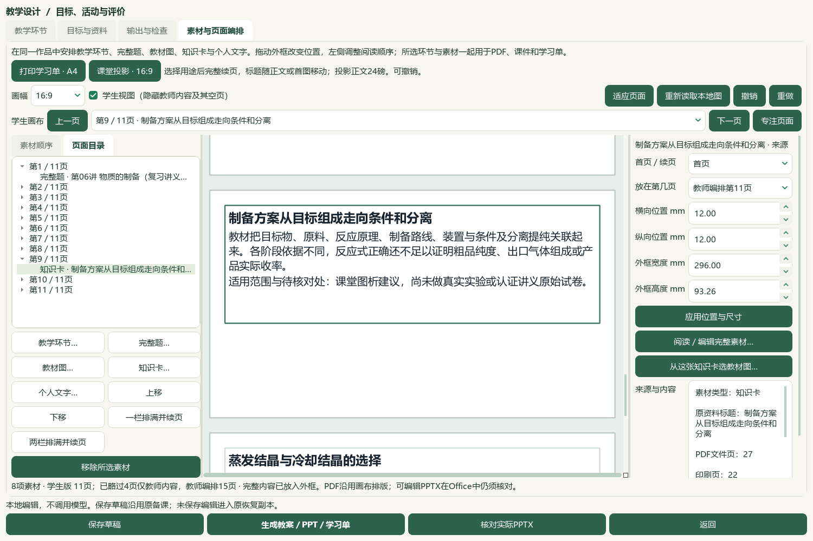
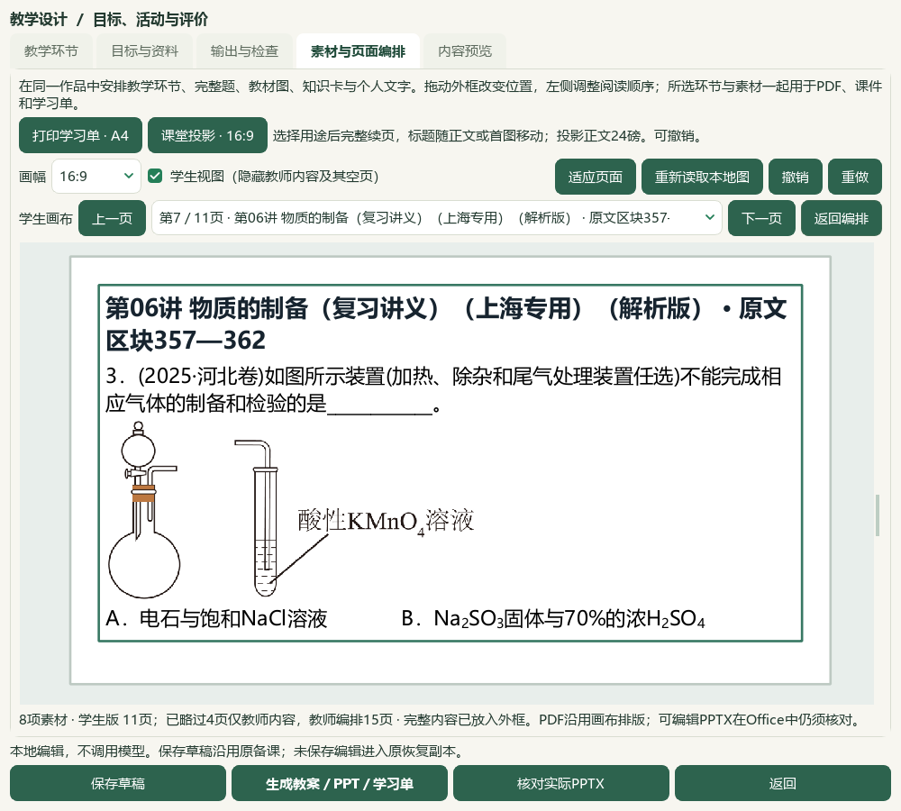
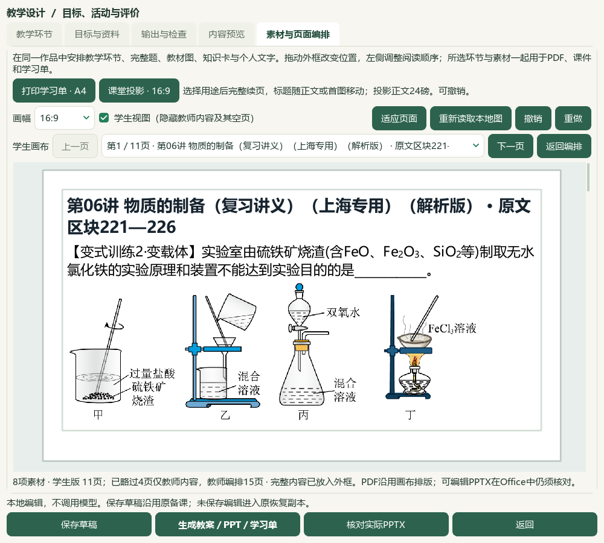

# 画布页面目录与专注阅读验收

2026-10-06，HEAD `e08c3e7`，当前维护源码，未发布。前序4题与3卡的来源、教材原页、实际Office和保存／恢复见[前序验收](2026-10-06-question-preparation-import-qa.md)；使用见[素材页面编排](../teacher/lesson-and-paper.md#lesson-composition)。微信读书停用。本轮文章、新有效试卷、下载、重复归档、外部请求和供应商调用均0，原资料缺项与原题待核问题沿用前序。

## 可使用的改进

在 **备课→教学环节→素材与页面编排**，用 **页面目录**、顶栏页码、**上一页／下一页** 直接定位当前画布页。页内条目按素材列出完整题、图、知识卡及续页；点续页同步右侧来源与原外框。**素材顺序**仍控制阅读顺序，右侧 **放在第几页** 仍指教师编排原页；学生目录重新编号实际可见页，保留相同原页身份。两版都空的手工页继续可选；预览失败或学生无内容时停用旧导航。

点 **专注页面** 展开图文阅读；页码和前后翻页仍可用，点 **返回编排** 回到同一页的素材和来源。1000像素实际窗可用画布宽470→948像素。切换教师／学生视图时，目录与实际镜头共同回到可见页，避免教师末页被略去后仍停在学生末页。翻页仅使用现有布局结果；来源、内容、位置、撤销和成品记录保持。

## 实际范围与证据

从前序已验证的备课ZIP恢复到`C:/Users/20671/AppData/Local/ShanghaiChem/LocalCandidates/2026-10-06-page-navigation/profile`，未操作前序候选或真实个人目录。实际完整Qt工作台重开8素材与3版记录，教师15页、学生11页均以原生下一页按钮逐页定位，共26页；原生树点击装置题与答案续页，随后检查1000像素专注、返回和视图切换。10张Qt截图根代理全部核看，早期5张导航截图不含后增的专注按钮；最终5张补充新按钮及镜头修复。并非26页全部逐张原尺寸化学审核。

3份草稿、3版18文件及16引用图片摘要逐份保持，当前备课载荷、外框、资源原快照和历史无编辑。无新草稿或导出；旧Word7／3页、PPT15／11页及36页实际Office证据来自前序。当前页码只表示画布，Word页数可能不同；本轮未重跑Office转换，不以Qt截图认证全部Office版面、真实投影或原题化学正确性。新正式题、标签、答案修订、知识笔记、完整阅读身份均0；正式教材登记167及457可选／60节保持，702待办与261未尝试图题沿用前序。

本机双击`E:/项目/上海高中化学等级考/outputs/2026-10-06-composition-page-navigation/打开页面目录备课候选.cmd`打开独立候选，按上面的路径进入编辑。入口通过标准快捷方式直启Pythonw，不改系统执行策略；依赖本机CODE源码、DATA原资料及既有Python环境。当前载荷与旧文件已有本轮实际入口核对。未替换安装EXE，备课ZIP不含正式原书、完整题库或个人研读档案。

## 参考视频与检查

核对本地V28原MP4 SHA-256 `dbeb9199d6fb3595ab9249452d420354dc59b5cc1a43d4ceac32a077d1adc559`，先看原6帧联系图，再提取36—104秒每4秒共18新帧，并看3完整联系图。可见目录入口、页码1—7、前后箭头与朗读控件；此范围未看到目录弹窗打开过程，不能据此声称还原其弹窗。未完整播放、未听音频，原清单记录该MP4音轨0；未验证朗读功能、效率倍数，也未新增HTML或语音导出。本轮仅参照其页面组织改善原生操作。

最终35项相关测试覆盖9项新导航／专注行为、既有素材编辑／来源、学生页范围与教学环节。早期新测试把“禁止重排”替身留到关闭时，又缺合成图片SHA长度及页码依据，修复测试夹具后34项通过；加入专注后35项通过。随后多可见页测试实际复现切换后的镜头／页码不一致，修复并重新检查最终35项。单学生页旧检查曾通过，不能替代多页检查。旧失败XML及私有记录保留；文档策略、14完整README、普通status／validate和5654冻结保护另存终验回执，不把局部检查计作全目标完成。

真实个人494文件及3684属性／9733历史保持，辅助466保持事故后字节，旧临时事故前原字节仍未恢复。知识库同步只更新化学行和项目页，先鲜读备份并核对写入版本，保留其他项目更新。当前human_reviewed、teaching_use_allowed、generation_allowed、publication_allowed仍false；候选不等于独立教师审校。更多资料、四层题目证据、视频功能、统一候选与发行继续，手机端排除、总目标active。

私有证据位于本片目录：`native-verification.json`、`native-focus-verification.json`、`native-audience-verification.json`、`page-navigation-final.xml`、`video-frame-extraction.json`、`candidate-entry-verifications/`和终验回执。原Word、教材原件、旧成品、失败XML和前序冻结记录保留；无提交、推送、发布或EXE重建。
