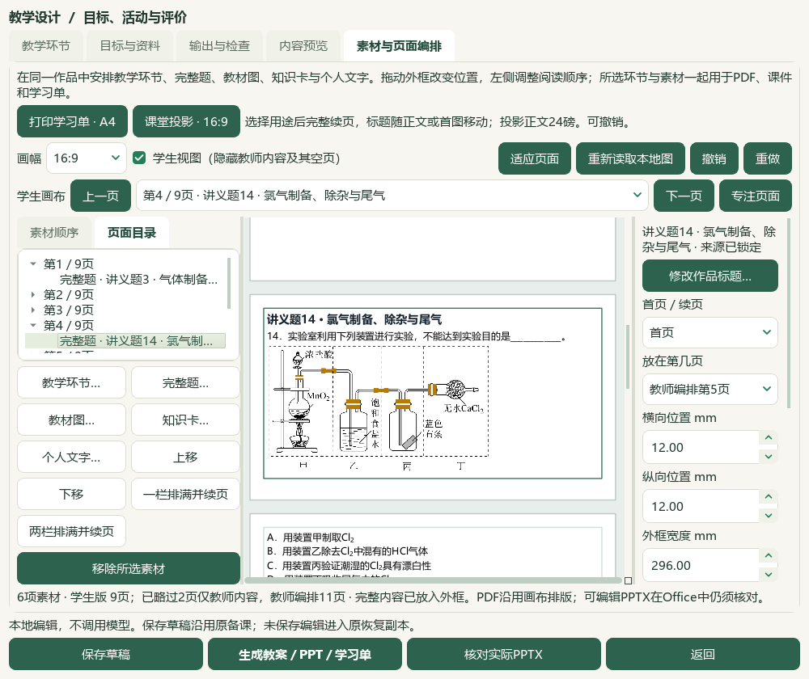
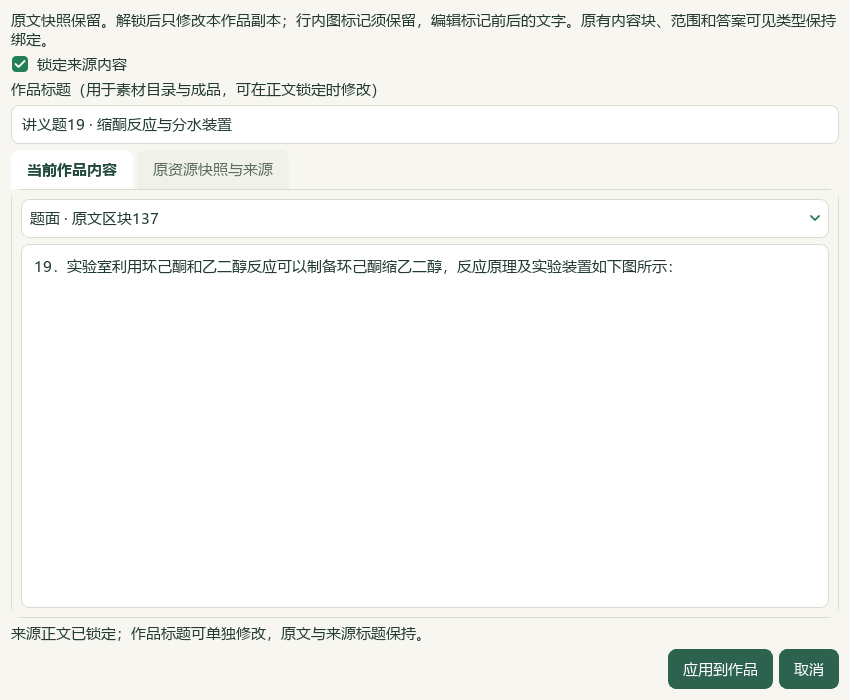
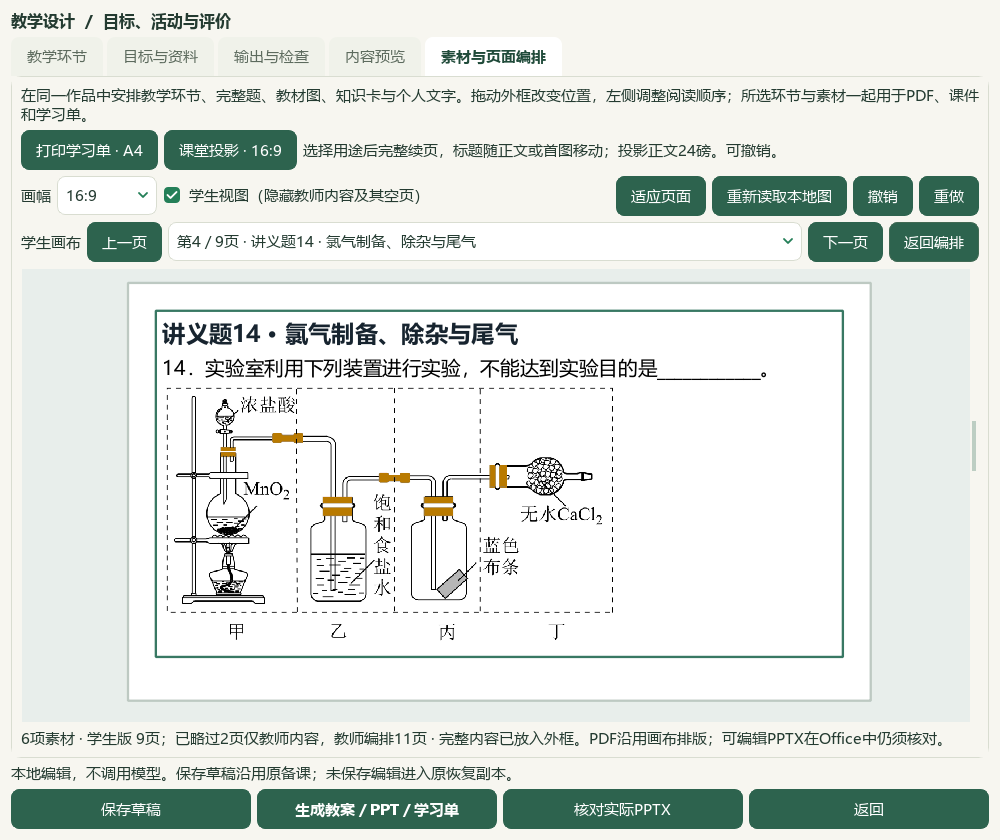

# 素材标题编辑、目录与成品联动验收

2026-10-06，维护源码候选。长讲义文件名不再作为新导入题的默认作品标题；旧素材可独立改名，来源正文继续锁定。当前HEAD e08c3e7，旧v0.1.101试用包未更新；未提交、推送或发行。

## 行为与来源

新导入完整题只读取原题面角色的首个可用文字段落，保留原生上下标显示，略去图片占位标记，显示最多72字。完整原文和图片保持；公共条件与答案不用于标题，纯图片没有可用文字时沿用来源标题。已有自定标题继续保留。作品标题和原资料标题分别记录，显示题号不能据此解锁整卷、主题、印刷小题或最小作答身份。

在素材右栏点“修改作品标题…”，或从完整素材编辑器直接修改标题。无需解锁题干；改名可取消、撤销，过期对话框的版本校验阻止覆盖并发修改。正文与答案仍须明确解锁作品副本才能编辑，原来源快照始终保留。旧保存的素材不自动改名。

## 实际本地流程

从前序备份恢复6备课草稿及36成品，另复制经冻结哈希核验的464份Word归档／预览文件、标签历史数据库和1份Word导入记录到独立候选。未复制teacher_workspace、模型配置或密钥。实际完整题目录3579项，选入PKG-061既有样本1、3、6、11验证新默认标题，随后通过撤销恢复完全一致的6素材载荷。这4次为旧题重放，本轮新增原题和阅读身份均为0。

既有四题分别改为“讲义题3 · 气体制备与收集”“讲义题6 · 侯氏制碱装置”“讲义题14 · 氯气制备、除杂与尾气”“讲义题19 · 缩酮反应与分水装置”。逐资源核对只变title；所有块、答案角色、图片、原快照与其SHA、来源证据、未知层级和审核字段保持，重新排满前位置不变。实际改名对话框的取消、编辑器正文锁定和保存重开均检查。下图为实际Qt控件自动操作结果，不是设计稿或教师人审。

## 实际Office与恢复

四份实际Office文档共28页：Word教师5、学生3，PPT教师11、学生9。所有六素材标题与可见全文均核验；教师嵌入7张原PNG，学生嵌入6张，教师答案专用结构图和所有答案／解析在学生版隐藏。原图按原像素保留；小图仍为源文件的低分辨率。根模型核看4联系图及选定原尺寸页，不声称全部页面逐张原尺寸细读或独立化学审校。

旧6草稿及36成品保留，新增1草稿和6成品。7草稿、7唯一输出版本、42登记文件及27图片摘要普通备份恢复一致。普通备课ZIP不含完整Word导入库、原教材、模型配置或密钥；完整选题仍依赖持久候选中的另存Word库与本地DATA。当前候选含6素材和2个输出版本，可从本机[打开素材标题候选](<E:/项目/上海高中化学等级考/outputs/2026-10-06-composition-resource-titles/打开素材标题候选.cmd>)重开。CMD→普通快捷方式→Pythonw实际入口验证通过，未更改或绕过执行策略。

## 视频与检查口径

新增V17原视频72、76、80、84、88秒5帧；根模型看联系图和80秒原尺寸。画面显示按工具名搜索及备课功能卡，教案、PPT大纲和课堂问答注明“占位”。这里只采用功能命名清晰的界面线索，未访问画面网站、未验证其功能或效率；无音轨，未声称全片播放。标题问题来自本地实际工作台，不将视频当作功能实现证据。

首轮相关检查40通过、2夹具失败：Word原文区块误用0起点及不存在的history.undo。修为1起点和实际撤销按钮后，7专项通过，111相关检查全部通过。首失败XML及修正回执保留。完整README、文档策略、控制器状态与validate的终验见本机输出回执。

本轮教材卡数499／460、目录60节、catalog与corpus各168、模型阅读身份727、702元数据待办不变，正式题／标签／答案写入0。原PDF／DOCX和旧候选冻结，真实个人目录不写入。微信读书永久停用；外部请求与真实供应商调用0。更完整的资料导入、教材蒸馏、化学审校和产品整合继续，总目标active。

## 本机证据

输出目录：`E:/项目/上海高中化学等级考/outputs/2026-10-06-composition-resource-titles`。`actual-new-import-title-proof.json`记录默认标题重放，`title-only-change-proof.json`记录精确字段比较，`native-verification.json`与`native-reopen-inspection.json`记录实际控件，`question-actual-office-verification.json`记录全文／标题与图片检查，`backup-roundtrip-verification.json`记录42成品恢复，`candidate-entry-final.json`记录真实入口。最终保全、视觉核看和源码清单见`input-preservation-final.json`、`root-visual-review-final.json`及`source-review-manifest-final.json`，本片验收见`root-final-acceptance.json`。
