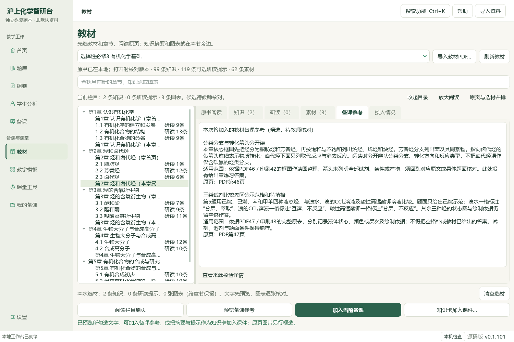
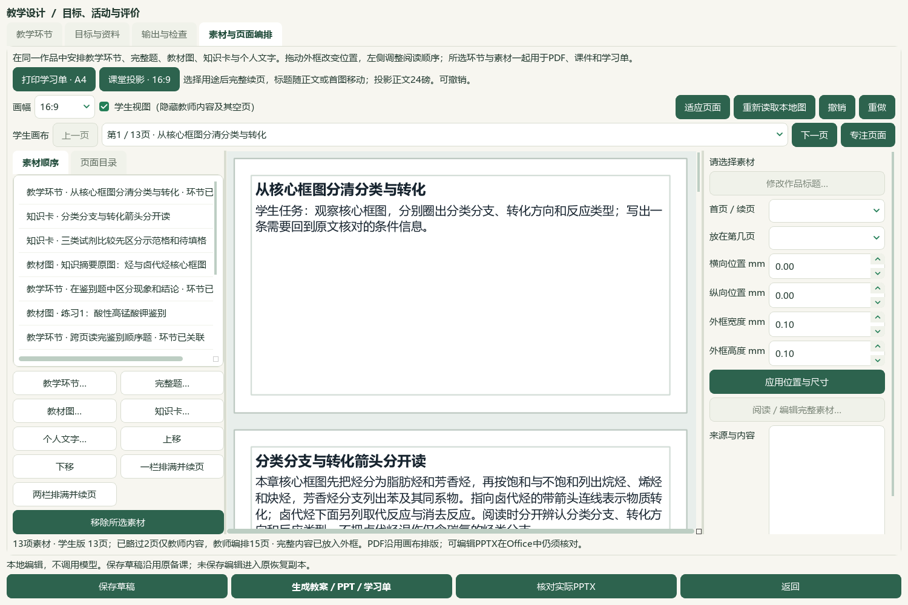

# 教材知识摘要卡与课件直接联动验收

385条教材知识摘要已纳入课件“知识卡…”入口，与460条可选研读提示及个人笔记分列。可按内容类别、教材和章节筛选；复习／附录按已登记补充栏目显示，待归条目保持未知，不改正式60节。选卡窗口可并排只读其明确引用的原页，页序不连续时按实际清单翻页。知识卡正文使用完整原摘要，原知识记录、来源SHA、目录版本、页码和栏目归属另存来源详情；选用不完成教师核验。

教材书架勾选、预览后可明确“知识卡加入课件…”，直接进入当前教学设计的素材编排；原备课文字、目标、环节和旧输出保留，同版本已在当前课件中的知识卡不重复追加。手工摘录继续通过“加入当前备课”追加；图像仍须单独框选。知识摘要卡可列同页／同栏目候选，或从其明确原页裁图；裁选记录保留摘要身份、版本和选图知识卡，不把同页关系当成用途或化学审校证据。

实际Qt在前序章复习课中接入2张摘要卡，对照PDF46／印刷42原页选取核心框图。首次阅读截图只有就绪状态，后补等待实际墨迹绘出；首次选框含上一段尾句，后用原生框选修正。最终去掉重复的旧独立框图，保留5个环节、40分钟、四组原练习1／3／5／7与6张有效裁片，共13素材。所有其余来源块、原快照、原备课文字、环节数据和旧草稿保持；未补练习答案或评分点。

17项新检查、119项相关检查（含新项）及38项兼容检查通过，共157项功能检查。4份实际Office共41页：Word教师9／学生4，PPT教师15／学生13；标题、可见原文及角色范围通过，6张当前原PNG按角色原字节嵌入。根模型核看4张联系图、5张选定成品页和原图／原生界面，不等同41页原尺寸逐页细读或独立教师化学审校。

本候选仅从普通备课ZIP恢复10草稿／60成品，未复制Word导入库、个人整书工作区、供应商配置或密钥；三个新版本后为13草稿／13唯一输出版本／78成品／35图片摘要，普通ZIP恢复一致。实际CMD→普通快捷方式→Pythonw重开当前13素材／5环节／6输出版本。主个人目录及前序候选不写入；本入口用于知识卡课例，完整Word资料仍在前序持久候选，普通备课ZIP不含原教材或Word库。

教材知识385、素材322、研读499存储／460可选、补充栏目77、catalog／corpus169、Word阅读身份727及元数据待办702保持；本轮新增正式题、标签、答案均0。新候选审核及发布字段全关。微信读书永久停用，外部请求及供应商调用0。重新核看既有V17第80秒一帧，仅借用功能命名与搜索入口线索；新帧、全片播放和音频核听0，不称视频功能全部对齐。维护源码尚未发布，旧EXE v0.1.101与渲染v13保持，未提交、推送或发布。全量导入、化学审校、候选整合与桌面发行继续，总目标active；历史临时原字节未恢复的例外仍保留。

本片为本地候选源码验证，无新检索文章、有效试卷、下载或正式题入库。旧源教材、知识JSONL、图表JSONL与登记文件不改写。

## 操作与原生证据

教材书架先勾选、预览，再点“知识卡加入课件…”。在课件素材中可从“知识卡…”选摘要／研读提示／个人笔记，阅读和取消不改变课件。每次接入重新核对原知识、目录及原PDF；版本或栏目变化时阻止接入。已有课件内同版本卡保持一份；修改工作副本保留来源原快照。未知印刷页不凭偏移补猜。

新裁片保存PDF46／印刷42、原书SHA、整数像素边界与CONCEPTPAGE记录；此定位标识不伪造研读提示ID。当前框图完整保留分类分支、转化箭头、反应类型和标题，不包含上一段尾句。选择确认由模型操作，只代表本次原生操作，不记为人审。

## 成品、恢复与限制

当前学生PPT的第2、3页为两张完整摘要，第4页为关联原框图；教师提示、活动评价与备注在学生版隐藏。第3题两片连续，比较表与路线留空。本片没有调用模型写答案或声称官方采分点。

本机[打开知识卡联动候选](<E:/项目/上海高中化学等级考/outputs/2026-10-06-concept-card-handoff/打开知识卡联动候选.cmd>)使用维护源码与专用候选状态，不改旧EXE。普通备份只含备课范围，原教材、完整Word库、个人教材工作区与配置另管；“知识卡可选”不等同全教材逐条来源或化学审校已经通过。

首轮3个新测试失败均为合成夹具页码预期写错；修正后相关119项和兼容38项通过。首失败XML保留。快捷方式助手最初引用本机未安装的win32com，改用现有Windows WScript COM；其UTF-8编码别名拼写也已修正。最终普通入口实测通过，未安装依赖、未更改或绕过执行策略。这些是验证助手的修正，不是应用功能失败。

## 本机验收文件

输出：`E:/项目/上海高中化学等级考/outputs/2026-10-06-concept-card-handoff`。`native-verification-current.json`、`delivery-payload-current.json`记录13素材与当前草稿；`native-verification-final.json`另记实际原页墨迹与修正裁图。`concept-card-actual-office-verification.json`记录41页检查；`backup-roundtrip-delivery-verification.json`记录78成品恢复；`candidate-entry-delivery.json`记录真实CMD／快捷方式／Pythonw入口。最终保全与源码范围见`input-preservation-final.json`、`source-review-manifest-final.json`、`root-visual-review-final.json`和`root-final-acceptance.json`。
