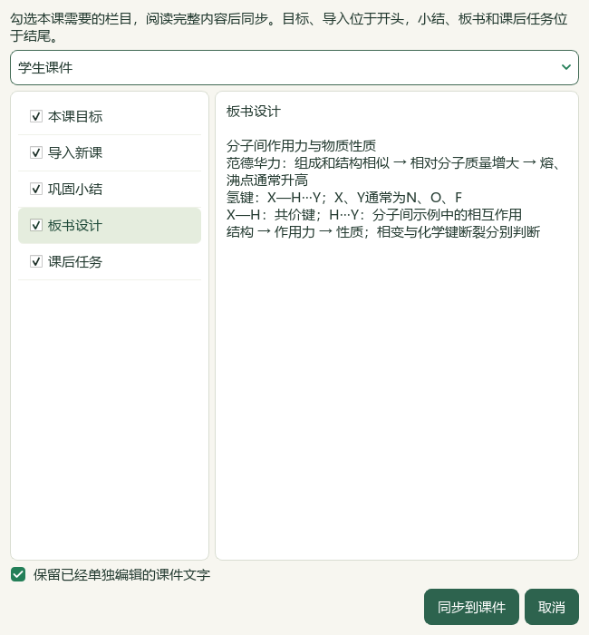
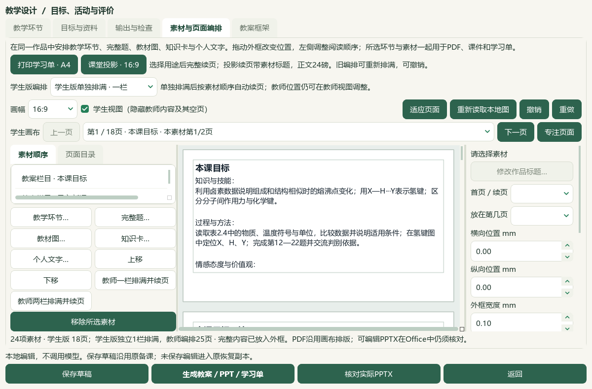

# 教案栏目预览、课件同步与保存恢复验收

教案目标、导入、小结、板书和作业可完整预览后加入当前课件。保存、生成或返回会应用当前框架输入，后续修改会更新已关联栏目；单独改过的课件文字默认保留。当前为本地维护源码，渲染v19、提示词v27，旧EXE v0.1.101未重建，未提交、推送或发行。

[操作说明](../teacher/lesson-and-paper.md#teaching-framework) · [当前闭环](../WORKFLOW_STATUS.md) · [前序框架验收](2026-10-06-teaching-framework-qa.md)。

本地入口：[打开教案课件联动工作台](E:/项目/上海高中化学等级考/outputs/2026-10-06-framework-slide-link/打开教案课件联动工作台.cmd)。当前成品：[教师教案](E:/项目/上海高中化学等级考/outputs/2026-10-06-framework-slide-link/教案课件联动成品-标题整理/教学成品-ba027415-pzgt6qr7/lesson_plan.docx) · [教师PPT](E:/项目/上海高中化学等级考/outputs/2026-10-06-framework-slide-link/教案课件联动成品-标题整理/教学成品-ba027415-pzgt6qr7/lesson_presentation.pptx) · [学生学案](E:/项目/上海高中化学等级考/outputs/2026-10-06-framework-slide-link/教案课件联动成品-标题整理/教学成品-ba027415-pzgt6qr7/student_worksheet.docx) · [学生PPT](E:/项目/上海高中化学等级考/outputs/2026-10-06-framework-slide-link/教案课件联动成品-标题整理/教学成品-ba027415-pzgt6qr7/student_presentation.pptx)。

## 实际行为与输入保持

新增`lesson_framework`素材类型，来源快照为`shchem.framework-card-source.v1`，关联实际教学设计ID、栏目及相关字段。手工框架使用内容修订摘要，不伪造来源文件SHA或官方属性。原始快照和作品副本分开保存；重复同步不新增卡片，更新保持素材身份及可继续使用的页面位置，长文字只重排改变的栏目。空白且未单独编辑的栏目可移除。陈旧来源关联、预览后的状态变化或重复栏目阻断新同步／输出。

教师Word按五部分输出框架一次，跳过再次写入课件中的框架卡。学生版显示三类目标和教学正文，隐藏重难点、方法备注及教师答案。完整原题不经过流程提醒清理。生成正文继续不加待核实、待核验或待教师核对等提醒，真实比较条件、单位与原始依据保留在各自记录；本轮没有调用供应商。

原19素材的快照、位置及原11题全文、全部图像、目标和2个活动保持，新增5个框架栏目后共24素材／11题／3个人笔记／40分钟／15输出版本。个人教材原书SHA为`4eb751c3bc879d2ad41a2faa723b3b4af05b29ff78f3e89a2eaf9727ebb8a848`；105原页、9目录候选、2.2节PDF49—59及阅读54保持。三笔记仍来自PDF54—56，原页阅读及整理依据见[前序记录](2026-10-06-personal-notes-to-lesson-qa.md)。用户粘贴的教案框架只作组织参考，其化学例子未新增为教材事实。

首次原生联动保存第31稿及第14版输出。根代理直接看样例发现助手手工添加的板书标题重复，实际界面仅删去重复首行，生成第15版并另存第32稿。两个样例均保留；标题整理后的新版本是当前交付，不覆盖原30稿／180成品或中间31稿／186成品。

## 检查和真实文件

7既有应用模块＋2新模块，新增`desktop_framework_composition.py`和`framework_slide_dialog.py`；1新测试文件，21新用例。最终271＋199＝470个不重复相关用例通过，17应用源文件与两组测试输入在运行前后及收尾时绑定完整SHA。覆盖原来源与资格、同步幂等、取消／撤销／重做、长栏目、独立编辑保留及覆盖、空白删除、陈旧关联、Word去重，以及真实Qt保存／生成／返回应用未提交的框架输入。

当前实际安装的Word和PowerPoint导出PDF并逐页栅格化：教师Word10页、学生Word6页、教师PPT25页、学生PPT18页，共59页。全文、栏目、标题、可编辑PPT文本、图像字节、教师答案隔离和正文无流程提醒检查通过。11题在两版Word及学生PPT中10个短题的32项整题同页检查通过。第20题四幅原图在24磅投影下使用两页，教师19—20、学生14—15；教师6图与学生4图的原图顺序和SHA保持。

根代理直接查看4张总览（59页缩略）、11个选定Office整页、4个有效Qt视图与1个诊断视图。Word板书延续到第10页，长目标卡跨页时类别标签可在前页、正文续至后一页；文字无缺失。原21／22题标题重复照原来源保留。原图分辨率和参考答案来自讲义，本轮未重新开展化学正确性审校。这些模型视检不等于59个整页逐页查看或独立真人审核。

初轮新检查暴露设计Schema未升级与夹具构造问题，修正后通过；扩大检查发现默认“过程与方法”照抄学生活动造成重复，改为方法摘要后重跑两组全部通过。启动助手的可选psutil导入失败发生在实际CMD已启动生产进程之后；成功恢复标记和确切PID退出均已核对，未重复启动或安装依赖。前序扩大Word12失败／8夹具错误仍未解决、本轮未重跑；470相关检查不代替全仓测试。

## 备份、重新打开与取证

[普通备课ZIP](E:/项目/上海高中化学等级考/outputs/2026-10-06-framework-slide-link/教案栏目与课件联动备课.zip)实际恢复32草稿、192登记成品、32唯一输出版本及56图片摘要，原／恢复文件字节一致，栏目关联与作品副本恢复一致。此ZIP不含Word库、原书、个人阅读位置、模型设置或密钥。

[个人教材ZIP](E:/项目/上海高中化学等级考/outputs/2026-10-06-framework-slide-link/个人原教材与三条知识笔记.zip)实际恢复1本105原页、9目录候选、3笔记、1批3条原生候选和PDF54阅读位置；改变来源路径重新导入新增0，标题与依据保持。此ZIP不含备课作品或Word库。465个Word库文件及属性／范围／选择保持在主候选，仍须单独保管。

实际CMD→快捷方式→Pythonw→Qt新窗口恢复当前草稿，24素材、5个当前关联栏目、11题、15输出版本及全部框架字段一致；个人原页、笔记、目录和阅读位置核对通过。使用隔离候选配置，不写入真实使用配置。

全部回执与完整SHA收于`E:\项目\上海高中化学等级考\outputs\2026-10-06-framework-slide-link\root-final-acceptance.json`。其中：`native-polished-verification.json`与`delivery-payload-polished.json`是当前原生样例；`framework-linked-actual-office-verification.json`、`complete-question-page-verification.json`及`Q20-export-image-role-verification-measured.json`对应实际Office；两个`*-backup-roundtrip-verification.json`对应恢复；`candidate-entry-receipt.json`包含启动诊断；两份`*-checks-final-command.json`是470项最终命令回执；`root-visual-review.json`注明实际观看范围。早期失败日志与中间版本均保留。

初始593份输入中的非计划变更项、前候选721文件和当前719份不变复制文件以完整SHA核对，只有当前草稿状态及恢复记录为可变项。34份旧原始draft记录精确保留，当前36份原始记录含32备课稿及4份其他业务记录。共享知识库只更新化学项目及索引化学行；不冻结或覆盖其他项目并发更新。

## 当前范围

检索文章0、有效新试卷0、下载0、供应商调用／外部请求0。中央知识386／图表322／登记170、正式4／真人0；Word98份／3580候选／465文件、属性3684／历史9737、5手工范围／11选择及阅读身份740／冻结702保持；未新增题库导入或中央标签。BDL只沿用V27第37秒与V32第39秒两张经完整原视频SHA核对的原帧，参照选择、完整预览、加入同一作品的操作，不声称全片或音轨审核。微信读书永久停用。

本片作为已验收的本地源码进展，总目标仍active；更多教材与题目、Q11、正式四层与化学审校、整体UI及桌面发行继续。手机端按既定范围排除，现有正式与发布资格未提升。
