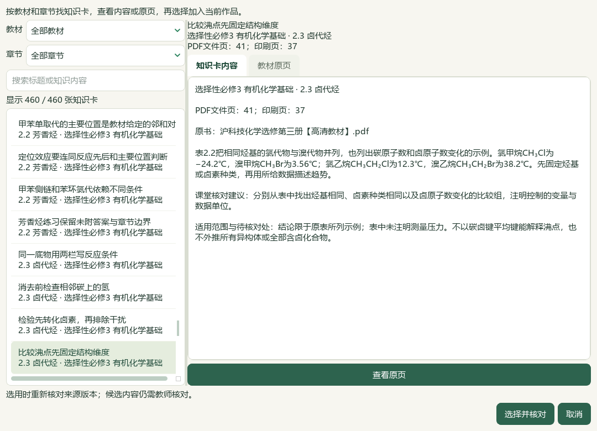
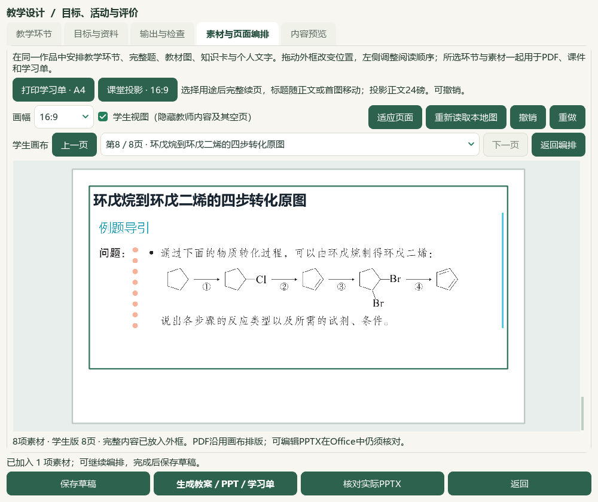
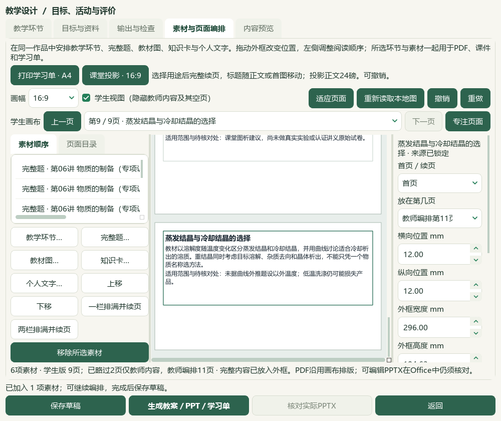

# 卤代烃知识与制备装置题导入验收

2026-10-06，当前源码与本地DATA候选；渲染仍`shchem.composition-qt-word-opening.v13`，应用版本不变。旧v0.1.101试用包未更新。

实际核看沪科技选必三PDF41—45／印刷37—41，新增“比较沸点先固定结构维度”“可能产物与主要产物分开回答”“沿结构变化核对环戊二烯路线”3卡，保留原文件SHA与各自页码。沸点不以碳卤键平均键能解释，81%仅限教材所给实例，路线不扩写为普适制备工艺。496→499存储、457→460可选，正式目录60节；catalog与corpus各167→168（108原件＋60衍生），仅追加1候选研读包。旧卡、原PDF和319图／5项图题更正保持。渲染40—46但只实际读41—45，未声称整节读完。

完整源码工作台通过原生知识卡与裁图入口加入5卡／3图共8素材。原沸点表、空白比较表和环戊烷→环戊二烯路线图保留；首版路线下缘带入半行解析，实际重新框选并导出第二版修正。正式图表的未知印刷页未据笔记反填。另通过“完整题”目录明确选择PKG-061样本1、3、6、11（原题3、6、14、19），4题／7图与2既有制备卡形成另一份6素材备课；原答案A／B／D／B保留，讲义原解析仍非官方、未独立化学审校。其余8样本继续待核，其中7题原生形状、公式、隐藏文字／域代码或相邻章节污染阻断，样本7虽结构闭合但原H₂S处理说明未接纳。

最新两组共8份实际Office文档：教材Word教师6／学生3页、PPT两版各8页；装置题Word5／3页、PPT11／9页，总53页。全部可见文字与相应原PNG字节检查通过，学生版隐藏教师答案及解析。根模型核看8联系图、4选定原尺寸成品页、3新卡内容、选定UI与源图；不称53页均逐张原尺寸细读，也不等同教师人审。小装置原图仅146×109，未伪造高清图。

新持久候选保存6备课草稿／6输出版本／36登记成品／27图片摘要，前序3草稿及18成品保留；普通备课ZIP恢复逐份一致。为在候选中继续选题，单独复制已验证Word库及其导入记录，实际目录3579项；真实个人目录不变，未复制模型配置或密钥。普通备课ZIP不含Word导入库、原教材或完整题库；完整选题依赖该持久候选与本地DATA。实际CMD→快捷方式→Pythonw重开最新6素材载荷，旧EXE未升级。

本轮模型阅读身份新增4至727，仍有702标签／元数据待办；完整阅读但标签待处理164，部分读图227，未完整读图465，其中可行动257。实际导入备课不等于正式题库入库；四层身份、能力、形态和难度证据不推断，正式题／标签／答案写入0。无新应用代码、供应商调用、新试卷、外部文章或请求；微信读书永久停用。本轮没有新视频抽帧，前序导航与V28依据沿用。总目标active，手机端排除，其余资料、化学审校、UI整合、更多视频功能及发行继续。

冻结5713选定文件，计划改变5文档、2知识库与catalog／corpus两索引共9现有文件，另新增候选包、QA和实际Qt截图。真实494文件／3684属性／9733历史、前序页面目录候选及辅助466另作终验，历史临时事故前原字节仍未恢复。原59项／X01—X10不重计全部完成；未提交、推送或发布。裁图、载入草稿、复制目标和保存会新建草稿等辅助断言失误留档，修正后从已保存成果继续，未重复覆盖旧版本。

## 打开与继续核对

本机入口：[打开教材与制备题候选](E:/项目/上海高中化学等级考/outputs/2026-10-06-halogen-preparation-import/打开教材与制备题候选.cmd)。进入备课后点“教学环节→素材与页面编排”。默认重开4题／2卡；教材候选在“我的备课”选择“卤代烃：数据比较、反应条件与合成路线”，以含2版输出的修正版为当前依据，1版旧裁图保留为历史。

[最新装置题独立成品](E:/项目/上海高中化学等级考/outputs/2026-10-06-halogen-preparation-import/exported-copy) · [修正教材独立成品](E:/项目/上海高中化学等级考/outputs/2026-10-06-halogen-preparation-import/book-repaired-exported-copy) · [备课备份](E:/项目/上海高中化学等级考/outputs/2026-10-06-halogen-preparation-import/教材与制备题候选-备课备份.zip)。这些是本地候选；备份范围见上文。

## 可复核证据

私有回执目录：`E:/项目/上海高中化学等级考/outputs/2026-10-06-halogen-preparation-import`。`knowledge-import-verification.json`及`registration-scope-addition.json`记录库增量、原文件与索引；`fresh-source-review-inputs.json`在questions子目录记录12样本原文与原生范围。`word-UI-selection-proof.json`记录3579项实际目录、4题选择与预览确认；`book-native-repaired.json`记录裁图修正及第二版成品。

`book-actual-office-verification.json`、`question-actual-office-verification.json`记录8实际文件、53页、文字检查、对应图片嵌入与独立Office会话清理；`backup-roundtrip-verification.json`记录36成品、6草稿及27图片摘要恢复一致。`candidate-entry-final.json`记录真实CMD／快捷方式／Pythonw入口。终验另见`input-preservation-final.json`、`root-visual-review-final.json`、`controller-validate-final.json`及`root-final-acceptance.json`。

无新应用代码，前序35相关用例仅沿用其原回执。本轮重新运行文档策略、完整README14项、控制器status／validate和本地内容检查；结果以终验回执为准。失败记录包括：fitz不可用改用已有PDFium；Word复制未完成及缺导入记录时目录为空；首次教材导出保存已成功但复制目标不存在；第一次修正载荷与恢复副本不同，正常打开已保存草稿后继续；正常保存会新建草稿，辅助计数断言4→5修正。原失败、旧裁片和旧成品保留，不声称首遍全部通过。

教师人审、正式教学／生成／发布资格均未解锁。4题原考试身份及难度未知，未按“上海专用”文件名猜测地区或官方属性；未把Word区块编号当整卷／主题／印刷小题编号。更多资料、正式标签与化学审校、候选整合及发行持续推进。
