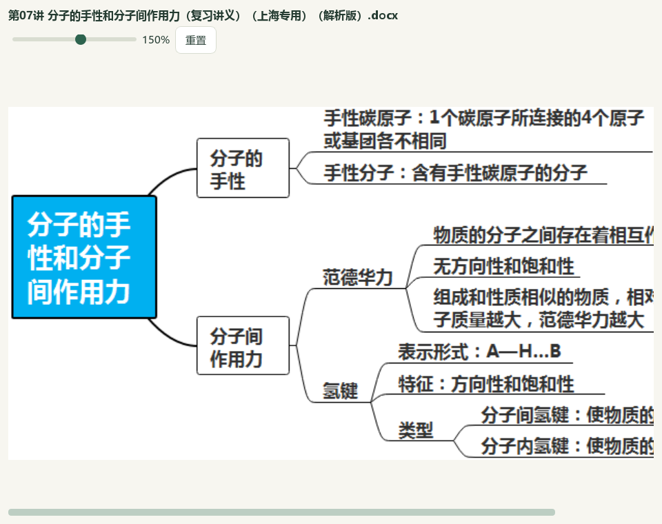

# 教材原图、讲义选图与问题导学验收（2026-10-06）

本地维护源码候选已接通“讲义图…”与课堂图片编排。40分钟的分子间作用力课使用10处教材裁片、4张实景照片和讲义原知识网，25页问题标题配合完整笔记、分步解释和少量例题。当前主入口：`E:\项目\上海高中化学等级考\outputs\2026-10-06-handout-maps-and-lesson-images\final-classroom\打开教材原图与问题导学工作台.cmd`；当前成品目录：`E:\项目\上海高中化学等级考\outputs\2026-10-06-handout-maps-and-lesson-images\final-classroom\教师成品\教案与课堂PPT-81f527e1-44wxt4fq`；全部完整SHA与验收绑定见 `E:\项目\上海高中化学等级考\outputs\2026-10-06-handout-maps-and-lesson-images\root-final-acceptance.json`。

## 原图选择与真实操作

只读盘点98来源的20,041图像出现次数，11,359为PNG/JPEG/WebP；不做OCR或把每张图认定为知识网。确切Word版本、区块、图摘要与字节在预览前后重核；取消不复制，同图同用途去重，不同用途分别编排。仅教师角色保持，缺完整题范围的答案图不能借此转成学生材料。真实Qt选择第07讲原知识网，预览、原图放大、加入同一课件、一次撤销与恢复通过；后续新入口只在本地源码候选中，v0.1.101包未更新。

## 教学设计与素材

左上主标题均为具体问题，沿观察、结构、作用对象和性质形成解释。10教材裁片含原表单位、数据、结构和多幅配对图；原甲醚/乙醇题完整放大。讲义原网保留原像素，本课用分子间作用分支；相似相溶来自讲义正文，不冒充原网分支。全课3完整知识页（5／11／20）、1教材例题、Q16课堂练习与Q22课后迁移；两个原题全部源区块与答案角色保持。原书PDF52—58读取记录与裁选请求保存，不推测全书印刷页偏移。

新3照片保留作者、日期、原始URL、许可原页与原像素摘要，位于 `E:\项目\上海高中化学等级考\outputs\2026-10-06-handout-maps-and-lesson-images\external-picture-provenance.json`：干冰原摄影者全球公共领域授权；Bentley雪花为Smithsonian CC0；USGS回形针原页明确公共领域。白雾是小水滴，CO₂气体无色；雪花照片作为有序结构的观察入口，回形针与浮冰的解释分别联系表面张力和密度。既有USGS浮冰照片保持。外部原站请求和下载真实发生，不写成0；Smithsonian单独快照请求403未重试或绕过，许可页面和IIIF已读取。照片是本课本地素材，中央catalog171未新增整卷或题目。

## Office、保存与恢复

实际Microsoft Word教案25页、课堂讲义14页，PowerPoint25页；正文和备注无来源、防御提醒及制作说明，原图包内字节完整。初次导出发现5条教师制作说明，改为提问与观察活动后另存第44稿／本课27版，原43稿及26版保留；学生可见块和全部原资源快照未改，最终像素复核范围见视觉回执。

实际PowerPoint MainSequence16个Appear/OnPageClick，第6／7／13／16页各3步骤，第14／23页各1同页反馈；原图和背景先显示。静态PDF展示完成后的页面。根代理逐页视觉检查、最终改动页复核见 `E:\项目\上海高中化学等级考\outputs\2026-10-06-handout-maps-and-lesson-images\root-visual-review.json`；不能据模型检查声称独立真人化学审校或真人逐帧放映。

普通备课ZIP恢复44草稿、264登记文件、44唯一版本、70引用图摘要，所有草稿与恢复副本一致，原42稿／252成品与43中间稿保持。实际CMD→快捷方式→Pythonw恢复48素材、框架、27版、8点击素材和Word讲义开关。原教材105页、9节、3笔记、PDF54及专用ZIP保持；普通ZIP不包含完整Word库、原书、阅读位置、模型配置或密钥。

## 检查与边界

686相关检查通过，包括源版本变动、字节失配、读取中变动、取消、去重、教师范围、异步陈旧结果、关闭、导航、撤销及完整原图框选；完整README14项和文档策略见当前回执。6既有应用模块修改、2新应用模块、1既有测试更新与2新测试文件；渲染v29／提示词v34。初次假存储方法和布局尝试的诊断保留，旧扩大Word12失败／8夹具错误未解决、未重跑，真实供应商0，自动成课质量未实测。

6561保护输入、881原候选文件、879不变复制文件与两份新稿的保护见回执。Word98／3580／465、属性3684／历史9737、范围5／选择11、中央386／322、catalog171、正式4／真人0、阅读740／冻结702保持；中央status既有问题仍在，未声称全库门禁通过。微信读书停用；无新卷、题库导入、正式资格提升、提交、推送、发布或EXE重建。BDL沿用两帧，未重看连续视频和音轨；总目标active，更多内容、Q11、四层与化学审校、整体UI及桌面发行继续。

[操作](../teacher/lesson-and-paper.md#classroom-purposes) · [保存与备份](../teacher/save-and-support.md#save) · [前序完整知识笔记](2026-10-06-classroom-knowledge-notes-qa.md)。
