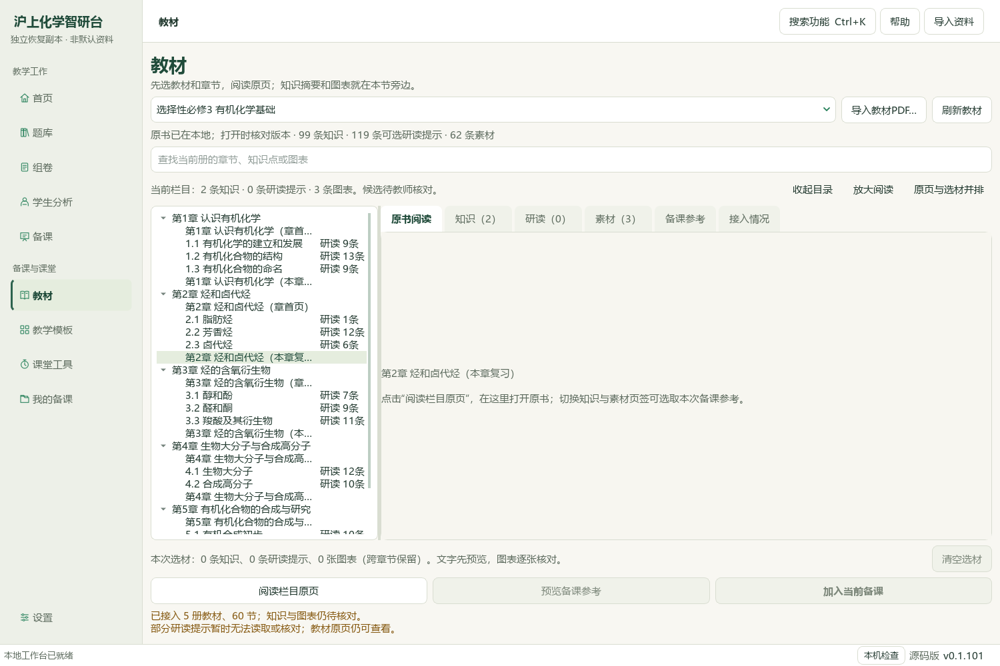
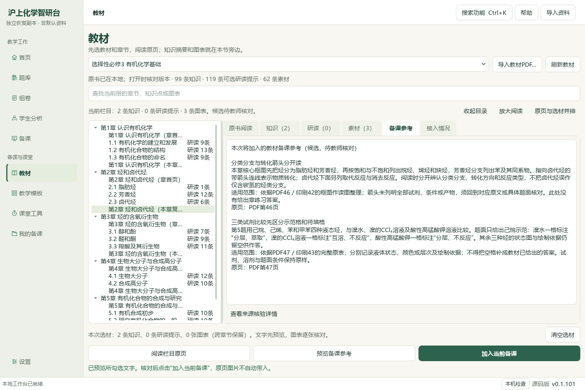

# 烃与卤代烃章复习：知识、原题与备课成品验收

2026-10-06。本地维护源码候选，未提交、推送或发行；应用代码与旧EXE未改。已把章复习原页、2条新知识候选及四组教材练习接到一份40分钟复习课，保留来源、空格和跨页关系。

## 来源与新增内容

本地原书：`E:/项目/上海高中化学等级考/课本/沪科技化学选修第三册【高清教材】.pdf`，SHA-256 `26ccd86648c807476fd6f08db7e414571fa0d5e077db63b15c9880cb225cd137`。PDF46—48对应印刷42—44，属于`TB-E3-C2-REVIEW`，不是正式2.3正文。版本、年份与原始URL待核验，不标为官方。PDF40属于此前已读的芳香烃练习，不重复计卡。

新增知识“分类分支与转化箭头分开读”“三类试剂比较先区分示范格和待填格”，383→385；新增三张整页素材入口，319→322。知识及素材JSONL原字节前缀保留。仍60正式节、77补充栏目、499存储／460可选研读提示，catalog／corpus各169（108原件＋61衍生）。新候选包只登记本次声明范围，未称整册完成。

## 实际备课操作与范围

完整Qt工作台从书架阅读PDF46、47、48，勾选2条候选知识，先预览、再明确加入当前备课。第一环节引用完整参考快照；五个环节的目标、教师活动、学生任务、产出、评价建议与备注均保留。下列分钟数是候选课时安排，不是实测课堂效率或认知难度。

| 环节 | 预计分钟 | 原页素材 |
| --- | ---: | --- |
| 从核心框图分清分类与转化 | 6 | PDF46核心框图 |
| 在鉴别题中区分现象和结论 | 8 | PDF46练习1 |
| 跨页读完鉴别顺序题 | 8 | PDF46题干／A项＋PDF47 B—D项 |
| 分栏记录混合状态与绘制依据 | 10 | PDF47练习5完整原表 |
| 沿路线检查结构和条件 | 8 | PDF48练习7完整路线及小问 |

五个环节与六张裁片交替放入同一画布，共11素材；第3题两片连续并在图题与用途注明相互依赖。四组练习不等于新增四个题库ID，没有赋予整卷／主题／印刷小题／最小作答身份。教材没有附答案与评分细则，不补选项答案、表格内容、中间体或方程式；己烷列是题面示范，其余仍留空。评价只称AI候选观察建议，所有目标评价人工确认保持未勾选。

## 终验成品与保全

四份实际安装的Office转换共35页：教师Word 8、学生Word 3、教师PPT 13、学生PPT 11。全部可见文字、11素材标题及6张PNG嵌入字节检查通过；学生版隐藏教师活动、完整知识参考、评价、用途说明与备注。图中字形、条件与空格由根模型另看原裁片和选定实际成品页，不以PDF文字提取代替图像审阅。联系图覆盖全部终验页，未称每页都原尺寸细读或已获教师化学审校。

初版自动操作没有触发QLineEdit.textEdited，五环节保留默认名；根模型在实际截图中发现后，用原生输入法事件录入五个标题，再逐条预览并更新关联素材。标题核验版后又发现第一环节投影包含多页核验记录，已在原生素材编辑器明确解锁作品副本，只把材料块改为两条完整候选摘要与适用范围后重新锁定；原资源、原SHA、节点、全量参考与其他块均保持。可读交付版再新增6成品，前两版保留。辅助脚本的字段名和导出目录前置错误修复有回执；应用未因夹具错误而改动。

前序7草稿、42成品保持；本轮首版、标题核验版和可读交付版另存为第8、第9、第10份草稿。最终普通备份恢复10草稿／10输出版本／60登记成品／33图片摘要一致。另存Word库464份资料／预览及1个标签历史数据库，保持前序完整选题库；普通备课ZIP不含Word库或教材原PDF，亦不含模型配置与密钥。真实个人目录及旧候选不写入。

从本机[打开章复习候选](<E:/项目/上海高中化学等级考/outputs/2026-10-06-hydrocarbon-review-lesson/打开章复习课.cmd>)重开当前5环节、11素材、3输出版本；CMD→快捷方式→Pythonw实际入口验证，没有修改或绕过执行策略。[终验PPT](<E:/项目/上海高中化学等级考/outputs/2026-10-06-hydrocarbon-review-lesson/lesson-readable-exported-copy/教学成品-e7820a1e-by7s7sl0/lesson_presentation.pptx>)、[学生学习单](<E:/项目/上海高中化学等级考/outputs/2026-10-06-hydrocarbon-review-lesson/lesson-readable-exported-copy/教学成品-e7820a1e-by7s7sl0/student_worksheet.docx>)是本地可检查副本。旧EXE仍v0.1.101，渲染v13；本轮没有应用代码增量，前序111相关检查不重复冒作本轮检查，完整README、文档策略与控制器终验另有回执。

## 待办与证据

新增正式题、标签、答案均0；原Word模型阅读身份727与702条元数据待办保持。未选练习2、4、6、8仍未制作本课素材；真实化学答案核验、其他原题处理、教材余页、UI整合与发行继续。此前PKG-061阻断题继续待核，不因本片导出成功而解锁。微信读书永久停用，外部请求与真实供应商调用0，总目标active。

本机输出：`E:/项目/上海高中化学等级考/outputs/2026-10-06-hydrocarbon-review-lesson`。知识包与登记见`chapter-review-packet.json`、`knowledge-import-verification.json`；原生流程见`native-reference.json`、`native-delivery-verification.json`与`delivery-payload.json`；裁片有保存的完整来源回执。Office见`lesson-readable-actual-office-verification.json`，恢复见`backup-roundtrip-delivery-verification.json`，实际入口见`candidate-entry-delivery.json`。最后保全、视觉核看、源码清单与本片判定见`input-preservation-final.json`、`root-visual-review-final.json`、`source-review-manifest-final.json`及`root-final-acceptance.json`。历史临时目录事故的原字节仍未恢复，沿用前序例外回执，不借本轮保全宣称修复。
