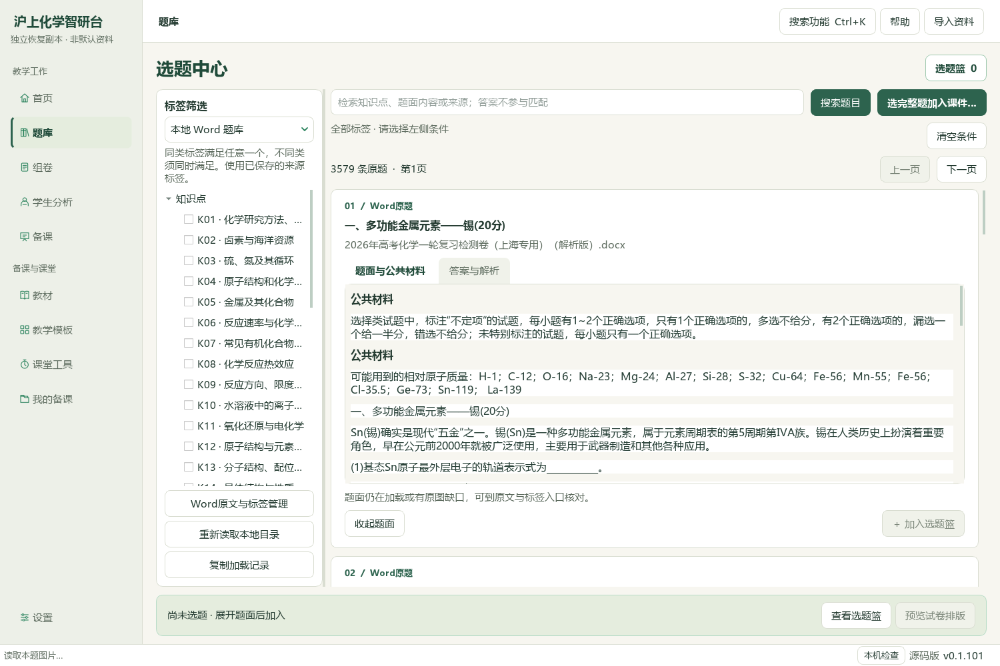
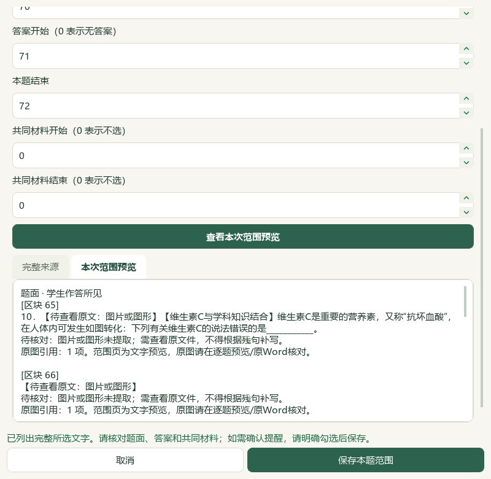
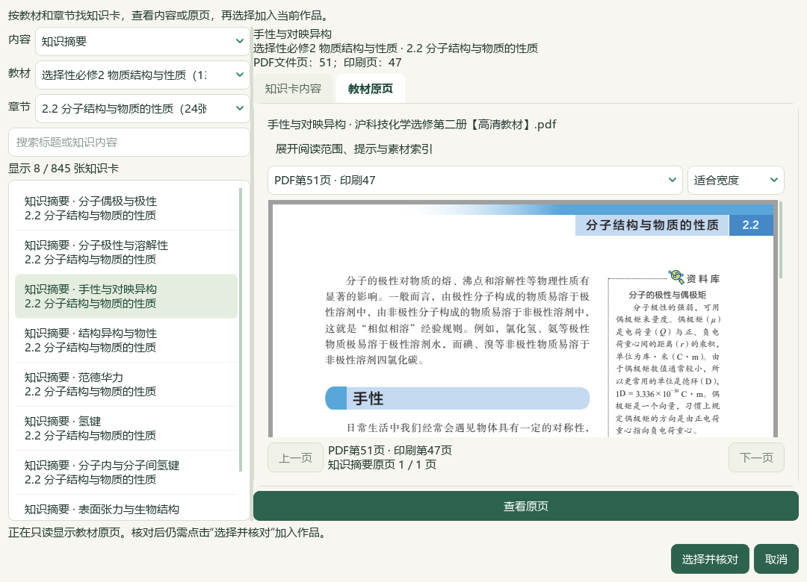
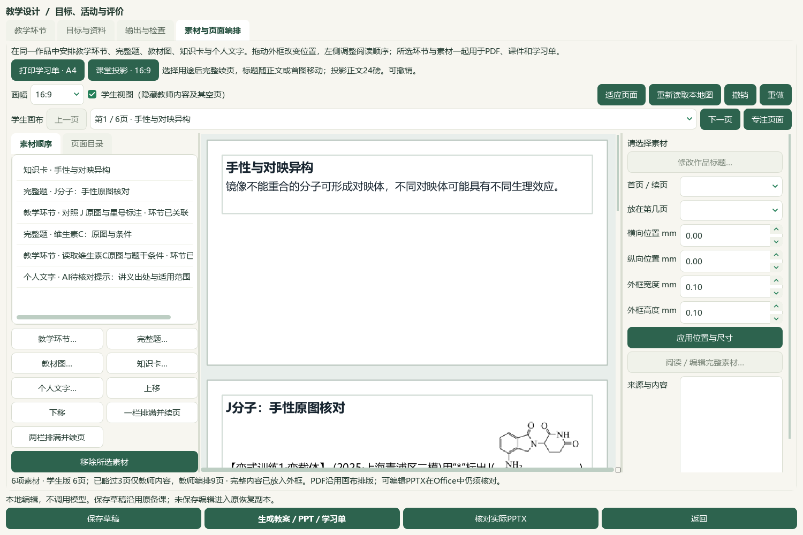

# 本地完整题、教材知识卡与课件接入验收

资料库的本地Word入口新增“选完整题加入课件…”，默认资料库与旧逐题窗口均可接入当前教学设计；画布“完整题…”沿用同一完整题模式。先预览题目及全部原图，确认时重新核对确切选题、范围、原文件与完整参考，再复制图片。每批1—20题，同来源范围版本去重，已编辑的作品标题与原副本保留；新来源版本另列。未保存或范围变化后的旧教学属性只作历史，读取当前范围时在内存取得材料清单，不补写标签或人审状态。

当前隔离候选在前序13备课草稿／78成品基础上，复制前序持久Word候选的465个明确原件、预览、批次和属性历史文件，并逐文件核对SHA；保留一份Word导入状态，未复制模型配置、密钥或个人教材工作区。实际Word目录3579条，与385教材摘要、460可选研读提示共同可用；这不是3579题已化学审校或正式入库。

本轮读取6个限定讲义范围，2题原生范围闭合。J题来自PKG-064，题面／答案／解析三张图原字节保留；维生素C题来自PKG-065，经真实范围编辑器预览并保存结束区块73→72，排除下一节“02范德华力”及图标。初始AI误判J末图缺NH₂，原尺寸复看证明三图均有NH₂；已从当前课件删去错误提示并修订活动，旧A4试验草稿和失败记录仅留验证历史，不作教学依据。题面自注青浦二模仍只是讲义出处线索；原试卷、官方答案与化学解释未核验，四层正式身份全部unknown。

真实Qt从资料库接入2道完整题，再选“手性与对映异构”教材摘要，实际绘出PDF51／印刷47原页。当前课件6素材＝2题＋1卡＋2环节＋1教师专用AI出处／适用范围提示，2环节共40分钟。按知识卡、J题及任务、维生素C题及任务、教师提示排序；另存16:9投影版本，正文24磅，原题答、图像和知识原记录不改写。教师编辑窗的素材列表及属性仍可显示教师条目，不是独立学生屏。

21项新检查覆盖范围与旧属性、原图角色、确认时变化、当前课件接入、去重、图片容量及取消；当前修正后38项回归通过。本片三个成功阶段97／30／38项按case身份去重为106项，包含复跑，不能相加。首轮默认资料库别名漏接信号导致启动失败，已修复；首失败XML保留。实际新范围揭示旧图片数量阻断，也已修复并有回归。原生助手早期选错筛选值、遗漏授课对象和过早截取空白PDF，分别纠正；已有13草稿均未被失败保存改变。

当前4份实际Office共22页：教师Word5、学生Word2、教师PPT9、学生PPT6。逐全文和角色范围核对通过，6张当前原PNG按角色原字节嵌入；学生文件不含答案与教师AI提示。根模型核看4张联系图、3张选定原尺寸成品页、7张来源图及教材原页，另核实际界面；不等同22页原尺寸逐页细读或教师化学审校。长题在24磅下会续页，后续仍可改善续页提示和课堂阅读组织。

当前15草稿／15唯一输出版本／90登记成品／41图片摘要经普通备课ZIP恢复逐一核对，前序13草稿保持；新旧输出均留存。真实CMD→快捷方式→Pythonw重开6素材、2环节与当前2输出版本。Word导入库保留在主候选配置，普通备课ZIP仍不含Word库、原教材、个人教材工作区、模型配置或密钥；原始文件另留本地DATA。

模型完整阅读身份727→729，702标签／元数据待办不变，其中已读待标签166、部分读图227、未完整读图463、可行动255。知识385、素材322、研读499存储／460可选、正式60节、补充77栏目、catalog／corpus169保持；新增正式题、标签、答案均0。检索文章、有效新试卷、重复新下载、供应商调用和外部请求均0。微信读书永久停用。本轮抽取本地V17第24／32／40／48／56／64秒6帧，根模型核看联系图及24／48秒原图，只取任务卡动作、状态与逐题证据列的UI线索；未访问演示站、未播放全片、无音轨核听，不称视频全部功能已对齐。

7个既有应用模块与2个新测试文件形成未提交的维护源码增量，旧EXE v0.1.101及渲染v13保持，未提交、推送、发布。总目标active，手机端仍排除；全量资料、化学与层级审校、UI整合、更多视频功能及桌面发行继续。历史临时原字节未恢复的例外仍保留。

## 实际操作与证据

先选当前备课，再在本地Word题库点“选完整题加入课件…”。勾选、预览后明确“完整题加入课件”，直接进入当前素材编排；画布“完整题…”使用同一模式。取消、只读、失败或版本变化不交付过时结果。接入保留全部原生段落、图片出现顺序及题面／答案角色，四层身份未知时不从讲义名或题号推断。

## 保存、恢复和当前版本

本机入口：[打开完整题课件联动投影候选](<E:/项目/上海高中化学等级考/outputs/2026-10-06-library-question-handoff/打开完整题课件联动投影候选.cmd>)。使用维护源码与专用状态，原EXE未升级。当前投影版为6素材、2环节、40分钟；每课件有原A4试验与16:9两条输出记录。原A4草稿的AI视觉提示错误，已由当前版纠正；旧稿和成品仅作历史证据，使用当前投影版。代码及普通入口核对不等于教师化学审核。

15草稿及90登记成品均在普通备课备份范围内，全部引用图片恢复一致；完整Word库与原教材不在该ZIP内。当前候选另保留Word批次、原件与属性历史，可继续本地选题。完整业务备份及正式原题层级仍未完成，不把该候选当作发行版。

## 验证边界与保留问题

成功测试阶段分别为97、30、38项；去重106case，当前最后38项覆盖全部21项新检查及资料库回归。首次默认资料库绑定错误是真实代码失败，已修复；原生调整范围后旧图片数量不匹配亦修复。助手筛选值、授课对象和过早PDF截图分别纠正。原尺寸看图推翻了初始NH₂缺失判断：三张J图都完整保留NH₂；当前作品不再记录该错误。失败XML、首轮截图、A4旧版及纠正记录原样留存。

当前Office22页全部作文本、图片原字节和角色范围检查；根模型核看联系图及3页原尺寸成品，不称逐页人工细读。投影保持24磅，维生素C长题续为两页，教师解析也会续页；续页标题与长题课堂组织仍可改进。原题图小尺寸及非官方解析的适用性仍需教师核对；没有生成新答案、评分标准、难度标定或学生作答。

## 本地记录

输出：`E:/项目/上海高中化学等级考/outputs/2026-10-06-library-question-handoff`。

- `native-verification-current.json`、`delivery-payload-current.json`：当前课件与15份草稿；`native-range-correction.json`：只改候选题目范围，原Word不变。
- `AI-visual-claim-correction.json`：原尺寸图纠正与被替代旧稿；`closed-native-source-scopes.json`、`reading-identity-ledger.json`：2题完整范围与729阅读身份。
- `question-projection-actual-office-verification.json`：当前22页、原图与答案隔离；`backup-roundtrip-projection-verification.json`：90登记成品恢复。
- `candidate-entry-projection.json`：真实CMD／快捷方式／Pythonw重开；`video-frame-extraction.json`：6帧本地V17，只作UI观察。
- `input-preservation-final.json`、`source-review-manifest-final.json`、`root-visual-review-final.json`、`root-final-acceptance.json`：最终保全、代码、读图与局部验收边界。
