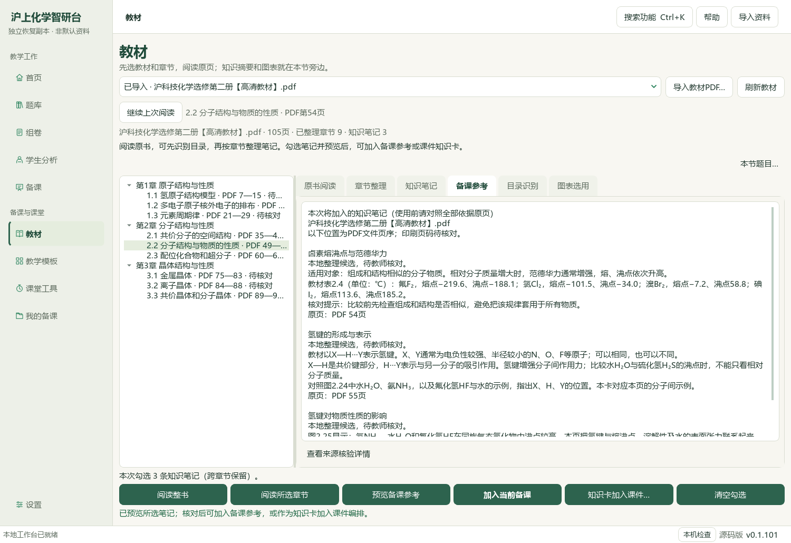
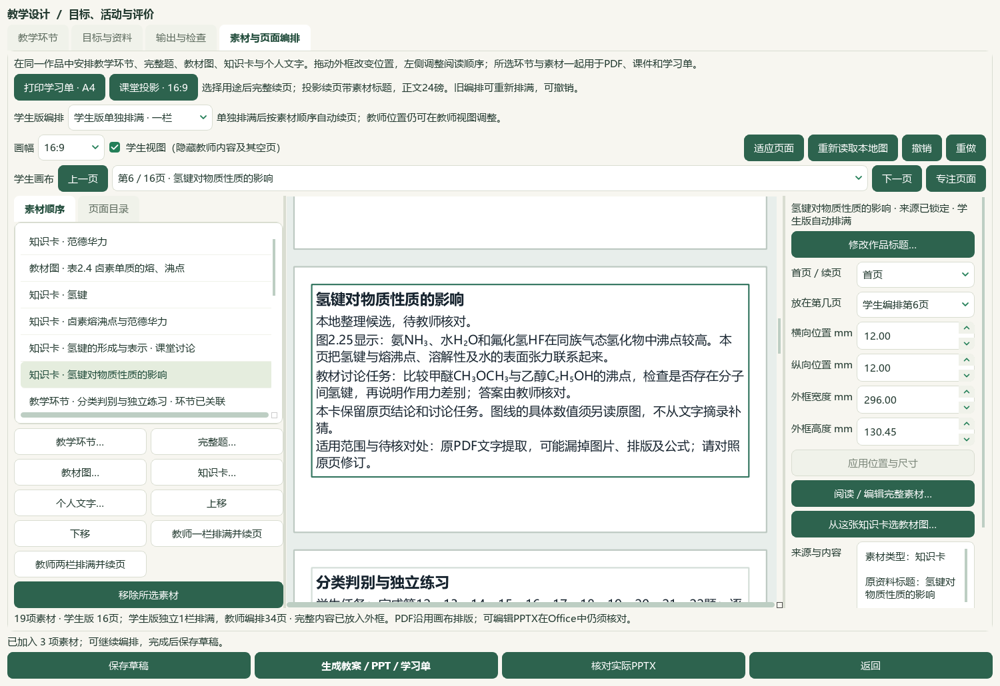
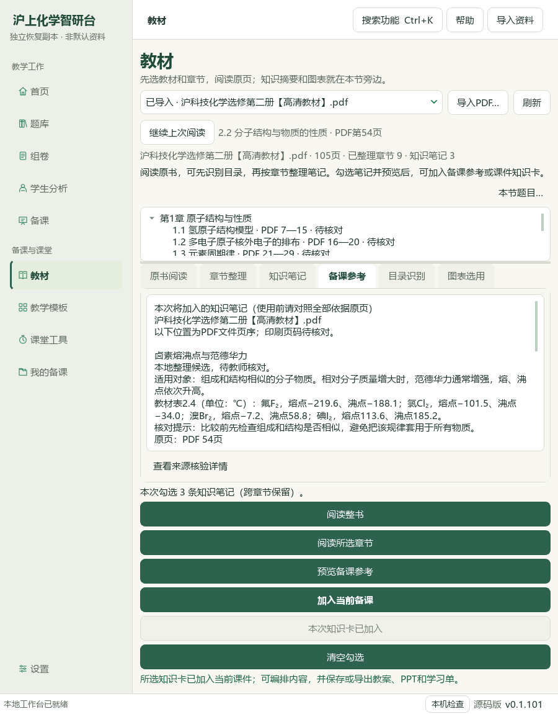

# 个人教材知识卡加入课件：本地候选验收

2026-10-06。个人阅读页的知识笔记可以在预览后直接进入当前课件。新增三条个人笔记，保留原书页序、SHA与笔记版本；这不是中央知识库正式入库或真人审核。当前维护源码尚未打包发布，试用EXE仍为v0.1.101，渲染v17保持，总目标继续active。

[打开当前候选](E:/项目/上海高中化学等级考/outputs/2026-10-06-personal-notes-to-lesson/打开教材笔记联动备课候选.cmd) · [成品副本](E:/项目/上海高中化学等级考/outputs/2026-10-06-personal-notes-to-lesson/exported-copy) · [普通备课备份](E:/项目/上海高中化学等级考/outputs/2026-10-06-personal-notes-to-lesson/教材笔记联动十一题备课候选.zip) · [原教材与笔记备份](E:/项目/上海高中化学等级考/outputs/2026-10-06-personal-notes-to-lesson/个人原教材与三条知识笔记.zip)

## 内容与实际流程

选必二2.2节PDF54—56／可见印刷50—52，三张整页白底渲染直接核对：卤素熔沸点、氢键形成和氢键对物质性质的影响。源PDF SHA为`4eb751c3bc879d2ad41a2faa723b3b4af05b29ff78f3e89a2eaf9727ebb8a848`。前三次Qt透明渲染在查看器中出现黑背景，不能据此宣称完整阅读；重渲染白底后核对全部正文、表2.4与图2.24—2.26。只审阅这三页，不声称研读整书105页。

本机文字摘录生成1批3条原生候选；实际Qt逐条定位原页、修订、保存三笔记并勾选预览，直接送入现有课件。新卡排在既有练习活动之前，中间卡作品标题另改为“氢键的形成与表示 · 课堂讨论”，原笔记标题和来源快照保留。19素材／11题12—22／2活动／40分钟／12输出版本；原16素材、题目原文／原图／参考答案、目标和活动均保持。图形与曲线数据未从文字摘录补猜。UI确认由AI测试操作完成，`teacher_confirmed`不等于真实独立教师审核，全部`human_reviewed=false`。

同一批已接收后按钮禁用；新窗口重开第29稿，再预览并接入同三笔记，资源与作品标题均不变，不新增草稿或输出。个人教材ZIP恢复到新路径后，重核原PDF和笔记再导入，合并结果为空，证明没有以绝对路径作为同版本的唯一身份。

## Office与备份

| 实际本机Office文件 | 页数 | 检查 |
| --- | ---: | --- |
| 教师Word | 15 | 正文、来源、图片与答案完整 |
| 学生Word | 6 | 知识正文和题目完整，教师摘录／答案隐藏 |
| 教师PPT | 34 | 可编辑文本与原图保持，原页摘录续页 |
| 学生PPT | 16 | 三卡正文与完整题目，教师内容隐藏 |

共71实际Office页；两版Word十一题和学生PPT十个短题的32整题同页检查通过。第20题的四幅选项图仍在两个投影页，教师31—32／学生13—14，原图字节和顺序一致，源题干字号实测24磅。教师另带两幅答案符号原图，学生不带。主代理直接查看四份Office总览；另核关键知识卡和第20题的整页渲染，视觉检查只对本轮导出负责。

普通备课ZIP恢复29稿／174成品／29唯一版本／56图片摘要，原28稿及168成品保持，全部登记文件恢复字节核对。普通ZIP不含Word库、标签／范围／选择、原书、阅读位置或模型配置。专用教材ZIP另恢复1书105原页／9目录候选／3笔记／原生候选及PDF54位置，不含备课作品或Word库。实际CMD→LNK→Pythonw重开当前19素材与三笔记通过。

## 校验与限制

22新检查计入271相关检查全部通过。来源／版本变化拦截、跨页面接收、已接收状态、关闭晚回调、真实源笔记接入、恢复路径去重、编辑副本保留、混合／无效整批拒绝及缺图提示均核对。模块与测试AST5文件通过；文档策略、README完整检查和中央控制器结果以本轮命令回执与根验收为准。前序扩大Word检查12失败／8夹具错误未解决，本轮未重跑，不声称全套Word检查全绿。

源副本显式696文件最初漏掉前序刚生成的六张Q20图片，初轮已保存三笔记，接入课件时缺图失败。按来源SHA补齐六图为702文件，并增加课件打开前缺图提示；继续使用原三笔记，没有重新生成。恢复助手随后成功导出、保存第29稿，但额外重复点击假设按钮可用，实际按钮正确禁用；新窗口再接入验证去重成功。首轮新测试漏导入夹具，新增缺图检查先使用错误异常构造参数，均保留失败记录后修正。未强制停止进程，不称首次全部通过。

700不变副本文件及465个Word库文件完整SHA复核。98Word／3580候选目录与前序最终快照完全相同；3684属性／9737历史、5手工范围和11选题保持。中央知识386／图表322／登记170、正式4／真人0保持；新增3条仅属个人笔记。完整题阅读身份740、冻结702待办未重算，Q11及四层／化学审核继续。延用前序两张BDL原帧，不称新增全片或音轨检查。检索文章0、新试卷0、下载0、外部请求0、供应商调用0，微信读书永久停用。

教师PPT含长原页摘录及原生提取的图中字词，当前34页不能冒充已完成课堂精简的最终授课稿。教材图需单独框选；印刷页字段仍为unknown；全量内容、教师摘录的更好呈现、Q11、独立真人审核、整体UI与新桌面发行继续。手机端按已定范围排除。只维护当前主指南及指定模块说明，未提交、推送或改动发行版本。

证据目录：`E:\项目\上海高中化学等级考\outputs\2026-10-06-personal-notes-to-lesson`。关键回执：`native-verification.json`、`personal-book-with-three-notes.json`、`source-distillation-plan.json`、`personal-notes-actual-office-verification.json`、`Q20-export-image-role-verification-measured.json`、`complete-question-page-verification.json`、两类`backup-roundtrip-verification`、`current-profile-final-verification.json`、`related-tests-repaired-command.json`和`candidate-entry-receipt.json`。
