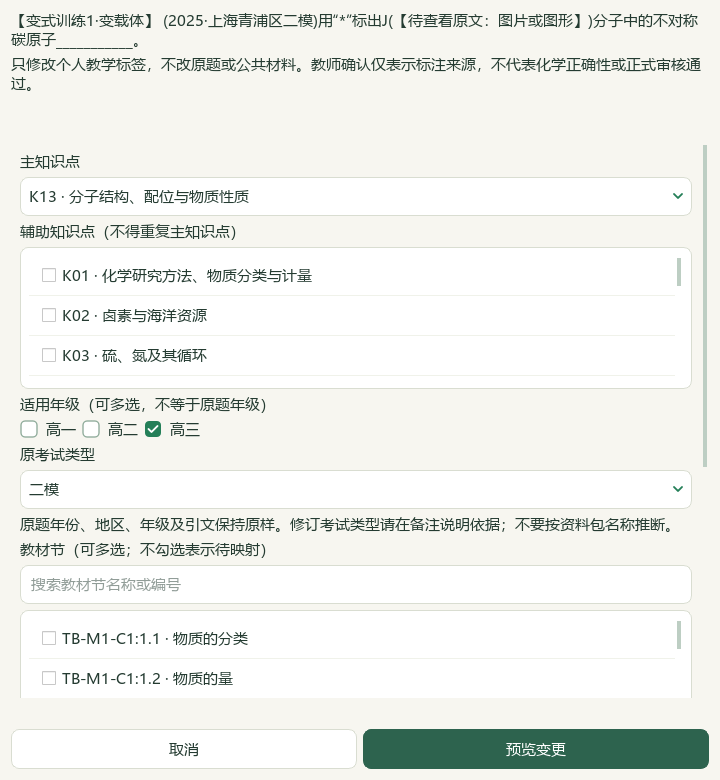

# 2026-10-06 投影续页、来源导航与本地教材关联候选验收

本轮已完成局部维护切片，完整目标仍active；候选未发布，教师化学审校未完成。微信读书／wechat-search-weread永久停用，不配置其密钥，不等待扫码或接口重试。

## 当前结果与实际操作

16:9长素材续页显示完整“作品标题（续）”，标题28.5磅，正文24磅，先预留标题空间再分页。来源文字、图片原字节及上下标保留；超长内容继续分页，原图保持完整。A4／A3排版沿用原样。已有编排在原生窗口明确点击“一栏排满并续页”更新；可撤销，不在载入时改写旧作品。渲染修订为`shchem.composition-projection-continuation.v14`，应用包版本未递增。

页面目录按教师／学生实际可见片段显示“本素材第n/N页”，完整题按既有角色标记“题面”“讲评”或“题面／讲评”，不推断答案或知识标签。学生隐藏片段不占该视图素材页数；选中仍绑定原页面和片段身份。右侧编排位置仍是教师原页，Word实际页数另核。

当前候选由前序15草稿、90登记成品及465个明确Word文件建立。原生Qt重开实际课例，重新排满并另存第16份草稿，添加第三个输出版本；全部旧15作品逐payload保持。当前6素材、2活动、40分钟、16:9；素材为2完整题、1教材摘要卡、2活动和1教师专用AI出处／适用范围提示。题面原图及教师答案沿用前序完整快照，不生成答案或评分细则。

## 题目与教材证据

根模型重读J题47—49区块及46／50相邻文字，查看3张原PNG，再查看沪科技化学选修第二册PDF51／印刷47原页。题干“不对称碳原子”与原页四个不同原子／原子团相连碳原子的解释支持K13“分子结构、配位与物质性质”、TB-E2-C2:2.2“分子结构与物质的性质”。原教材知识卡为TB-E2-C2-S22-C03，知识库原记录不写入。

原Word：`sh-chem-db/.intake/2026-07-30-user-teaching-pack/expanded/PKG-064/第07讲 分子的手性和分子间作用力（复习讲义）（上海专用）（解析版）.docx`，SHA-256 `084da90dae9f2a26007164e070290255325995241de4c34051c4ffc97bbe3d71`。原教材：`课本/沪科技化学选修第二册【高清教材】.pdf`，SHA-256 `4eb751c3bc879d2ad41a2faa723b3b4af05b29ff78f3e89a2eaf9727ebb8a848`，均位于本地DATA目录。

通过现有`OfflineWordImageLabelReviewService`生成严格来源／原图阅读绑定候选，根模型核对完整材料后应用确切预览SHA及当前属性版本。仅新隔离配置中的1题发生自动候选变化，状态仍auto_suggested，人工／教师确认false；3683条其他属性和9733条旧历史逐行保持，仅加1条历史。原身份、范围、出处、适用年级、答题形态与答案状态保持，正式题库与中央标签写入0。界面只读打开后取消，未调用教师保存确认。

题面自注“2025·上海青浦区二模”仍为讲义出处线索；原试卷及官方答案未查得核验，本轮外部请求0。paper→theme_big_question→printed_question→atomic_part正式身份保持unknown，不从讲义名、题号、来源ID或标签猜测。题目化学答案未独立审校，原讲义解析仍标作原来源内容。

前序AI曾误判J解析图缺NH₂；前序已以原图纠正，本轮复看三图均有NH₂，星号答案图保留。当前作品不含错误判断，旧A4实验草稿和失败记录仅作历史证据；不能据此宣称原答完成化学审核。

## 迁入范围与备份边界

初次复制465个Word原件、缓存、批次与属性文件，加普通备课ZIP恢复，没有带入Word题目范围和选题状态。实际维生素C材料检查揭示后，只从前序候选明确复制`native-word-question-ranges-v1`与`native-word-question-selection-v1`。原检查失败和`Word-range-selection-copy-correction.json`保留；其余16作品、供应商设置、密钥和个人教材工作区不因此迁入或覆盖。

维生素C题继续以65—72区块读取，下一节“02范德华力”及图标不进入题目；旧属性`range_review_required=True`保留，未自动重新绑定或标成人工确认。这是下一片可处理的明确待办。

普通ZIP恢复到独立检查配置，16草稿、16唯一输出版本、96登记成品、41图片摘要逐一一致；当前保存／恢复副本与所有15旧草稿保持。ZIP包含已登记作品与引用图片、任务和成品，仍不含Word库、标签历史、手工题目范围／选题状态、原教材、个人教材工作区、供应商设置或密钥。主候选保留Word库及本轮J自动属性，继续整理需保管其完整配置与原件；普通ZIP不能代替这些状态的另行保存。

## 检查、实际Office与可见范围

7个新case覆盖续页标题、页面边界、原正文、A4、教师隐藏范围、可编辑PPT及实际Qt导航身份。65项当前相关回归通过，包含新7项；另一个26项成功子集包含复跑，不累加计数。最初39项出现2失败，来自旧断言将派生标题混入来源；后续46项的5失败来自新测试沿用A4外框。改为独立核验导航文字与来源，以及实际16:9编排位置后通过；首轮XML保留。原生正文未删减来迎合测试。

4份已安装Office实际转换共22页：教师Word5、学生Word2、教师PPT9、学生PPT6。原文、可见标题、续页提示、教师／学生角色和原PNG嵌入检查0失败；教师6图、学生3图按角色原字节嵌入。导航文字与来源正文独立核对，不把新增标题当成来源。只读COM转换后源文件SHA保持，私有Office实例退出。

根模型实际查看4张Office联系图、3张完整PPT页（学生第5、教师第3／7）、2张完整画布页、学生1000像素专注视图、重开J属性窗口，以及3张J原图和教材原页。联系图可看页面布局，不等于22页原尺寸逐页细读；未标记human_reviewed、人工视觉复核或化学答案审校完成。所有生成页图和Qt截图另存明确清单，不宣称全部已由根模型逐页看过。本轮无新视频抽帧／全片播放／音轨核听，沿用前序有限UI观察，不声称视频全部功能对齐。

实际CMD→普通快捷方式→Pythonw入口重开保存作品、3输出版本、J自动主知识点与教材候选，并解析维生素C当前范围版本；运行后新配置文件除普通窗口状态外保持。属性窗取消不写教师确认。执行策略不改、不绕过；实际个人目录与所有前序候选不写入，旧EXE不更新。

原生读取助手曾用错服务参数、XML正文入口或Windows文件搜索写法，均在只读阶段纠正；不计作应用通过，也没有因此写入标签或来源。正式属性写入仅限已核对的J严格候选及确切版本应用。

## 数据与版本边界

完整README的14项测试与文档策略通过；中央status／validate通过，catalog／corpus各169，既有正式4题、人工审核0。中央检查启用私有内容保护，未执行旧整工作区验证器；旧锁定计数被当前快照替代及公开快照漂移警告保留。该检查不证明本地候选已发布或教师审核通过。

知识385、素材322、研读499存储／460可选、正式60节、补充77栏目、catalog／corpus169保持。模型Word阅读身份729、冻结元数据待办702原字节保持；重读既有J不新增阅读身份，1条隔离自动标签不据此把702减为701。既有控制器正式4题／人工审核0另列，本轮新增正式题、中央标签、正式答案0。3579条Word目录不等于3579题已审校。新增检索文章／有效试卷／重复下载均0，无新归档材料、供应商调用或外部请求。

原件、正式库、实际个人状态、前序候选、旧输出和冻结待办保留。新增公开范围仅本轮QA、1测试模块和实际Qt截图，既有4应用模块、2测试及6说明文档明确变更，两个匹配知识库笔记同步；不改95-Source。本轮保存验证以最终文件哈希清单为准，不扫描整份私有档案。

源码HEAD仍`e08c3e778d94ac9bdb526266dc668cc9b18a5091`，保留未提交前序编辑，索引空；渲染v14，旧EXE v0.1.101原发行未替换，无提交、推送或发布。历史辅助临时状态原字节未恢复的例外仍保留在`outputs/2026-10-05-question-confirm-performance-slice/auxiliary-state-exception.json`，不宣称已恢复。全目标未完成：维生素C范围属性、更多资料、化学和四层题目审校、候选整合、视频功能及桌面发行继续；手机端仍排除。

## 当前本地路径与证据

代码：`C:\Users\20671\.codex\worktrees\e6ae\上海高中化学等级考`。

DATA：`E:\项目\上海高中化学等级考`；本轮输出：`outputs/2026-10-06-projection-continuation`。

主候选：`C:\Users\20671\AppData\Local\ShanghaiChem\LocalCandidates\2026-10-06-projection-continuation\profile`；草稿：`prep-b50f51d6e2b6499ca18c5341f4045ac3`。

入口：本轮输出目录`打开投影续页与来源导航候选.cmd`；备份：`投影续页与来源导航候选-备份.zip`；实际文件：`exported-copy`。

主要证据为`inputs-before.json`、`native-verification-current.json`、`canvas-layout-verification.json`、`Word-range-selection-copy-correction.json`、`J-source-evidence.json`、`J-mapping-preview.json`、`J-mapping-apply-receipt.json`、`J-mapping-preservation-verification.json`、`question-continuation-actual-office-verification.json`、`backup-roundtrip-verification.json`、`candidate-entry-verification.json`、`related-tests-final.xml`。文档策略、完整README测试、中央status／validate、输入保存、公开源码清单、根模型视觉记录及最终验收另见同目录最终JSON／XML；失败记录保留。
