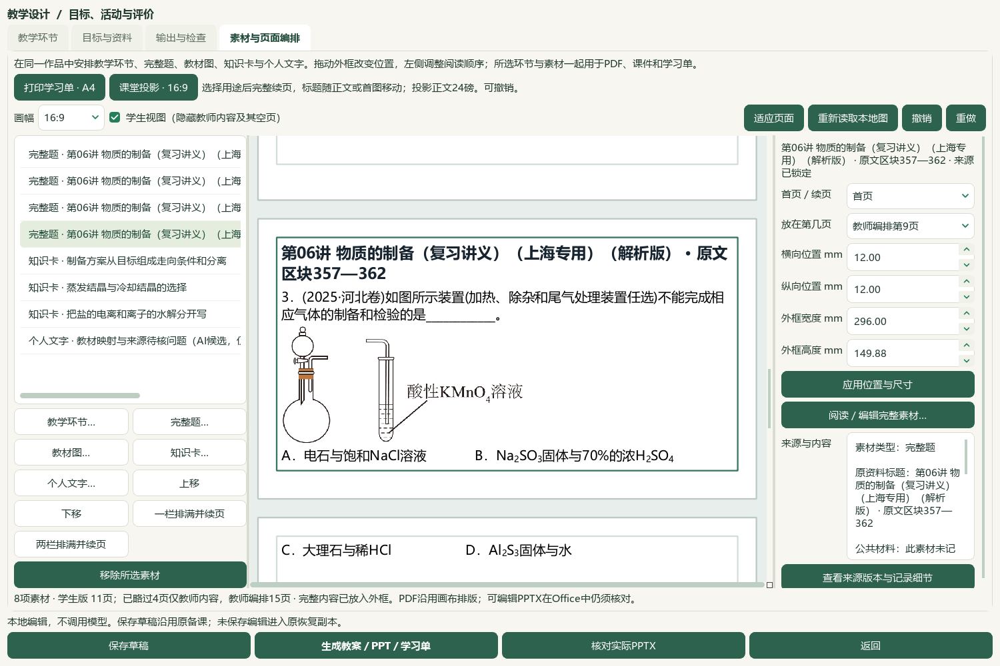
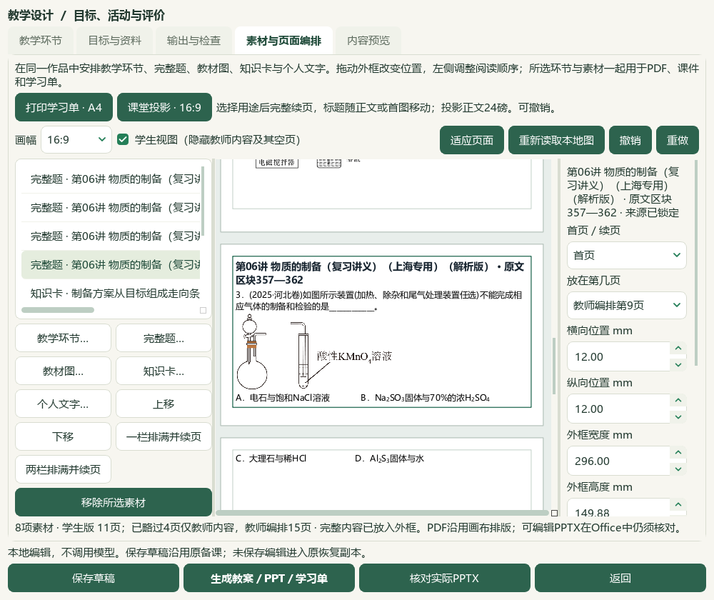

# 四题与教材知识联动、保存和Word分页验收

2026-10-06，当前维护工作区HEAD `e08c3e7`，本地候选，未发布。前序见[教材图与来源知识卡](2026-10-06-textbook-figure-flow-qa.md)，操作见[素材页面编排](../teacher/lesson-and-paper.md#lesson-composition)。微信读书停用。本轮文章检索、新有效试卷、下载、外部请求和模型供应商调用均0。

## 本片结果

实际Qt/QTest打开默认完整Word目录，逐题检索、阅读题答与图像、勾选并明确确认带入4题，再从真实知识卡选择器加入3张卡。原生对象转为本地预览的两个铁离子图保留在原段落位置，8张所用PNG原字节嵌入教师／学生Word与PPT。保存来源文件SHA、版本、题答区块与原快照；未编辑原题、原解析或正式标签。

已选完整素材时，保存前若“本次资料范围”为空，会自动列出当前所选资料概况；已有教师文字保留。题答、图像和来源仍保存在素材原快照中。此列表在空框保存时生成，后续删除／调序素材不会自动改写已有说明，教师仍可编辑核对。修复了本次7素材能导出却因空框无法保存的实际失败。

实际学生Word中原题4的短题干在第2页、首图在第3页；新规则把有限长度的标题、短题干与首张装置图保持一起，实际第3页现含标题、题干、完整图与选项。小行内公式或徽标不提前终止分组；长导语、长题其余部分和过高图保留完整正常分页。投影仍为24磅，原图与素材全文保持。修改3既有应用模块，新增2测试模块，最终35项相关检查通过；渲染修订`shchem.composition-qt-word-opening.v13`，应用版本未递增。

## 原题与教材

| 原讲义范围 | 本次用途与保留问题 |
| --- | --- |
| PKG-060样本2，区块221—226 | 烧渣制无水氯化铁，原答案D；过滤图、Fe²⁺／Fe³⁺对象和原“在将晶体”措辞保持。水解原则不能直接认证脱水操作 |
| 样本6，264—272 | NOCl制备、干燥与冷凝，原答案C；原解析Y／图②不一致仍待核 |
| 样本7，273—278 | 镁法脱硫，保留投料方式和除杂／结晶两个空及原问答；旧自动K14标签待复核，候选建议以实验方法、pH与离子反应逐任务判断 |
| 样本11，357—362 | 气体制备与检验，原答案C；“2025·河北卷”为讲义自述，未认证原卷与官方答案 |

原Word SHA-256为`68f4f4c3b93a048a50eea10a15a0dc91e9a41f7621623f857014d30d1393f6f1`。正式paper→theme_big_question→printed_question→atomic_part身份仍unknown。侧存4份来源绑定的教材映射候选／5个本地作答任务建议，正式题、标签和答案修改均0；作答形态、表征、能力与难度未强行登记。

三张既有卡为“制备方案从目标组成走向条件和分离”“蒸发结晶与冷却结晶的选择”“把盐的电离和离子的水解分开写”。本轮实看必修一PDF27、30、37／印刷22、25、32，选必一PDF76、77、79／印刷70、71、73；79页只作为配液抑制水解的补充依据，未新增卡。原书SHA分别为`a565f0a15ffd10c704f4be42bfe7200c125b68959d11ef582acdc45dde2ccf22`与`79e1e8391749b01a2d9d632531615ef9b644613130e28b98279aaea71aab2b05`。课堂建议为教师可见；空白pH实验表继续未测，未填实验结果。

最后以实际“个人文字…”入口明确勾选“仅教师可见”，加入AI整理的教材映射与来源待核说明。7份来源素材＋1教师说明共8项，不把模型观察当作教师确认或化学认证。

## 成品、保存与可打开候选

| 实际输出 | 最新版本 | 核对范围 |
| --- | --- | --- |
| 教师／学生Word | 7／3页 | 题答和图像完整；学生无答案与教师说明；短原题4首图与开头同页 |
| 教师／学生PowerPoint | 15／11页 | 8张原PNG与上下标位置保持，原长题和解析完整续页；学生隐藏教师内容 |

分页前后两版共8份实际Office文件、72页；最终4份36页。根代理实看8完整联系图覆盖72页，另看4个选定最终Word原尺寸页、4原题图文面板、6教材原页和3个选定实际UI；不称72页全部逐页原尺寸细读。应用以已安装Word／PowerPoint只读转换，私有实例退出及源文档摘要保持；画布PDF另计机器产物，不能代替Office证据。本机结果不等于全硬件或真实课堂投影验收。

从真实个人目录副本保留1旧草稿，先保存8素材候选，再为Word规则生成新版本、另存候选至3份。3版18登记成品、16个引用图片摘要在备课ZIP恢复后逐份一致，原草稿与先前12成品保持，最新6份独立导出副本一致。完整源码工作台重开最新候选，载荷、素材位置和3版记录一致；正常窗口大小与更新时间另有回执。备课ZIP仍不包含正式原书PDF、完整题库和研读档案，须另外保管。

本机可双击`E:/项目/上海高中化学等级考/outputs/2026-10-06-question-preparation-import/打开本次备课候选.cmd`继续编辑。ASCII包装通过标准Windows快捷方式直接启动Pythonw；实际CMD→快捷方式→Pythonw检查重开8素材／3版相同载荷，正常入口与检查入口只差离屏核对参数。它使用当前CODE源码、现有DATA资料和已校验的独立持久候选目录`C:/Users/20671/AppData/Local/ShanghaiChem/LocalCandidates/2026-10-06-question-preparation-v13/profile`；未替换真实个人目录或已安装EXE，移动源码／原书后须重新关联。最新文件在本片`accepted-exported-copy`，备份为`accepted-question-preparation-backup.zip`。

## 保护、限制与后续

正式catalog/corpus167、319原图与5图题更正、496存储／457可选／60正式节保持；新增知识笔记、正式题和完整阅读身份0。沿用前序702待办、723完整／227部分身份与261未尝试可处理图题，不称本轮全库扫描。本轮参考视频新帧、完整播放、音频核听与新HTML／语音功能0，继续更多视频对齐。

冻结5577条选定路径，只允许3应用、5文档、2知识库文件改变。最终普通status／validate、文档策略、14完整README及来源保护另存回执。真实494文件、3684属性／9733历史保持；辅助466保持事故后字节，历史临时desktop-state.v1.json事故前原字节仍未恢复，保留旧异常回执。知识库更新只改化学行与项目页，其他项目保留。

失败记录保留：原Save空框失败；辅助复制缺目标文件夹；把恢复目录放在项目内导致供应商设置路径规则正确拒绝启动；启动检查调用了错误API／结果字段，以及把正常窗口几何保存误当改稿；新Word高度估计先遗漏默认字号、再重复计空图片段文字高度，修复后35项通过。首题答案面板过早截图仅474字节，未用来证明视觉阅读；实际原答案载荷及Office题答另核。原UTF-8批处理未留下实际启动回执，后续PowerShell文件包装被本机脚本执行策略拒绝；两版保留，最终标准快捷方式实际通过，未修改或覆盖系统执行策略。早期直接Python检查中误名为CMD执行的字段已在修复回执澄清。原导出成功后只续做保存、复制、恢复；Word规则变更才追加新版本，没有重导原4题。

当前候选human_reviewed、teaching_use_allowed、generation_allowed、publication_allowed仍false。总目标active，手机端排除；更多资料、正式四层标签、独立化学／教师审校、视频功能、候选整合和桌面发行继续。未复制应用到DATA旧代码、提交、推送、发布或重建v0.1.101 EXE。

私有证据：本片`word-UI-selection-proof.json`、`accepted-saved-payload.json`、`question-textbook-mapping-candidates.json`、`related-tests-accepted.xml`、`native-verification-final.json`、`candidate-launch-verification-final.json`（完整窗口重开，旧入口摘要已由`candidate-entry-final.json`替代）、`accepted-office-verification.json`和终验回执；旧失败、首轮版本及冻结备份保留。
