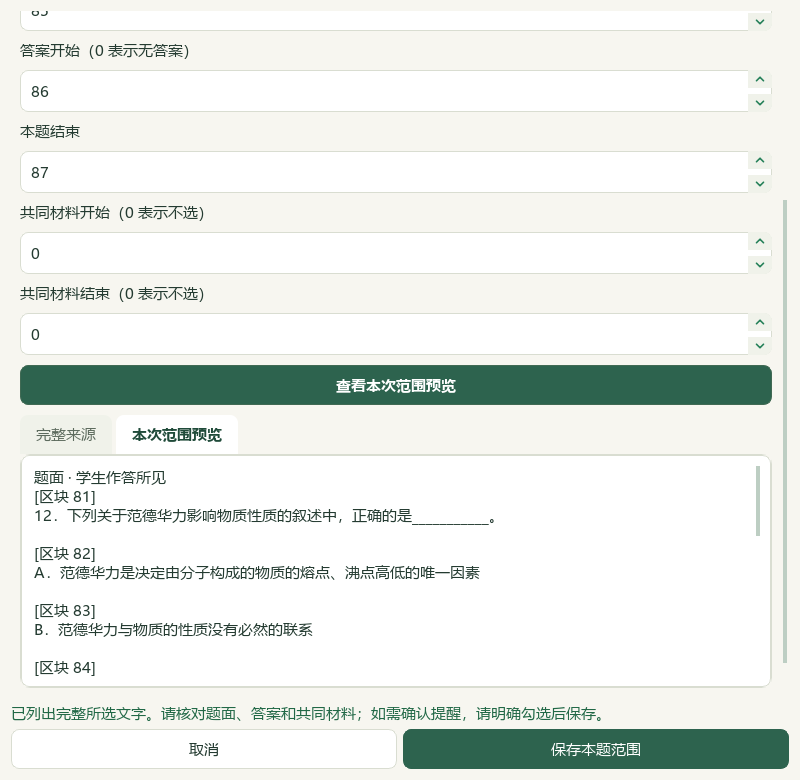
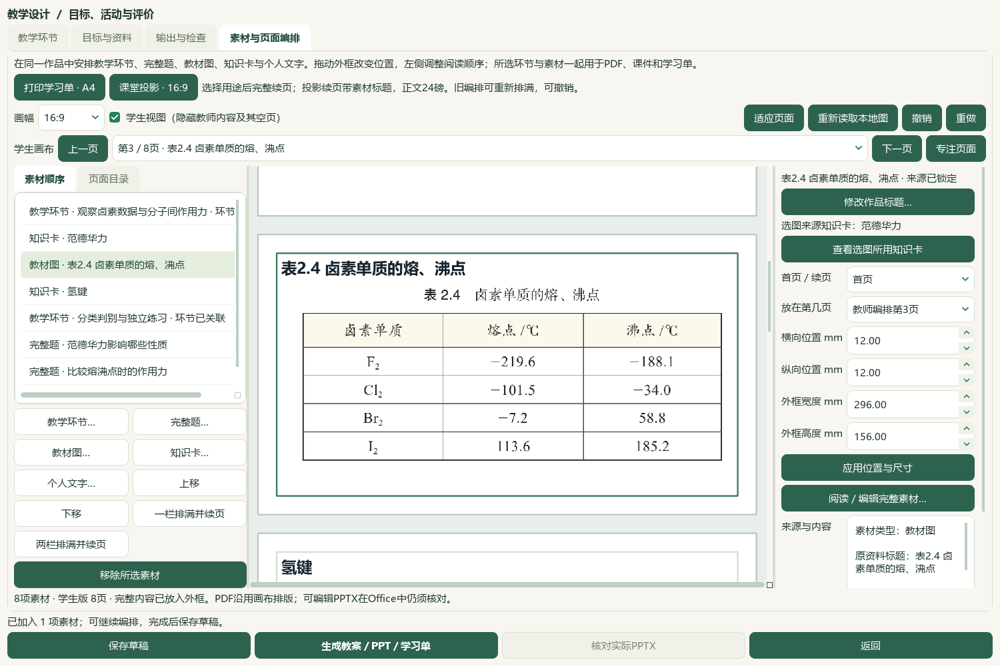

# 2026-10-06 读取退出回调与分子间作用力备课验收

本片为本地未发布进展，完整目标仍active，教师／人工审校未完成。微信读书永久停用，不重试、不扫码、不配置其密钥。本轮检索文章0、新试卷套数0、重复下载0；没有检索外部资料或调用模型供应商。

## 当前结果

资料读取完成但Qt成功回调仍在排队时关闭工作台，原回调可能继续创建阅读器或图片任务并触发“任务桥正在关闭”。任务桥现在在派发公共信号和界面回调时检查关闭状态，保留内部清理及已经提交的工作；首页、学生页和备课页的初始定时读取也在关闭后退出。真实窗口故意保留排队成功再关闭，0回调异常、无新阅读器或图片任务，17个前序草稿和属性数据库保持。

本轮从PKG-065原Word逐题读分子间作用力题，Q12原81—92误并Q13，真实范围预览收正为81—87（题面81—85／答案86—87），并保存当前范围自动建议。隔离库3684属性仍在，仅Q12当前属性变化；其他3683属性与9736旧历史逐payload保持，历史增至9737。Q14为93—97、Q15为98—101。Q11原答案与教材关于范德华力普遍存在的表述需进一步核对，未选入；Q13的88—92暂无独立索引身份，保留原文待处理。未知出处、四层身份与难度不补猜。

直接读取选必二原PDF52—56／印刷48—52，选用既有“范德华力”“氢键”两卡；从原PDF54页面素材裁出完整表2.4卤素熔沸点，保留标题、四行数值和℃单位。未新增中央知识、素材或catalog记录，知识386／素材322、catalog与corpus170、研读499存储／460可选、60正式节／77补充保持；原PDF、原Word和既有派生页图均不写。

独立另存“分子间作用力：熔沸点与相变判别”第18份草稿，8素材＝3完整题＋2既有知识卡＋1原表裁图＋2活动，2环节40分钟，16:9／正文24磅／渲染v14、1输出版本。前序17份草稿及其中8素材／4输出版本作品逐对象保持。实际安装版Word教师5／学生2页、PPT教师8／学生8页，共23页；全文、标题、导航及答案隔离检查通过，教师和学生各嵌入1张原裁图的确切字节。普通备课ZIP恢复18草稿／18唯一版本／108成品／50图片摘要，实际CMD→普通快捷方式→Pythonw重开当前作品、Q12范围及前序题目绑定。

12新增关闭回调测试，117项相关检查与64项窗口检查分别通过（共同12项，不相加为181）；README与文档策略另核。模型阅读身份730→734，新增4包含未选入的Q11；冻结元数据待办702未重建或扣减。新增正式题、中央标签和官方答案0，教师／人工审核资格保持关闭。没有检索外部资料或调用模型供应商；微信读书永久停用。本轮没有新BDL抽帧、全片观看或音轨核听。

主候选另保留465个明确Word文件、教学属性历史、3处手工范围及当前选题状态；普通备课ZIP不含Word库、范围／标签库状态、原教材或供应商配置。实际个人配置、前序候选和冻结队列保持。4既有应用模块、1新测试及1既有测试替身修正形成本轮维护增量；旧EXE v0.1.101未升级，无提交／推送／发行。全目标active，手机端排除；更多资料、化学／四层审校、学生页布局、UI整合和桌面发行继续。历史辅助临时原字节未恢复例外仍保留。

验收：[本轮记录](2026-10-06-reader-close-and-polarity-import-qa.md)；入口：`E:\项目\上海高中化学等级考\outputs\2026-10-06-reader-close-and-polarity-import\打开分子间作用力备课候选.cmd`。

## 原件、范围与教材依据

PKG-065原Word：`E:\项目\上海高中化学等级考/sh-chem-db/.intake/2026-07-30-user-teaching-pack/expanded/PKG-065/第07讲 分子的极性和分子间作用力（专项训练）（上海专用）（解析版）.docx`，SHA-256 `5ba3b6599d3ceb6109ab0e4ac5ac600a9a9282a59f9f892d3521292af824b966`。根模型读取Q11完整74—80及选入Q12、Q14、Q15的完整题面和答案；三道选入题均无题目原图。原参考答案分别D、D、C，只作为讲义来源记录，不标官方评分或教师审核。源年份、考试地域及四层正式身份unknown；文件名不作为这些字段的证据。

Q12原81—92把Q13并入答案，真实Word范围窗口预览和保存81—87，当前题面81—85／答案86—87；随后在真实自动建议窗口预览与保存。其他3683属性、全部9736旧历史保持，新增1历史；前序J教材映射、维生素C主知识点unknown及两处手工范围保持。Q11的A“范德华力存在于所有分子之间”与教材PDF52普遍存在、PDF53色散力表述相符，原答案仅D，作答形态与答案完整性仍需核对。Q13标题缺常规分隔，88—92暂无独立目录键，未从内部ID猜造身份或重建全库。

原教材：`E:\项目\上海高中化学等级考/课本/沪科技化学选修第二册【高清教材】.pdf`，SHA-256 `4eb751c3bc879d2ad41a2faa723b3b4af05b29ff78f3e89a2eaf9727ebb8a848`。根模型直接看PDF52—56／印刷48—52的五页完整原页图和文字，核对范德华力、作用力类型、卤素数据及氢键；现有卡TB-E2-C2-S22-C05/C06与2.2节精确来源保持，K13粗分类不代替教材节证据。官方出版年份／版次与URL未知保持unknown，未新增官方属性。

表2.4从既有V06原页锚点PDF54裁出，原页面SHA `d378e216ce7db2067a0d3dcec6a41d93d00402af44a0e21b8df00dcc4ddc1163`。实际像素边界675／570／1806／1058，裁图1131×488；根模型查看原页、裁图及真实裁图对话框后再确认。四行熔／沸点℃：F₂ −219.6／−188.1，Cl₂ −101.5／−34.0，Br₂ −7.2／58.8，I₂ 113.6／185.2。未重绘或改字，裁图只有作品副本，中央322素材原记录不变。

## 关闭修复、回归与原生验证

任务桥用关闭状态在排队回调实际送达时检查；公共GUI信号及调用方回调不再触发后续工作，内部worker清理继续。未把显式晚提交静默吞掉，已经完成的提交文件保留，取消与提交语义未改。12个真实Qt回归覆盖排队成功／失败／进度、公共信号、正常打开时GUI线程回调与跟进、提交文件保护和超时后完成；修复前9失败／3通过留档。

真实TeacherWorkbenchWindow的QuestionExplorer展开带图主题，故意等worker完成但不派发GUI队列后关闭，随后继续处理Qt事件。第一次原生检查还暴露首页、学生页和备课页的3个初始定时回调；三处加入关闭检查后，实际排队关闭0异常、无新reader或image任务、17旧草稿及属性数据库SHA保持。此处不是用“等待队列清空”避开问题。

117项相关回归首次有3项ImportStub缺open_textbooks_requested初始字段失败；替身补齐实际对话框字段后117通过。64项窗口检查在初始定时修复后通过，共同12项关闭测试，成功用例去重169，不累加失败或复跑。README完整14项、文档策略和控制器检查另记录。4既有应用模块都有本片编辑前SHA；既有测试替身也另冻前态。

## 原生接入、实际Office、保存与恢复

通过真实备课、完整题、知识选择器和裁图窗口操作。首次裁图确认驱动点到复选框非活动位置，留下7素材恢复副本；重开同一副本核对原裁图，改用控件有效点击位置后仅补入裁图，没有重加题或卡。独立新课2环节18＋22分钟，2目标，8素材按观察活动→范德华力卡→卤素表→氢键卡→练习活动→Q12→Q14→Q15排列。节点和来源资格仍未标教师确认。

两次初始知识阅读器截图空白，驱动误把灰背景算作页面文字；这些图留档，不作为已渲染证据。后续只读重开实际QPdfView，排除灰背景、等待深色文字像素后截图，未重加知识卡。根模型直接查看修正的PDF52和55真实渲染截图；原PDF五页另已完整读取。这个纠正仅涉及验收驱动，未改阅读器应用逻辑。

实际安装版Office只读转换四份成品：教师Word5、学生Word2、教师PPT8、学生PPT8，共23页。机械全文／标题／导航／教师内容隔离检查0失败，教师和学生均确切嵌入1张原裁图。根模型看四份23页联系图和3页完整尺寸重点页（学生PPT3、教师PPT7、学生PPT8），不是逐页完整尺寸审校。学生PPT第2页因共享教师布局留下较大空白，后续仍需改善；教师Word最后一页解析续文保持。Office源文件SHA不变，私有COM实例清理按原回执记录。

新课1成品版本登记6输出，前序17份草稿及原102输出逐对象／字节保持；普通ZIP恢复18草稿／18唯一版本／108输出／50图片摘要，当前作品恢复payload一致。Word库465文件、3684属性／9737历史、3手工范围及3题当前选题另留在主候选；普通ZIP不含这些库状态、原教材或配置。真实CMD→快捷方式→Pythonw入口重开作品与范围绑定，不改执行策略或旧EXE。

## 待核清单与发行边界

Q11答案及作答形态、Q13独立题目身份、更完整原出处、正式四层拆分、实测难度和化学教学审校待核；本片未新增正式题或中央标签，未写官方采分点。控制器既有正式4／人工审核0与catalog170保持。新阅读身份4含Q11，累计734是模型读取，不代表化学／教师审校；702元数据待办为前序冻结值，未按本片读取扣减。

BDL既有视频路线继续属于全目标，本片没有新抽帧、全片或音轨核听；未据此宣称视频功能全验收。更多教材与题目导入、独立学生页布局、UI整合、教师审校与桌面发行继续；手机端仍排除。历史J图缺NH₂的错误判断已在前序纠正，未推翻；辅助临时原字节未恢复的历史例外见`outputs/2026-10-05-question-confirm-performance-slice/auxiliary-state-exception.json`，仍未宣称恢复。

## 路径与证据

CODE：`C:\Users\20671\.codex\worktrees\e6ae\上海高中化学等级考`；DATA：`E:\项目\上海高中化学等级考`；本片证据：`E:\项目\上海高中化学等级考\outputs\2026-10-06-reader-close-and-polarity-import`；持久主候选：`C:\Users\20671\AppData\Local\ShanghaiChem\LocalCandidates\2026-10-06-reader-close-and-polarity-import\profile`；草稿：`prep-882d3579b1e74eb4adef59fdf68a6760`。

入口：本片输出`打开分子间作用力备课候选.cmd`；普通备份：`分子间作用力备课候选-备份.zip`；独立成品：`exported-copy`。HEAD e08c3e7、渲染v14、发行EXE v0.1.101保持，无提交／推送／发行。

主要证据：native-close-race-verification.json、Q12-scope-preservation.json、selected-source-final.json、source-content-review.json、textbook-source-pages.json、table-crop-root-review.json、original-reader-render-verification.json、knowledge-reader-initial-capture-correction.json、native-verification-current.json、question-vdw-actual-office-verification.json、backup-roundtrip-verification.json、candidate-entry-verification.json、reading-identity-ledger.json、related-tests-fixture-corrected.xml、window-timer-tests-final.xml、documentation-sync.json及最终input-preservation／source-review-manifest／root-visual-review／root-final-acceptance。初始失败记录均保留。最终验收不把上述局部进展标成完整目标完成。
