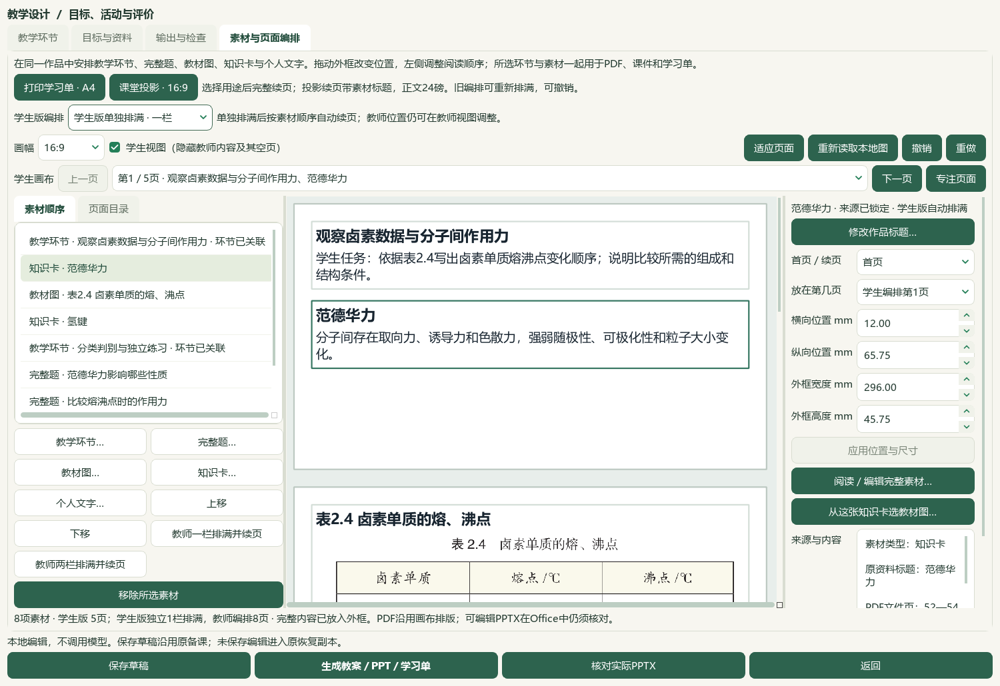
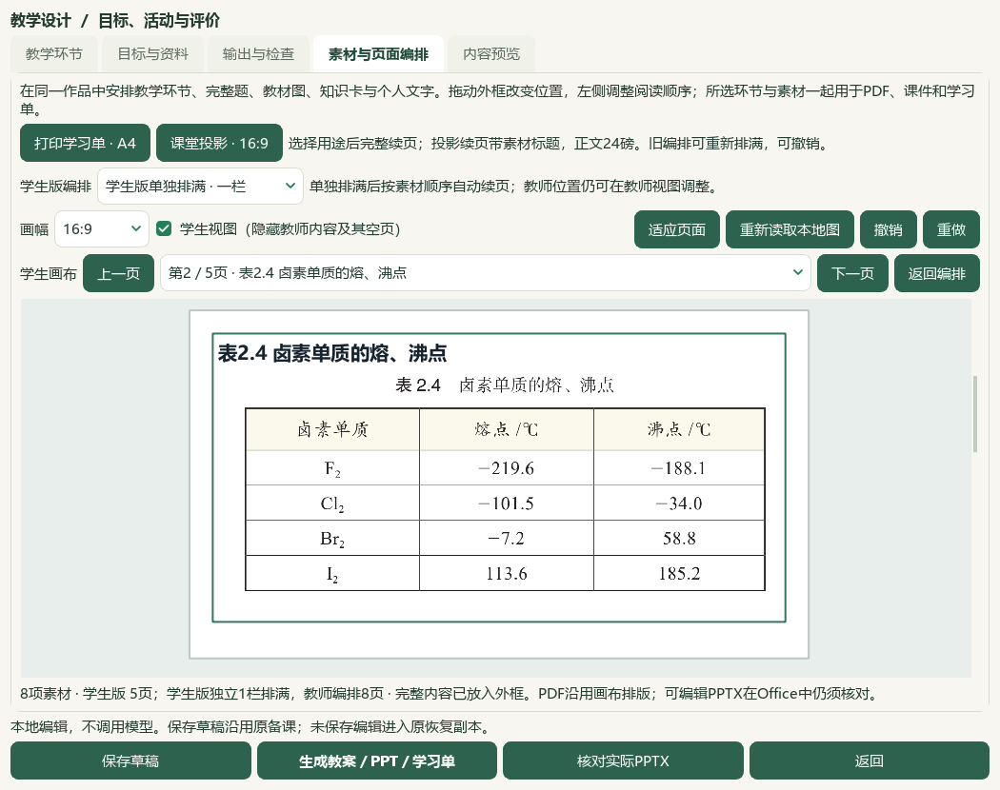

# 2026-10-06 学生版独立编排与完整短题分页验收

本片为未发布的本地进展，完整目标仍active，人工／教师审校未完成。微信读书永久停用；本轮检索文章0、新试卷0、重复下载0，没有检索外部资料或调用模型供应商。

## 当前结果

页面编排新增“学生版编排”：沿用教师位置、学生版单独排满一栏或两栏。独立模式只按学生可见正文和整张原图测量、分页，选择随草稿和普通ZIP保存；教师外框、页面标识、资料原文及阅读顺序保留。预览、学生PDF和可编辑PPT共享同一测量结果及稳定页码；学生自动模式的外框不拖动，教师视图仍可调整教师位置。修改素材和调序后学生版自动更新，无需重复设置；旧草稿未选择时沿用原位置并保留有意空白页。

真实分子间作用力课从学生PPT8页收至5页，教师仍8页，教师定位元素逐项保持。原范德华力卡由学生第2页移到第1页，与观察任务相邻；完整表2.4独立保留。实际首版审阅发现Q12、Q15题干和选项跨页，最终规则把能够在一页容纳的完整短题一起移动，长题仍以24磅完整续页；当前学生PPT的Q12、Q14、Q15均各在一页。窗口缩小后自动适应当前页，1050宽窗口及专注页重开通过。渲染修订v16，仅为维护源码行为修订，应用发行版未变。

本轮复用3完整题、2既有知识卡、1原表裁图和2活动，共8素材／40分钟，没有新题或知识入中央库。原18份草稿及108成品保持；中间v15第19份／第2输出版本保留，最终v16另存第20份／当前第3输出版本。安装版Office教师Word5、学生Word2、教师PPT8、学生PPT5，共20页，全文、标题、导航、答案隔离及原裁图字节检查通过。普通ZIP恢复20草稿／20唯一版本／120成品／50图片摘要；实际CMD→普通快捷方式→Pythonw重开独立模式、5学生页及前序范围自动标签。

19新增用例包含在最终165相关通过检查中；首轮160通过、1旧测试替身参数不匹配，替身修正及7项模块补验留档。缩放37项补验和首轮／终轮重跑不累加。README14项、文档策略与控制器另核。465个Word文件、3684属性／9737历史、3处手工范围和当前选题状态逐字节或payload保持；中央知识386／素材322、catalog与corpus170、研读499存储／460可选、60正式节／77补充保持。734模型阅读身份与冻结702待办均未新增或重建，新增正式题／中央标签／官方答案0，人工审核0。

主候选保存于独立LocalCandidates，个人配置、前序候选、原教材／讲义和冻结队列不写。普通备课ZIP不含Word库、标签／范围／选题库状态、原教材或供应商配置；它们仍需单独保管。4既有应用模块、1既有测试替身修正和1新测试形成本轮增量，旧EXE v0.1.101未升级，HEAD e08c3e7及空索引保持，无提交／推送／发行。微信读书永久停用，没有检索外部资料或调用模型供应商。

本轮只复看既有BDL V17第48秒的作业分析表，它不是课件布局功能证据；没有新抽帧、全片观看或音轨核听。总目标仍active，手机端排除；Q11答案／作答形态、Q13独立索引、更多资料、化学及四层审校、整体UI整合、视觉主题与桌面发行继续。历史辅助临时原字节未恢复例外保持。

验收：[本轮记录](2026-10-06-student-independent-flow-qa.md)；入口：`E:\项目\上海高中化学等级考\outputs\2026-10-06-student-independent-flow\final\打开学生版独立编排候选.cmd`。

## 保存选择与派生布局

原composition.v1允许可选student_arrangement字段，仅含整数columns=1或2；无该字段的旧数据保留原行为。独立学生布局先按现有角色过滤，标题和整张原图按原顺序测量，隐藏教师专用资源时也隐藏其标题。页码由可见内容、标题、画幅和栏数派生，重复预览和导出稳定；保存的教师pages、placements、原资源与来源快照不改。预览不写派生几何，来源与教师标签不因布局变化被确认。

独立模式修改内容、标题或阅读顺序后即时重新测量。画布显示实际学生外框和学生页码，自动框不拖动／不应用尺寸；教师视图仍可编辑教师位置。界面布局选择可撤销、重做、恢复共享位置，随备课草稿、恢复副本和普通ZIP保留。选择独立模式明确重新排列学生可见内容；共享模式仍保留有意的空白教师页。长内容不缩字或截断，短题能容纳在画布一页时保持题干与选项同页，图片保持整张、纵横比及原字节。Word会按自身打印页重新分页，不等同于画布或PPT页码。

## 实际操作与视觉核对

真实TeacherWorkbenchWindow／LessonDesignDialog通过QTest操作选择、撤销、重做和保存，3道完整题、2卡、1原表和2活动的原始记录保持。教师定位元素在独立模式前后逐项相等；知识卡由学生第2页移到第1页。最终Q12（81—87）、Q14（93—97）、Q15（98—101）各只有1学生素材片段，完整条件和选项保留，教师答案仍按原角色隔离。

第一阶段v15实际Office20页确认学生8→5，但Q12、Q15仍跨页；该19份／114成品备份、入口、截图和Office原件保留在父输出目录，作为中间证据。随后v16加入可容纳短题的整组分页规则，真实窗口再生成第3输出版本，另存第20份。初始1050宽截图沿用宽窗缩放而右侧截出视口，未作为小窗完整显示证据；加入受控单次定时适应后，37项UI补验以及最终原生小窗、专注页和入口重开通过。没有重写中间成品或隐藏初始观察。

安装版Office最终教师Word5、学生Word2、教师PPT8、学生PPT5，共20页；全文、标题和续页导航0失败，学生文件不含教师答案或说明，教师与学生各嵌入1张原裁图的确切PNG字节。根模型看四份20页联系图及全部5页最终学生PPT原尺寸页；教师Word／PPT只作联系图和机械全文检查，不称全20页都已原尺寸细读。Word学生学习单的Q12题干位于第1页末、选项位于第2页；本次短题整组规则验证覆盖画布、PDF与PPT，Word段落分页仍待改进。其化学答案、教案教学语义和真人视觉审校尚未完成。源Office文件只读转换SHA保持，COM清理按实际回执记录。

## 回归、备份与入口

19新增用例覆盖三种画幅、一／两栏、隐藏答案／教师标题、完整短题同页、长题完整续页、调序／改标题即时布局、稳定页码、PDF／PPT审计一致、非法栏数、真实UI选择／撤销／教师几何保护、缩窗适应。最终165相关用例均通过；首轮161中160通过、1旧属性-store替身不接受当前source_sha256／question_revision参数，补齐**binding后该模块7项通过。15初验、37缩放补验与各次重跑均不累加到最终165。README14项和文档策略另验。

普通ZIP恢复20草稿／20唯一版本／120登记成品／50图片摘要。原18份及原108成品、中间第19份／114成品保持，最终新6文件另列；当前3输出版本原2版本不覆盖。主候选所有465 Word文件（包括SQLite）、3684属性／9737历史、3手工范围和3题选题状态保持。普通备课ZIP只含作品、引用图片、终态任务与登记成品，不含Word库、教材原件、标签／范围／选题状态或配置。实际CMD→WScript普通快捷方式→Pythonw重开作品、独立一栏、5页学生布局、1050缩窗及原J／维生素C／结构题／Q12范围绑定，不改执行策略或EXE。

## 来源、保护与剩余范围

本片不新增材料条目，catalog／corpus170、知识386／素材322及教材研读499存储／460可选保持；原教材PDF与Word、派生源页、个人配置、全部前序候选及冻结队列按明确路径和SHA核对。734阅读身份对象保持，新阅读0，702待办不重算；正式题／中央标签／官方采分点新增0，既有正式4／人工审核0。原题出处、答案疑点、四层身份及实测难度仍须逐题审校；Q11、Q13待办未由本片解决。

BDL V17-048s只显示作业分析表，根模型本轮复看这一个既有帧，未把它当成课件独立布局依据，未新抽帧、播放全片或核听音轨。更多本地材料、整体UI及视频功能对齐、视觉主题、真实教师审校和桌面发行继续，手机端排除。历史J缺NH₂观察已由前序纠正，未逆转；`outputs/2026-10-05-question-confirm-performance-slice/auxiliary-state-exception.json`的辅助临时原字节仍未恢复。

## 路径与证据

CODE：`C:\Users\20671\.codex\worktrees\e6ae\上海高中化学等级考`；DATA：`E:\项目\上海高中化学等级考`；最终证据：`E:\项目\上海高中化学等级考\outputs\2026-10-06-student-independent-flow\final`；中间证据：`E:\项目\上海高中化学等级考\outputs\2026-10-06-student-independent-flow`；主候选：`C:\Users\20671\AppData\Local\ShanghaiChem\LocalCandidates\2026-10-06-student-independent-flow\profile`；最终草稿：`prep-cdd0c8b606dc40fd8a9f6932b89fc156`。

入口：最终目录`打开学生版独立编排候选.cmd`；备份：`学生版独立编排候选-备份.zip`；独立成品：`exported-copy`。维护源码渲染v16，已发布EXE v0.1.101未变、HEAD e08c3e7及空索引保持，无提交／推送／发布。

主要证据：inputs-before.json、intermediate-v15-evidence.json、native-verification-current.json、canvas-layout-verification.json、student-flow-actual-office-verification.json、backup-roundtrip-verification.json、candidate-entry-verification.json、related-tests-final.xml、reading-identity-ledger.json、next-question-work.json、documentation-sync.json、控制器与README报告，以及最终source-review-manifest／input-preservation／root-visual-review／root-final-acceptance。最初1734明确文件冻结；同步前发现知识库INDEX已被其他工作更新，化学项目行仍与前序回执一致，另存当前全文快照并只改化学项目行，保留其他项目现状。全部本片应用编辑和既有测试替身有编辑前SHA；最终验证只接纳计划内修改，不对全目标宣称完成。
