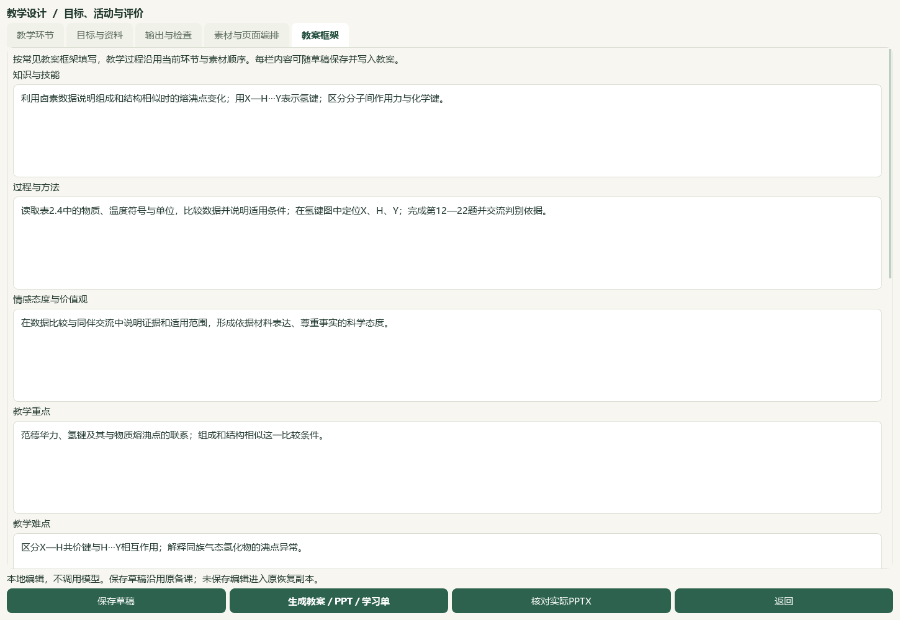
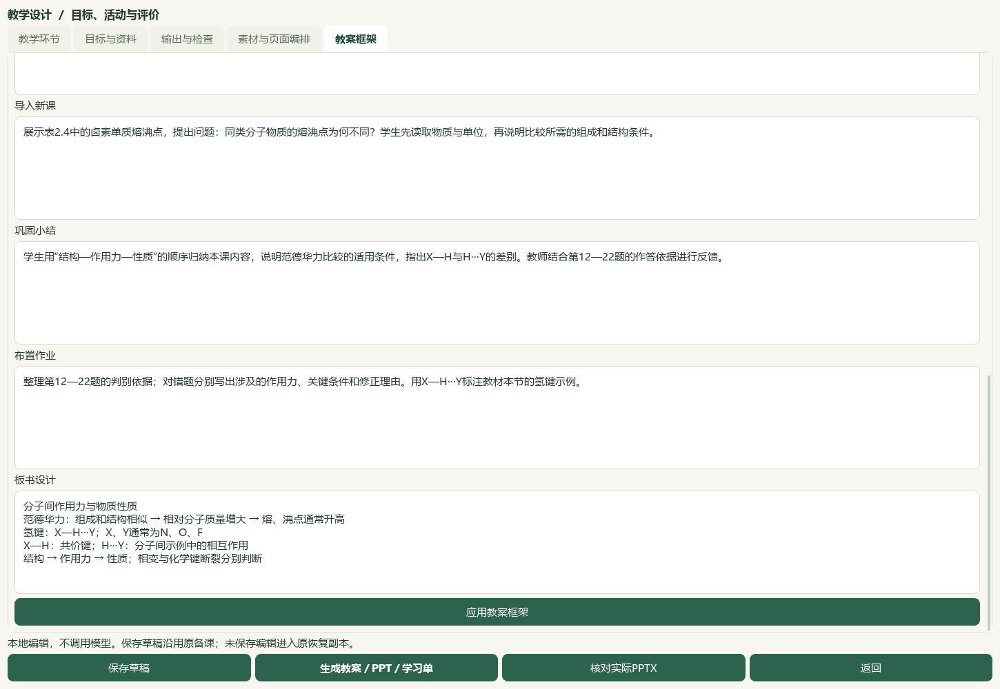
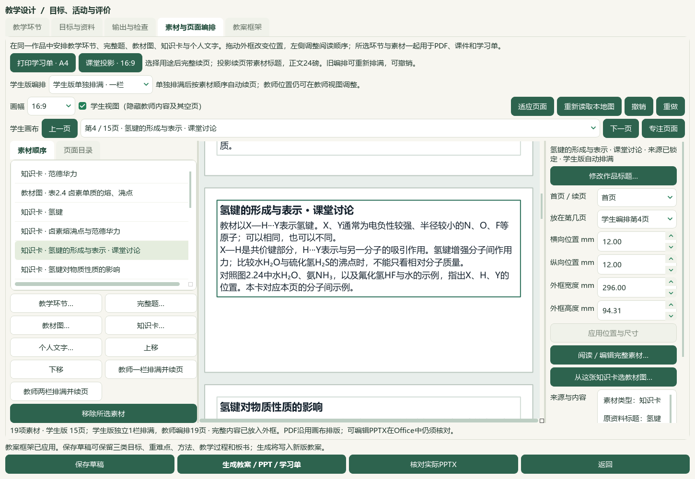

# 常见教案框架、个人笔记联动与简洁教学正文验收

新增“教案框架”页，三类目标、重难点、方法、导入、巩固、作业和板书可编辑、应用并随草稿恢复，Word教案按五部分组织。依据用户2026-10-06新要求，生成正文不加“待核实／待核验／待教师核对”等流程提醒，长原页摘录及审核状态保留在来源记录；真实条件保留，标为待核验的数字不因去掉标签而写成结论。原始题目不按提醒清理规则改写。模型提示词v27同时要求三类目标、教学过程、方法和板书，不新增供应商Schema字段；本轮未调用供应商。

当前19素材／11完整题／2环节／40分钟／13输出版本，新增第30稿，原29稿及174成品保持。最新实际Word教师10／学生5、PPT教师19／学生15，共49页；32整题同页及第20题24磅两页原图检查通过，教师图在16—17页，学生图在12—13页。全文、标题、可编辑文字、原图字节、教师答案隔离和生成正文无流程提醒检查通过。板书在Word末两页延续，全文保持。普通备课ZIP恢复30草稿／180成品／30唯一版本／56图片摘要；原教材ZIP恢复105原页／9节／3笔记及原生候选，恢复路径变化仍去重。实际CMD入口重开新草稿、教案框架及PDF54阅读位置通过。

11既有应用模块、1新应用模块、2新测试模块及2既有测试更新；本轮新检查33项计入271＋158＝429相关检查。文档策略、完整README和中央控制器结果见命令回执。中央知识386／图表322／登记170、正式4／真人0；Word98份／3580条／465文件、属性3684／历史9737、5手工范围／11选题、阅读身份740／冻结702保持。初始1103冻结输入中1091个非计划变更项、前一完整712文件个人笔记候选及当前710不变副本文件完整SHA保持。前序扩大Word检查的12失败／8夹具错误未解决，本轮未重跑该扩大检查。

首个原生助手对“保存会新增草稿”作了错误计数断言；实际第30稿与第13版输出已保存，先核对旧29稿原字节与新稿再仅结束已识别的本次离屏助手。新窗口完整恢复框架，没有重生成、追加重试版本或丢失资料。另有测试夹具漏导入、辅助检查脚本编码拼写及辅助收尾脚本语法错误，分别修正后通过；这些诊断不代表应用运行失败。

微信读书永久停用。新增资料仍属本地工作副本，原始证据和独立人审状态继续保留，正文清理不改变发布资格。渲染修订升为v18、提示词v27，EXE v0.1.101保持，HEAD与空索引保持；未提交、推送或发行。总目标active，教材和题目继续整理，正式四层／化学审校、整体UI及桌面发行继续，手机端按既定范围排除。

本轮原始用户框架：`C:\Users\20671\.codex\attachments\d072cd2a-fb51-46e1-9a28-00a06f8c2839\已粘贴的文本.txt`，只采纳其教学组织结构，未把文中的化学示例冒充已核教材或新原题。

本地入口：[打开教案框架工作台](E:\项目\上海高中化学等级考\outputs\2026-10-06-personal-notes-to-lesson\teaching-framework\打开教案框架工作台.cmd)。最新输出：[教案](E:\项目\上海高中化学等级考\outputs\2026-10-06-personal-notes-to-lesson\teaching-framework\教案框架-教案学案课件\教学成品-f34e0a37-9l5hkyn4/lesson_plan.docx)、[学生学案](E:\项目\上海高中化学等级考\outputs\2026-10-06-personal-notes-to-lesson\teaching-framework\教案框架-教案学案课件\教学成品-f34e0a37-9l5hkyn4/student_worksheet.docx)、[学生课件](E:\项目\上海高中化学等级考\outputs\2026-10-06-personal-notes-to-lesson\teaching-framework\教案框架-教案学案课件\教学成品-f34e0a37-9l5hkyn4/student_presentation.pptx)、[教师课件](E:\项目\上海高中化学等级考\outputs\2026-10-06-personal-notes-to-lesson\teaching-framework\教案框架-教案学案课件\教学成品-f34e0a37-9l5hkyn4/lesson_presentation.pptx)。

备份：[备课草稿与成品](E:\项目\上海高中化学等级考\outputs\2026-10-06-personal-notes-to-lesson\teaching-framework\教案框架与十一题备课.zip)；[个人原教材与三条知识笔记](E:\项目\上海高中化学等级考\outputs\2026-10-06-personal-notes-to-lesson\teaching-framework\个人原教材与三条知识笔记.zip)。

前一子片的原书PDF54—56／印刷50—52、三笔记整理、来源SHA和原图接入详见[独立记录](2026-10-06-personal-notes-to-lesson-qa.md)。此前71页Office样本与29稿／174文件没有覆盖；当前另保存30稿及新版49页输出。根代理直接观看原书白底3整页、前一子片8个Qt视图／4总览／9关键Office整页，以及当前4个Qt视图／4总览（49页缩略）／10关键Office整页；不把缩略图说成逐页整图审核，也不把模型视检称为独立真人审核。

检查与全部SHA依据在 `E:\项目\上海高中化学等级考\outputs\2026-10-06-personal-notes-to-lesson\root-final-acceptance.json`；来源、正文显示、模式标志、实际Office、32同页／第20题图形、两类恢复、CMD入口、初始冻结输入和源代码检查分别保存回执。

