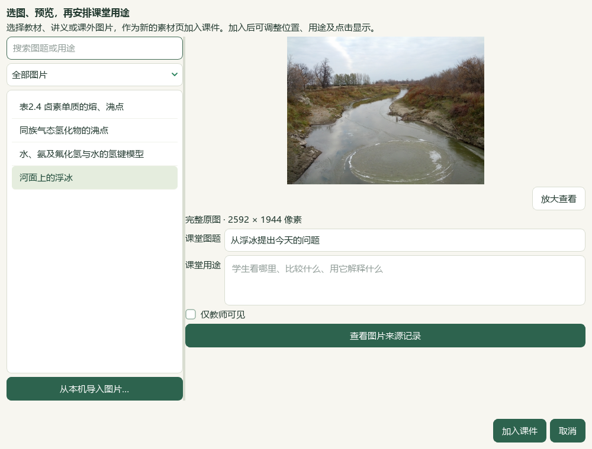
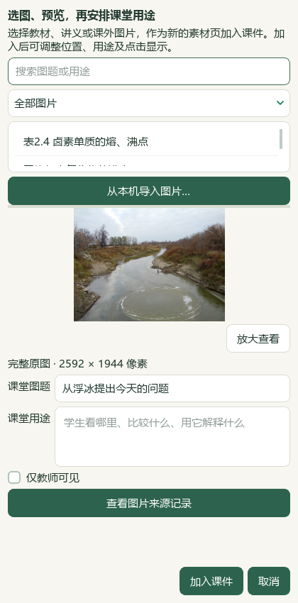

# 本课图片预览与本机导入验收 · 2026-10-06

本片结论：当前本地源码切片通过，整体目标仍active。EXE v0.1.101未重建，未提交、推送或发布。生成教案、课堂内容和讲稿不附来源或防御性提醒；出处继续保存在内部记录。

## 实际使用

在“教学设计→素材与页面编排”新增 **备课图片…**。先搜索／预览本课图片，也可 **从本机导入图片…**，填写图题、来源记录和用途后回到选择窗。修改这次课堂图题与用途，点 **加入课件** 后定位新素材页；再用位置控件加入已有页面。每张10MB、最多48张，支持PNG、JPEG、WebP。取消父选择窗不导入图片；相同图题与用途去重，同图不同用途可分别使用。

原“分子间作用力”课开场照片从现有图片加入，结尾照片从本机导入相同原文件。实际Qt入口、元数据窗、预览、确认、位置／移除控件和保存均已执行；回到原阅读顺序及清理新增空页使用作品控制器，未声称这些是鼠标拖拽。两处旧手写照片资源换为绑定原图SHA与元数据版本的 `preparation_image`；原35份草稿仍保留旧副本，新第36稿有32素材／2完整题／6环节／40分钟／19输出版本。

## 文件与动画

教师成品位于本机 `E:/项目/上海高中化学等级考/outputs/2026-10-06-teaching-image-picker/教师成品/`，新子目录仅含 `教案.docx` 和 `课堂演示.pptx`，逐字节等于登记成品。实际Word13页、PowerPoint16页，共29页；正文及备注无来源、路径或核验提醒，原图字节完整，原题教师答案角色保持。图片原来源与完整摘要留在草稿中，不猜测或提升官方属性。

PowerPoint私有只读进程实际读回13个Appear／OnPageClick效果，分布9页，第10、13页同页反馈保持；静态预览显示步骤完成后的页面，放映逐次显示。新图片也可用已有“课堂PPT中点击后显示”。本片未新增运动路径或复杂变形编辑，未调用真实供应商。

实际Office逐页渲染、范围文字检查和原图包内校验通过。根代理另查看两张29页缩略总览及选定整页；视觉检查范围写入最终回执，未声明逐页真人审校或逐帧放映体验。BDL参考仅为已定位V27／V32的两张原视频帧，交互借鉴筛选、完整预览和明确加入作品，未连续重看视频／音频。

## 保存和恢复

普通备课ZIP `教学图片与课堂设计备课.zip` 实际恢复36草稿／216登记成品／36唯一版本／59图片摘要；全部草稿、恢复副本、图像和每份成品相同。普通ZIP不含Word库、原教材、阅读位置、模型设置或密钥。原教材专用ZIP仍为105原页／9节／3笔记／PDF54阅读位置。原生CMD→快捷方式→Pythonw重开32素材、19版、两处教学图片、教案框架和13点击设置通过；新入口为同目录 `打开教学图片与课堂设计工作台.cmd`，只读写隔离候选配置。

## 代码与检查

6既有应用模块修改：作品契约、排版、Word输出、来源摘要、图片元数据窗、页面编排；2新模块为图片导入服务及选择窗。两新测试文件加既有图片UI检查共25项，包含像素和源版本变化阻断、教师角色保持、未知完整题范围、取消零导入、撤销、宽窄布局、并发编辑保护及重复用途。621相关检查全部通过，25项包含其中；文档策略及完整README14项通过。渲染 `shchem.composition-teaching-images.v23`，提示词仍v30。

前两次新检查暴露合成夹具缺Qt、导航属性命名及布局返回键断言错误，修正后通过；原失败XML保留。文档助手第一次因README体量超限在写入前停止，缩短首页说明后重新执行。历史扩大Word12失败／8夹具错误未解决、未重跑，621项不代表全仓测试。

证据目录为本片 `outputs/2026-10-06-teaching-image-picker/`：`inputs-before.json`、`profile-clone.json`、`native-verification.json`、`actual-office-verification.json`、`powerpoint-animation-verification.json`、`related-checks-command.json`、`backup-roundtrip-verification.json`、`candidate-entry-receipt.json`、`preservation-after-docs.json` 与 `root-final-acceptance.json`。当前与原文件均用完整SHA绑定；旧35稿／210成品和785文件副本保留。

中央386知识／322图表、catalog171、正式4／真人0，Word98份／3580候选／465库文件、3684属性／9737历史、5范围／11选择及阅读740／冻结702保持，无新题导入、下载、外部请求、供应商或WeRead调用。正式四层、独立化学审校、Q11、更多导入与整体UI／发行仍继续。
