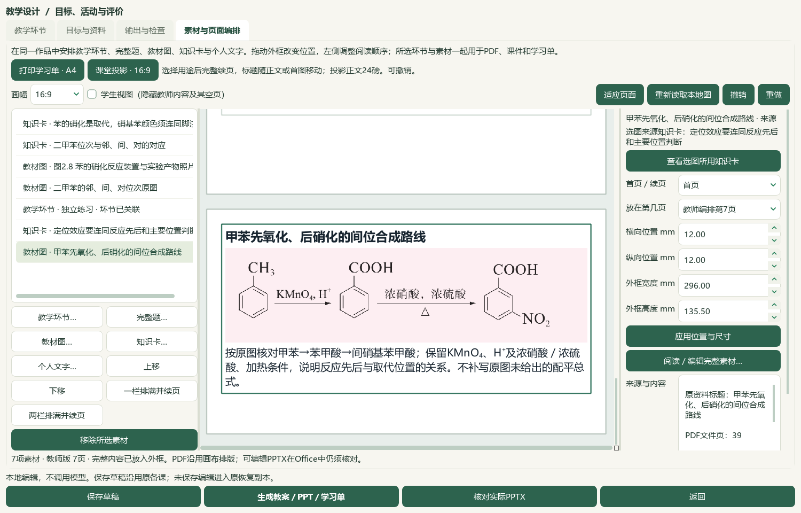
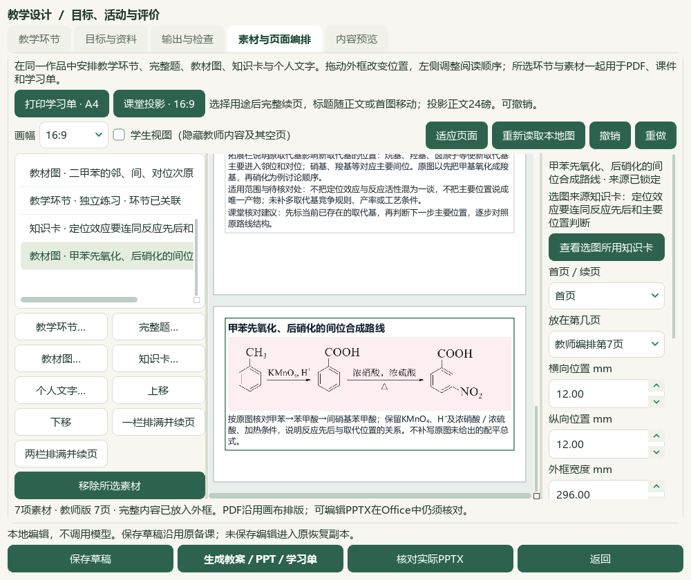

# 教材图与用途同页、来源知识卡联动验收

2026-10-06，维护工作区HEAD `e08c3e7`，本地候选，未发布。前序见[知识卡选图切片](2026-10-05-card-to-textbook-crop-slice-qa.md)，操作见[素材页面编排](../teacher/lesson-and-paper.md#lesson-composition)。微信读书停用，本轮只使用本地资料与Office。

## 本片结果

自动排满并续页时，完整教材图、标题和短用途作为一组安排；Word还考虑教师来源说明。长用途完整续页，手工小框保留正常分页。投影正文仍为24磅，PNG按比例显示、原字节保持。学生隐藏的教师用途不参与学生分页。本片修改6既有应用模块、新增3测试模块，最终相关用例127通过，渲染修订`shchem.composition-qt-figure-purpose.v12`，应用版本未递增。

从知识卡新选出的图保存原知识卡标题、身份、原快照SHA和来源版本。右栏直接可见“选图来源知识卡”，点击“查看选图所用知识卡”返回该版本；卡移除或版本不匹配时保留说明、停用跳转。旧图和独立选图不猜关联，此记录不等于化学相关性审校。真实Qt/QTest在1000与1500像素窗口操作，跳转、返回均未修改保存载荷、历史或登记成品。

## 实际教材与Office成品

使用已有选必三2.2定位效应知识卡，从其PDF39／已登记印刷35明确选图、框选、填写用途、预览并勾选。新933×244裁片保留甲苯→苯甲酸→间硝基苯甲酸及KMnO₄／H⁺、浓硝酸／浓硫酸、加热条件，排除下方对氯甲苯例题。教材SHA-256为`26ccd86648c807476fd6f08db7e414571fa0d5e077db63b15c9880cb225cd137`；原图记录VIS-TB-E3-C2-2-2-003的印刷页未知、整页锚点及待定位字段不改。此为个人备课候选裁片，未新增正式图表定位或教材知识笔记。

| 当前检验范围 | 实际Word教师／学生 | 实际PPT教师／学生 | 可据以确认 |
| --- | --- | --- | --- |
| 前序5素材原内容重排 | 4／3页 | 5／5页 | 原教师PPT6页降至5页；两图、短用途同页，Word图与用途／来源同在第3、4页 |
| 最终7素材：3知识卡＋3图＋1前序未审核练习 | 5／3页 | 7／7页 | 新路线在教师Word第5、两版PPT第7页；教师短用途与图同页，学生没有指定教师用途／行动 |

两组共8份实际Office文档、39页。应用以已安装Word／PowerPoint进行只读转换并核对私有实例退出，原文档摘要保持；原PNG均以相同字节嵌入。根代理实看8完整联系图覆盖39页，另实看5选定原尺寸成品页、5选定UI、原PDF39与裁片，不称39页逐张原尺寸细读。教师／学生画布PDF另外只作机器计数。本机检查不等于全部学校Office、长题或课堂投影验收。

## 保存、恢复与旧资料

验证副本从20份旧草稿新增1份候选至21份，共享历史按输出身份去重27版162登记成品。全部旧草稿载荷、150成品与2旧讲稿保持；162源／恢复成品、全部引用图片摘要一致，最新6份独立副本一致。备课ZIP仍不含个人整书PDF与研读档案，原教材与裁选来源回执需另保管。

正式登记167、319原图和5项候选图题更正、496存储／457可选／60正式节均保持。新知识笔记、正式题库题、标签与原答案修改均0。真实494文件、3684属性／9733历史及辅助466文件与冻结状态核对；历史临时desktop-state.v1.json事故前原字节仍未恢复，保留原异常回执。

## 题目与参考视频边界

前序PKG-060样本2、6、7、11从真实状态的新鲜只读副本复核题答与原生对象范围，4份均通过当前版本的selection_ready／export_ready和native_scope_closed。原答案与已发现来源问题保持，未增加完整阅读身份或真实题目UI导入。教材映射、四层卷面层级和独立化学审校仍待核。沿用前序702待办、723完整／227部分阅读身份、261未尝试可处理图题；这不是本轮新鲜全题库扫描。

复看既有V28六帧联系图作为同页图文与目录导航参考；新抽帧、完整播放、音频核听和HTML／语音新功能均0。文章检索、新试卷、下载、外部请求与供应商调用均0，后续不使用微信读书。

## 记录与继续工作

私有证据位于`outputs/2026-10-06-textbook-figure-flow`：`inputs-before.json`、`related-tests-final.xml`、`native-03/native-verification.json`、`actual-office-verification.json`、`native-visible-origin-probe.json`、`questions/structural-recheck-fresh.json`；最终文档、普通status／validate和保护检查分别保存回执，根验收另列所见图像摘要。

保留补丁上下文不符、原生草稿选择断言、未处理已有恢复确认、PNG字节JSON序列化失败和旧克隆版本过期的助手记录。最终原生流程完成导出后仅续做证据、复制与恢复，没有重复生成；新鲜状态复核保持原版本门禁。首轮／中间截图和零字节失败回执保留，不称全部流程首遍成功。

所有新候选human_reviewed、teaching_use_allowed、generation_allowed、publication_allowed均false。总目标继续active，手机端排除；复杂题目、实际题目导入、全教材化学／教师审校、更多视频功能、候选统一及桌面发行继续。维护源码未复制到DATA旧应用，未提交、推送、发布、递增版本或重建v0.1.101 EXE。
